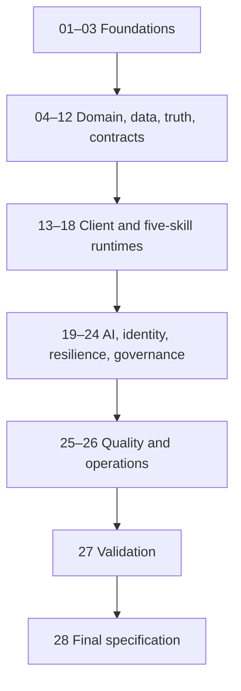

# Bestehen / App — Architecture Shaping Plan

> **Status:** Master workflow plan; architecture stages are not yet executed  
> **Planning baseline:** m-elsharkawi/Bestehen-Shaping@9f37ad78fdd101b3c9cb8782ddc54d12dbce1fdc and m-elsharkawi/Bestehen-App@7fa7f297e7b041da04d27ce275f0d3b802710617 on `main`  
> **Stage count:** 28  
> **Live checklist:** `Bestehen_App_Architecture_Checklist.md`  
> **Prompt directory:** `prompts/architecture/`

## 1. Purpose and scope

This program converts the completed Bestehen / App product record and finalized design system into a complete, implementation-facing architecture through 28 sequential, decision-owning stages. It is an architecture-shaping workflow, not application implementation. Stage agents make durable architecture decisions, update the live checklist, create Markdown handoffs, and add concise ADRs only for consequential choices with meaningful alternatives.

The workflow protects the full learner promise: a responsive, account-optional exam coach that takes a learner from approximately A1 toward passing TELC B1; uses exam preparation as the learning method; keeps Written and Oral pass risk independent; preserves evidence validity and uncertainty; supports all five skills through a shared loop; uses Corpus asynchronously as rights-aware intelligence; bounds AI and operating cost; and treats accessibility, recovery, privacy, and evidence truth as architecture.

This plan does not select the final framework, provider, schema, model, or deployment topology. Those decisions belong to the named stages and require current primary-source research where facts are mutable.

## 2. Source authority and contradiction rules

When sources disagree, apply this order:

1. `Bestehen-Shaping/app/28-bestehen-app-product-specification.md`.
2. `Bestehen-Shaping/app/01-*.md` through `app/27-*.md`; a final-spec delegation keeps the detailed stage normative, and Stage 27 controls cross-stage precedence.
3. `Bestehen-Shaping/02_Bestehen_Identity.md`.
4. `Bestehen-Shaping/01_Bestehen_Product_Overview.md`.
5. `Bestehen-App/Design/DESIGN-HANDOFF.md` and human-authored `.dc.html` files, when consistent with product truth.
6. Design runtime/example code, including `support.js`, is illustrative only.

Never silently fix a shaping or design source. The stage document records the exact paths, conflict, applied authority, architecture consequence, and any design/implementation issue. Product truth beats design expression; design expression beats incidental implementation examples.

Stage 27 product precedence applies everywhere:

1. validity and fairness;
2. direct evidence in the claimed modality;
3. independent Written/Oral pass risk;
4. uncertainty resolution;
5. due repair and retention;
6. progression and coverage;
7. learner preference.

Exam urgency and learner overrides change planning priority only. They do not change evidence truth, target rules, validity, or Readiness semantics.

## 3. Source manifest

The planning run read current human-authored contents, not filenames alone. Blob SHAs below are the immutable source baseline; later stage agents must re-fetch `main`, record the current SHA/commit in their output, and reconcile drift before deciding.

### 3.1 Every App Markdown source read

Repository: `m-elsharkawi/Bestehen-Shaping`; branch: `main`; commit: `9f37ad78fdd101b3c9cb8782ddc54d12dbce1fdc`.

| Path | Blob SHA | Primary architecture consumers |
|---|---|---|
| `app/01-product-thesis.md` | `6bbb074dc6a262cb66cebad960dd248d1010f21f` | 01, 02, 04, 27, 28 |
| `app/02-complete-learner-journey.md` | `3c536176154a8239aeafc0697acd947280130142` | 02, 08, 13, 20, 21, 27, 28 |
| `app/03-initial-diagnostic.md` | `038ab89b0be23464eedf1408111dd1936320f57a` | 06, 07, 08, 13, 15–18, 20, 21, 27, 28 |
| `app/04-learner-model.md` | `f7ae1f4af375ee3302d04c726d8fe8453a9daf80` | 04–08, 11, 12, 20, 24, 25, 27, 28 |
| `app/05-mistake-memory.md` | `a7c574b08c33418eab44aba8b6e9b7f8ab877109` | 06–08, 11, 12, 24, 25, 27, 28 |
| `app/06-daily-coaching-engine.md` | `3cd869cd337dd3a878c27f35e1e8b5dad0c4c7bb` | 07, 08, 11, 12, 22, 24, 27, 28 |
| `app/07-core-learning-loop.md` | `c313c859f64997972feca87497d70476c4528a20` | 04, 06–09, 15–19, 21, 25, 27, 28 |
| `app/08-a1-to-b1-progression.md` | `839a01c010cf79777520714d0ab09304a2ba9a06` | 04, 07–09, 11, 15–18, 25, 27, 28 |
| `app/09-reading-training.md` | `fcc41029a7dfc44a65feca0602b42c4fa40e53cf` | 09, 11, 13, 15, 25, 27, 28 |
| `app/10-language-elements-training.md` | `a5aac29a9cb4b84e2951fc64bf0b5f4b0d15e6bf` | 09, 11, 13, 15, 25, 27, 28 |
| `app/11-listening-training.md` | `e77948d6722b2ce635886d4b345e2ff9aad476a8` | 09, 11, 13, 14, 16, 25, 27, 28 |
| `app/12-writing-coaching.md` | `0a606197ad514e8c8958004188837e37173258be` | 06, 09, 11, 13, 17, 19–21, 23, 25, 27, 28 |
| `app/13-speaking-coaching.md` | `9462c78a1e7cc68249d38aa5a18a287be8aacd9c` | 06, 09, 11, 13, 16, 18–21, 23, 25, 27, 28 |
| `app/14-review-and-spaced-repetition.md` | `fa9b65e92cd1511e00e106a199eb6fbc06273a69` | 06–08, 11, 22, 24, 25, 27, 28 |
| `app/15-telc-readiness.md` | `b4456939928493569336bbc565d7e67307e7a3db` | 04, 06, 07, 11–13, 19, 24, 25, 27, 28 |
| `app/16-mock-exams.md` | `8f6c23fa16524bd251cef39d823cfeea73bfcef3` | 06, 09, 11–13, 16–19, 21, 23–28 |
| `app/17-ready-to-book-logic.md` | `9e3e8b24faefe885d5b10409725619d0d0d84e6d` | 06, 11–13, 22, 24, 25, 27, 28 |
| `app/18-coach-personality-and-behavior.md` | `7bc3c2ee918264911a9550fe20e53dc565f986dd` | 08, 13, 19, 22, 24, 27, 28 |
| `app/19-information-architecture-and-core-screens.md` | `615ba3ce97fb25f974b6ba3a020cf254ddd0065f` | 02, 08, 13, 14, 27, 28 |
| `app/20-progress-and-motivation.md` | `fd8d002dbb79fd66dca3fdfa8f6771318f76cbe4` | 07, 11, 13, 24, 27, 28 |
| `app/21-content-strategy.md` | `8149d6a268da70e17cad46f774b9d5de77776986` | 05, 06, 09, 10, 12, 15–19, 23–26, 28 |
| `app/22-user-controls-vs-coach-autonomy.md` | `27f33cd56a09df27952e15bb3dfd0e077b89633c` | 08, 12, 13, 20, 22, 27, 28 |
| `app/23-exam-date-and-urgency.md` | `5942ed811bcbaa5baaf1dd55079b8971d34b1d01` | 08, 20–22, 24, 26–28 |
| `app/24-analytics-and-success-metrics.md` | `28d1a5380a7ea9f28efdc95ce0c96987920917e1` | 05–07, 11, 12, 19, 20, 23–28 |
| `app/25-business-model-and-product-boundaries.md` | `904ae20e8cb3f9f354d6505513821e86f609622b` | 01–03, 19, 20, 23, 24, 26–28 |
| `app/26-platform-accessibility-nonfunctional.md` | `8137091683941b0d55f3d4fb90af3c402b8371e5` | 01–03, 05, 12–14, 16–28 |
| `app/27-end-to-end-scenario-validation.md` | `5da3b0a27ba516770210773399f0415cfb1f5460` | 01–28; precedence authority for conflicts |
| `app/28-bestehen-app-product-specification.md` | `18ae80cc2fd63cecd76c297c3e56d44a68367856` | 01–28; consolidated product authority |

### 3.2 Other shaping, contract, prompt-convention, and design sources read

| Repository | Path | Blob SHA | Role | Primary consumers |
|---|---|---|---|---|
| Bestehen-Shaping | `01_Bestehen_Product_Overview.md` | `42f15da945e03f1d8e32dfe010f95aae6b87daa3` | Umbrella purpose and App/Corpus boundary | 01, 02, 09, 10, 28 |
| Bestehen-Shaping | `02_Bestehen_Identity.md` | `f8799407f7b4a5a657f8c81439425d5a004f4e1c` | Brand, voice, visual character | 01, 13, 14, 18, 22, 28 |
| Bestehen-Shaping | `Bestehen_App_Product_Shaping_Checklist.md` | `f73ad7b50f2ebb9309b16ba5ab98e070a40008bb` | Product-shaping continuity | all stages as a provenance check |
| Bestehen-Shaping | `corpus/12-corpus-app-contract.md` | `7add217f62118e5abe100680d2e8230a93b8c280` | Detailed Corpus/App conceptual contract | 02, 09, 10, 12, 23, 25, 27, 28 |
| Bestehen-Shaping | `corpus/17-bestehen-corpus-product-specification.md` | `537b5185313097d043748f9dc9f9fdaf432ee71d` | Consolidated Corpus authority | 02, 09, 10, 12, 23, 25, 27, 28 |
| Bestehen-Shaping | `prompts/app/01_lock_the_product_thesis.txt` | `e79c53aaf67fa626e277f5a1716af76d599bee29` | Prompt convention: first stage | planning convention |
| Bestehen-Shaping | `prompts/app/14_define_review_and_spaced_repetition.txt` | `2a0105e5a9e25fc362c6f3543acada1ec54567fd` | Prompt convention: middle stage | planning convention |
| Bestehen-Shaping | `prompts/app/27_validate_with_end_to_end_scenarios.txt` | `684d393cbd76396142d3211243499b54b04e772c` | Prompt convention: validation stage | Stage 27 prompt |
| Bestehen-Shaping | `prompts/app/28_produce_the_final_product_specification.txt` | `7280ebf032f2966891d5edebf5248b1e8112e815` | Prompt convention: consolidation stage | Stage 28 prompt |
| Bestehen-App | `Design/DESIGN-HANDOFF.md` | `417a6820037e045e2dd9f29afc42b9f2e94fd638` | Architect handoff and open-decision list | 01–28 |
| Bestehen-App | `Design/Bestehen-01-Design-System.dc.html` | `d4e371aacee32c85ddc53cf9cf3abaaff4e86e7a` | Tokens, components, states, UI-domain models | 01, 04, 06–19, 23, 25, 27, 28 |
| Bestehen-App | `Design/Bestehen-02-Mobile-Screens.dc.html` | `0a9f2d3ea982c3197f399941b57defd9869d2428` | 24 phone-first screens and production copy | 08, 11, 13–18, 20–23, 25, 27, 28 |
| Bestehen-App | `Design/Bestehen-03-Desktop-Responsive.dc.html` | `94056db181b45298a759ff727ad5cfeac2f2a469` | Tablet/desktop responsive contract | 13, 14, 17, 25, 27, 28 |
| Bestehen-App | `Design/Bestehen-04-Flows-Handoff.dc.html` | `7120b05a2272c31e5896e4313a7007935f5d0aed` | Flows A–G, exits, accessibility, coverage | 02, 08, 13–25, 27, 28 |
| Bestehen-App | `Design/Bestehen-Type-Options.dc.html` | `7b51302ad1943c2676a5bb28d54aa7ead28b8dcd` | Typography comparison; Option A chosen | 13, 14, 28 |
| Bestehen-App | `Design/Bestehen Logo/Bestehen Logo System.dc.html` | `5eb296da8a83531306195c9d91dd30cbeed8c608` | Final logo: Concept B / B1 Threshold B | 13, 14, 23, 28 |
| Bestehen-App | `Design/support.js` | `cb009b69ec6b5e00f48c6287a587fe7e0c6c421b` | Design-artifact renderer only; illustrative runtime | 03, 13 (anti-mandate check) |

The `.docx` files were not parsed because Markdown counterparts exist. `.thumbnail` files and `Design/uploads/` copies were not treated as independent authorities. The duplicate logo-directory `support.js` has the same SHA as `Design/support.js` and was not counted twice. No newer App/Corpus contract document existed beyond the listed contract/final specifications at the planning baseline.

### 3.3 Verified current design facts

- The handoff declares **25 semantic tokens × two modes** plus brand constants; the CSS contains additional implementation custom properties/aliases. Architecture must preserve the semantic contract rather than mistake every CSS variable for a separate design token.
- Typography is finalized as Bricolage Grotesque for screen/section headings, IBM Plex Sans for readable UI and numbers, and IBM Plex Mono for labels/timers/evidence metadata.
- One shared library covers all five skills; the handoff indexes 41 components. Skills extend the input region rather than fork shell/result/repair/evidence behavior.
- The design covers 24 mobile screens, four desktop layouts, one tablet layout, seven Flows A–G, 12 recovery situations, a keyboard map, an announcement list, and a specification-to-design coverage matrix.
- Evidence validity has five distinct states: `valid`, `partially_valid`, `pending`, `interrupted`, `not_counted`.
- Readiness has six client-visible states: `evidence_building`, `not_ready`, `borderline`, `safe`, `ready_to_book`, `stale_contradicted`.
- The finalized logo is Concept B, variant B1 — Threshold B; the optical micro-mark replaces B1 below 20 px. Trademark clearance remains explicitly outside the design claim and is required before public commercial use.

## 4. Reconciliation of design open decisions and mismatches

| Design item | Product resolution | Architecture treatment |
|---|---|---|
| Safety margin assumed 65 | Resolved by `app/15-telc-readiness.md`, `app/17-ready-to-book-logic.md`, and final specification: official line 60; Bestehen Safe default 65 with lower range bound ≥60 and other gates | Version 60 and 65 separately; 65 is a tunable calibration default labelled as Bestehen's margin, never TELC's line |
| First session assumed 6 minutes in design Flow A | Superseded/clarified by `app/03-initial-diagnostic.md` and final specification: five-skill diagnostic, 12–16-minute foundation route, normally 18–22 minutes, hard 30-minute ceiling; default coached session is 25 minutes | Do not build a six-minute “complete placement.” A shorter partial probe may be resumable and honestly remain evidence-building; duration/routing is configurable and versioned, not an owner blocker |
| Evaluator banner says “usually under a minute” | Resolved by `app/26-platform-accessibility-nonfunctional.md`: first useful result normally ≤15 s, ≤30 s connected degradation, then Pending; raw audio pending ceiling seven days | Model latency and Pending explicitly; copy comes from structured SLA state/config and must not promise a provider result that measurements do not support |
| Notification tone/frequency open | Resolved by `app/23-exam-date-and-urgency.md` and final §13.3, including type, quiet-hour, suppression, one/day and rolling-seven-day caps | Stage 22 selects transport/scheduling, not product tone/caps; reviewed templates, no engagement-only messaging |
| Whether P0–P4 rung labels are visible | Resolved by `app/08-a1-to-b1-progression.md`, Stage 18, and final specification: rungs are internal/local profiles; learner sees Foundation/Bridge/B1 evidence language and actual conditions | APIs may carry internal rung IDs; UI uses learner-facing condition/evidence projections, never collectible/global rung badges |
| Speech-evaluation confidence floor | Behavior resolved by productive-evaluation and Readiness rules: low/uncertain output cannot set Oral estimate and may be Pending/evidence-building; exact numeric floor is empirical | Version the calibrated threshold and evaluator release; no owner question or invented precision |
| Design readiness copy calls Ready-to-Book a four-condition checklist | Product Stage 17 defines six named gates (target current, both Safe, breadth, clean recent full mock, independent consistency, confidence/contradiction) | UI may group for comprehension, but domain/API must return every authoritative gate and granular failing reason |
| Design handoff shortens weakness lifecycle | Product Stage 05/final specification includes Candidate, Historical/Unconfirmed, Known, Repairing, Stabilizing, Repaired, Resolved, and Reopened behavior | Domain includes complete lifecycle; design surfaces may project a learner-relevant subset without deleting states |

No owner question remains. Any numeric calibration named above is a versioned empirical parameter, not missing permission to define the architecture.

## 5. Architecture invariants

### 5.1 Product and system boundary

- App owns learner state, coaching, approved content, evaluation interpretation, evidence projections, Readiness, mocks, and learner UX.
- Corpus owns provenance-preserving, rights-aware, confidence-qualified, deduplicated, versioned exam intelligence and eligibility for Corpus-derived uses.
- Normal learner attempts require neither live Corpus search nor per-click Corpus AI. Raw/reference sources are internal authoring/QA/audit inputs unless exact use is expressly eligible.
- Corpus task frequency/relevance may prioritize content; it never creates learner mastery, weakness, or Readiness.

### 5.2 Evidence and Readiness truth

- Learning evidence and Readiness evidence are different; direct modality evidence cannot be replaced by inference.
- Assistance, timing, exposure, freshness, interruption, pending evaluation, accessibility condition, validity, and affected scope remain explicit.
- Fresh-content family and independent occasion identity matter for transfer, retention, mocks, and booking confirmation.
- Written and Oral have independent pass gates; the overall index cannot compensate across them.
- Missing estimate is absence, not zero. No pass-probability field, model, event, template, or hidden calculation exists before empirical calibration and product authorization.
- Official pass line, Bestehen Safe margin, Safe state, and Ready-to-Book gate are distinct and versioned.
- Calculations and historical corrections are explainable, reproducible, targeted, and auditable.

### 5.3 Coaching, skills, content, and AI

- Coach/Home supplies one dominant action; `Coach me` and `Just practice X` remain distinct.
- Learners control choices; the system owns truth. One factual consequence is enough; no compliance score or punishment.
- Observe → Attempt → Diagnose → Repair → Retry → Remember is the shared semantic loop; all five skills use one foundation with valid modality extensions.
- C0–C4 content classes, rights, approval, freshness, forms, and media remain explicit. Objective scoring is deterministic; routine content/audio is authored/generated in batches, reviewed, cached, and reused.
- Writing/Speaking evaluation is structured, versioned, confidence-aware, bounded, and may stay Pending. Default maximum is one justified escalation. Raw voice is ephemeral.

### 5.4 Platform, accessibility, recovery, privacy, and cost

- Responsive web is launch platform; phone-first daily use coexists with stronger large-screen Writing/Readiness/mock layouts.
- WCAG 2.2 AA, keyboard, screen-reader semantics, text alternatives, 200% zoom, 320 px reflow, reduced motion, drag-free alternatives, and non-color meaning are release criteria.
- A missing capability degrades locally. Checkpoints, timers, media, resume, conflict, and idempotency preserve real conditions and the smallest affected evidence scope.
- Core first use is account optional. Data is exportable/deletable; external AI receives the minimum necessary pseudonymous payload.
- Prefer one maintainable system, deterministic/cached/precomputed work, and managed services only where they reduce solo maintenance with explicit recurring/exit cost. Cost never removes pass-critical productive evidence.

## 6. Stage sequence, dependency map, and critical path

The 28-stage baseline is retained unchanged. It separates high-risk truth, modality, governance, and operations concerns while keeping every prompt independently executable. The order has no circular prerequisite.

The principal critical path is 01 → 02 → 04 → 05 → 06 → 07 → 08 → 09/10 → 11 → 12 → 13/14 → 16/17/18 → 19/20/21/22/23/24 → 25 → 26 → 27 → 28. Where checklist dependencies permit, parallel research may occur, but an agent may not finalize a stage before all listed prerequisites are complete. Stage 25 depends on all substantive Stages 01–24; Stage 27 reads 01–26; Stage 28 reads 01–27.

## 7. Artifact and naming conventions

- Stage outputs: `Architecture/XX-kebab-case-title.md` exactly as indexed below.
- Stage prompts: `prompts/architecture/XX_snake_case_action.txt`.
- Stage 00 master prompt remains a workflow generator and is not one of the 28 executable architecture stages.
- Supporting ADRs: `Architecture/adr/ADR-NNNN-short-title.md`; Stage 01 creates the template/index rules.
- Diagrams use Mermaid for context, component, sequence, state, data-flow, and deployment relationships. Exact mappings, states, alternatives, ownership, failure, and traceability use Markdown tables. ASCII diagrams are prohibited.
- Every stage document records source paths and current SHAs/commit refs, decisions, alternatives, consequences, ADRs, dependencies, risks, cost triggers/fallbacks, deferred implementation choices, and a definition-of-done audit.

## 8. ADR strategy

ADRs are intentionally lightweight:

- Create one only for a consequential, durable decision with meaningful alternatives and downstream coupling.
- The stage document is the full rationale/handoff; an ADR is a concise decision index with context, decision, status, consequences, alternatives, traceability, owner, review trigger, and supersession link.
- Statuses: Proposed, Accepted, Superseded, Deprecated. Never delete or rewrite history to hide a superseded choice.
- One ADR may be amended by a later stage only with explicit continuity and a reason. A changed decision normally creates/supersedes an ADR rather than silently mutating it.
- Stage 28 includes the complete ADR index and status. This planning run creates no speculative technology ADR.

## 9. Traceability method

Each architecture decision table uses stable identifiers:

- Product sources: `PROD-APP-SXX-§Y`, `PROD-FINAL-§Y`, `PROD-CORPUS-S12-§Y`.
- Design sources: `DESIGN-DS-§Y`, `DESIGN-MOBILE-ACTn`, `DESIGN-RESP-Dn`, `DESIGN-FLOW-X`, `DESIGN-LOGO-§Y`.
- Architecture decisions: `ARCH-SXX-DNN`.
- ADRs: `ADR-NNNN`.
- Quality evidence: `QG-S25-*`; implementation slices later use `IMPL-*`.

Each decision row includes upstream requirement/design references, owning stage, state/data/API implications, failure/accessibility/security/privacy/cost consequences, ADR if any, validation method, downstream consumers, and review trigger. Stage 27 audits coverage and contradiction; Stage 28 publishes the authoritative registry. A UI state that cannot point to a domain/API owner is a defect, as is an architecture decision with no upstream reason.

## 10. Research and decision rules

- Fetch current repository content and SHA before deciding or editing. Do not rely on this baseline if `main` changed.
- For frameworks, managed services, browser APIs, identity, media codecs, notifications, AI/STT/TTS providers, security guidance, pricing, quotas, limits, and support lifetimes, use current official primary sources. Record access date and direct links.
- Compare at least two credible alternatives plus “keep it simpler/do nothing” where meaningful. State criteria, recommendation, rejected alternatives, consequence, exit/fallback, and review trigger.
- Cost notes cover idle, variable, storage, egress, model/media, backup, observability, maintenance, and exit costs. Do not invent a euro budget; define measurement, alerts, and upgrade triggers.
- Stable product rules are not generic abstractions. Empirical values are versioned parameters with evidence and calibration lineage. Never invent precision.
- Ask an owner question only for unavailable preference, legal-risk tolerance, or budget that materially changes the architecture. Include impact and recommended default. Ordinary technical trade-offs are the architect's job.

## 11. Cross-cutting rules

- Security/privacy/rights: data minimization, purpose limitation, least privilege, pseudonymous provider calls, account-optional first use, ephemeral audio, export/delete orchestration, rights-aware asset serving, secrets boundaries, proportionate abuse controls, dependency security, and auditable corrections/deletion. Do not claim legal compliance without jurisdiction-specific review.
- Accessibility: WCAG 2.2 AA is feature completeness; identical-evidence alternate inputs are first-class. When support changes the tested capability, preserve access and change the evidence label honestly.
- Reliability/recovery: local failure never becomes global failure; Pending blocks dependent conclusions only; retry/reconnect is idempotent; history and unaffected scope remain visible.
- Cost/operations: deterministic logic, batching, caching, approved reusable assets, one source of truth, bounded providers, low idle cost, simple managed services, and measured upgrades. Reject per-click premium AI, routine runtime question generation, service-per-domain, speculative million-user infrastructure, and a warehouse before need.

## 12. Prompt/stage index

| Stage | Title | Prompt | Output | Required prior stages | Primary product/design inputs | Major downstream consumers |
|---:|---|---|---|---|---|---|
| 01 | Architecture Charter and Quality Attributes | `prompts/architecture/01_define_architecture_charter_and_quality_attributes.txt` | `Architecture/01-architecture-charter-and-quality-attributes.md` | None | `01_Bestehen_Product_Overview.md` `02_Bestehen_Identity.md` `app/01-product-thesis.md` `app/25-business-model-and-product-boundaries.md` `Design/Bestehen-01-Design-System.dc.html §§0–1 and §3` `Design/Bestehen-04-Flows-Handoff.dc.html #h` | All stages; Stage 25 turns the quality attributes into gates and Stage 28 consolidates them. |
| 02 | System Context and Product Boundaries | `prompts/architecture/02_define_system_context_and_product_boundaries.txt` | `Architecture/02-system-context-and-product-boundaries.md` | 01 | `01_Bestehen_Product_Overview.md` `app/01-product-thesis.md` `app/02-complete-learner-journey.md` `app/19-information-architecture-and-core-screens.md` `Design/Bestehen-04-Flows-Handoff.dc.html Flows A–G` `Design/DESIGN-HANDOFF.md §§1, 3.7, 9` | Stages 03–05, 09–12, 20, 23, 26–28. |
| 03 | Technology Stack and Repository Strategy | `prompts/architecture/03_decide_technology_stack_and_repository_strategy.txt` | `Architecture/03-technology-stack-and-repository-strategy.md` | 01, 02 | `app/25-business-model-and-product-boundaries.md` `app/26-platform-accessibility-nonfunctional.md` `Design/DESIGN-HANDOFF.md §2` `Design/Bestehen-03-Desktop-Responsive.dc.html` | All implementation-facing stages, especially 05, 12–14, 19–26, and 28. |
| 04 | Domain Model and Bounded Contexts | `prompts/architecture/04_define_domain_model_and_bounded_contexts.txt` | `Architecture/04-domain-model-and-bounded-contexts.md` | 01, 02 | `app/04-learner-model.md` `app/05-mistake-memory.md` `app/06-daily-coaching-engine.md` `app/07-core-learning-loop.md` `Design/Bestehen-01-Design-System.dc.html §3` `Design/DESIGN-HANDOFF.md §3` | Stages 05–13, 15–25, 27, 28. |
| 05 | Data Ownership, Persistence, and Schema Evolution | `prompts/architecture/05_define_data_ownership_persistence_and_schema_evolution.txt` | `Architecture/05-data-ownership-persistence-and-schema-evolution.md` | 01, 02, 03, 04 | `app/04-learner-model.md` `app/05-mistake-memory.md` `app/15-telc-readiness.md` `app/21-content-strategy.md` `Design/DESIGN-HANDOFF.md §3` `Design/Bestehen-02-Mobile-Screens.dc.html Act 5` | Stages 06–12, 16–24, 26–28. |
| 06 | Evidence Ledger, Validity, Versioning, and Audit | `prompts/architecture/06_define_evidence_ledger_validity_versioning_and_audit.txt` | `Architecture/06-evidence-ledger-validity-versioning-and-audit.md` | 04, 05 | `app/03-initial-diagnostic.md` `app/04-learner-model.md` `app/05-mistake-memory.md` `app/07-core-learning-loop.md` `Design/Bestehen-01-Design-System.dc.html §§2.5, 3.2, 3.3, 3.6` `Design/DESIGN-HANDOFF.md §3` | Stages 07–12, 15–25, 27, 28. |
| 07 | Learner Model, Mistake Memory, Progression, and Review | `prompts/architecture/07_define_learner_model_mistake_memory_progression_and_review.txt` | `Architecture/07-learner-model-mistake-memory-progression-and-review.md` | 04, 05, 06 | `app/04-learner-model.md` `app/05-mistake-memory.md` `app/06-daily-coaching-engine.md` `app/08-a1-to-b1-progression.md` `Design/Bestehen-01-Design-System.dc.html §3.4 and weakness models` `Design/Bestehen-02-Mobile-Screens.dc.html return/weakness/review surfaces` | Stages 08, 11, 12, 20, 22, 24, 25, 27, 28. |
| 08 | Coaching Engine and Session State Machines | `prompts/architecture/08_define_coaching_engine_and_session_state_machines.txt` | `Architecture/08-coaching-engine-and-session-state-machines.md` | 04, 06, 07 | `app/02-complete-learner-journey.md` `app/03-initial-diagnostic.md` `app/06-daily-coaching-engine.md` `app/07-core-learning-loop.md` `Design/Bestehen-02-Mobile-Screens.dc.html Acts 1–2` `Design/Bestehen-04-Flows-Handoff.dc.html Flows A–C` | Stages 11–13, 15–22, 24, 25, 27, 28. |
| 09 | Content, Exercise, Form, and Media Architecture | `prompts/architecture/09_define_content_exercise_form_and_media_architecture.txt` | `Architecture/09-content-exercise-form-and-media-architecture.md` | 02, 04, 05, 06 | `app/07-core-learning-loop.md` `app/08-a1-to-b1-progression.md` `app/09-reading-training.md` `app/10-language-elements-training.md` `Design/Bestehen-01-Design-System.dc.html shared attempt/component library` `Design/Bestehen-02-Mobile-Screens.dc.html skill input regions` | Stages 10–12, 15–19, 23–26, 28. |
| 10 | Corpus Integration, Compatibility, Cache, and Rights | `prompts/architecture/10_define_corpus_integration_compatibility_cache_and_rights.txt` | `Architecture/10-corpus-integration-compatibility-cache-and-rights.md` | 02, 05, 09 | `01_Bestehen_Product_Overview.md` `app/21-content-strategy.md` `app/22-user-controls-vs-coach-autonomy.md` `corpus/12-corpus-app-contract.md` `Design/DESIGN-HANDOFF.md §§1, 9 (Corpus remains behind the learner experience)` | Stages 11, 12, 16, 19, 23–28. |
| 11 | Readiness, Scoring, Mocks, and Ready-to-Book | `prompts/architecture/11_define_readiness_scoring_mocks_and_ready_to_book.txt` | `Architecture/11-readiness-scoring-mocks-and-ready-to-book.md` | 04, 05, 06, 07, 09, 10 | `app/15-telc-readiness.md` `app/16-mock-exams.md` `app/17-ready-to-book-logic.md` `app/24-analytics-and-success-metrics.md` `Design/Bestehen-01-Design-System.dc.html §§2.8, 3.3` `Design/Bestehen-02-Mobile-Screens.dc.html Act 4` | Stages 12–14, 17–25, 27, 28. |
| 12 | API Contracts, Jobs, Events, and Idempotency | `prompts/architecture/12_define_api_contracts_jobs_events_and_idempotency.txt` | `Architecture/12-api-contracts-jobs-events-and-idempotency.md` | 03, 04, 05, 06, 08, 09, 10, 11 | `app/03-initial-diagnostic.md` `app/06-daily-coaching-engine.md` `app/07-core-learning-loop.md` `app/15-telc-readiness.md` `Design/DESIGN-HANDOFF.md §3` `Design/Bestehen-04-Flows-Handoff.dc.html Flows B–F` | Stages 13–26, 28. |
| 13 | Frontend Application and Design-System Architecture | `prompts/architecture/13_define_frontend_application_and_design_system_architecture.txt` | `Architecture/13-frontend-application-and-design-system-architecture.md` | 01, 02, 03, 04, 08, 11, 12 | `02_Bestehen_Identity.md` `app/18-coach-personality-and-behavior.md` `app/19-information-architecture-and-core-screens.md` `app/20-progress-and-motivation.md` `Design/DESIGN-HANDOFF.md` `Design/Bestehen-01-Design-System.dc.html` | Stages 14–22, 25–28. |
| 14 | Responsive, Accessibility, Browser, and Device Architecture | `prompts/architecture/14_define_responsive_accessibility_browser_and_device_architecture.txt` | `Architecture/14-responsive-accessibility-browser-and-device-architecture.md` | 01, 03, 13 | `app/19-information-architecture-and-core-screens.md` `app/26-platform-accessibility-nonfunctional.md` `Design/DESIGN-HANDOFF.md §§5–6` `Design/Bestehen-03-Desktop-Responsive.dc.html` | Stages 15–18, 20–23, 25–28. |
| 15 | Reading and Language Elements Runtime | `prompts/architecture/15_define_reading_and_language_elements_runtime.txt` | `Architecture/15-reading-and-language-elements-runtime.md` | 06, 08, 09, 11, 12, 13, 14 | `app/07-core-learning-loop.md` `app/08-a1-to-b1-progression.md` `app/09-reading-training.md` `app/10-language-elements-training.md` `Design/Bestehen-01-Design-System.dc.html attempt/input/result/repair components` `Design/Bestehen-02-Mobile-Screens.dc.html Reading and shared shell` | Stages 21, 24–28. |
| 16 | Listening, Audio, TTS, and Media Delivery | `prompts/architecture/16_define_listening_audio_tts_and_media_delivery.txt` | `Architecture/16-listening-audio-tts-and-media-delivery.md` | 05, 06, 09, 10, 12, 13, 14 | `app/07-core-learning-loop.md` `app/08-a1-to-b1-progression.md` `app/11-listening-training.md` `app/14-review-and-spaced-repetition.md` `Design/Bestehen-01-Design-System.dc.html audio/timer/failure components` `Design/Bestehen-02-Mobile-Screens.dc.html Listening and audio-failed states` | Stages 18, 19, 21, 23–28. |
| 17 | Writing Editor, Autosave, and Evaluation Pipeline | `prompts/architecture/17_define_writing_editor_autosave_and_evaluation_pipeline.txt` | `Architecture/17-writing-editor-autosave-and-evaluation-pipeline.md` | 05, 06, 08, 09, 11, 12, 13, 14 | `app/07-core-learning-loop.md` `app/08-a1-to-b1-progression.md` `app/12-writing-coaching.md` `app/14-review-and-spaced-repetition.md` `Design/Bestehen-02-Mobile-Screens.dc.html Writing/offline states` `Design/Bestehen-03-Desktop-Responsive.dc.html D3` | Stages 19–21, 23–28. |
| 18 | Speaking Audio, STT, Partner, and Evaluation Pipeline | `prompts/architecture/18_define_speaking_audio_stt_partner_and_evaluation_pipeline.txt` | `Architecture/18-speaking-audio-stt-partner-and-evaluation-pipeline.md` | 05, 06, 08, 09, 11, 12, 13, 14, 16 | `app/07-core-learning-loop.md` `app/08-a1-to-b1-progression.md` `app/11-listening-training.md` `app/13-speaking-coaching.md` `Design/Bestehen-02-Mobile-Screens.dc.html Speaking/mic-denied states` `Design/Bestehen-01-Design-System.dc.html recording/pending/failure components` | Stages 19–21, 23–28. |
| 19 | AI Gateway, Model Governance, Evaluation, and Cost | `prompts/architecture/19_define_ai_gateway_model_governance_evaluation_and_cost.txt` | `Architecture/19-ai-gateway-model-governance-evaluation-and-cost.md` | 03, 05, 06, 09, 12, 17, 18 | `app/07-core-learning-loop.md` `app/12-writing-coaching.md` `app/13-speaking-coaching.md` `app/16-mock-exams.md` `Design/Bestehen-01-Design-System.dc.html pending/failure models` `Design/Bestehen-04-Flows-Handoff.dc.html evaluator branches` | Stages 23–28. |
| 20 | Account, Local-First Use, Profile, Sync, Export, and Deletion | `prompts/architecture/20_define_account_local_first_profile_sync_export_and_deletion.txt` | `Architecture/20-account-local-first-profile-sync-export-and-deletion.md` | 03, 04, 05, 06, 12, 13, 14 | `app/02-complete-learner-journey.md` `app/04-learner-model.md` `app/19-information-architecture-and-core-screens.md` `app/22-user-controls-vs-coach-autonomy.md` `Design/Bestehen-02-Mobile-Screens.dc.html landing and Data & deletion` `Design/Bestehen-04-Flows-Handoff.dc.html Flow G` | Stages 21–26, 28. |
| 21 | Offline, Checkpointing, Recovery, Conflicts, and Timing Integrity | `prompts/architecture/21_define_offline_checkpointing_recovery_conflicts_and_timing_integrity.txt` | `Architecture/21-offline-checkpointing-recovery-conflicts-and-timing-integrity.md` | 05, 06, 08, 12, 13, 14, 16, 17, 18, 20 | `app/02-complete-learner-journey.md` `app/06-daily-coaching-engine.md` `app/07-core-learning-loop.md` `app/12-writing-coaching.md` `Design/Bestehen-02-Mobile-Screens.dc.html offline Writing/mock interruption` `Design/Bestehen-04-Flows-Handoff.dc.html Flows D, F, G` | Stages 22–28. |
| 22 | Notifications, Scheduling, and Time Zones | `prompts/architecture/22_define_notifications_scheduling_and_time_zones.txt` | `Architecture/22-notifications-scheduling-and-time-zones.md` | 05, 08, 12, 13, 14, 20, 21 | `app/02-complete-learner-journey.md` `app/06-daily-coaching-engine.md` `app/14-review-and-spaced-repetition.md` `app/17-ready-to-book-logic.md` `Design/Bestehen-02-Mobile-Screens.dc.html goal/date surfaces` `Design/Bestehen-04-Flows-Handoff.dc.html notification examples/open-decision reconciliation` | Stages 23–28. |
| 23 | Security, Privacy, Rights, Retention, and Threat Model | `prompts/architecture/23_define_security_privacy_rights_retention_and_threat_model.txt` | `Architecture/23-security-privacy-rights-retention-and-threat-model.md` | 02, 03, 04, 05, 06, 09, 10, 12, 16, 17, 18, 19, 20, 21, 22 | `app/01-product-thesis.md` `app/04-learner-model.md` `app/05-mistake-memory.md` `app/12-writing-coaching.md` `Design/DESIGN-HANDOFF.md §§3.6–3.7` `Design/Bestehen-02-Mobile-Screens.dc.html Act 5/Data & deletion` | Stages 24–28. |
| 24 | Analytics, Calibration, Observability, Performance, Reliability, and Cost | `prompts/architecture/24_define_analytics_calibration_observability_performance_reliability_and_cost.txt` | `Architecture/24-analytics-calibration-observability-performance-reliability-and-cost.md` | 01, 03, 05, 06, 07, 08, 09, 11, 12, 16, 17, 18, 19, 20, 21, 22, 23 | `app/01-product-thesis.md` `app/04-learner-model.md` `app/05-mistake-memory.md` `app/06-daily-coaching-engine.md` `Design/Bestehen-03-Desktop-Responsive.dc.html evidence audit` `Design/Bestehen-04-Flows-Handoff.dc.html recovery/acceptance coverage` | Stages 25–28. |
| 25 | Testing, Evaluation, and Quality Gates | `prompts/architecture/25_define_testing_evaluation_and_quality_gates.txt` | `Architecture/25-testing-evaluation-and-quality-gates.md` | 01, 02, 03, 04, 05, 06, 07, 08, 09, 10, 11, 12, 13, 14, 15, 16, 17, 18, 19, 20, 21, 22, 23, 24 | `All `app/01-*.md` through `app/28-*.md`, with special focus on Stages 15, 16, 17, 21, 24, 26, and 27` `corpus/12-corpus-app-contract.md` `corpus/17-bestehen-corpus-product-specification.md` `All human-authored design files; especially `Design/Bestehen-04-Flows-Handoff.dc.html` accessibility/coverage and `Design/DESIGN-HANDOFF.md` acceptance criteria` | Stages 26–28. |
| 26 | Environments, CI/CD, Release, and Operations | `prompts/architecture/26_define_environments_ci_cd_release_and_operations.txt` | `Architecture/26-environments-ci-cd-release-and-operations.md` | 03, 05, 10, 12, 19, 20, 21, 22, 23, 24, 25 | `app/21-content-strategy.md` `app/23-exam-date-and-urgency.md` `app/24-analytics-and-success-metrics.md` `app/25-business-model-and-product-boundaries.md` `Design/Bestehen-04-Flows-Handoff.dc.html #h (build order is illustrative, not binding)` `Design/DESIGN-HANDOFF.md §8` | Stages 27 and 28. |
| 27 | End-to-End Architecture Validation | `prompts/architecture/27_validate_end_to_end_architecture.txt` | `Architecture/27-end-to-end-architecture-validation.md` | 01, 02, 03, 04, 05, 06, 07, 08, 09, 10, 11, 12, 13, 14, 15, 16, 17, 18, 19, 20, 21, 22, 23, 24, 25, 26 | `All App product Markdown files, especially `app/27-end-to-end-scenario-validation.md` and `app/28-bestehen-app-product-specification.md`` `corpus/12-corpus-app-contract.md` `corpus/17-bestehen-corpus-product-specification.md` `All human-authored design files, including Flows A–G, 12 recovery situations, screen coverage, responsive and accessibility contracts` | Stage 28 only. |
| 28 | Final Architecture Specification and Implementation Roadmap | `prompts/architecture/28_produce_final_architecture_specification_and_implementation_roadmap.txt` | `Architecture/28-bestehen-app-architecture-specification.md` | 01, 02, 03, 04, 05, 06, 07, 08, 09, 10, 11, 12, 13, 14, 15, 16, 17, 18, 19, 20, 21, 22, 23, 24, 25, 26, 27 | `Every current App Markdown source, product overview, identity, live product checklist, both Corpus contract/final documents, and the final product specification` `Every human-authored design `.dc.html`, `Design/DESIGN-HANDOFF.md`, logo system, and typography decision; `support.js` only as renderer context` | Implementation planning and later feature agents. |

## 13. Planning-run quality checks

The pack is valid only when automated and manual review confirms:

- exactly 28 checklist stages and 28 Stage 01–28 prompts; Stage 00 is excluded from the executable count;
- numbers, titles, output paths, dependencies, and prompt filenames match one-to-one;
- every prerequisite is earlier than its consumer;
- every prompt reads the final product specification, design handoff, this plan, the live checklist, all direct prerequisite outputs, and stage-specific sources;
- Stages 27 and 28 read all prior architecture outputs;
- every prompt contains GitHub source-of-truth/write rules, source authority, Stage 27 precedence, research/cost rules, checklist workflow, exact deliverable, no-production-code boundary, and handoff requirements;
- no prompt writes to Bestehen-Shaping or `Bestehen-App/Design/`;
- every product state has one owning stage and every design state has a domain/API production path;
- all five skills share foundations while modality differences remain explicit;
- the architecture can answer interrupted mock scope, defective-item recomputation, anonymous adoption, Pending productive work, absent Readiness estimate, version lineage, Corpus downtime, Writing recovery/timing, Speaking deletion/audit, accessibility-equivalent evidence, local degradation, and variable cost per useful productive evidence unit.

## 14. Definition of done for this planning run

Planning is complete when `Architecture/00-architecture-shaping-plan.md`, `Bestehen_App_Architecture_Checklist.md`, and one detailed prompt for each of Stages 01–28 exist on `m-elsharkawi/Bestehen-App/main`; source coverage and design open decisions are reconciled; the 28-stage dependency graph is acyclic; checklist/prompt titles, paths, dependencies, and counts match; and later agents can execute sequentially without inventing workflow or modifying product/design sources.

No owner question remains at this planning baseline.
