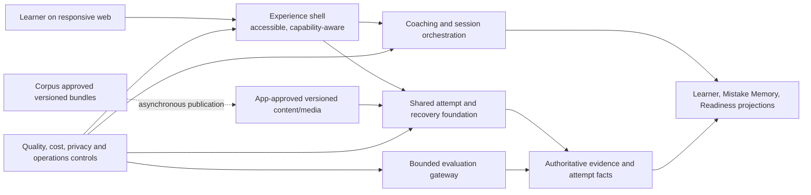
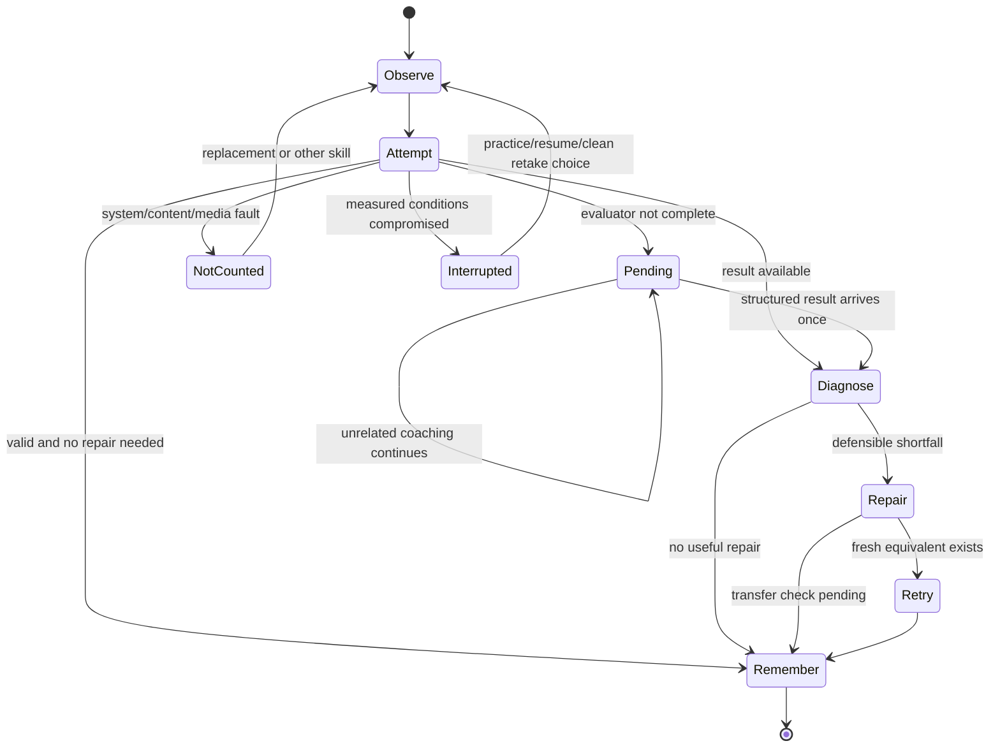

# Bestehen / App — Architecture Charter and Quality Attributes

> **Stage:** 01 of 28  
> **Status:** Accepted architecture baseline  
> **Decision owner:** Architecture  
> **Applies to:** every later architecture stage and every implementation slice  
> **Last verified:** 2026-08-22

## 1. Purpose and scope

This charter turns the settled Bestehen / App product and design invariants into binding architecture constraints. It defines how later decisions are made, which shortcuts are forbidden, which state and failure semantics every component must preserve, and the initial measurable quality budgets that Stage 25 must turn into executable gates.

This stage does not choose a framework, database, cloud, AI/STT/TTS provider, deployment topology, schema, or production API. It also does not implement application code. Those decisions remain with their named downstream stages, but they may not weaken this charter.

The target posture is the smallest maintainable responsive-web system that can deliver the complete five-skill exam coach truthfully at private/personal-project scale. Complexity must answer a measured requirement, a security boundary, or an observed failure domain.

## 2. Inputs, authority, and continuity

### 2.1 Current repository references

All required files were read from current `main`; no local attachment or prior-chat copy was treated as authority.

| Repository / commit | Path | Blob SHA | Stage-01 use |
|---|---|---|---|
| `m-elsharkawi/Bestehen-Shaping@9f37ad78fdd101b3c9cb8782ddc54d12dbce1fdc` | `app/28-bestehen-app-product-specification.md` | `18ae80cc2fd63cecd76c297c3e56d44a68367856` | Consolidated product authority; §§1–3, 10–20 |
| same | `01_Bestehen_Product_Overview.md` | `42f15da945e03f1d8e32dfe010f95aae6b87daa3` | Umbrella purpose; Corpus/App split; canonical loop |
| same | `02_Bestehen_Identity.md` | `f8799407f7b4a5a657f8c81439425d5a004f4e1c` | Calm evidence-led coach; visual/voice guardrails |
| same | `app/01-product-thesis.md` | `6bbb074dc6a262cb66cebad960dd248d1010f21f` | Product objective, non-goals, explainability, cost filter |
| same | `app/25-business-model-and-product-boundaries.md` | `904ae20e8cb3f9f354d6505513821e86f609622b` | Private/free posture, cost classes, portability, no data monetization |
| same | `app/26-platform-accessibility-nonfunctional.md` | `8137091683941b0d55f3d4fb90af3c402b8371e5` | WCAG/recovery/latency/durability/browser and audio expectations |
| same | `app/27-end-to-end-scenario-validation.md` | `5da3b0a27ba516770210773399f0415cfb1f5460` | Binding cross-stage precedence and nine journey validation |
| `m-elsharkawi/Bestehen-App@f1803e2c7cac89cdf0da4b342caef91f2377fdab` | `Architecture/00-architecture-shaping-plan.md` | `b263c5e7b3bccc0450ddd17aa0cc007432d672b7` | Workflow, naming, routing, ADR and traceability conventions |
| same | `Bestehen_App_Architecture_Checklist.md` | `03566f90c003c6e012ca3990a266e20b3563d5a2` | Live Stage 01 acceptance record |
| same | `Design/DESIGN-HANDOFF.md` | `417a6820037e045e2dd9f29afc42b9f2e94fd638` | UI-domain assumptions, recovery and a11y contract |
| same | `Design/Bestehen-01-Design-System.dc.html` §§0–1, §3 | `d4e371aacee32c85ddc53cf9cf3abaaff4e86e7a` | Principles, semantic modes, canonical loop and state models |
| same | `Design/Bestehen-04-Flows-Handoff.dc.html#h` | `7120b05a2272c31e5896e4313a7007935f5d0aed` | Build-order context and six design assumptions |
| same | `prompts/architecture/01_define_architecture_charter_and_quality_attributes.txt` | `65e1e3825b3e45179739d0e15182e61932f6a9dc` | Authoritative Stage 01 execution contract |

The workflow plan records an older App planning baseline (`7fa7f297…`). The current App commit is `f1803e2…`; the drift is the architecture workflow pack itself. Required shaping and design blobs are unchanged from the plan manifest, and no prior architecture-stage output existed. Stage continuity is therefore intact.

### 2.2 Authority and resolved source differences

Authority is: final App specification; detailed App shaping documents (with Stage 27 precedence); Identity; Product Overview; human-authored design handoff/artifacts; illustrative design runtime last. Product truth wins over a conflicting design expression, while design behavior/layout remains binding where consistent.

| Difference | Applied authority and architectural consequence |
|---|---|
| Design Flow A assumes a six-minute first session; product final §4.1 specifies a five-skill diagnostic with a 12–16 minute foundation route, normally 18–22 minutes, hard 30-minute ceiling. | Preserve the product duration/routing as versioned configuration. A six-minute partial probe may be resumable only if honestly `evidence_building`; it is not a complete placement. |
| Design calls Ready to Book a four-condition display; final product §11.2 has six authoritative gates. | Domain/API return all six gates and exact failing reasons. The UI may group them without deleting semantics. |
| Design pending copy says “usually under a minute”; product §16.3 targets useful evaluation normally ≤15 s, connected degradation ≤30 s, then Pending. | Copy is derived from measured/versioned SLA state; no hard-coded provider promise. |
| Design shortens weakness lifecycle; final product §5.2 includes Candidate, Historical/Unconfirmed, Known, Repairing, Stabilizing, Repaired, Resolved, and Reopened behavior. | Domain preserves the complete lifecycle; the UI may project a subset. |
| Design marks 65 and speech confidence as open. Product fixes the behavior: 60 is the official line, 65 is a versioned Bestehen Safe default, and uncertain productive evaluation cannot set Oral. | Store official target rules and empirical calibration separately; low-confidence output remains Pending/evidence-building. |
| Design asks whether P0–P4 are visible; product §7 keeps them internal/local. | API may carry condition profile IDs; learner copy exposes actual conditions, not a global rung badge. |

No contradiction or missing owner preference blocks this stage. Shaping and design sources remain untouched.

### 2.3 Current external quality references

These references set validation vocabulary, not a technology choice. Accessed 2026-08-22:

- [W3C Web Content Accessibility Guidelines (WCAG) 2.2](https://www.w3.org/TR/WCAG22/) — WCAG 2.2 AA baseline.
- [OWASP Application Security Verification Standard](https://owasp.org/www-project-application-security-verification-standard/) — risk-based application-security verification source; Stage 23 chooses the applicable verification level and controls.
- [NIST SP 800-218, Secure Software Development Framework](https://csrc.nist.gov/pubs/sp/800/218/final) — secure-development and release-evidence reference for Stages 23, 25, and 26.

This document makes no claim of legal compliance. Public/commercial operation requires later jurisdiction-specific legal, privacy, accessibility, rights, and processor review owned by Stage 23 and the owner before launch.

## 3. Architecture charter

### 3.1 Binding principles and forbidden shortcuts

| Principle | Binding rule | Categorically forbidden shortcut | Primary traceability | Downstream consumers |
|---|---|---|---|---|
| Truth before convenience | Apply validity/fairness → direct evidence → independent Written/Oral risk → uncertainty resolution → due repair/retention → progression/coverage → preference. Urgency changes priority only. | Scoring a broken task as learner failure; averaging away a weak pass component; changing truth after an override. | `app/27` §4; final §§2.1, 19 | All; especially 04, 06, 08, 11, 25 |
| Explicit evidence conditions | Assistance, timing, exposure/freshness, modality, independence, validity, scope, evaluator confidence and target condition are durable facts. | A generic `score`/`success` record that loses conditions; cross-skill substitution. | final §§5, 10; design §3.1–3.4 | 04–12, 15–25 |
| Absence is not zero | Missing or pending estimates are absent discriminated states; historical evidence remains auditable. | `0` for missing evidence; guessed temporary score; destructive recalculation. | final §§10, 19; design §3.3 | 05, 06, 11–13, 24, 25 |
| Two pass gates | Written and Oral remain independent aggregates; the overall index is their bottleneck and never probability. | One merged compensating total; any pass-probability field/event/template before the empirical product gate. | final §§10–11; design §§0, 3.3 | 04–06, 11–13, 24–28 |
| One shared five-skill foundation | Session, attempt, result, diagnosis, repair, evidence and recovery are shared; modality input/evaluation extends them. | Five drifting applications, schemas, or result cards. | final §§5–8; design §§3.1, 4 | 03–09, 12–18 |
| Learner agency; system truth | The learner controls action choice and support in ordinary practice; the system owns target, validity, actual conditions and interpretation. | Editable evidence labels, coach-obedience scores, punitive skip/backlog state. | final §12.3; design §3.5 | 04, 08, 12, 13, 20, 22 |
| Corpus is asynchronous intelligence | App consumes compatible approved/versioned bundles; Corpus gets no learner profile and normal attempts survive its outage. | Live Corpus search or Corpus AI per click; raw/reference source as learner runtime dependency. | final §14.2; overview §4 | 02, 09, 10, 12, 23, 26 |
| Accessible evidence equivalence | WCAG 2.2 AA is release completeness. Alternative interaction paths produce identical evidence when they test the same capability; otherwise record the changed condition honestly. | Drag-only tasks, color/chart-only meaning, inaccessible pass-critical flows, or silently claiming standard conditions after a material adaptation. | final §16.2; design §6 | 03, 13–18, 21, 25, 26 |
| Local degradation and named ownership | App/content/media/browser/network/evaluator faults affect the smallest defensible scope and never become learner failure. | Global outage screen for a local capability; red learner-error styling for system fault; hidden timer reset. | final §§16, 19; design §§3.2, 3.6 | 05, 06, 12, 14–26 |
| Privacy and rights by default | Account-optional first use, minimum-purpose data, pseudonymous provider payloads, ephemeral raw audio, export/delete, rights-aware serving and least privilege are architectural boundaries. | Background microphone capture, indefinite raw audio, default provider training, ad tracking, serving assets without eligible rights. | final §§14–15; `app/25` §§3, 7 | 05, 09, 10, 19, 20, 23–26 |
| Deterministic and cached first | Routine scoring, Readiness, review, planning, approved content/audio and fallback copy are deterministic/versioned/cached. AI is bounded, structured and allowed to remain Pending. | Per-click premium AI, runtime generation of routine objective work, unbounded evaluator voting, AI-only truth. | final §§3.5, 18; `app/25` §5 | 03, 08–12, 16–19, 24–26 |
| Personal-project proportionality | Prefer a modular, low-idle-cost system and managed capabilities only when they lower solo maintenance without weakening exit paths. | Microservice per domain, Kubernetes, streaming platform, warehouse, multi-region or speculative million-user architecture before a measured trigger. | final §18; `app/25` §§3, 13 | 02, 03, 12, 19, 24, 26 |
| Versioned and reversible claims | Product facts, rules, evaluation releases, content/blueprints and derived projections carry lineage; corrections are targeted and reproducible. | In-place historical reinterpretation; mutable magic numbers; provider output as the system of record. | final §§5, 10, 14, 20.5 | 04–12, 19, 23–25 |

### 3.2 Architecture boundaries and responsibility ownership

This is a logical responsibility view, not a service/deployment mandate.



| Logical owner | Owns | Does not own | Later defining stage |
|---|---|---|---|
| Experience shell | Rendering, accessibility semantics, responsive layout, capability/preflight presentation | Evidence truth, scoring, validity, pass gates | 13–14 |
| Coaching/session orchestration | One dominant action, session/loop state, structured reasons | Learner-evidence mutation outside authoritative commands | 08, 12 |
| Shared attempt/recovery foundation | Attempt conditions, checkpoints, idempotent submission, smallest-scope recovery | Five separate modality truth models | 04, 08, 12, 21 |
| Evidence ledger | Immutable observations/corrections, exact condition/version lineage | Learner-facing projection wording | 05–06 |
| Learner/Mistake/Readiness projections | Recomputable derived state and explanations | Destructive editing of source facts; provider-owned truth | 07, 11 |
| App content/media | Approval, learner-use eligibility, freshness family, served version | Corpus raw provenance search; assumed redistribution right | 09–10, 16 |
| Evaluation gateway | Minimum-purpose bounded jobs, structured result, confidence/release/cost, fallback/Pending | Unbounded free-form authority; readiness calculation | 17–19 |
| Local/account data boundary | Anonymous/local identity, adoption/sync/export/delete orchestration | Mandatory account before value | 05, 20, 23 |
| Quality/operations controls | Release evidence, telemetry minimization, failure/cost/capability health | Engagement-only optimization | 24–26 |

## 4. Decisions, alternatives, and rationale

### 4.1 Decision registry

| ID | Decision and default | Alternatives considered and rejected | Consequences / exit / review trigger | ADR |
|---|---|---|---|---|
| `ARCH-S01-D01` | Make evidence truth and Stage 27 precedence the non-overridable decision filter. | (A) Let each feature decide locally — simpler initially, but contradictory. (B) Optimize global average/engagement — hides pass risk. (C) Recommended explicit precedence. | Requires traceable condition facts and independent gates. Exit only through a superseding product decision; any cross-stage contradiction triggers review. | [ADR-0001](adr/ADR-0001-evidence-truth-and-explicit-uncertainty.md) |
| `ARCH-S01-D02` | Use one shared logical five-skill foundation with modality extensions. | (A) Five vertical products — fast prototypes, permanent drift. (B) Highly generic workflow engine — premature abstraction. (C) Recommended shared attempt/result/evidence contracts plus explicit extensions. | Stage 04/08 define seams. Review if a modality cannot preserve its required behavior without pervasive conditionals. | [ADR-0002](adr/ADR-0002-modular-low-ops-deterministic-first-posture.md) |
| `ARCH-S01-D03` | Persist observations/corrections as authoritative facts; derive versioned projections. | (A) Store only current aggregates — cheapest, unauditable. (B) Full event-stream platform — excessive. (C) Recommended append-oriented logical ledger using ordinary storage. | Enables targeted recomputation and historical audit without choosing storage. Review only if measured volume/throughput exceeds the chosen Stage 05 design. | ADR-0001 |
| `ARCH-S01-D04` | Treat explicit discriminated states and version tuples as API/domain contracts. | (A) Booleans/nulls — ambiguous. (B) Free-form states — drift. (C) Recommended closed versioned unions with unknown-version failure behavior. | Clients never infer truth. Additive compatibility first; incompatible semantics require a new contract/rules version. | ADR-0001 |
| `ARCH-S01-D05` | Adopt the quality budgets in §6 as release criteria, not aspirational targets. | (A) “Best effort” — untestable. (B) Enterprise SLA now — unnecessary cost. (C) Recommended measurable personal-project budgets and local fail-safe behavior. | Stage 25 turns scenarios into gates; Stage 24 measures them; Stage 26 owns release operation. Recalibrate with evidence, never silently. | [ADR-0003](adr/ADR-0003-quality-attributes-are-release-gates.md) |
| `ARCH-S01-D06` | Fail locally, assign a non-learner owner, preserve unaffected work and block only dependent conclusions. | (A) Fail whole session — simple but harmful. (B) Guess a result — falsely complete. (C) Recommended smallest-scope `pending`/`interrupted`/`not_counted`. | Requires idempotency, checkpoint and affected-scope contracts. Review when incident evidence shows a narrower recovery is possible. | ADR-0003 |
| `ARCH-S01-D07` | Make WCAG 2.2 AA core-flow conformance and equivalent non-drag/non-color/non-chart paths release gates. | (A) Retrofit later — architectural rework and exclusion. (B) Separate accessible mode — drift. (C) Recommended one semantic product with evidence-aware alternatives. | Stage 14 defines browser/device matrix; Stage 25 verifies. A capability-changing adaptation narrows evidence, never access. | ADR-0003 |
| `ARCH-S01-D08` | Enforce privacy-by-default, least privilege, rights eligibility, ephemeral raw audio and provider minimization. | (A) Retain everything “for future AI” — privacy/cost risk. (B) Avoid productive data entirely — removes pass-critical evidence. (C) Recommended purpose-specific bounded retention. | Stage 23 threat-models and sets jurisdictional controls. Provider exit requires exportable structured records and deletion orchestration. | ADR-0001 |
| `ARCH-S01-D09` | Use deterministic/cached/pre-generated defaults and one bounded productive evaluation, with at most one justified escalation. | (A) Premium AI everywhere — variable cost/provider lock. (B) No AI — insufficient productive evaluation. (C) Recommended bounded gateway and Pending fallback. | Stage 19 selects providers using measured quality/unit cost. Outage/price exit is cached/fixed/deterministic work plus narrower claims. | ADR-0002 |
| `ARCH-S01-D10` | Keep the deployable system modular and low-ops until measurements justify topology complexity. | (A) Microservices/event platform immediately — solo burden. (B) Unstructured single code mass — coupling. (C) Recommended module boundaries in one maintainable system, split only on evidence. | Split trigger: sustained independent scaling, security boundary, availability isolation, or deploy cadence benefit exceeding operational cost. | ADR-0002 |
| `ARCH-S01-D11` | Treat empirical defaults as versioned calibration records with provenance, effective date, validation, monitoring and rollback. | (A) Constants in code — hidden and sticky. (B) Generic rules platform now — excessive. (C) Recommended typed configuration per domain. | Stage owners define schema; Stage 24 monitors and Stage 25 gates. Stable product rules do not become configurable. | ADR-0001 |
| `ARCH-S01-D12` | Use lightweight, immutable-history ADR governance for durable high-coupling decisions. | (A) No ADRs — context loss. (B) ADR per section — noise. (C) Recommended selective index under `Architecture/adr/`. | Supersede, never erase; Stage 28 publishes the full index. Review when a decision crosses stages or its trigger fires. | — |

### 4.2 Decision method

Every consequential later decision must contain:

1. **Question and owner:** exact decision boundary and stage owner.
2. **Evidence:** current repository sources/SHAs plus official primary sources for mutable claims; observed metrics when available.
3. **Constraints and criteria:** validity, direct evidence, independent pass risk, accessibility, privacy/rights/security, failure isolation, cost and solo maintenance.
4. **Alternatives:** at least two credible choices where meaningful, including keep-it-simple/do-nothing; explicitly state rejected reasons.
5. **Recommendation:** smallest sufficient default, affected state/data/API/version and downstream consumers.
6. **Consequences:** security/privacy/rights/accessibility/failure/operations/cost; cheaper fallback and provider exit where applicable.
7. **Validation and trigger:** test/metric, test owner, review/upgrade threshold, rollback.

Empirical defaults are configuration records, not owner blockers. A calibration record minimally has `parameter_id`, typed `value`, `provenance`, `effective_at`, `validation_evidence`, `owner_stage`, `rules_version`, and `rollback_to`. Stable rules such as independent Written/Oral gates are not tunable parameters.

## 5. Data, state, contracts, and versioning

### 5.1 Facts versus projections

This explanatory pseudotype is non-production architecture notation:

```text
ObservationFact = {
  observation_id, learner_scope, attempt_id, direct_modality,
  content_version, freshness_family, blueprint_version,
  assistance, timing, exposure, independence, accessibility_condition,
  validity: valid | partially_valid | pending | interrupted | not_counted,
  affected_scope, evaluator_release?, evaluator_confidence?, occurred_at
}

ProjectionEnvelope<T> = {
  value: T | absent,
  derived_from_fact_ids[], rules_version, calibration_version,
  calculated_at, explanation_reasons[], supersedes_projection_id?
}
```

Facts are append-oriented; corrections/invalidation point to affected facts and reasons rather than rewriting history. Projections are replaceable and reproducible. Provider responses are inputs to a versioned evaluation result, never the sole authoritative record.

### 5.2 Client-visible state contract

Clients receive server/domain-owned discriminated states and render them; they never infer validity or Readiness from score/color/timeout.

```text
EvidenceValidity = valid | partially_valid | pending | interrupted | not_counted

ReadinessState =
  | { kind: evidence_building; estimate: absent; missing_evidence[] }
  | { kind: not_ready | borderline | safe; written; oral; reason_code; rules_version }
  | { kind: ready_to_book; written; oral; six_gate_results[]; rules_version }
  | { kind: stale_contradicted; historical_milestone; current_reason; next_recheck }
```

The architecture must not contain a pass-probability field, model, event, hidden calculation or copy template until an independently calibrated product gate explicitly permits one. Unknown state/contract versions fail closed for consequential claims: show a safe unavailable/pending state, preserve data, and request refresh/recalculation rather than guess.

### 5.3 Version lineage and compatibility

Consequential facts/projections name applicable versions: target/blueprint, content/form/media, skill/taxonomy, evidence rules, calibration, evaluator/rubric/prompt/model, API/schema, and accessibility/accommodation condition where relevant.

- Additive contract changes should preserve older consumers.
- A semantic change requires a new version, affected-scope analysis, targeted recomputation/revalidation and rollback path.
- Historical observations retain original version lineage.
- Blueprint or defective-content changes suspend only affected current claims.
- App-approved cached bundles declare compatibility; last-compatible fallback is explicit.
- Duplicate/idempotent delivery cannot create a second attempt or evidence observation.

Stage 05 owns persistence/evolution mechanics, Stage 06 evidence audit, Stage 10 Corpus compatibility, Stage 12 API/job/event idempotency, and Stage 24 recalculation observability.

## 6. Quality-attribute scenarios and initial budgets

Budgets are launch defaults to validate. A miss causes an explicit degraded state, blocked release for a core-flow criterion, or a tracked corrective decision; it never authorizes hiding the miss. Stage 25 owns executable gates unless another owner is named.

| ID / attribute | Stimulus and environment | Required response | Initial measure | Validation evidence | Test owner |
|---|---|---|---|---|---|
| `QA-E01` Evidence correctness | Valid target attempt completes under declared conditions. | Record exact conditions/version once; recompute deterministic projection reproducibly. | 100% of sampled consequential projections trace to source facts and rule versions; zero duplicate evidence from retried delivery. | Golden fixtures, property tests, replay/recompute comparison, audit sample. | 06 + 25 |
| `QA-E02` Evidence correction | Content/evaluator/blueprint defect is confirmed after publication. | Invalidate/reclassify affected scope, retain history, recompute dependent claims without learner penalty. | 100% affected facts discoverable by version; zero unaffected facts changed; before/after explanation retained. | Fault-injection fixture and correction audit. | 06, 09, 11 + 25 |
| `QA-E03` Pass truth | Written is strong and Oral weak/missing, or vice versa. | Keep gates independent; overall follows weaker component; missing remains absent. | Zero compensating aggregate and zero probability field in schema/API/copy; all six Readiness states contract-tested. | Contract/schema lint plus scenario fixtures. | 11, 12 + 25 |
| `QA-A01` Accessibility | Keyboard/screen-reader learner executes each core flow on supported desktop web. | Same task and evidence path without pointer; meaningful focus/announcements/text alternative. | WCAG 2.2 AA core-flow gate; 100% core actions keyboard operable; no critical automated violation plus manual AT pass. | Automated scan + NVDA/VoiceOver/manual flow evidence. | 14 + 25 |
| `QA-A02` Equivalent interaction | A matching/reordering task is used without drag, or readiness graphic without vision/color. | Non-drag path produces identical evidence; graphic has prior sentence and real table. | 100% such components have equivalent path and contract-equivalent evidence; 320 px reflow and 200% zoom pass. | Component and E2E equivalence tests, grayscale/text-only review. | 13–15 + 25 |
| `QA-L01` Interaction latency | Learner types/selects/toggles/timer on supported device under ordinary load. | Acknowledge locally; never wait for model/network. | Target ~100 ms response to input; no intentional network dependency. | Client performance traces on supported matrix. | 13, 14, 24 |
| `QA-L02` Deterministic latency | Learner submits objective work or opens cached state under ordinary connected load. | Return deterministic result/state; show progress if degraded. | p95 ≤1 s; explicit progress after ~2 s. | Synthetic and real-user percentile dashboards. | 12, 24 |
| `QA-L03` Productive evaluation | Writing/Speaking evaluation is slow or unavailable. | Preserve response; normally return useful result ≤15 s; after ~30 s transition to Pending and unblock unrelated work. | No indefinite spinner; 100% >30 s jobs have durable Pending/job identity; result applies once. | Timeout/failover tests and latency distribution. | 17–19, 24, 25 |
| `QA-L04` Adaptive partner | Meaning-dependent partner service slows. | Begin response around ≤2 s; tolerate ≤4 s; after repeated >~5 s use fixed/modified fallback or stop honestly. | No false clean interaction after material fallback. | Network shaping and transcript/evidence review. | 18, 19, 25 |
| `QA-D01` Draft durability | Browser/app/network fails during Writing. | Preserve draft/checkpoint and actual timer conditions. | Recoverable Writing loss normally ≤5 s; no duplicate submission. | Crash/reload/offline fault injection across browser matrix. | 17, 21, 25 |
| `QA-D02` Timed durability | Mock reloads/backgrounds or connection changes. | Preserve completed responses, consumed media/replays and trusted elapsed time; narrow only affected claim. | 100% saved units recoverable; no silent timer freeze/reset/extra target time. | Clock/background/crash scenario tests. | 21 + 25 |
| `QA-R01` Local recovery | Media/mic/content/evaluator/Corpus capability fails. | Name system owner, preserve unaffected work, keep other skills available, use Pending/interrupted/not-counted as appropriate. | Zero synthetic failure converted to negative learner evidence; normal cached practice survives Corpus outage. | Twelve design recovery fixtures plus Corpus/evaluator outage drills. | 10, 16–21, 25 |
| `QA-P01` Privacy | Learner deliberately enters productive work; external evaluator is required. | Send minimum purpose-specific pseudonymous context; no unrelated history; visible mic state; delete raw audio after finalization. | 100% provider payloads schema-allowlisted; raw audio pending ceiling ≤7 days; no default provider training use. | Payload tests, retention sweep audit, processor configuration evidence. | 19, 23, 25 |
| `QA-P02` Data rights | Learner requests export or deletion from local/account state. | Export understandable structured learner data without restricted Corpus assets; delete in-scope personal data across stores/providers. | Orchestration is idempotent and auditable; no inaccessible paid-only path; completion/error scope explicit. Exact operational duration is set after Stage 20/23 design. | End-to-end inventory/export/delete rehearsal. | 20, 23, 25 |
| `QA-S01` Security | Unauthorized actor or compromised client attempts learner/admin/provider action. | Least-privilege authorization, secrets kept server-side, input/output validation, audit without sensitive payload leakage. | No critical/high release-blocking finding in the Stage 23 threat-model/verification profile; secrets scanning clean. | Threat-model abuse cases, dependency/secret/SAST/DAST evidence. | 23 + 25 |
| `QA-O01` Operability | A release changes rules/content/evaluator or a dependency degrades. | Identify version and affected scope, observe failure/cost, roll back or disable capability locally. | Each consequential release has owner, changelog, health signal and rollback; actionable alert for pass-truth/data-loss/privacy breach. | Release rehearsal, rollback drill, runbook review. | 24–26 |
| `QA-C01` Cost | Ordinary objective practice runs at private-project scale. | Use deterministic/cached paths and near-zero idle posture. | Zero routine model calls for objective scoring/Readiness/review/planning; track cost by capability and useful productive evidence unit. | Meter reconciliation and call-path tests. | 19, 24 |
| `QA-C02` Cost pressure | Unit price/budget alert or provider outage affects productive AI/media. | Reduce richness, batch, cache, switch provider or remain Pending/narrow claim; preserve Writing/Oral path and truth. | Every variable provider has alert, cheaper fallback and export/delete/contract exit; no unbounded retry chain. | Cost fault drill and provider-exit checklist. | 19, 24, 26 |

Stage 24 must establish measured baselines and alert thresholds where only behavior is currently known. Stage 25 may tighten these budgets from evidence but cannot relax truth, accessibility or pass-critical recovery merely to pass a gate.

## 7. Main flow and failure/uncertainty handling



| Failure owner | Required state/response | Prohibited consequence | Recovery/fallback |
|---|---|---|---|
| Learner response under valid conditions | `valid`/`partially_valid` facts and defensible diagnosis | Unsupported fine-grained cause | Smallest clarifier, repair, fresh retry |
| App/network/browser | `interrupted` or `not_counted` for affected scope; checkpoint preserved | Learner failure, hidden time grant, global block | Resume as practice, clean retake, unaffected skills |
| Content/media | Quarantine version, exclude/recompute affected evidence | Lower mastery/Readiness | Replacement approved family; cached fallback |
| Evaluator/provider | `pending`, confidence/version retained | Guessed score or endless polling/escalation | One justified escalation; alternate provider or later fresh sample |
| Corpus | Continue last compatible approved bundle | Live learner-runtime dependency or invented fine-grained claims | Verified blueprint + curated seed + conservative claim |
| Accessibility/capability mismatch | Preserve access and actual condition | Blaming learner or silently standard claim | Equivalent input if same evidence; otherwise narrower evidence |
| Product inventory | Name missing fresh/P4 content as product gap | Reuse exposed form as independent evidence | Useful lower-claim practice; defer gate |

Pending blocks only conclusions that depend on it. Immediate retry is not delayed retention. A historical milestone may remain true while current status becomes stale/contradicted. Owner-visible incidents and learner-visible state use separate minimum-purpose records; raw learner payloads do not enter general logs.

## 8. Security, privacy, rights, and accessibility implications

### 8.1 Security/privacy/rights baseline

- Threat modeling begins with learner/evidence integrity, account/local adoption, content rights, provider boundary, deletion/export and administrator/secret abuse cases.
- Deny by default; least-privilege identities and scoped credentials; secrets never shipped to the client or written to architecture/config examples.
- Provider adapters accept allowlisted minimum-purpose payloads and return validated structured results with release/version/confidence/cost metadata.
- Logs/analytics use pseudonymous identifiers and structured incident codes; no routine raw Writing/audio/transcripts, auth secrets or restricted Corpus material.
- Microphone permission is contextual with visible capture. Raw audio is ephemeral after final evaluation; unresolved processing has a seven-day maximum before deletion/unresolved handling.
- Rights eligibility is independent from authenticity/confidence. Serving requires App approval and eligible use; export omits restricted source assets while retaining learner-relevant references/explanations.
- Account-optional first use is a security/privacy boundary, not merely onboarding copy. Stage 20 must explain local data-loss risk before surprise loss and preserve a secure adoption path.
- Stage 23 must define jurisdiction, retention schedule, processor terms, deletion verification, incident response and current security verification profile before any public/commercial launch. No compliance claim is made here.

### 8.2 Accessibility baseline

Core flows are incomplete until WCAG 2.2 AA acceptance passes. Required architecture support includes semantic focus/order, live-state announcements, meaningful text alternatives, non-color status, 44×44 targets, 320 px reflow, 200% zoom, reduced-motion comprehension and keyboard alternatives. Timer ticks are never announced; material warnings are. A chart has a sentence and real data table. A drag interaction has a select/place path that produces identical evidence.

Accessibility support is itself not assistance. Only support that changes the tested capability/official condition changes the evidence label. Standard P4 timing remains exact unless a verified official accommodation profile defines equivalent target conditions. Stage 14 owns capability/browser detail; Stage 25 owns release verification.

## 9. Performance, reliability, operations, and cost

### 9.1 Operating posture

Initial operation is private, personal, free/non-commercial, low traffic and maintained by one person. There is no enterprise uptime claim. Prefer a single deployable modular system, ordinary durable storage, managed services where they reduce maintenance, static/cached delivery, background work only for genuine asynchronous capability, and capability flags/circuit breakers for local degradation.

Added topology is justified only by observed evidence:

- independent scaling pressure sustained beyond the current module/deployment capacity;
- a security/data boundary that cannot be enforced safely in-process;
- a failure/availability domain whose isolation materially protects learners;
- deploy cadence or ownership independence whose benefit exceeds on-call/observability/data-consistency cost;
- public usage requiring measured SLO/error-budget, redundancy or queue guarantees.

Microservices, Kubernetes, event-streaming platforms, multi-region active-active and an analytics warehouse are rejected at launch. A modular system does not mean an unstructured monolith: module ownership and contracts in §3.2 remain mandatory.

### 9.2 Spend model, triggers, fallbacks, and exits

No euro budget is invented. Stage 24 must meter idle baseline, compute/runtime, database/storage/backups, media storage/CDN/egress, email/notifications, observability, AI/STT/TTS/evaluator calls, Corpus publication, human QA and solo maintenance time.

| Spend category | Default | Upgrade trigger | Cheaper fallback | Provider exit requirement |
|---|---|---|---|---|
| Hosting/data | Low-idle managed or simple deployable topology | Measured capacity, recovery, security or availability miss | Reduce replicas/features; static/cache more; scheduled jobs | Standard exports/backups, documented restore, no proprietary truth-only format |
| Objective/coaching rules | Deterministic versioned code/config | Independently evaluated model materially improves decision quality | Keep transparent rules/recalibrate | Rules/config/data export; no model dependency |
| Productive evaluation | One cheapest validated structured call | Pass-critical ambiguity, contradiction, evaluator quality miss | Pending/lower confidence/later fresh sample | Adapter boundary, portable rubric fixtures/results, deletion and bulk export |
| Speaking interaction | Fixed/bounded turns where valid | Meaning-dependent interaction proves added evidence value | Fixed/prerecorded rehearsal; narrower claim | Portable scenario/turn contract and recordings deletion |
| Content/audio | Batch, review, cache, reuse | Freshness/coverage/P4 quality gap | Curated seed or lower approval/claim | Keep source brief, rights, versions and reusable assets portable |
| Observability | Lean structured metrics/logs without raw learner payload | Incident/capacity complexity exceeds manual diagnosis | Sampling/aggregation; retain pass-truth alerts | Export standard metrics/events and documented dashboards/runbooks |

Alerts are tied to quality/cost measures, not arbitrary engagement. Cost may select among equivalent-quality options. It may not remove direct Writing/Oral evidence, evidence correctness, accessibility or recovery.

## 10. ADR convention and governance

The live index is [`Architecture/adr/README.md`](adr/README.md), and the reusable template is [`Architecture/adr/ADR-template.md`](adr/ADR-template.md).

- Filename: `ADR-NNNN-kebab-case-title.md`, zero-padded, next unused number from the index. The template is the sole filename exception.
- Statuses: `Proposed`, `Accepted`, `Superseded`, `Deprecated`.
- Owner: the architecture stage making the durable decision; a later stage may amend factual continuity but must record why.
- Create an ADR only for a durable, consequential choice with meaningful alternatives and cross-stage coupling. The stage document holds full analysis.
- Accepted ADR content is historical. A reversal creates a new ADR and marks the former `Superseded by ADR-NNNN`; deprecation without replacement explains the removal trigger. Never delete history.
- Index update is part of the same commit as a new/status-changed ADR. Numbers are never reused. Stage 28 publishes the consolidated index/status.
- Proposed ADRs may guide exploration but cannot satisfy a stage-owned completion gate until accepted or precisely blocked.

Stage 01 accepts ADR-0001 through ADR-0003; none is Proposed, Superseded or Deprecated.

## 11. Assumption and risk vocabulary/register

### 11.1 Vocabulary

| Term | Meaning and required handling |
|---|---|
| Assumption | Believed condition not yet empirically demonstrated. Name validation owner/date/evidence and consequence if false. |
| Risk | Uncertain event that can harm validity, accessibility, privacy/rights/security, durability, operability, cost or learner outcome. Record likelihood/impact qualitatively, mitigation and trigger. |
| Constraint | Binding product/design/legal/operating boundary; not traded away locally. |
| Calibration default | Implementable empirical value with provenance/version/effective date/monitor/rollback; not a stable product rule. |
| Dependency | Required component/source/capability with owner and failure behavior. |
| Issue | Observed defect/contradiction requiring action; unlike a risk, it has occurred. |
| Owner blocker | Missing preference/legal-risk/budget/private-access decision that materially changes viable architecture. Must remain unchecked with one precise question. |
| Implementation choice | Bounded later selection that cannot change the architecture contract. Name the future stage owner and acceptance criteria. |

Likelihood: `low`, `medium`, `high`. Impact: `moderate`, `major`, `critical`. A risk affecting evidence truth, deletion, pass claims, accessibility to a core flow or exposed secrets is critical regardless of low current traffic.

### 11.2 Initial register

| ID | Type / likelihood / impact | Statement and consequence if false/realized | Evidence/test and owner | Mitigation / trigger |
|---|---|---|---|---|
| `A-S01-01` | Assumption / medium / major | One modular deployable system is sufficient at private scale. | Stage 24 load/cost/incident baseline; Stage 26 operations. | Preserve module seams; split only on §9.1 triggers. |
| `A-S01-02` | Assumption / medium / major | Current+previous major supported browsers can meet checkpoint/media/accessibility needs. | Stage 14 capability matrix and Stage 25 browser/a11y suite. | Preflight and local degradation; revise matrix from measured usage. |
| `A-S01-03` | Assumption / medium / critical | Bounded productive evaluation can meet B1 rubric consistency and fairness. | Stage 19 benchmark; Stage 25 evaluator gates; Stage 24 drift. | Structured confidence, one escalation, Pending, provider exit. |
| `A-S01-04` | Assumption / medium / major | App-approved cached content/Corpus bundles cover normal practice during Corpus outage. | Stage 09 inventory and Stage 10 outage drill. | Last-compatible bundle, curated seed, narrower claims. |
| `R-S01-01` | Risk / medium / critical | Aggregate/projection logic could erase conditions or compensate across pass gates. | Stage 06/11 golden scenarios and schema lint. | ADR-0001; append facts, versioned rules, independent aggregates. |
| `R-S01-02` | Risk / medium / critical | AI/provider output or latency could be treated as truth or block unrelated learning. | Stage 19 contract/failure tests; QA-L03/L04. | Bounded gateway, validated structured result, Pending/circuit breaker. |
| `R-S01-03` | Risk / medium / critical | Recovery/timer defects could publish misleading clean evidence. | Stage 21 crash/background/offline suite. | Preflight, checkpoints, monotonic/trusted timing decision, affected-scope validity. |
| `R-S01-04` | Risk / medium / critical | Accessibility alternative changes evidence without being recorded. | Stage 14 equivalence mapping; Stage 25 manual AT/evidence test. | Same-evidence alternatives by contract; explicit condition/narrower claim otherwise. |
| `R-S01-05` | Risk / low / critical | Learner/raw audio or restricted content leaks through logs/providers/export. | Stage 23 data-flow/threat model, payload and deletion audits. | Allowlisted payloads, no raw logs, rights gate, ephemeral audio. |
| `R-S01-06` | Risk / medium / major | Fresh P4 inventory is too small for independent confirmation. | Stage 09/24 freshness-collision and form-health metrics. | Name product gap, lower-claim practice, batch/curate inventory; never reuse as independent. |
| `R-S01-07` | Risk / medium / major | Solo maintenance/provider cost grows faster than learner value. | Stage 24 cost per active learner/session/useful productive evidence; maintenance log. | Alerts, cache/batch, fixed fallbacks, provider adapters, §9 triggers. |
| `R-S01-08` | Risk / medium / critical | Empirical safety/evaluator/recency defaults are miscalibrated. | Stage 24 calibration and future matched outcomes; Stage 25 release gates. | Version/monitor/rollback; no pass probability; conservative uncertainty. |
| `R-S01-09` | Risk / medium / major | Design grouped projections drift from full domain states/gates. | Contract-to-UI coverage audit in Stages 13/25/27. | Domain owns complete states; UI projections are explicit and tested. |

No current risk requires an owner decision. Jurisdiction-specific public-launch review is a named future dependency, not permission to weaken the private architecture now.

## 12. Relationships, dependencies, and deferred implementation choices

### 12.1 Decisions every downstream stage must preserve

1. Evidence/fairness precedence and independent Written/Oral pass truth.
2. Learning evidence versus Readiness evidence, explicit conditions, absence/pending semantics and historical audit.
3. One shared five-skill attempt/result/repair/evidence/recovery foundation.
4. Client-visible five validity states and six Readiness states owned by domain/API, not UI inference.
5. Asynchronous versioned Corpus boundary and normal-runtime independence.
6. Responsive web, account-optional first use, WCAG 2.2 AA release completeness and evidence-aware alternatives.
7. Smallest-scope non-learner failure handling, checkpoints/timer integrity and Pending isolation.
8. Privacy/rights/least-privilege, minimum provider data, ephemeral raw audio, export/delete.
9. Deterministic/cached/pre-generated defaults, bounded productive AI and personal-project low-ops posture.
10. Versioned calibration and reproducible/correctable projections.

### 12.2 Intentionally deferred choices and named owners

| Deferred choice | Future owner | Boundary already fixed here |
|---|---|---|
| External/system boundary detail | Stage 02 | App/Corpus ownership and normal-runtime independence |
| Framework, repository modules, hosting/runtime | Stage 03 | Responsive web, modular low-ops posture, provider exits |
| Bounded contexts and exact state owners | Stage 04 | Logical owners in §3.2 and shared foundation |
| Persistence/schema/evolution/backup | Stage 05 | Facts vs projections, version lineage, correction/audit |
| Evidence validity/ledger/recomputation | Stage 06 | Five states, explicit conditions, no learner penalty for system faults |
| Session/coaching state machines | Stage 08 | Canonical loop and precedence |
| Content/media approval and freshness | Stage 09 | Rights eligibility, versions, product-gap semantics |
| Corpus transport/cache compatibility | Stage 10 | Async bundles, last-compatible fallback, no learner data |
| Readiness formula implementation | Stage 11 | Independent gates, absence, six states, no probability |
| API/jobs/events/idempotency | Stage 12 | Discriminated contracts, apply once, compatibility/fail closed |
| Frontend/design system details | Stage 13 | Domain-owned truth and one shared component foundation |
| Browser/device/accommodation implementation | Stage 14 | WCAG gate, equivalent evidence or explicit changed condition |
| Audio/Writing/Speaking pipelines | Stages 16–18 | Bounded calls, checkpoints, ephemeral audio, Pending/fallback |
| Provider/model/STT/TTS selection | Stage 19 | Minimum payload, benchmarked cheapest sufficient, one escalation, exit |
| Local/account/sync/export/delete | Stage 20 | Account optional, idempotent portability/deletion, no restricted exports |
| Offline/checkpoint/conflict/timer mechanics | Stage 21 | QA-D01/D02 and affected-scope truth |
| Threat model, retention, jurisdiction and security profile | Stage 23 | Privacy/rights/least privilege baseline; no compliance claim |
| Telemetry/SLO/cost thresholds | Stage 24 | Lean minimum-purpose measures and §6 scenarios |
| Executable test/release gates | Stage 25 | Quality attributes are release criteria |
| CI/CD/environments/runbooks | Stage 26 | Versioned release, rollback, local disablement, solo operation |

Deferred selections cannot be left for a feature implementer to invent ad hoc: each named stage must decide them, compare alternatives and record acceptance evidence. No Stage 02+ choice is made or prepared here.

## 13. ADRs created

| ADR | Status | Decision |
|---|---|---|
| [ADR-0001](adr/ADR-0001-evidence-truth-and-explicit-uncertainty.md) | Accepted | Evidence truth, explicit uncertainty, append-oriented facts and versioned projections |
| [ADR-0002](adr/ADR-0002-modular-low-ops-deterministic-first-posture.md) | Accepted | Modular low-ops responsive-web posture with deterministic/cached defaults |
| [ADR-0003](adr/ADR-0003-quality-attributes-are-release-gates.md) | Accepted | Measurable accessibility/evidence/recovery/privacy/operations/cost scenarios are release gates |

## 14. Decisions made and owner questions

Stage 01 accepts `ARCH-S01-D01` through `ARCH-S01-D12`. It introduces no new external provider, production dependency, recurring AI requirement, infrastructure purchase or irreversible commitment.

**Owner questions:** None.

The numeric values in §6 are shaped launch budgets or explicit empirical defaults. They are versioned, measured and reviewable; they are not invented legal/commercial guarantees or a fixed euro budget.

## 15. Definition-of-done check and handoff

| Stage 01 acceptance area | Result / evidence |
|---|---|
| Current inputs and SHAs | Complete — §2.1; current App/Shaping commits recorded and drift reconciled |
| Source precedence/conflicts | Complete — §2.2; no source modified and no owner blocker |
| Principles/forbidden shortcuts | Complete — §3.1 |
| Measurable quality scenarios | Complete — §6 covers evidence, accessibility, latency, durability, recovery, privacy, security, operability and cost |
| Decision method and tunable defaults | Complete — §4.2 and §5.3 |
| ADR workflow/template/index | Complete — §10 and `Architecture/adr/` |
| Personal-project posture/complexity triggers | Complete — §§9.1–9.2 |
| Risk/assumption vocabulary/register | Complete — §11 |
| Alternatives/rationale/consequences/exits | Complete — §4.1 and §§7–9 |
| Data/state/API/versioning | Complete — §5 |
| Security/privacy/rights/accessibility | Complete — §8 |
| Failure/recovery/uncertainty | Complete — §7 |
| Components/ownership and diagrams | Complete — §§3.2, 7 |
| Downstream traceability/deferrals | Complete — §12; named owners and preserved boundaries |
| Consequential ADRs | Complete — §13; all three Accepted |

**Stage 01 completion status:** complete; every owned decision is decided and documented. The Stage 01 checklist section may be fully checked. No owner decision or downstream stage is blocked.

