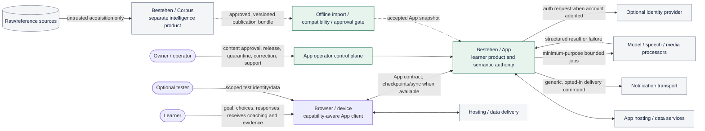
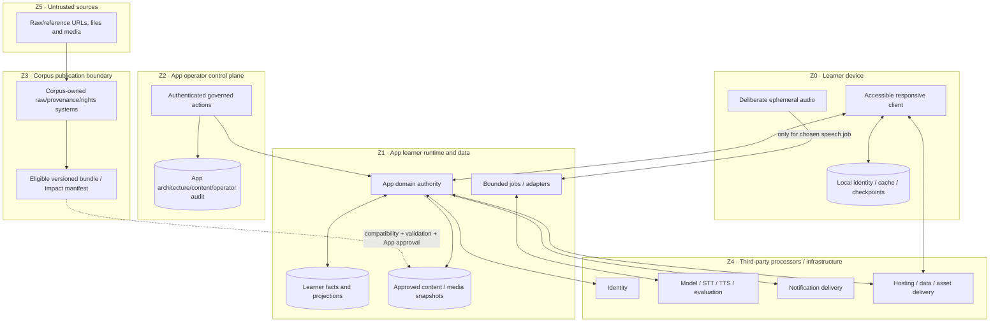
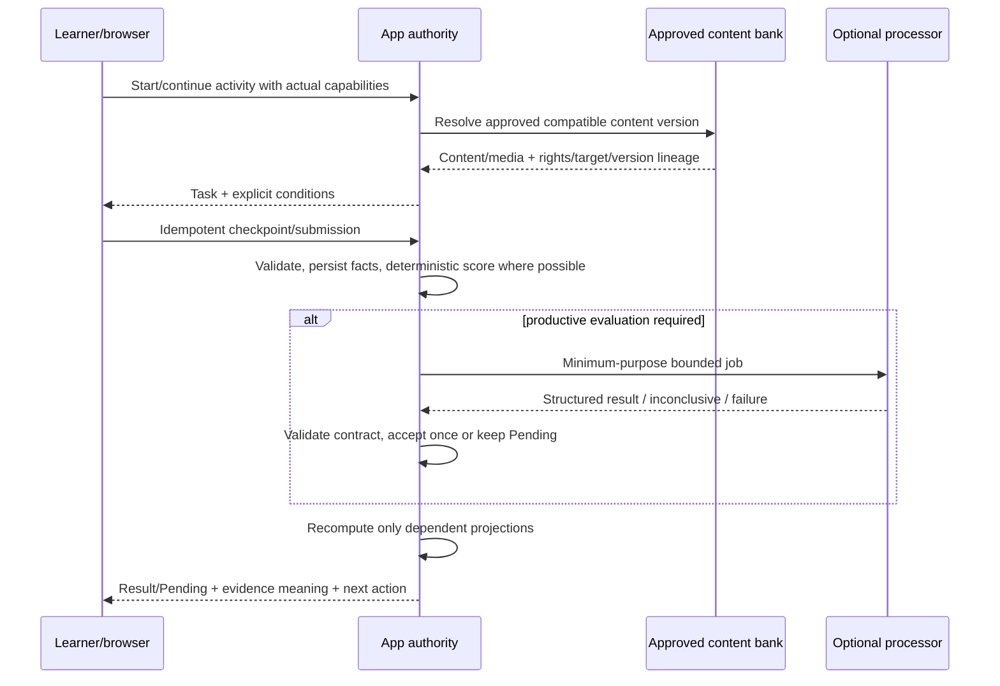

# Bestehen / App — System Context and Product Boundaries

> **Stage:** 02 of 28
>
> **Status:** Accepted architecture baseline
>
> **Decision owner:** Architecture
>
> **Applies to:** learner runtime, App content publication, operator actions, and all App integrations
>
> **Last verified:** 2026-08-22

## 1. Purpose and scope

This document defines the system boundary around Bestehen / App, the actors and external systems it may interact with, the authority and data that cross each trust boundary, and the behavior when any external capability is unavailable. It is a logical context and contract decision, not a framework, provider, deployment-topology, or physical-schema choice.

The simplest sufficient boundary is one App-owned learner product with an account-optional browser experience and an App-owned data/evidence domain. Bestehen / Corpus is a separate offline intelligence and publication source. Corpus, raw/reference sources, AI/media providers, identity, notifications, and hosting infrastructure never become authorities for learner mastery, evidence validity, Readiness, or coaching. Normal attempts use App-approved, versioned content and intelligence already inside the App boundary; they do not search Corpus or raw sources and do not invoke Corpus AI per click.

This stage introduces no production application code, runtime service, commercial vendor, purchase, or legal-compliance claim.

## 2. Inputs, authority, and continuity

### 2.1 Current repository references

Every required input was read from current `main`. Blob SHAs below are the immutable references used for this decision.

| Repository / commit | Path | Blob SHA | Stage-02 use |
|---|---|---|---|
| `m-elsharkawi/Bestehen-Shaping@9f37ad78fdd101b3c9cb8782ddc54d12dbce1fdc` | `app/28-bestehen-app-product-specification.md` | `18ae80cc2fd63cecd76c297c3e56d44a68367856` | Final product authority; product boundary, evidence truth, learner journey, runtime/degradation rules |
| same | `01_Bestehen_Product_Overview.md` | `42f15da945e03f1d8e32dfe010f95aae6b87daa3` | App/Corpus mission split and canonical loop |
| same | `app/01-product-thesis.md` | `6bbb074dc6a262cb66cebad960dd248d1010f21f` | Learner promise, non-goals, low-cost and explainability guardrails |
| same | `app/02-complete-learner-journey.md` | `3c536176154a8239aeafc0697acd947280130142` | First use, daily, mock, return, failure and post-exam flows |
| same | `app/19-information-architecture-and-core-screens.md` | `615ba3ce97fb25f974b6ba3a020cf254ddd0065f` | Learner-visible App surface and explicit no-Corpus-browser rule |
| same | `app/21-content-strategy.md` | `8149d6a268da70e17cad46f774b9d5de77776986` | App content approval, rights-safe generation, publication/correction boundary |
| same | `app/22-user-controls-vs-coach-autonomy.md` | `27f33cd56a09df27952e15bb3dfd0e077b89633c` | App/Corpus request/response and learner-data separation |
| same | `app/25-business-model-and-product-boundaries.md` | `904ae20e8cb3f9f354d6505513821e86f609622b` | Private-first, no billing, cost classes and provider fallbacks |
| same | `app/26-platform-accessibility-nonfunctional.md` | `8137091683941b0d55f3d4fb90af3c402b8371e5` | Responsive web, capability-local degradation, privacy, checkpoint and latency contract |
| same | `corpus/12-corpus-app-contract.md` | `7add217f62118e5abe100680d2e8230a93b8c280` | Pattern-first capabilities, ownership, compatibility, removal and impact behavior |
| same | `corpus/17-bestehen-corpus-product-specification.md` | `537b5185313097d043748f9dc9f9fdaf432ee71d` | Corpus product/trust boundary, operator authority, no learner data |
| `m-elsharkawi/Bestehen-App@893a8c104471f0e3af23962f9066b7a60e92eb36` | `Design/DESIGN-HANDOFF.md` | `417a6820037e045e2dd9f29afc42b9f2e94fd638` | Domain assumptions, failure ownership, accessibility, explicit UI exclusions |
| same | `Design/Bestehen-04-Flows-Handoff.dc.html` (Flows A–G) | `7120b05a2272c31e5896e4313a7007935f5d0aed` | First use, coaching, mock, readiness, failure, return and deletion flows |
| same | `Architecture/00-architecture-shaping-plan.md` | `b263c5e7b3bccc0450ddd17aa0cc007432d672b7` | Stage route, dependencies, output and ADR convention |
| same | `Bestehen_App_Architecture_Checklist.md` | `5c42c93945e5a789295bd1b90edc49ed566c5e55` | Live Stage 02 acceptance items before this write |
| same | `Architecture/01-architecture-charter-and-quality-attributes.md` | `cc8d28816f43d627861d11cd90e8770c4c96414c` | Accepted prerequisite and binding quality/evidence posture |
| same | `prompts/architecture/02_define_system_context_and_product_boundaries.txt` | `07b0e6311667e8eb6e3b1d56e5a057ee0381b138` | Authoritative Stage 02 execution contract |

Stage 01 is accepted at App commit `893a8c1…`; its output and all 22 Stage-01 checklist items are present. The plan still records its original planning baseline while the current App head contains the accepted Stage 01 work. Required shaping and design blobs match the Stage 01 continuity record. No Stage 02 output previously existed, so there is no stage-local work to reconcile.

### 2.2 Authority and source differences

Applied authority is final App specification; detailed App stages with Stage 27 precedence; Identity; Product Overview; consistent human-authored design; illustrative runtime last. No shaping or design source is changed.

| Source difference | Resolution and boundary consequence |
|---|---|
| Design Flow A assumes a six-minute first session; final product §4.1 requires the adaptive five-skill diagnostic route (normally 18–22 minutes, with a 12–16 minute foundation route and hard 30-minute ceiling). | App runtime owns the versioned diagnostic contract. A short partial probe is resumable `evidence_building`, never a complete placement. |
| Design describes four Ready-to-Book conditions; final product §11.2 defines six. | App domain/API owns all six gates. Presentation may group them but no external provider or client may omit them. |
| Design pending copy assumes “usually under a minute”; final product §16.3 / platform Stage 26 define useful evaluation normally within 15 seconds, connected degradation to 30 seconds, then Pending. | App derives copy from its versioned latency class and observed state; a processor promise is not product truth. |
| Design shortens the weakness lifecycle and lists safety margin/speech confidence as open; final product and Stage 01 settle full history, the versioned Safe default, and Pending behavior. | App persists the complete product state. Corpus/provider confidence cannot become learner confidence, and design projection cannot delete domain semantics. |
| Design Flow G says deletion is immediate/total/no backup while detailed product shaping assigns retention/deletion mechanics to the data contract. | Preserve the learner-visible deletion promise as a required outcome; Stage 20 and Stage 23 must define physically honest propagation, backup and legal-retention behavior without claiming a mechanism here. |

No unresolved contradiction requires an owner decision. Stage 01 decisions and ADR-0001 through ADR-0003 remain accepted and unchanged.

### 2.3 Current external references

No mutable framework, service, provider, quota, price, region, codec, or SDK is selected here; provider-specific research belongs to the stage that makes that selection. Boundary validation uses these official primary references, accessed 2026-08-22:

- [W3C WCAG 2.2](https://www.w3.org/TR/WCAG22/) — the shaped AA accessibility baseline and capability-equivalent interaction vocabulary.
- [OWASP Application Security Verification Standard](https://owasp.org/www-project-application-security-verification-standard/) — trust-boundary and application-security verification source for Stage 23/25.
- [NIST Secure Software Development Framework SP 800-218](https://csrc.nist.gov/pubs/sp/800/218/final) — release and supplier/security evidence reference for Stages 23, 25 and 26.

These references do not establish legal compliance. Jurisdiction, processor terms, data residency, accessibility law, copyright/licensing and official accommodation equivalence require later specialist/owner review before public or commercial launch.

## 3. System context and responsibility ownership

### 3.1 Actors and systems

| Actor/system | Role and authority | Data it may hold/receive | Explicit non-authority |
|---|---|---|---|
| **Learner** | Chooses participation, ordinary-practice support, time, deliberate skill and account adoption; supplies responses and optional exam outcome | Own responses, preferences, goal/date, optional account identifiers | Cannot edit validity, actual conditions, scoring, evidence strength, Readiness or rights eligibility |
| **Owner/operator** | Operates the private product; approves App content/releases; manages quarantine, corrections, providers, cost and deletion operations | Minimum operational/audit data and explicitly authorized support context | Cannot silently rewrite historical evidence or bypass rights/evidence gates |
| **Optional tester** | Exercises released/preview behavior under an explicitly scoped test identity | Own test data; seeded/synthetic fixtures by default | No production learner-data, Corpus raw-store or owner-secret access by default |
| **Browser/device** | Presents the responsive App, captures deliberate input, maintains eligible local cache/checkpoints, exposes capabilities | Minimum local learner state, cached App-approved assets, draft/checkpoint, ephemeral capture | Does not decide evidence meaning; capability failure changes only eligible activity/scope |
| **Bestehen / App** | Learner product and sole semantic authority for learner state, coaching, content approval/serving, attempts, evaluation interpretation, evidence, Readiness, UX, export/delete | Learner facts/projections, approved content/media, imported Corpus lineage, operational audit | Does not ingest/search raw Corpus sources or claim provider output as truth |
| **Bestehen / Corpus** | Separate offline exam-data/intelligence product; owns source provenance, authenticity/confidence, rights action eligibility, deduplication, taxonomy, task-side difficulty/relevance and publication eligibility | Raw/reference sources, Corpus operator audit, published intelligence/bundles; no learner profile | Does not coach, evaluate learner mastery, calculate Readiness or receive personal learner state |
| **Model/speech/media processors** | Execute one bounded generation, transcription, synthesis, partner or evaluation job under an App/authoring contract | Minimum-purpose prompt/content or learner response/audio needed for that job; pseudonymous correlation | No learner truth, final content approval, evidence validity, Readiness, retention policy or product copy authority |
| **Notification transport** | Best-effort delivery of an App-selected message to an opted-in endpoint | Delivery address/token, locale/template reference and minimal delivery metadata | No scheduling priority, weakness/Readiness truth or learner-model access |
| **Identity provider (optional)** | Authenticates an account when adopted | Minimum identity claims/tokens needed for authentication | App owns account-to-learner mapping, anonymous use, authorization, sync semantics and deletion |
| **Hosting/data services** | Run/deliver App code and persist/transport App-owned data under operator control | Encrypted/controlled App data necessary to provide the service, plus minimized operations metadata | No product-rule, scoring, content-rights or evidence authority |
| **Raw/reference sources** | Untrusted Corpus inputs, outside the App | Never receive learner data; never enter ordinary learner runtime | Not learner-playable merely because authentic or accessible |

### 3.2 C4-style system context



Solid lines are learner-runtime or operator dependencies; dotted lines are asynchronous authoring/publication. Corpus and raw sources are never in the normal learner request path.

### 3.3 High-level ownership matrix

| State/capability | Authoritative owner | App copy/cache | Correction/audit owner | Downstream definition |
|---|---|---|---|---|
| Learner identity link, profile, preferences, goal/date | App | Browser may hold an anonymous/local representation | App; identity provider proves authentication only | 04, 05, 20, 23 |
| Attempts, responses, actual conditions, evidence observations | App | Browser checkpoints are temporary/replicated facts, not a second truth model | App append/correction audit | 05, 06, 12, 15–18, 21 |
| Learner mastery, mistake state, coaching and Readiness projections | App | Client renders returned discriminated states | App recomputation from facts/rules | 04, 06–08, 11–13 |
| Raw/reference ingestion, provenance, authenticity/confidence | Corpus | App stores only stable lineage/impact references needed for approved activity history | Corpus operator/audit | 09, 10, 23, 26 |
| Source rights action eligibility and attribution obligations | Corpus | App enforces imported eligibility/conditions and blocks unsupported use | Corpus owns classification; App owns learner-serving enforcement | 09, 10, 23 |
| Original learner-playable content/media approval | App | Versioned App content bank | App content/release audit; Corpus may report upstream impact | 09, 10, 16 |
| Exam/task taxonomy, target profile, task-side difficulty/relevance | Corpus | App-approved compatible snapshot with immutable revision lineage | Corpus migration/impact; App reconciles learner projections | 04, 06, 09–11 |
| Evaluation/transcription/provider result | Processor produces candidate; App owns accepted structured observation and interpretation | Idempotent job/result record | App validates, records release/confidence/failure; provider is replaceable | 12, 17–19, 23 |
| Notifications | App owns eligibility, schedule, copy intent and preferences; transport owns delivery attempt | Transport delivery receipt is operational fact only | App audit/preferences | 12, 20, 22, 23 |
| Architecture/release/operator audit | App/owner for App; Corpus/owner for Corpus | No learner-facing editing path | Append-oriented governed record | 05, 06, 23–26 |

## 4. Architecture decisions and alternatives

### 4.1 Decision registry

| ID | Decision and recommended default | Alternatives considered / rejected | Consequences, fallback, exit and review trigger | Traceability / consumers | ADR |
|---|---|---|---|---|---|
| `ARCH-S02-D01` | App is the only learner product and learner-semantic authority; Corpus remains a separate pattern/intelligence product. | **A Do nothing/shared database:** simplest plumbing but couples learner truth to Corpus internals and leaks profiles. **B Live Corpus service:** fresh but makes attempts depend on availability/cost. **C Chosen:** explicit product boundary. | Stable ownership and privacy; duplicate integration work is avoided through a versioned contract. Reopen only after a separately shaped public Corpus product or a material ownership change. | final §§1, 14; `corpus/12` §§3–4; 03–05, 09–12, 23, 26–28 | [ADR-0004](adr/ADR-0004-app-runtime-independent-from-corpus.md) |
| `ARCH-S02-D02` | Normal learner runtime consumes App-approved compatible snapshots; Corpus ingestion/publication is asynchronous and never per click. | **A Bundle manually once:** cheapest but cannot reconcile currentness/rights changes. **B Synchronous Corpus API per attempt:** current but fragile/private/costly. **C Chosen:** versioned import, validation, approval and last-compatible snapshot. | Corpus outage leaves all already-approved compatible work available. Unknown major/withdrawal fails the affected import/use, not the App. Review if publication staleness or emergency withdrawal cannot meet product needs. | final §14.2; `corpus/12` §§4.12–4.14; 09, 10, 12, 26 | ADR-0004 |
| `ARCH-S02-D03` | App owns authoritative learner facts and versioned projections; provider and Corpus results are inputs with lineage, never truth by themselves. | **A Store only current scores:** minimal storage but unauditable. **B Provider/Corpus-owned derived state:** easy integration but semantic lock-in. **C Chosen:** App facts + reproducible projections. | Correction/recomputation can target affected scope; requires explicit version lineage. Review only if Stage 05/06 proves an equally auditable simpler representation. | Stage 01 §§5–7; final §§5, 10; 04–07, 11, 12, 24 | [ADR-0005](adr/ADR-0005-app-semantic-authority-across-processors.md) |
| `ARCH-S02-D04` | Use five trust zones and minimum-purpose, allowlisted data flows; raw/reference and operator planes never share learner-runtime authority. | **A One broad trusted backend:** operationally simple but excessive privilege/blast radius. **B Service-per-zone:** strong isolation but premature operations. **C Chosen:** logical zones with enforceable interfaces; physical split only where later risk/scale requires. | Least privilege without mandating microservices. Stage 23 threat-models physical controls. Split on measured security/isolation need; consolidate only if the logical boundary remains testable. | final §§14–16; `corpus/17` §4.14; 03, 05, 10, 12, 20, 23, 26 | ADR-0005 |
| `ARCH-S02-D05` | Browser/device capability determines eligibility of the smallest activity, never global access or learner ability. | **A Block unsupported device globally:** simple but exclusionary. **B Pretend all capabilities equivalent:** accessible-looking but false evidence. **C Chosen:** capability preflight + equivalent path or narrower claim. | Core unaffected practice continues; P4/mock starts only when required capabilities pass. Stage 14 owns exact capability matrix. Review from supported-device/a11y failure evidence. | `app/26` §§3.3–3.7; design §§3.7, 6; 13, 14, 16–18, 21, 25 | ADR-0003 |
| `ARCH-S02-D06` | Every external failure is local, explicitly owned and discriminated: continue, degraded, pending, incompatible, interrupted or unavailable; never learner failure. | **A Global error page:** simplest but destroys unaffected learning. **B Silent retry/guess:** smooth-looking but false/costly. **C Chosen:** smallest affected scope, bounded retry and truthful fallback. | Requires client-visible failure states and idempotency. Review when incidents demonstrate a narrower safe fallback or a dependency merits redundancy. | final §§16, 19; design Flow F; 05, 06, 12, 16–26 | ADR-0003 |
| `ARCH-S02-D07` | App separately approves and versions learner-playable content/media even when Corpus supplied an eligible blueprint or reusable component. | **A Serve published Corpus directly:** less duplication but conflates eligibility with App QA. **B App ignores Corpus rights/lineage:** independent but unsafe and wasteful. **C Chosen:** Corpus eligibility + App artifact approval. | Two auditable gates protect learner evidence. A rights/correctness impact can withdraw future use and recompute only affected evidence. Review if duplicated manual review adds no measured safety; never remove either authority. | `app/21` §§3–5; `corpus/12` §§3.3, 4.15; 09, 10, 16, 23 | ADR-0004 |
| `ARCH-S02-D08` | Model/speech/media providers sit behind App-owned purpose-specific adapters and portable structured contracts; no vendor is selected here. | **A Direct SDK calls in features:** fastest first slice, high coupling and inconsistent privacy/failure. **B No productive processors:** cheapest but omits pass-critical evidence. **C Chosen:** bounded gateway/adapters with cached/fixed/Pending fallback. | Store provider-independent accepted result plus provider/release lineage; raw audio remains ephemeral. Substitute when quality, privacy terms, cost, latency or availability fail the Stage 19 benchmark. | final §§3.5, 15, 18; `app/25` §5; 12, 16–19, 23, 24 | ADR-0005 |
| `ARCH-S02-D09` | First use remains account-optional; identity is a replaceable authentication dependency only when the learner adopts sync/account. | **A Mandatory hosted account:** simpler cross-device identity, violates first-use contract. **B Local-only forever:** cheapest/private but blocks recovery/sync. **C Chosen:** anonymous/local identity with explicit adoption/linking. | Identity outage cannot block local anonymous work; sign-in/sync waits. App owns mapping/export/delete. Stage 20 selects mechanism and merge rules; review after real cross-device demand. | final §§4, 15; `app/25` §7; 03, 05, 12, 20, 23 | ADR-0005 |
| `ARCH-S02-D10` | Notifications are optional best-effort delivery, not a runtime or evidence dependency; App owns schedule/copy/preferences. | **A No notifications:** simplest and valid fallback. **B Transport-owned campaigns:** convenient but leaks semantics and invites engagement optimization. **C Chosen:** minimal App command to replaceable transport. | Outage means no message; the in-App plan remains current. Generic/minimum-sensitive payload by default. Stage 22 decides channels/time zones/caps. Replace on delivery, privacy or cost failure. | final §§13, 17; design open decision; 12, 20, 22–24 | ADR-0005 |
| `ARCH-S02-D11` | Owner/operator is a separate elevated control plane; optional testers receive least-privilege test identities and synthetic/own data by default. | **A Same learner UI/admin secret:** minimal UI, unacceptable privilege/audit risk. **B Enterprise RBAC now:** robust but disproportionate. **C Chosen:** one-owner governed actions plus scoped tester role. | Consequential actions are attributable and cannot silently mutate facts. Add roles only when another write-capable operator appears. | `corpus/17` §§4.12, 4.14; final §§15, 18; 03, 05, 23, 26 | — |
| `ARCH-S02-D12` | Start with the fewest independently operated systems: one modular App runtime/data boundary plus static/cached assets and asynchronous jobs as needed; split only on evidence. | **A Serverless/provider feature per concern:** low idle cost but fragmented semantics/lock-in. **B Microservices/event platform:** scalable but high solo burden. **C Chosen:** logical modules in the smallest deployable topology Stage 03 can justify. | No always-on Corpus, notification, AI or media-generation dependency. Split on sustained independent scale, security/isolation, deploy cadence or availability evidence exceeding maintenance cost. | final §18; `app/25` §§3, 13; Stage 01 ADR-0002; 03, 12, 24, 26 | ADR-0002 |

### 4.2 Decision criteria

Decisions were evaluated in this order: evidence validity/fairness; direct modality truth; independent Written/Oral risk; privacy/rights and accessibility; graceful recovery; version/audit correctness; maintainability and provider exit; then cost. Cost selects among learning-equivalent options and cannot remove Writing/Oral evidence or misstate altered conditions.

## 5. Trust zones and boundary flows

### 5.1 Trust-zone model

| Zone | Contents | Trust posture | Allowed ingress/egress | Prohibited crossing |
|---|---|---|---|---|
| `Z0 Learner device` | Browser UI, eligible cache, local anonymous state, drafts/checkpoints, deliberate ephemeral capture | Learner-controlled and potentially lost/compromised; validate every server-bound command | Versioned App contract, signed/controlled assets, idempotent sync, minimum capture upload | Owner secrets, raw Corpus, unrestricted processor credentials, UI-authored truth |
| `Z1 App learner runtime/data` | Domain commands, learner facts/projections, approved content, job orchestration, export/delete | Primary App semantic trust boundary | Allowlisted client commands; compatible imports; bounded processor results | Raw Corpus store/admin access; provider result directly mutating Readiness |
| `Z2 App operator control plane` | Release/content approval, quarantine/correction, provider config, incident/deletion operations | Elevated, authenticated, auditable and separated from ordinary learner routes | Governed operator actions and read-only evidence needed for the task | Silent historical rewrite; broad tester access; source rights override without authority |
| `Z3 Corpus publication boundary` | Compatible bundle/export, impact/withdrawal manifests, stable IDs/versions | Separate product; trust only signed/identified eligible publication, then validate/approve | Pull/push bundle through import gate; no learner request | Learner profile, response/audio, App secrets, live per-click selection |
| `Z4 Third-party processors/infrastructure` | Identity, model/STT/TTS/media, notification, hosting/data subprocessors | Contractual/untrusted for semantics; least data/privilege | Purpose-specific request/result, encrypted transport, scoped credentials | Full learner profile, raw evidence logs, final content/evidence authority |
| `Z5 Raw/public source world` | URLs, files, pages, media and external claims | Untrusted Corpus input only | Corpus acquisition pipeline under Corpus security rules | Any direct App learner-runtime access or learner-data flow |

### 5.2 Trust-zone and data-flow diagram



### 5.3 Main runtime flow



No step contacts Corpus or a raw/reference source. A processor failure cannot erase the submitted response or block independent activities.

### 5.4 Offline authoring/publication flow

```mermaid
sequenceDiagram
  participant C as Corpus publication
  participant I as App import gate
  participant O as Owner/operator
  participant B as App approved bank
  participant R as App runtime

  C->>I: Bundle + contract/target/taxonomy/rights revisions + impact manifest
  I->>I: Authenticate source, negotiate compatibility, validate completeness and non-reconstructive boundary
  alt unsupported major / withdrawn / invalid
    I-->>O: Quarantine with exact reason; retain last-compatible snapshot
  else compatible candidate
    I-->>O: Review material changes and App artifact QA
    O->>I: Approve publication revision
    I->>B: Atomically publish immutable App snapshot
    B-->>R: New attempts use new version
    I->>R: Reconcile only identified affected historical projections if required
  end
```

## 6. Runtime versus offline dependencies

| Dependency/capability | Normal learner runtime? | Asynchronous/offline use | What continues when unavailable | Withheld/changed state | Authority and substitution |
|---|---|---|---|---|---|
| Browser/device capability | Yes, for chosen activity | Release capability testing | All activities whose local capability passes | Only incompatible activity/P4 claim blocked or narrowed | App capability contract; alternate device/browser/equivalent interaction |
| App hosting/runtime | Needed for initial/new online work; loaded local continuity may remain | Release/deploy | Already-loaded eligible low-risk work/drafts where implemented | New content, sync, server scoring/jobs may wait | App; restore/rollback. No enterprise multi-region default |
| App authoritative data service | Needed for durable online state; local checkpoints protect effort | Backup/restore/migration | Local anonymous/checkpointed work within Stage 20/21 contract | Cross-device truth and dependent projections pending until safe sync | App; portable export/backup and replacement selected later |
| Approved App content/media delivery | Runtime for the chosen item; preloaded measured blocks must not depend on a mid-block fetch | Batch publication/preload | Cached/other approved items and unaffected skills | Affected item unavailable/not-counted; clean block does not start | App bank; replacement form/cached asset/curated seed |
| Corpus | **No** | Bundle production, compatibility, withdrawal/impact reconciliation | All already-approved compatible App content, attempts, coaching and Readiness | Only new/changed Corpus intelligence and affected withdrawn content wait | Corpus owns intelligence; last-compatible snapshot/curated App fallback |
| Raw/reference sources | **Never** | Corpus-only acquisition/review | Entire learner product | No learner effect until a governed impact reaches App | Corpus boundary; App never falls back to raw source runtime |
| Standard AI/evaluator/STT | Only when a selected productive result needs it | Offline QA/calibration also possible | Objective scoring, unrelated skills, history, plan, saved response | Productive result `pending`/`inconclusive`; dependent gate withheld | Replaceable adapter; one justified escalation, later sample, deterministic partial feedback |
| Live adaptive partner | Only for meaning-dependent interaction that requires it | Fixed partner production/QA | Fixed/bounded speaking, other skills | Interaction modified/partial or deferred | Fixed/prerecorded branch first; provider substitution after benchmark |
| TTS/media generation provider | **No** for normal approved assets | Batch generation and exceptional adaptive media | Cached reviewed audio/media | New asset publication waits; existing playback unaffected | Cached asset, alternate generator/human recording, provider exit |
| Identity provider | Only after account adoption/sign-in | Account configuration | Anonymous/local use and already-authenticated eligible session | Sign-in/link/sync/recovery wait; no evidence change | Replaceable OIDC-like role without selecting protocol/vendor here; App mapping remains portable |
| Notification transport | No | Scheduled delivery | Entire in-App product and plan | Message not delivered; no state/evidence penalty | In-App status is source of truth; disable/change transport |
| Operator | No per attempt | Approval, release, incident, deletion and correction | Published runtime and automatic safe degradation | New approvals/manual adjudication wait | One owner initially; add governed roles at measured need |

## 7. External dependency and failure inventory

| Boundary | Data crossing out / back | App authority retained | Failure effect and recovery | Privacy/security/rights/accessibility | Cost and substitution path |
|---|---|---|---|---|---|
| Browser ↔ App | Purpose-specific commands, content, responses, checkpoints, discriminated states | Conditions, validity, scoring and projections | Retry idempotently; local checkpoint; narrow only affected scope | Treat client as untrusted; semantic a11y contract; no UI-authored truth | No per-action vendor premium; switch supported browser/device |
| Corpus → App import | Pattern/target/taxonomy/difficulty/rights/lineage versions and impact scope; no learner data | App content approval, serving, learner interpretation | Quarantine incompatible import; last-compatible snapshot; disable impacted content; targeted recomputation | No raw source by default; enforce eligibility/attribution; separate authenticity from rights | Batch/precompute; bundle or service transport chosen Stage 10; export by stable portable format |
| App ↔ model/evaluator | Minimum task spec and learner text/audio only when required; structured result/status/confidence/release | Final accepted observation, validity, Readiness and learner copy | Timeout → Pending; bounded retry/escalation; preserve response; other work continues | Pseudonymous ref, no general training by default, no raw logs, audio ≤ product retention ceiling | Meter per useful result; fixed/deterministic/later-sample fallback; adapter benchmark enables exit |
| App ↔ media/TTS/STT | Approved script or deliberate audio; generated asset/transcript/result | Asset approval and oral/listening evidence meaning | Batch job waits or runtime result Pending; cached assets continue | Rights-approved script; ephemeral raw learner audio; transcript not substitute for oral truth | Generate once/cache; alternate provider or human-reviewed asset export |
| App ↔ identity | Auth request/token and minimum claims; App-local learner link | Authorization, account lifecycle, merge/sync/export/delete | Local use continues; adoption/sync waits; never duplicate evidence | Least claims/scopes; separate admin auth; deletion propagation defined Stage 20/23 | Avoid provider-specific identity as learner key; export mapping and rotate provider |
| App → notification | Opted-in endpoint, locale/template/ref and delivery timing; generic content default | Recommendation eligibility, schedule, preferences, in-App truth | Drop/defer; no repeated spam and no learner consequence | Avoid sensitive readiness/weakness text in transport by default; accessible in-App equivalent | Optional; no-transport fallback; replace on delivery/cost/privacy evidence |
| App ↔ hosting/data | Encrypted requests, App records/assets, minimized logs/metrics | All semantic state and retention/deletion policy | Loaded local continuity; explicit outage; restore/rollback; no guessed state | Least privilege, environment separation, no raw audio/content in logs | Low-idle managed/portable default; export/backups; split/upgrade only on measured need |
| Operator ↔ App | Governed content/release/correction/deletion actions and necessary audit context | Domain rules and append history prevent silent override | Queue/manual work waits; runtime uses last accepted release | Strong auth, least privilege, reason/audit, synthetic tester data | One-owner operation; add tools/roles only when review load or risk triggers |

### 7.1 Dependency health states

Boundary-facing clients use explicit states rather than booleans/null guessing. This is explanatory architecture notation, not production code:

```text
available(version)
degraded(reason, affected_capabilities, fallback)
pending(job_ref, retry_after_or_none, affected_conclusions)
incompatible(received_major, supported_major, last_compatible_ref_or_none)
withdrawn(impact_ref, affected_scope, replacement_or_none)
unavailable(reason, affected_capabilities)
```

The state always names affected scope and owner. `pending` blocks only dependent conclusions. Missing remains absent, not zero.

## 8. Data, contracts, state, and versioning

### 8.1 Persisted facts versus derived projections

| Persisted fact/reference | Owner | Derived projection/use | Correction rule |
|---|---|---|---|
| Learner command, response, timestamp, actual assistance/timing/capability, content version | App | Evidence observation and session progress | Append correction/invalidation; do not rewrite what was seen |
| Evaluation job request digest, provider/adapter/evaluation release, structured result/confidence/status | App record of processor output | Accepted rubric observation or Pending | Validate schema/lineage; apply once; supersede with auditable adjudication |
| Corpus bundle/revision, stable pattern/taxonomy/target/rights references and impact class | Corpus origin; App imported copy | App content selection, currentness, audit and reconciliation | New immutable import; old attempt retains old refs; targeted impact handling |
| App content/media artifact version, approval role, rights condition and family identity | App | Learner serving/freshness/evidence eligibility | New version or withdrawal; historical attempt retains served version |
| Identity-provider subject proof and App learner-link record | Provider proof / App mapping | Account/session authorization and sync | App-controlled link/merge/delete audit; never use provider subject as learner evidence ID |
| Notification delivery attempt/receipt | Transport result / App operation record | Delivery health only | Never changes learner truth or recommendation history |

### 8.2 Corpus publication contract

The exact transport is Stage 10's decision. Every candidate import must conceptually carry:

- contract semantic version and immutable bundle/revision ID;
- effective/published time and current/superseded/withdrawn state;
- taxonomy, difficulty/relevance model, analytics snapshot and target-profile revisions as applicable;
- capability/use eligibility and material limitations;
- rights action status/conditions and required attribution for exact components;
- evidence sufficiency/currentness and non-reconstructive provenance;
- stable IDs, migrations and impact class/scope for material changes;
- content integrity/authenticity of the publication artifact itself.

Patch is non-behavioral clarification/correction; minor is additive and ignorable only when supported semantics explicitly remain eligible; major is breaking. Unknown major fails closed at the import gate. The runtime retains a named last-compatible App-approved snapshot, never silently reinterprets a bundle, and never reaches around the contract into Corpus storage.

### 8.3 App content and attempt lineage

Every served attempt must be explainable through a tuple conceptually equivalent to:

`app_content_version + content_family + target_profile_revision + corpus_bundle/references + app_approval_revision + evidence_rules_version + evaluation_release_if_any`.

The exact fields/storage belong to Stages 05, 06, 09 and 10. Historic attempts keep the tuple active at delivery time. Corrections append an impact record and recompute only affected projections. Rights-only withdrawal stops future display but does not automatically make past learner performance wrong; correctness/fairness invalidation can exclude the affected observation without penalty.

### 8.4 Processor job contract

A processor request is purpose-specific, idempotent and allowlisted. It includes only content/response needed for one job, a pseudonymous job reference, expected structured schema, evaluation/content specification release, deadline/cost class and retention instruction. A result is `succeeded`, `inconclusive`, `failed` or remains `pending`; it includes provider/adapter/model release, confidence/limitations and correlation to the immutable input digest.

App validates and records a result exactly once before deriving learner state. Free prose is feedback, never a state mutation. Unknown consequential schema/release, mismatched digest, unsafe payload or missing confidence fails the affected job closed. Stage 12 owns exact API/idempotency and Stage 19 owns provider/model validation.

### 8.5 Identity and notification contracts

- Identity returns proof/claims only; App issues authorization and maps an optional account to an App learner identity. Anonymous/local state must survive an identity outage and account adoption must not duplicate or overwrite evidence.
- Notification transport receives a delivery command only after App policy and learner preference permit it. The in-App plan/evidence remains canonical. A delivery receipt is not proof that the learner saw, understood or complied.

## 9. Explicit product boundary

### 9.1 Inside Bestehen / App

- responsive learner UX and local capability/preflight behavior;
- anonymous/local and optional-account learner identity/profile;
- App-approved content/media bank and learner-serving eligibility;
- shared five-skill session/attempt/result/repair/evidence/recovery foundation;
- learner responses, evidence facts, Mistake Memory, progression and Readiness projections;
- coaching, review, mock and notification decisions;
- bounded evaluation orchestration and interpretation;
- App export/delete, content correction, release and operator audit.

### 9.2 Explicitly outside Bestehen / App

- raw Corpus ingestion, crawling, source search, provenance review and raw-source archive UI;
- a learner-facing source catalog, Corpus browser or operator provenance dashboard;
- Corpus authenticity/confidence, rights classification, deduplication and global task-side intelligence computation;
- billing, subscription, payment, entitlement, coupon, ad, affiliate and upgrade surfaces at private launch;
- social accounts, public profiles, messaging, leaderboards, classrooms, teachers and enterprise administration;
- a public multi-tenant Corpus API/research product;
- live human tutor/examiner service, official result/guarantee or TELC affiliation;
- provider implementation internals, provider-native schemas as domain truth, or a general AI chat product;
- native apps, full offline parity, multi-region, Kubernetes, event-streaming platform and analytics warehouse without later measured justification.

Account recovery is not a launch learner surface in the current design; Stage 20 may define only what is necessary for the chosen optional identity path without broadening product scope. A future public/commercial, multi-operator, public-submission, social, classroom or Corpus-API product is a new shaping trigger rather than an implied implementation backlog.

## 10. Security, privacy, rights, and accessibility implications

### 10.1 Security/privacy/rights rules

1. Corpus receives no learner mastery, mistakes, readiness, fatigue, schedule, goal/date, exposure history, response, voice or personal profile. App may request a generic desired practice pattern only after personalization remains inside App.
2. Raw/reference sources are untrusted Corpus inputs and never learner-runtime dependencies. App has no raw-source-store, crawler, Corpus admin or secret access.
3. Third-party payloads are purpose-specific, minimized and pseudonymous where possible. Provider output, prompts and source text are data, never authority or tool instructions.
4. Raw voice is captured only after deliberate action, visibly, and retained only for the bounded product purpose; it is excluded from generic analytics/logs and inherits the shaped seven-day maximum unresolved ceiling.
5. App enforces Corpus rights action eligibility and exact attribution conditions for served components. Authenticity/confidence and rights are separate; neither payment nor pedagogical value overrides them.
6. Operator actions are authenticated, least-privilege and auditable. Testers use own/synthetic data by default. No claim of legal, copyright, privacy or accessibility compliance is made.
7. Exports contain learner-owned App data, not restricted Corpus/raw source assets unless their independent export eligibility permits it. Deletion must propagate through selected processors/storage under the Stage 20/23 contract.

### 10.2 Accessibility and device capability

Browser/device capability is an input to **activity eligibility**, not learner identity or global access. The App must support a semantic equivalent path when it tests the same capability (for example keyboard select-then-place); this keeps identical evidence. If an alternative changes the tested capability or target timing/playback/interaction, App records the actual condition and narrows the evidence claim. Denied microphone blocks only oral capture; media failure invalidates only affected Listening scope; inaccessible pass-critical flow blocks release rather than being hidden behind a desktop requirement.

## 11. Failure, recovery, and uncertainty behavior

| Failure | Required behavior | Evidence/learner state | Owner/fallback |
|---|---|---|---|
| Corpus offline or publication late | Continue from last App-approved compatible snapshot; report staleness to operator | No learner penalty; current target/rights impact may withhold only affected new use | Corpus publication / Stage 10; curated App fallback |
| Corpus unsupported major | Quarantine import; never reinterpret | Existing snapshot remains; affected new capability unavailable | App import gate; coordinated migration or last-compatible snapshot |
| Corpus rights withdrawal | Stop new exact serving; identify affected App artifacts; apply impact class | Rights-only change does not automatically lower performance; correctness/fairness change can invalidate affected evidence | Corpus impact + App enforcement/correction |
| AI/evaluator slow/outage | Preserve immutable submission; Pending after shaped threshold; continue independent work; bounded retry/escalation | Dependent productive conclusion withheld, never zero/weak | App evaluation owner; later result, one escalation or fresh sample |
| Media/TTS generation unavailable | Existing cached approved assets continue; new publication waits | No learner impact until a needed asset is absent | App content owner; alternate provider/human recording |
| Runtime media load/playback failure | Do not count affected item; offer replacement/other skill | No Listening/learner penalty; history records non-learner owner | App runtime/media delivery; cached replacement |
| Identity unavailable | Keep anonymous/local and eligible authenticated work; defer sign-in/link/sync | No evidence change or duplicate account | App account owner; retry or alternate provider later |
| Notification unavailable | In-App plan remains current; drop/defer within caps | No missed-session/debt/learner penalty | App notification owner; no-notification fallback |
| Hosting/network unavailable | Continue already-loaded eligible work/draft/checkpoints; block only online needs | Preserve actual conditions; sync exactly once; no guessed result | App operations; restore/rollback/retry |
| Browser/device capability fails | Preflight; block/narrow only affected activity; offer equivalent/lower-stakes path | Unknown/stale for missing modality, never failure | App accessibility/platform owner; alternate device/browser/path |
| Operator unavailable | Runtime stays on last accepted release; new approval/correction waits | No silent content change | Owner; bounded queue/manual follow-up |

## 12. Performance, reliability, operations, and cost

### 12.1 Operating posture

- One low-ops App deployment/data boundary is the default candidate for Stage 03, with logical modules and asynchronous jobs only where latency/retry/isolation requires them.
- Corpus publication, batch content/media generation, and human approval are offline. No Corpus or generation process must be always on for learner attempts.
- Runtime always-on/per-request dependencies are limited to App delivery/data for new online work. Identity is conditional, notification is optional, and AI/speech processing is invoked only for a selected productive capability.
- Preload measured content/media, cache approved assets and last-compatible Corpus snapshots, acknowledge local actions without waiting for processors, and isolate Pending jobs.
- No enterprise uptime promise, multi-region topology, microservice-per-domain, stream platform, Kubernetes or warehouse is justified at private/personal scale.

### 12.2 What is measured and validated

| Evidence | Why | Owner / change trigger |
|---|---|---|
| Corpus import compatibility, rejection reason, bundle age/currentness, withdrawal reconciliation time | Proves runtime independence and safe updates | Stage 10/24; change transport/cache when stale or impact handling misses product need |
| Runtime requests to Corpus/raw sources | Must be exactly zero for normal attempts | Stage 10/25; any call is a release-blocking boundary violation |
| Processor calls by purpose/cost class, useful-result rate, latency, timeout, retry/escalation and unit cost | Proves bounded AI and substitution economics | Stage 19/24; replace/upgrade when cheapest path misses quality/privacy/latency/cost gate |
| Dependency failures by affected capability, Pending age and successful fallback | Proves local degradation | Stage 12/24/25; add redundancy only when measured learner/evidence harm exceeds maintenance cost |
| Identity adoption/link/sync duplicates/conflicts and deletion propagation | Proves optional-account truth and portability | Stage 20/23/24/25; change provider/mechanism on integrity/privacy failures |
| Browser/device capability/preflight and accessibility equivalence outcomes | Proves local eligibility rather than global exclusion | Stage 14/25; broaden/support/replace path from actual failure evidence |
| Content rights/correctness withdrawal-to-block time and affected-evidence recomputation | Proves rights/evidence separation | Stage 09/10/23/25; release block on unexplained or overbroad impact |
| Hosting/data restore, checkpoint loss, duplicate application and timer integrity | Proves learner effort/evidence durability | Stage 21/24/25/26; upgrade storage/topology after gate breach |
| Owner review time, idle cost and recurring/variable/egress/storage cost by boundary | Proves personal-project sustainability | Stage 24/26; simplify, cache, batch, switch or split only from measured trigger |

Telemetry is minimum-purpose and excludes raw responses/audio/source expression and secrets from ordinary logs. Stage 24 sets numeric SLOs/alerts from observed use; Stage 25 makes boundary and failure scenarios executable release gates; Stage 26 owns rollback/runbooks.

### 12.3 Cost, fallback and provider exit

| Cost surface | Default | Cheaper/no-service fallback | Upgrade/substitute trigger | Exit/migration evidence |
|---|---|---|---|---|
| Corpus publication | Precomputed versioned bundles/snapshots; affected-only recompute | Last-compatible snapshot + curated App seed/broader pattern | Target/rights freshness or import latency materially blocks approved work | Stable IDs, semantic versions, exportable manifests, replayable import fixtures |
| Hosting/data | Lowest-maintenance low-idle option satisfying durability/security | Loaded local continuity and restore/rollback; reduce nonessential jobs | Measured capacity, restore, security/isolation or availability gate breach | Portable records/assets/backups; provider-neutral domain identifiers |
| Identity | No provider cost before account adoption; smallest supported auth service later | Anonymous/local first use | Cross-device recovery demand or provider security/availability/cost failure | App-owned learner IDs, exportable account links, documented relink/revoke |
| AI/STT/evaluation | Cheapest benchmark-qualified standard pass; at most one justified escalation | Pending, deterministic partial feedback, fixed branch, later fresh sample | Quality/confidence, privacy terms, unit cost, p95 latency or availability fails gate | Provider-independent fixtures/schema, input digest/result lineage, deletion verification |
| Media/TTS | Generate once, review, cache and reuse | Human/authored/cached alternative; text only when it does not claim Listening | Asset quality, rights, unit generation cost or maintenance failure | Original scripts/assets/metadata in portable formats and reproducible asset manifest |
| Notification | Optional best-effort transport | In-App only / no notification | Delivery benefit, privacy or cost evidence justifies channel/provider | App-owned schedule/templates/preferences; portable endpoint revocation |

No fixed App euro budget is invented. Recurring, variable, egress, storage and maintenance costs must be recorded for every later concrete choice. Cost may reduce novelty, richness, immediacy or capacity; it cannot remove direct Writing/Oral evidence, accessibility, evidence truth, rights enforcement or recovery.

## 13. Risks, assumptions, and validation

| ID | Type / severity | Statement | Evidence/test and owner | Mitigation/fallback |
|---|---|---|---|---|
| `A-S02-01` | Assumption / major | Last-compatible App-approved content covers normal practice during Corpus outage. | Stage 09 inventory and Stage 10 outage/withdrawal drill. | Curated seed, broader valid work, explicit content gap; never raw-source fallback. |
| `A-S02-02` | Assumption / major | A provider-neutral bounded result contract can preserve adequate Writing/Oral evaluation. | Stage 19 multi-provider/offline benchmark and Stage 25 fixtures. | Keep Pending/lower confidence; one adjudication; fresh sample. |
| `A-S02-03` | Assumption / major | Account-optional local identity can later link/sync without evidence duplication. | Stage 20 anonymous-to-account merge/conflict/deletion tests. | App-owned stable learner/event IDs; reversible link and export. |
| `R-S02-01` | Risk / critical | A feature silently calls Corpus/raw search during an attempt. | Stage 10 dependency test + Stage 25 network allowlist/zero-call gate. | Build-time/runtime boundary policy; cached App snapshot only. |
| `R-S02-02` | Risk / critical | Provider prose/result mutates learner truth without validation. | Stage 12 contract/idempotency tests, Stage 19 adversarial fixtures, Stage 25 schema gate. | Allowlisted structured schema; App interpretation; fail Pending. |
| `R-S02-03` | Risk / critical | Rights/correctness withdrawal is over- or under-applied to learner evidence. | Stage 10 impact fixtures + Stage 06 recomputation golden tests. | Separate impact classes, immutable attempt lineage, affected-scope repair. |
| `R-S02-04` | Risk / critical | Browser/device failure becomes a global block or learner score. | Stage 14 capability matrix and Stage 25 a11y/fault tests. | Local eligibility, explicit non-learner owner, equivalent/narrower path. |
| `R-S02-05` | Risk / critical | Third-party or operations logs leak learner audio/text/profile or restricted source expression. | Stage 23 data-flow/threat/log payload audit and deletion drill. | Allowlist/minimize, pseudonymous refs, no raw logs, ephemeral audio. |
| `R-S02-06` | Risk / major | Identity outage/account linking duplicates or loses evidence. | Stage 20 merge/idempotency/offline tests. | Anonymous continuity, apply-once events, manual recovery audit. |
| `R-S02-07` | Risk / major | Too many provider/infrastructure boundaries make the personal project unsustainable. | Stage 24 cost/maintenance ledger and Stage 26 operator-time review. | One modular App, batch/cache, no optional transport, consolidate/switch via adapters. |
| `R-S02-08` | Risk / major | Cached content becomes target- or rights-stale while Corpus is unavailable. | Stage 10 expiry/impact/currentness tests and operator freshness alert. | Per-capability effective/expiry state, safe withdrawal, last compatible only while eligible. |
| `R-S02-09` | Risk / major | Notification payload reveals a sensitive weakness/readiness state. | Stage 22 copy/data classification and Stage 23 processor audit. | Generic default, in-App detail only, opt-out/no-transport fallback. |

No current risk requires an owner decision.

## 14. Relationship to earlier/later stages

### 14.1 Decisions every downstream stage must preserve

1. App is the sole learner semantic authority; Corpus owns source intelligence and rights eligibility, never learner state.
2. Normal attempts make zero live Corpus/raw-source calls and remain usable from App-approved compatible snapshots.
3. Corpus receives no learner profile or learner response/audio. Personalization happens inside App before a generic pattern request/import use.
4. App separately approves learner-playable content and retains immutable Corpus/App/version lineage.
5. Third parties are minimum-purpose replaceable processors/infrastructure; no provider-native result/schema becomes domain truth.
6. Browser/device capability gates only the smallest affected activity and changes evidence only when the tested condition changes.
7. Identity is optional for first use; notification is optional; AI/media generation is bounded; each failure stays local and truthful.
8. Operator/admin and raw Corpus controls are outside ordinary learner routes and subject to separate least privilege/audit.
9. One low-ops modular App is the default physical posture; topology complexity requires measured scale, security, isolation, deploy or availability evidence.

### 14.2 Intentionally deferred implementation choices and named owners

| Deferred choice | Future owner | Boundary fixed here |
|---|---|---|
| Framework, repository modules, deployable topology, hosting/data class | Stage 03 | One responsive modular App; no live Corpus dependency; portability/low ops |
| Exact bounded contexts and command ownership | Stage 04 | High-level ownership matrix and no cross-boundary semantic authority |
| Physical persistence, backup, schema/migration, audit stores | Stage 05 | App facts/projections and immutable version lineage |
| Evidence correction/recomputation mechanics | Stage 06 | Impact is affected-scope, auditable and never learner penalty for system fault |
| App content/media bank and approval model | Stage 09 | Corpus eligibility is necessary but App approval owns learner serving |
| Corpus transport, bundle schema, signature/integrity, cache/withdrawal reconciliation | Stage 10 | Semantic-versioned async publication, last-compatible fallback, unknown major fail-closed |
| API/job/event/idempotency formats | Stage 12 | Purpose-specific discriminated contracts and apply-once processor results |
| Exact browser/device/preflight/equivalence implementation | Stage 14 | Local activity eligibility; access need never global failure |
| Media/TTS/STT delivery and cache | Stage 16 | Approved/preloaded/cached default; media failure local |
| Writing/Speaking processor pipelines | Stages 17–18 | Minimum data, saved response, Pending and provider-independent result |
| Provider/model selection, benchmarks, retry/circuit/cost policy | Stage 19 | Bounded adapters, one justified escalation, structured exit |
| Anonymous identity, account adoption, provider, sync/export/delete | Stage 20 | Account optional; App owns learner mapping/truth |
| Offline checkpoint/conflict/timer mechanism | Stage 21 | Loaded continuity, apply once, no hidden timing/evidence corruption |
| Notification channel/provider/time-zone/copy/cap policy | Stage 22 | Optional best effort, minimum-sensitive payload, in-App truth |
| Threat controls, encryption, credentials, retention, legal/processor review | Stage 23 | Trust zones, minimization, rights separation, no compliance claim |
| SLOs, alerts, cost thresholds, telemetry implementation | Stage 24 | Boundary measures in §12.2, minimum-purpose logs |
| Executable boundary/failure/a11y gates | Stage 25 | Required validations and zero-runtime-Corpus invariant |
| Environments, delivery, rollback, runbooks and operator tooling | Stage 26 | Last accepted release survives external/offline authoring failure |

No deferred choice is permission for a feature implementer to select a high-coupling provider or weaken a boundary ad hoc.

## 15. ADRs created or amended

| ADR | Status | Decision |
|---|---|---|
| [ADR-0004](adr/ADR-0004-app-runtime-independent-from-corpus.md) | Accepted | App runtime is independent from Corpus through approved versioned publication snapshots |
| [ADR-0005](adr/ADR-0005-app-semantic-authority-across-processors.md) | Accepted | App retains learner-semantic authority across minimum-purpose third-party processor boundaries |

ADR-0001 through ADR-0003 remain Accepted and were not amended. `Architecture/adr/README.md` is updated only to add ADR-0004 and ADR-0005 to the index.

## 16. Decisions made, owner questions, and handoff

Stage 02 accepts `ARCH-S02-D01` through `ARCH-S02-D12`. It introduces no production dependency: Corpus transport, hosting, data storage, identity, model/media, notification and delivery products remain intentionally unselected for their named stages to research against current official specifications/pricing/terms.

**Owner questions:** None.

Major consumers are Stages 03–05, 09–12, 20, 23, 26–28; Stages 13–25 must also preserve the applicable boundary/failure rules. The only new logical dependency is the asynchronous Corpus publication/import contract; the architecture removes live Corpus/raw-source access, routine provider AI, mandatory identity and notification transport from normal attempt dependencies.

## 17. Definition-of-done check

| Stage 02 acceptance area | Result / evidence |
|---|---|
| Current inputs, SHAs and prerequisite continuity | Complete — §2.1 |
| Authority/conflicts without source edits | Complete — §2.2 |
| All required actors/systems and responsibilities | Complete — §§3.1, 3.3 |
| C4 context and trust/data-flow diagrams | Complete — §§3.2, 5.2 |
| Runtime versus offline dependency separation | Complete — §6; Corpus/raw source absent from runtime |
| External dependency/failure/substitution inventory | Complete — §§7, 11 |
| Explicit App/out-of-scope boundary | Complete — §9 |
| Learner/content/evidence/readiness/rights/intelligence/audit ownership | Complete — §§3.3, 8 |
| Alternatives, rationale, consequences, review/exits | Complete — §4.1 and §12.3 |
| Data/API/state/compatibility/versioning | Complete — §§7.1, 8 |
| Security/privacy/rights/accessibility | Complete — §§5, 10 |
| Performance/reliability/operations/cost | Complete — §12 |
| Dependencies, risks, validation, upgrade/fallback/provider exit | Complete — §§12–14 |
| Consequential ADRs | Complete — ADR-0004 and ADR-0005 Accepted |
| Named downstream deferrals | Complete — §14.2 |
| Owner blockers | None |

**Stage 02 completion status:** complete. Every owned decision is decided and traceable; all 23 Stage-02 checklist items may be checked. No owner decision or downstream stage is blocked.
