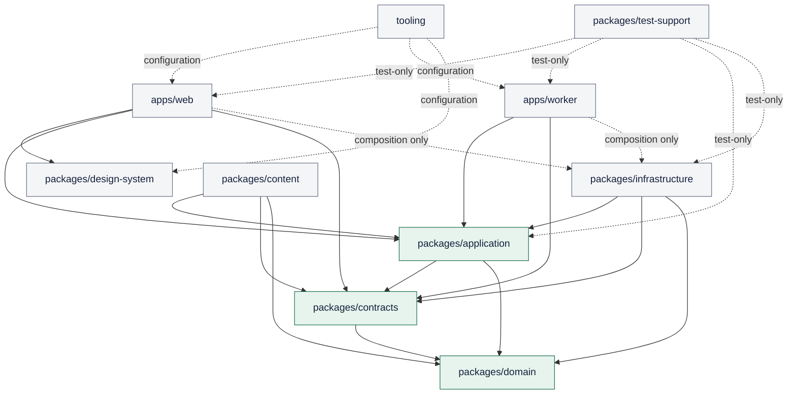

# Bestehen / App — Technology Stack and Repository Strategy

> **Stage:** 03 of 28
>
> **Status:** Accepted architecture baseline
>
> **Decision owner:** Architecture
>
> **Applies to:** implementation repository, learner web runtime, worker runtime, persistence, object storage, build/test toolchain and initial deployment topology
>
> **Last verified:** 2026-08-23

## 1. Purpose and decision summary

This document selects the smallest implementation stack and repository shape that can preserve the accepted evidence, accessibility, privacy, recovery and low-operations contracts. It is a technology baseline, not a request to scaffold packages or provision services.

The baseline is one private TypeScript monorepo containing a Next.js responsive web application, one Node.js background worker, pure domain/application packages and provider adapters. Both processes use one managed PostgreSQL 18 database; Kysely is the thin typed SQL access layer and `pg-boss` provides a durable PostgreSQL-backed job queue. Approved media and temporary processor inputs use a private Cloudflare R2 EU-jurisdiction bucket through a narrow S3-compatible storage port. Initial production hosting is one Render Frankfurt web service, one Render Frankfurt background worker and one Render Frankfurt managed PostgreSQL database. One repository, one language, one transactional database and no cache/broker service are deliberate reductions in solo-maintainer burden.

The version baseline is Node.js 24 LTS, pnpm 11, TypeScript 5.9 and Next.js 16 Active LTS. Exact patches are pinned when implementation starts. TypeScript 6 and pnpm 12 are not adopted while their current transition/release status adds avoidable churn. The browser release contract remains current and current-previous major Chrome/Edge, Firefox and Safari; Next's lower compile target is not the product support promise.

No microservices, Kubernetes, streaming platform, Redis, warehouse, multi-region topology, public internal packages, billing system or production provider account is introduced here. Identity, AI/speech evaluation, notifications, monitoring vendors and their exact data-processing choices remain owned by later stages. This document changes no product, design or production application source.

## 2. Inputs, continuity and authority

### 2.1 Immutable repository inputs

Every required input was fetched from current `main` before deciding. The App had no Stage 03 output or partial Stage 03 checklist state to reconcile.

| Repository / commit | Path | Blob SHA | Stage-03 use |
|---|---|---|---|
| `m-elsharkawi/Bestehen-Shaping@9f37ad78fdd101b3c9cb8782ddc54d12dbce1fdc` | `app/28-bestehen-app-product-specification.md` | `18ae80cc2fd63cecd76c297c3e56d44a68367856` | Final product authority; evidence, activity, failure and runtime requirements |
| same | `app/25-business-model-and-product-boundaries.md` | `904ae20e8cb3f9f354d6505513821e86f609622b` | Private-first, no billing, low-cost and provider-fallback posture |
| same | `app/26-platform-accessibility-nonfunctional.md` | `8137091683941b0d55f3d4fb90af3c402b8371e5` | Responsive-web, browser, accessibility, checkpoint and degradation contracts |
| `m-elsharkawi/Bestehen-App@b8924677b0750e6507f9e50467dbd69465c94a64` | `Design/DESIGN-HANDOFF.md` | `417a6820037e045e2dd9f29afc42b9f2e94fd638` | Semantic UI, responsive/a11y intent and implementation handoff constraints |
| same | `Design/Bestehen-03-Desktop-Responsive.dc.html` | `94056db181b45298a759ff727ad5cfeac2f2a469` | Large-screen layout strengths; design reference only |
| same | `Design/support.js` | `cb009b69ec6b5e00f48c6287a587fe7e0c6c421b` | Rendering insight only; explicitly not a framework/runtime mandate |
| same | `Architecture/00-architecture-shaping-plan.md` | `b263c5e7b3bccc0450ddd17aa0cc007432d672b7` | Stage route, output, constraints and ADR convention |
| same | `Bestehen_App_Architecture_Checklist.md` | `cef55d1ab4e0b75b1712be7a876294a9353ad243` | Live Stage 03 acceptance state before this write |
| same | `Architecture/01-architecture-charter-and-quality-attributes.md` | `cc8d28816f43d627861d11cd90e8770c4c96414c` | Accepted evidence, quality, cost and operability posture |
| same | `Architecture/02-system-context-and-product-boundaries.md` | `046d114bbbc96528bf0b9eae0406c0235f759127` | Accepted authority, trust zones, processors and runtime/offline split |
| same | `prompts/architecture/03_decide_technology_stack_and_repository_strategy.txt` | `5953dc205808a36144ebcde8b11001c971aa5263` | Authoritative Stage 03 execution contract |

Stage 01 is accepted at App commit `893a8c104471f0e3af23962f9066b7a60e92eb36`; Stage 02 is accepted at current App head `b8924677b0750e6507f9e50467dbd69465c94a64`. ADR-0001 through ADR-0005 remain Accepted and unchanged.

### 2.2 Authority and source differences

The authority order from the accepted plan is applied: final App specification; detailed App shaping with Stage 27 precedence; Identity; Product Overview; consistent human-authored design; illustrative runtime last.

| Exact source difference | Resolution |
|---|---|
| `Design/support.js` includes a React rendering support runtime. | It proves only that the illustrative design can render through React-related tooling. It is neither shipped production code nor a reason to select Next.js. The framework is selected against product and architecture criteria; design files remain read-only reference assets. |
| The desktop `.dc.html` naturally emphasizes large-screen composition while the product requires phone-first daily use. | One responsive web application serves both. Package boundaries must not create separate phone/desktop products; tests cover 320px reflow and the large-screen Writing/readiness/mock strengths. |
| Design copy and flows simplify some diagnostic, readiness and Pending timing semantics resolved by the final product and Stages 01–02. | Technology may render those projections but cannot re-author them. Domain rules and accepted structured observations live outside UI/provider packages. |

No contradiction requires an owner decision. No fixed euro budget is inferred: official providers publish USD prices and the owner has not supplied a spending ceiling.

## 3. Selection method and official evidence

### 3.1 Criteria and weights

Alternatives are scored from 1 (poor) to 5 (strong). The weighted total is out of 500. Weight follows the accepted priority order: evidence/accessibility/security before convenience and cost.

| Criterion | Weight | Meaning in this product |
|---|---:|---|
| Product and evidence fit | 22 | Server authority, explicit Pending, idempotent submissions, deterministic/domain-first behavior |
| Accessibility and browser fit | 14 | Semantic HTML, focus/live regions, 320px reflow, current/current-previous family testing |
| Operability and failure isolation | 18 | Solo operation, backups, bounded jobs, local degradation, few independently operated systems |
| Portability and exit | 14 | Standard runtime/data/protocols, exportability, low provider coupling |
| Security and support lifetime | 14 | Maintained LTS lines, patch path, secrets/data boundaries and dependency controls |
| Cost sustainability | 12 | Low recurring baseline, useful free development path and variable-cost controls |
| Developer/tooling fit | 6 | One language, testability, type feedback and repository ergonomics |

### 3.2 Weighted alternative matrix

The matrix compares coherent stack/topology choices, not isolated popularity. Supporting claims use current official primary sources, all accessed **2026-08-23**.

| Alternative | Product 22 | A11y 14 | Ops 18 | Exit 14 | Security 14 | Cost 12 | DX 6 | Weighted total / 500 | Decision |
|---|---:|---:|---:|---:|---:|---:|---:|---:|---|
| **A. Next.js/Node + PostgreSQL + PG jobs; Render + private R2** | 5 | 5 | 4 | 4 | 4 | 4 | 5 | **436** | **Selected**: strongest fit with one origin, one database and replaceable managed infrastructure |
| B. React Router framework + custom Node server + same data/services | 4 | 5 | 3 | 5 | 4 | 4 | 4 | 404 | Credible exit; more server/render/build wiring without a current product benefit |
| C. Vite SPA + separate REST API/worker + same data/services | 3 | 5 | 3 | 5 | 4 | 4 | 4 | 382 | Portable, but creates a second independently deployed runtime/origin and more auth/cache/error plumbing |
| D. Next.js on Vercel + external database/object/worker providers | 5 | 5 | 3 | 3 | 4 | 2 | 5 | 368 | Excellent framework integration, but a persistent worker and database still require other providers; higher fragmented baseline |
| E. Cloudflare Workers + D1 + Queues + R2 | 3 | 4 | 4 | 2 | 4 | 5 | 4 | 362 | Low idle cost, but platform-specific runtime/data semantics and provider concentration raise exit/evidence risk |
| F. Static-only/local-browser app (“do nothing” backend) | 1 | 4 | 5 | 5 | 2 | 5 | 3 | 340 | Cheapest, but cannot provide durable cross-device facts, controlled processor jobs, governed correction/export/delete or reliable evidence history |

Evidence behind the matrix:

- Next.js 16 is Active LTS under the official [support policy](https://nextjs.org/support-policy); its [Node deployment](https://nextjs.org/docs/app/getting-started/deploying) supports all framework features and its [platform deployment guidance](https://nextjs.org/docs/app/guides/deploying-to-platforms) permits a single `next start` origin. The [version-16 upgrade guide](https://nextjs.org/docs/app/guides/upgrading/version-16) sets Node.js `20.9+`, TypeScript `5.1+`, Chrome/Edge/Firefox 111+ and Safari 16.4+ as framework floors. These are floors, not Bestehen's browser support window.
- React Router's official [framework modes](https://reactrouter.com/start/modes) and [rendering strategies](https://reactrouter.com/start/framework/rendering) can provide SPA, SSR and static rendering; Vite's official [build](https://vite.dev/guide/build) and [static deployment](https://vite.dev/guide/static-deploy) guides make it a viable split-client alternative.
- Vercel's [Pro plan](https://vercel.com/docs/plans/pro-plan) currently starts with a USD 20/month platform fee; it does not remove the need for a durable database and continuously consuming worker in this design.
- Cloudflare's [Workers pricing](https://developers.cloudflare.com/workers/platform/pricing/) starts at USD 5/month and its [D1 pricing](https://developers.cloudflare.com/d1/platform/pricing/) is usage-based. The low cost is credible, but the chosen architecture values PostgreSQL portability and conventional long-running Node worker semantics more highly.

Scores are architecture judgment, not vendor benchmarks. Re-score when a measured trigger in §11 fires.

## 4. Accepted technology decisions

### 4.1 Frontend, server and language — `ARCH-S03-D01`

Use **Next.js 16 Active LTS** with React and the App Router for one responsive web application and same-origin server/BFF routes. Use **Node.js 24 LTS** for both web and worker processes and **TypeScript 5.9** in strict mode across production and test code.

Why:

- A single origin avoids a separate browser-facing API deployment, CORS surface and duplicate release coordination while preserving server authority.
- React/Next can produce semantic HTML and does not require bespoke accessibility forks. Server rendering and progressive enhancement can improve first navigation, but no scoring/evidence command depends on client-only state.
- Node across web and worker keeps contracts, validation, domain rules and operational skills in one language.
- The Node project lists 24 as an LTS line in its official [release schedule](https://nodejs.org/en/about/previous-releases); production uses only an LTS line and upgrades before its published end of life. The exact Node 24 patch is pinned from the official [v24 archive](https://nodejs.org/en/download/archive/v24).
- TypeScript [5.9](https://www.typescriptlang.org/docs/handbook/release-notes/typescript-5-9.html) is the stable baseline already proven across the surrounding toolchain. TypeScript [6.0](https://www.typescriptlang.org/docs/handbook/release-notes/typescript-6-0.html) contains deliberate compatibility/deprecation changes; adoption waits for a clean framework, types, build and test compatibility run.

Rules:

- Server Components are allowed for read-oriented composition; interactive and browser-capability paths use explicit client boundaries. Framework caches never store learner truth or authorize stale evidence decisions.
- Route handlers translate transport contracts to application use cases; they do not contain scoring or Readiness rules.
- Avoid framework-specific persistence APIs and edge-only runtime assumptions. The deployable baseline is the standard Node runtime and Next standalone-compatible output.
- No native mobile application or separate desktop build is created. If browser capability is missing, only the affected activity is ineligible or degraded, per Stage 02.

### 4.2 Database and access layer — `ARCH-S03-D02`

Use one managed **PostgreSQL 18** database as the authoritative server store. Use **Kysely** plus the standard PostgreSQL driver as a thin, type-safe query builder and migration runner. SQL remains visible and reviewable; there is no generated ORM client.

Why:

- PostgreSQL provides ordinary transactions, constraints, indexing, JSON only where justified, and portable logical backup. The project supports each major for five years; its official [version policy](https://www.postgresql.org/support/versioning/) currently supports PostgreSQL 18 through November 2030. Pin the current 18.x minor and apply security/bugfix minors promptly after test/restore evidence.
- Kysely describes itself as a thin type-safe SQL query builder, provides a migration primitive and supports PostgreSQL in its official [repository](https://github.com/kysely-org/kysely) and [API documentation](https://kysely-org.github.io/kysely-apidoc/). Its low abstraction preserves a direct SQL/provider exit.
- Prisma remains a credible generated-client alternative; its official [ORM documentation](https://www.prisma.io/docs/orm) adds a larger code-generation/migration abstraction. Drizzle's official [v1 beta release notes](https://orm.drizzle.team/docs/latest-releases/drizzle-orm-v1beta2) still warn of breaking changes. Neither provides enough current benefit to outweigh transition surface.
- SQLite is valuable for local/single-writer cases, but its own [appropriate-use guidance](https://www.sqlite.org/whentouse.html) recommends client/server databases where many clients write over a network. Web and worker are concurrent writers; browser-local offline state remains a separate later-stage choice.

Migration contract:

- Version-controlled, forward-only migration files and reviewed SQL are the source of schema evolution. Do not use unreviewed schema `push` behavior in shared or production environments.
- CI applies the complete migration chain to an empty PostgreSQL 18 database and exercises supported upgrade fixtures. Production uses one pre-deploy migration runner, a database backup/restore point, backward-compatible expand/contract changes and roll-forward repair.
- Stage 05 owns exact tables, indexes, constraints, retention fields and migration compatibility. Stage 03 only fixes the engine/access posture.

### 4.3 Background jobs — `ARCH-S03-D03`

Use **pg-boss** in the same PostgreSQL database and one separately deployed Node worker. Web requests transactionally record accepted facts and enqueue bounded work; worker handlers validate a versioned job contract, are idempotent and apply domain effects once. Provider marketing such as “exactly once” never replaces application idempotency.

The official [pg-boss repository](https://github.com/timgit/pg-boss) documents PostgreSQL-backed reliable jobs using `SKIP LOCKED`, retries, cron, dead-letter behavior and Node/PostgreSQL requirements. Its [job API](https://github.com/timgit/pg-boss/blob/master/docs/api/jobs.md) exposes retry/expiration/retention controls.

This avoids a Redis/BullMQ service and enables atomic fact-plus-job creation. Inline-only synchronous processing is rejected because productive evaluation must survive request timeout/provider outage and become truthful Pending. A managed proprietary queue remains an exit if PostgreSQL job load measurably harms learner transactions.

The worker is allowed to be temporarily unavailable: submissions/checkpoints remain durable, dependent evidence stays Pending and unrelated activities continue. Retry budgets, dead-letter operator actions, job versioning and service objectives are owned by Stage 12 and Stages 17–19.

### 4.4 Object and media storage — `ARCH-S03-D04`

Use one **private Cloudflare R2 Standard EU-jurisdiction bucket** through an App-owned minimal S3-compatible object-storage port. PostgreSQL stores authoritative metadata, ownership, rights status, lifecycle state and checksums; object storage holds bytes only. Use opaque/versioned keys, short-lived signed access, no public learner-upload bucket and no bucket event as domain truth.

Official evidence, accessed 2026-08-23:

- [R2 pricing](https://developers.cloudflare.com/r2/pricing/) currently includes 10 GB-month Standard storage, 1 million Class A and 10 million Class B operations monthly, then lists USD 0.015/GB-month, USD 4.50/million Class A and USD 0.36/million Class B, with no R2 egress charge.
- [Data location](https://developers.cloudflare.com/r2/reference/data-location/) states an EU jurisdiction bucket stores and processes object data in the EU; jurisdiction is immutable, so the bucket is created correctly rather than converted later.
- R2 documents an [S3-compatible API](https://developers.cloudflare.com/r2/api/s3/api/) with unsupported features explicitly listed, [private-by-default buckets](https://developers.cloudflare.com/r2/buckets/public-buckets/), bearer-like [presigned URLs](https://developers.cloudflare.com/r2/api/s3/presigned-urls), and [strong object consistency](https://developers.cloudflare.com/r2/reference/consistency/). Code uses only the tested portable subset.
- R2's [durability guidance](https://developers.cloudflare.com/r2/reference/durability/) explicitly says object storage is not a substitute for backup or availability design.

Raw learner audio remains ephemeral: upload only for the deliberate speech job, restrict scope/TTL, delete after the accepted result or terminal failure window, and never include it in ordinary logs/backups. Stage 18/23 defines the exact TTL and deletion evidence. Approved static media may be content-addressed and long lived where rights allow.

Exit: enumerate manifest/checksum metadata from PostgreSQL and copy through the S3-compatible port to AWS S3, Backblaze B2 or self-hosted S3-compatible storage; dual-write is introduced only during a validated migration. A cheaper tiny-scale fallback is to avoid persistent raw media entirely and ship small rights-approved static assets in the application build; the R2 free allowance covers the initial private baseline without becoming a product entitlement.

### 4.5 Hosting and deployment topology — `ARCH-S03-D05`

Use **Render Frankfurt** as the initial managed deployment baseline:

1. one Node web service running the Next.js production server;
2. one Node background worker consuming pg-boss jobs;
3. one managed PostgreSQL 18 database on the same regional private network; and
4. the separate private R2 EU bucket for object bytes.

Render's official [regions](https://render.com/docs/regions) include Frankfurt and state services communicate privately within a region; a service's region cannot be changed in place. Its [PostgreSQL guide](https://render.com/docs/postgresql-creating-connecting) supports PostgreSQL 13–18 and same-region private connections. [Background workers](https://render.com/docs/background-workers) are continuously running services for asynchronous work. Pin Node with the mechanism in Render's [Node version documentation](https://render.com/docs/node-version) rather than relying on a mutable default.

Use native Node builds initially with exact Node/pnpm versions and the committed lockfile; produce Next's standalone-compatible output. Stage 26 owns the actual Render Blueprint, health checks, release command, secrets, backups and rollback. An OCI image is not required until an OS dependency, provider exit or build drift demonstrates need; the same Node entry points must remain containerizable.

Single instance per process is the launch default. Next's [self-hosting guidance](https://nextjs.org/docs/app/guides/self-hosting) notes that multiple instances require coordinated cache/version considerations. Learner truth is never stored in a process cache. Before horizontal web scaling, Stage 26 must prove shared-cache/version-skew behavior or disable the affected cache features.

The Render free tier is development/disposable preview only. Official [free-instance limits](https://render.com/docs/free) include sleep/spin-up behavior, ephemeral filesystems and an expiring free PostgreSQL database without production backup; durable learner evidence must never depend on it.

### 4.6 Repository strategy and contracts — `ARCH-S03-D06`

Use one **private pnpm workspace monorepo**. It provides atomic changes across domain, contracts, web and worker without publishing internal packages or coordinating cross-repository versions. pnpm's official [workspace documentation](https://pnpm.io/workspaces) provides built-in monorepo support and the `workspace:` protocol for guaranteed local resolution.

Do not add Turborepo/Nx initially. Workspace scripts and pnpm filters are sufficient until measurement shows the build graph needs remote caching or orchestration.

## 5. Repository and dependency design

### 5.1 Intended top-level modules

These are implementation boundaries for later stages, not directories to scaffold in Stage 03.

| Boundary | Owns | May depend on | Must not own/import |
|---|---|---|---|
| `apps/web` | Next pages/layouts, accessible UI composition, same-origin route handlers, browser capability/checkpoint adapters | application, contracts, design-system, infrastructure composition root | scoring/readiness rules; provider SDK calls; raw SQL |
| `apps/worker` | job consumers, scheduler entry point, process health and infrastructure composition | application, contracts, infrastructure | UI; independent semantic rules; direct result-to-readiness mutation |
| `packages/domain` | pure facts, value objects, evidence/readiness state machines, deterministic rule interfaces and version identifiers | no workspace package | Next/React, database, network, clock/random globals or provider SDKs |
| `packages/application` | use cases, ports, transactions, idempotency/orchestration, authorization intent | domain, contracts | framework route objects; concrete provider/database clients |
| `packages/contracts` | runtime API/job/bundle schemas, discriminated failure/Pending states, compatibility fixtures | domain primitives only where unavoidable | UI components; infrastructure clients; duplicate domain computation |
| `packages/infrastructure` | Kysely/PostgreSQL repositories and migrations, pg-boss, R2 and later provider adapters | application ports, contracts, domain types | learner-facing copy; new semantic rules |
| `packages/content` | approved bundle/import validation, stable IDs, rights/lineage/checksum manifests | application, contracts, domain | Corpus raw ingestion/search; learner state |
| `packages/design-system` | semantic tokens, accessible primitives, layout/focus/live-region utilities | third-party UI primitives admitted by policy; otherwise domain-free | Readiness/scoring/evidence meaning; design runtime files |
| `packages/test-support` | deterministic builders, fakes, contract fixtures and test harnesses | any package under test | imports from production entry points; real learner/provider secrets |
| `tooling` | shared build/lint/type/test configuration | package-manager tooling only | production runtime code or secrets |

There is no `shared`, `common` or `utils` dumping ground. A new package requires a named owner, stable responsibility, permitted dependency direction and at least two real consumers or an isolation/security reason.

### 5.2 Dependency diagram

All arrows point toward allowed dependencies. `packages/domain` has no workspace dependency. Infrastructure is injected only at application composition roots. CI later enforces forbidden imports; a diagram alone is not a boundary.

### 5.3 Shared and generated artifacts

- Hand-authored domain/transport schemas, migration source and semantic design tokens are authoritative.
- API, job and Corpus bundle contracts carry explicit major/minor version fields and compatibility fixtures. Consumers accept only documented compatible versions and preserve provider/contract/rule lineage.
- OpenAPI/JSON Schema/client artifacts may be generated deterministically from the authoritative contract only when a real cross-process consumer needs them. A generated file has a header, generator/version/command, is never hand-edited and is either committed with a CI regenerate-and-diff check or generated entirely in the build—never an ambiguous mixture.
- Kysely removes the need for a generated ORM client. Database types may be hand-maintained beside repositories or deterministically generated later; if generated, migrations remain authority and CI detects drift.
- Build output, local databases, secrets, downloaded browser binaries, recordings and learner fixtures are ignored. Large content/media bytes are not Git history; manifests, stable IDs, checksums, rights/lineage metadata and small licensed fixtures are.
- `Design/*.dc.html` and `Design/support.js` remain reference-only, read-only inputs. They are never imported into production, copied as framework configuration or treated as generated source.
- Internal packages are `private` and use `workspace:` resolution. Do not publish them to npm until an independently versioned external consumer exists.

## 6. Toolchain and environments

### 6.1 Toolchain table

| Concern | Baseline | Architecture rule / evidence |
|---|---|---|
| Runtime | Node.js 24 LTS, exact patch pinned in repository and deployment | One runtime line for web/worker/CI; upgrade before EOL and after compatibility/security validation ([Node releases](https://nodejs.org/en/about/previous-releases), accessed 2026-08-23) |
| Package/workspace | pnpm 11 stable, exact patch in `packageManager`; one root `pnpm-lock.yaml` | Frozen install in CI/deploy; `workspace:` for internal dependencies. Do not adopt pnpm 12 release candidate. ([installation](https://pnpm.io/installation), [workspaces](https://pnpm.io/workspaces), accessed 2026-08-23) |
| Language/type | TypeScript 5.9 strict; project references or equivalent package-level checks | No unchecked boundary payloads; schema validation is runtime, types are compile-time |
| Framework/build | Next.js 16 Active LTS; standard Node/standalone-compatible output | One same-origin web deploy; no edge-only dependency; `next build` plus explicit checks |
| Formatting/lint | Biome 2, exact version pinned; add a narrow specialist rule only when Biome lacks a release gate | Biome recommends exact package-manager pinning and shared config ([getting started](https://biomejs.dev/guides/getting-started/), [configuration](https://biomejs.dev/guides/configure-biome/), accessed 2026-08-23) |
| Unit/component | Vitest 4 + React Testing Library | Pure domain/property examples and user-observable component behavior; no implementation-detail snapshots. Official [Vitest guide](https://v4.vitest.dev/guide/) and [React Testing Library](https://testing-library.com/docs/react-testing-library/intro/), accessed 2026-08-23 |
| Browser/a11y | Playwright current supported release, Chromium/Firefox/WebKit projects; automated axe checks plus manual keyboard/screen-reader verification | Pin runner and browser binaries together. Official [browser matrix](https://playwright.dev/docs/browsers) covers Chromium, Firefox, WebKit and mobile emulation; automation does not prove WCAG conformance (accessed 2026-08-23) |
| Integration | Real ephemeral PostgreSQL 18 in local/CI; S3-port contract fake plus R2 integration in non-learner sandbox | Do not substitute SQLite for database semantics; deterministic provider fixtures by default |
| Migration | Kysely migration runner + reviewed SQL; empty-db and upgrade-path CI | Single production migration runner; expand/contract; backup/restore evidence before destructive evolution |
| Build orchestration | Root pnpm scripts and workspace filters | Add graph/cache tool only if a 30-day sample shows median clean CI above 10 minutes or redundant workspace work above 30% |
| Security/dependencies | pnpm admission controls, Dependabot, dependency review, secret scanning, lockfile/signature verification | No install scripts by default; exception is reviewed/allowlisted and time-bounded |
| Documentation | Markdown + Mermaid, decisions in `Architecture/adr` | Diagrams and source links version with code; Stage 28 consolidates status |

### 6.2 Environment classes

| Environment | Data/secrets | Infrastructure | Required evidence and prohibited use |
|---|---|---|---|
| Local | Synthetic fixtures; developer-scoped disposable credentials only | Pinned Node/pnpm; local PostgreSQL 18; storage/provider fakes by default | Full type/unit/integration subset; never copy production learner data or secrets |
| CI test | Generated synthetic data; short-lived CI credentials | Ephemeral PostgreSQL 18 and pinned Playwright browsers | Frozen install, format/lint/type, migration-from-empty, unit/integration/contract/a11y/browser gates |
| Preview | Synthetic seeded identities/data; no production secrets/provider datasets | Disposable web/worker/DB where the change requires them | Smoke/e2e/review only; free expiring DB is allowed only because no durable learner evidence exists |
| Production | Minimum learner data; managed secret references; private DB/object access | Paid durable Render services + R2 EU bucket | Backup/restore, health/rollback and least-privilege evidence; no shell-local secret files |

Configuration is validated at process start. Public browser configuration uses an explicit allowlist; all credentials and processor endpoints are server-only. Secrets are referenced from the deployment secret store, never committed, baked into output, echoed to CI logs or exposed through `NEXT_PUBLIC_*`. Stage 23 owns the secrets threat model/rotation; Stage 26 owns actual environment and release configuration.

## 7. Dependency, support and supply-chain policy — `ARCH-S03-D07`

### 7.1 Admission

A runtime dependency is admitted only when it has a named capability, maintained upstream, compatible license/rights review, support/security path, acceptable transitive/install behavior, no avoidable learner-data egress and lower whole-life cost than a small local implementation. Record owner, pinned range, alternatives and removal path in the pull request. Provider SDKs exist only in infrastructure adapters.

Prefer platform APIs and small focused packages. Reject abandoned packages, unpinned Git/tarball URLs, duplicate libraries, native binaries without a supported build/patch path, packages requiring unexplained install scripts and packages that silently send telemetry. A dependency cannot author evidence semantics merely because it is typed or convenient.

### 7.2 Reproducibility and provenance

- Commit one root `pnpm-lock.yaml`; CI/deploy use frozen lockfile and exact Node/pnpm tool versions. A lockfile change is reviewed as code.
- pnpm 11's official [supply-chain security controls](https://pnpm.io/supply-chain-security) disable dependency lifecycle scripts unless allowlisted and support minimum release age, exotic-source blocking and trust policies. Set a minimum release age of at least seven days for ordinary packages, with a documented emergency/security exception; block exotic transitive sources; allowlist only required build scripts.
- Verify npm registry signatures/provenance where available with the official [`npm audit signatures`](https://docs.npmjs.com/generating-provenance-statements/) path. Provenance is evidence, not proof of safe behavior.
- Enable GitHub [Dependabot](https://docs.github.com/en/code-security/tutorials/secure-your-dependencies/dependabot-quickstart) for small scheduled groups and the official [dependency review action](https://docs.github.com/en/code-security/how-tos/secure-your-supply-chain/manage-your-dependency-security/configure-dependency-review-action) for pull requests. Stage 25 owns the concrete CI/security policy.
- No internal package is published initially; npm trusted publishing is therefore unnecessary. If publishing becomes real, use npm's official [trusted publishing](https://docs.npmjs.com/trusted-publishers/) rather than long-lived tokens.

### 7.3 Updates and support window

- Security fixes: triage on notification; critical exploitable issues receive immediate isolated update/mitigation and evidence. Ordinary patch/minor updates are grouped at least monthly. Framework/runtime/database majors are deliberate migration changes, never automatic production merges.
- Stay on Node LTS, Next Active/Maintenance LTS and a PostgreSQL supported major. Begin upgrade evaluation six months before upstream support ends; complete production migration at least three months before end of support.
- Pin exact tool patches while permitting only reviewed lockfile changes. Update Playwright and its browser binaries together.
- Browser product support is current and current-previous major Chrome/Edge, Firefox and Safari. CI continuously exercises Chromium, Firefox and WebKit, mobile and 320px layouts; a current-previous stable smoke lane is added where the CI image permits. Capability detection, not user-agent inference, gates activity-specific APIs.

## 8. Cost, operations and exit risks

Official prices and quotas below were accessed **2026-08-23**, are mutable, generally exclude tax/currency conversion and are not a spending commitment. Verify them again before provisioning. No invented euro budget is used.

| Component | Current official baseline / limit | Cost and operational trigger | Cheaper fallback | Exit / lock-in control |
|---|---|---|---|---|
| Render web service | Starter currently USD 7/month on [pricing](https://render.com/pricing); free web sleeps after inactivity under [free limits](https://render.com/docs/free) | Start paid when any real learner relies on availability. Scale only after 14-day p95 CPU >70%, memory >80%, or latency SLO breach attributable to capacity | Free instance for synthetic/disposable previews; local development | Standard Node server/standalone output; move to Fly.io/Railway/container host. No Render-only application API |
| Render worker | Starter compute currently USD 7/month on [pricing](https://render.com/pricing) | Start paid with productive async evaluation. Scale/split only when oldest eligible job exceeds Stage-12 SLO from capacity for 7 days | Run worker only in controlled private windows before productive providers exist; inline deterministic work remains in web transaction | Standard Node process + pg-boss. Move unchanged worker near PostgreSQL or replace queue behind application port |
| Render PostgreSQL | Basic-256mb currently USD 6/month plus USD 0.30/GB-month storage on [pricing](https://render.com/pricing) / [flexible plans](https://render.com/docs/postgresql-refresh) | Paid database before durable learner evidence. Upsize after sustained memory/CPU/storage/connection evidence or restore window misses SLO | Disposable free DB only for synthetic preview; never learner truth | Portable PostgreSQL schema and `pg_dump`; periodic off-provider logical export and restore test. [Backups/PITR](https://render.com/tutorials/postgres-on-render/backups-and-pitr) remain provider-local and deletion removes backups |
| Cloudflare R2 Standard EU | 10 GB-month, 1m Class A, 10m Class B monthly free; then USD 0.015/GB-month, USD 4.50/million A and USD 0.36/million B on [R2 pricing](https://developers.cloudflare.com/r2/pricing/) | Review lifecycle/caching or provider when storage/operations exceed free allowance for 3 months, object cost >25% of monthly infrastructure, or access SLO misses | Persist no raw audio; bundle small approved static media with the application where rights permit | Portable tested S3 subset, PG manifest/checksum authority, bulk copy to S3/B2/MinIO |
| Next.js/Node/TypeScript/pnpm/Kysely/pg-boss | Open-source software; no per-request license fee established by these selections | Upgrade on support/security/compatibility triggers; operations cost is CI and maintainer time | Remove optional abstraction/tool before adding another service | Standard JS/TS, SQL, PostgreSQL and HTTP; contracts/domain avoid framework/provider imports |

The selected minimum paid baseline at current list prices is approximately **USD 20/month plus PostgreSQL storage, R2 overage, tax and any later processor/monitoring cost**. This arithmetic is a comparison, not a budget. The owner must approve actual accounts/spend in Stage 26. Free tiers are fallback/development affordances, never availability, retention or production evidence guarantees.

Render's [backup/PITR documentation](https://render.com/tutorials/postgres-on-render/backups-and-pitr) currently describes plan-dependent retention. Stage 26 must create an off-provider logical-export schedule and quarterly restore drill because provider-local backup is not an exit plan.

## 9. Accessibility, failure and cross-cutting implications

### 9.1 Accessibility and browser behavior — `ARCH-S03-D08`

- Semantic native elements are the default. The design-system package owns accessible primitives, focus restoration, status/live-region patterns, reduced-motion behavior and target sizing; it never hides evidence meaning behind color alone.
- Every asynchronous transition has a visible text state and appropriate live announcement without moving focus unexpectedly. Pending remains a domain/contract state, not a spinner timeout.
- Server-rendered markup and hydration must preserve logical reading/tab order. CSS layout, not duplicated DOM by breakpoint, provides phone/desktop composition. Required 320px reflow and zoom testing are release evidence.
- Browser APIs for recording, IndexedDB, notifications or storage are capability-detected and have equivalent/narrower paths. A missing microphone cannot block Reading/Writing/Listening work or globally label the learner.
- Playwright/axe catches regressions but does not certify WCAG 2.2 AA; Stage 14/25 owns manual keyboard, screen-reader, zoom/reflow, contrast and real-device evidence.

### 9.2 Failure and recovery

| Failure | Truthful behavior | Recovery / exit evidence |
|---|---|---|
| Web process restart/deploy | Durable accepted facts remain in PostgreSQL; browser retains eligible draft/checkpoint and retries idempotently | Health check + resume test; no process memory as truth |
| Worker/provider unavailable | Submission is durable; dependent result remains Pending; unrelated practice continues | Queue age/retry/dead-letter evidence; replay same contract idempotently or substitute adapter |
| PostgreSQL unavailable | No command is acknowledged as durable; read-only cached/static shell may explain outage without inventing current evidence | Managed recovery, connection backoff, backup restore drill; migrate by logical dump/replication plan |
| R2 unavailable | Text/non-media work continues; only required media activity is unavailable/degraded; metadata does not claim byte availability | Checksum inventory, retry/copy from source/backup where rights allow, S3-provider migration |
| Identity unavailable | Anonymous/local first use continues; account sign-in/sync waits | Stage 20 link/merge retry; replace identity adapter |
| Render regional outage | No multi-region promise; honest interruption/Pending, browser drafts and recovery from managed/off-provider backup | Stage 26 recovery objective and restore/runbook. Add another region/provider only after measured availability need justifies semantic/ops cost |
| Dependency/security incident | Freeze affected release, disable optional adapter/capability, patch from reviewed lockfile change | SBOM/dependency inventory, signature/provenance evidence, rollback or adapter removal |

### 9.3 Data, API, state and versioning consequences

- PostgreSQL is server truth for learner facts, accepted projections, content/media metadata, job state and audit lineage. R2 and provider systems never become independent semantic stores.
- Browser local state is a checkpoint/replica with explicit sync status; Stage 20/21 defines its database and merge behavior. It cannot silently overwrite accepted server facts.
- Every mutation has an idempotency identity, expected version where concurrency matters and discriminated result (`accepted`, `pending`, `conflict`, `incompatible`, `unavailable`, or validation rejection). Exact API shape belongs to Stage 12.
- Job payloads reference immutable response/content/rule/contract versions rather than copying mutable learner profiles. Processor results are validated, carry provider/model/release lineage and are accepted once.
- Database migrations, API/job/bundle contracts, content revisions and rule versions evolve independently but retain explicit compatibility relationships. Unknown incompatible majors quarantine only the dependent input/capability.
- Account-optional behavior means infrastructure cannot assume an identity-provider subject is the learner primary key. Stage 20 owns anonymous-to-account adoption.
- Raw audio and secrets do not enter general telemetry, fixtures, build artifacts or backups. Rights status controls media availability independently of byte existence.

## 10. Deliberate deferrals and owners

Stage 03 fixes ports and constraints, not vendors that require domain-specific benchmark/privacy decisions.

| Deferred choice | Required default boundary now | Named owner stage | Decision evidence required later |
|---|---|---:|---|
| Speech recording/transcription, TTS/partner audio, pronunciation and productive evaluation providers/models | Purpose-specific server adapter; minimum payload; bounded call; ephemeral raw audio; structured portable result; deterministic/cached/Pending fallback | 16–19, especially 19 provider evaluation | German B1 benchmark, modality fidelity, latency/cost, data-use/retention/residency terms, accessibility and substitution test |
| Generative AI/model provider | No runtime call where deterministic/cached content suffices; no provider output is semantic truth | 19 and 23 | Bounded use case, quality/safety benchmark, spend cap, terms/privacy review, outage/cached fallback |
| Identity provider and browser local database | Anonymous first use; App-owned learner mapping; provider proves authentication only | 20 and 23 | Linking/merge/delete/export/recovery model, security/privacy terms, offline/conflict evidence and cost |
| Notification transport/channel | Optional best effort; generic minimum-sensitive payload; App owns eligibility/copy/preferences | 22 and 23 | Opt-in/time-zone/cap policy, delivery/privacy/cost comparison and no-notification fallback |
| Monitoring/error/analytics vendors | OpenTelemetry-compatible/internal interfaces where practical; scrubbed/minimized events; no raw response/audio | 24 and 26 | Signal/SLO need, retention/access/redaction, regional/privacy terms, price/quotas and provider-off switch |
| CI host, container registry, exact Render Blueprint, domains/TLS/CDN and off-provider backup target | Reproducible pinned build; standard Node processes; PostgreSQL/R2 exits; managed secrets | 25 and 26 | Release/rollback/restore evidence, account spend approval and operating runbooks |

No downstream stage may treat a named deferred vendor as implicitly approved. If its evidence fails, the valid fallback is capability-local degradation or no provider, not weaker learner truth.

## 11. Decision registry, dependencies and review triggers

| ID | Accepted decision | Main alternatives rejected | Dependencies / consumers | Measured review or exit trigger | ADR |
|---|---|---|---|---|---|
| `ARCH-S03-D01` | Next.js 16 + Node 24 LTS + TypeScript 5.9, one same-origin responsive web app | React Router/custom server; Vite SPA + API; static-only | 04–08, 12–21, 25–28 | LTS/EOL; critical unmitigated issue; framework prevents release-grade a11y/browser behavior; split only with measured independent deployment need | [ADR-0006](adr/ADR-0006-typescript-nextjs-modular-monorepo.md) |
| `ARCH-S03-D02` | PostgreSQL 18 + Kysely; migrations/SQL remain explicit | Prisma; Drizzle beta; SQLite | 05–08, 11–13, 20, 23–26 | Six months before support end; restore/SLO failure; Kysely blocks required SQL or becomes unmaintained—replace access adapter, retain SQL/data | [ADR-0007](adr/ADR-0007-postgresql-authority-and-durable-jobs.md) |
| `ARCH-S03-D03` | pg-boss + one Node worker in same PostgreSQL | Inline-only; Redis/BullMQ; proprietary queue | 05, 12, 17–19, 24, 26 | Queue work causes learner DB SLO breach, oldest-job SLO misses 7 days, or security/isolation need; migrate behind job port | ADR-0007 |
| `ARCH-S03-D04` | Private R2 Standard EU bucket via portable S3 subset; PG metadata authority | App bundle only; Render disk; AWS S3 | 09, 10, 16–19, 23, 26 | Three-month overage/cost trigger; data-location/terms/security/support/SLO failure; S3 contract test failure | [ADR-0009](adr/ADR-0009-private-eu-s3-compatible-object-storage.md) |
| `ARCH-S03-D05` | Render Frankfurt web + worker + PG; paid before real learner evidence | Vercel + providers; Cloudflare platform stack; self-managed VM | 23–26, 28 | Regional/SLO/restore failure; provider cost > approved Stage-26 threshold; missing control; migrate standard Node/PG processes | [ADR-0008](adr/ADR-0008-render-single-region-managed-deployment.md) |
| `ARCH-S03-D06` | Private pnpm monorepo with explicit domain/application/contracts/infrastructure boundaries | Polyrepo; single undifferentiated app; heavy build orchestrator | Every implementation stage | Split repository only for separate ownership/release/security boundary; add build graph at >10m median clean CI or >30% redundant work | ADR-0006 |
| `ARCH-S03-D07` | Frozen lockfile, exact tools, guarded dependency admission/update/provenance | Floating ranges; automatic majors; no third-party deps | 23, 25, 26 | Security incident, upstream support policy, install drift or SBOM/audit gap; remove/replace dependency |
| `ARCH-S03-D08` | Semantic HTML and capability-local browser behavior; Playwright cross-browser plus manual a11y gates | Bespoke fork; Chromium-only; device-global blocking | 13, 14, 16–18, 21, 25 | Supported-family/reflow/assistive-tech release failure; change stack only after component-level remediation is disproven |

### 11.1 Principal dependencies and risks

| Risk/dependency | Consequence | Validation owner / evidence | Fallback |
|---|---|---|---|
| Next/React cache or hydration behavior obscures current learner state | Stale or inaccessible projection | Stages 12–14/25: no-cache truth tests, navigation/focus/live-region and browser matrix | Dynamic server read/client refresh; disable affected framework cache feature |
| PostgreSQL serves both truth and queue | Contention couples async work to learner commands | Stages 05/12/24: indexes, connection budgets, transaction/queue-age/latency telemetry and load test | Throttle/pause worker; separate database/managed queue only after evidence |
| Managed Frankfurt is single region | Regional outage interrupts server work | Stage 26 recovery/restore test and honest SLO | Browser checkpoint + restore/provider migration; no false multi-region promise |
| R2 S3 compatibility is incomplete | Migration or SDK feature lock-in | Stages 16/23/26: portable-subset contract tests and manifest/checksum export | Replace adapter/copy objects; avoid unsupported feature |
| New major tool lines move quickly | Upgrade/supply-chain churn | Stage 25 monthly dependency evidence; exact patches, minimum release age | Stay on supported previous line; isolate/revert lockfile update |
| Solo maintainer overload | Backups/patches/jobs silently degrade | Stages 24/26: small SLO set, alerts, restore/release runbooks and monthly cost review | Remove optional provider/capability before adding infrastructure |

## 12. Validation and handoff

### 12.1 Stage-03 validation evidence

- Required source paths, current heads and blobs were re-fetched before selection; prior Stage 01–02 outputs and ADR statuses are unchanged.
- Current official primary sources were checked on 2026-08-23 for framework/runtime support, browser floors, PostgreSQL lifetime, package/tool status, hosting regions/prices/free limits/backups, R2 pricing/location/security behavior, job behavior and dependency provenance controls.
- The weighted matrix includes the selected option, two credible implementation alternatives, provider-platform alternatives and the simplest static-only option.
- Repository dependency arrows, generated-artifact rules, toolchain/environments, provider costs/exits, accessibility, failure/recovery, data/API/state/versioning, named deferrals, risks and measurable triggers are explicit.
- Consequential choices are recorded in ADR-0006 through ADR-0009. No production code, package/config/lockfile, migration, deployable infrastructure, provider account or later-stage artifact is created.

### 12.2 Downstream handoff

- **Stages 04–08:** keep domain and deterministic rules infrastructure-free; Stage 05 designs PostgreSQL schema/migrations and idempotent facts without turning Kysely types into the domain.
- **Stages 09–10:** define versioned approved content/bundle manifests; large bytes use the storage port, never raw Corpus runtime access.
- **Stage 12:** specify same-origin API/job contracts, idempotency, Pending, retries/dead letter and failure envelopes compatible with pg-boss but not owned by it.
- **Stages 13–14/21:** implement one responsive Next client, explicit capability boundaries, checkpoint/offline states and the browser/a11y verification matrix.
- **Stages 16–19:** benchmark and select media/evaluation providers behind the deferred adapters; preserve ephemeral audio and local degradation.
- **Stage 20:** choose identity/local persistence without replacing App learner IDs or account-optional first use.
- **Stages 22–24:** choose notification/observability mechanisms from minimum-purpose ports and cost/privacy evidence.
- **Stage 25:** instantiate frozen/tool/security/a11y/browser/migration/contract gates and dependency enforcement.
- **Stage 26:** re-verify prices/regions/quotas, obtain owner spend approval, create actual Render/R2 environments, secret/backup/restore/release/rollback/exit runbooks and decide whether OCI packaging is warranted.
- **Stage 28:** re-fetch and consolidate ADR status, exact pinned implementation versions and any supersession evidence.

## 13. Acceptance statement

Stage 03 has no unresolved owner decision. The baseline is deliberately conventional: one repository, one language/runtime family, one relational source of truth, a database-backed worker queue, one private object store and one managed single-region host. Each commercial dependency has a current official-source cost comparison, cheaper fallback, measured upgrade trigger and provider/format exit. Later provider selections remain explicitly unapproved until their named owner stage supplies benchmark, privacy, accessibility, failure and cost evidence.
