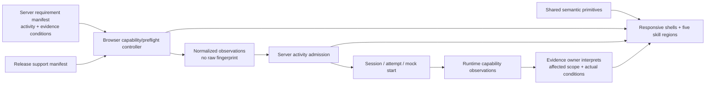
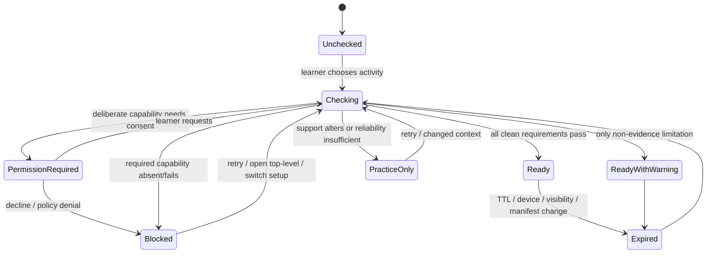

# Bestehen / App — Responsive, Accessibility, Browser, and Device Architecture

> **Stage:** 14 of 28  
> **Status:** Accepted architecture decision and implementation handoff  
> **Decision owner:** Responsive layout, browser/device capability admission, accessibility interaction mechanics, support policy, and evidence-aware accommodation boundary  
> **Baseline:** `m-elsharkawi/Bestehen-App@29cd6672ff1ea0fe17aea1b5f69407a5f182405b`; `m-elsharkawi/Bestehen-Shaping@9f37ad78fdd101b3c9cb8782ddc54d12dbce1fdc`  
> **Scope:** Architecture and test contracts only; no component, style, route, feature, test, production configuration, or product/design source is implemented or changed

## 1. Purpose and scope

This stage makes responsive behavior, accessibility, browser support, device capability, preflight, and evidence accommodation an implementation-facing contract. It fixes the five layout ranges; defines how the browser observes capabilities without becoming a domain owner; gates only the activity whose required capability cannot be established; turns every shaped accessibility commitment into a mechanism and acceptance test; and bounds launch support to current and immediately previous major browser families.

The browser remains an interaction and observation surface. It never decides evidence validity, progression, Readiness, mock validity, Ready-to-Book, content rights, or learner ability. Technical, content, media, accessibility, browser, network, storage, and evaluator faults have zero learner-negative effect. The server owners interpret recorded conditions and narrow only the affected claim. Missing evidence is absence, not zero. Written and Oral remain independent. Safe is not Ready to Book. No pass-probability field, calculation, event, copy, or telemetry dimension exists.

This stage does not choose final media codecs, notification transport, timer clock implementation, authentication, accommodation-verification authority, device-cloud vendor, or a native/PWA client. Those choices remain with their named later stages, within the fixed boundaries below.

## 2. Inputs, authority, and continuity

All required inputs were fetched from GitHub immediately before deciding. No required source drifted from the planning manifest. Required Stages 01, 03, and 13 are accepted and mutually consistent. The Stage 14 output did not exist; all 24 Stage 14 checklist items were open at baseline.

| Repository / path | Current commit or blob SHA | Stage-14 use |
|---|---|---|
| Bestehen-Shaping `main` | `9f37ad78fdd101b3c9cb8782ddc54d12dbce1fdc` | Current read-only shaping head |
| `app/28-bestehen-app-product-specification.md` | `18ae80cc2fd63cecd76c297c3e56d44a68367856` | Consolidated product authority |
| `app/19-information-architecture-and-core-screens.md` | `615ba3ce97fb25f974b6ba3a020cf254ddd0065f` | Screen priority, focused work, same semantics by device |
| `app/26-platform-accessibility-nonfunctional.md` | `8137091683941b0d55f3d4fb90af3c402b8371e5` | Responsive web, support window, preflight, WCAG, evidence-sensitive access |
| `02_Bestehen_Identity.md` | `f8799407f7b4a5a657f8c81439425d5a004f4e1c` | Calm, legible, non-gamified expression |
| Bestehen-App accepted baseline | `29cd6672ff1ea0fe17aea1b5f69407a5f182405b` | Parent of this stage |
| `Architecture/00-architecture-shaping-plan.md` | `b263c5e7b3bccc0450ddd17aa0cc007432d672b7` | Routing, invariants, downstream ownership |
| `Bestehen_App_Architecture_Checklist.md` | `22ac4eb7d96d554cfdfcc724f30da3c4b5751962` | 24 Stage-14 checks initially open |
| `Architecture/01-architecture-charter-and-quality-attributes.md` | `cc8d28816f43d627861d11cd90e8770c4c96414c` | Accessibility, local degradation, recovery release gates |
| `Architecture/03-technology-stack-and-repository-strategy.md` | `907b04c57813dc50f92a7ed00e49196ff7d4a924` | One Next.js responsive web client and low-ops posture |
| `Architecture/13-frontend-application-and-design-system-architecture.md` | `7da94f122fa86412b0d1a12b84c123645693efb4` | Server-first composition, shared primitives, focused shells |
| `Design/DESIGN-HANDOFF.md` | `417a6820037e045e2dd9f29afc42b9f2e94fd638` | Five breakpoints and accessibility acceptance summary |
| `Design/Bestehen-03-Desktop-Responsive.dc.html` | `94056db181b45298a759ff727ad5cfeac2f2a469` | Desktop/tablet behavior and max measures |
| `Design/Bestehen-04-Flows-Handoff.dc.html` | `7120b05a2272c31e5896e4313a7007935f5d0aed` | Ten accessibility surfaces, keyboard map, announcements |
| `Design/Bestehen-01-Design-System.dc.html` | `d4e371aacee32c85ddc53cf9cf3abaaff4e86e7a` | Primitive states, accessibility rows, motion |
| Stage prompt | `d15e005c654414062403777dc3e3bc9db77ef8fd` | Exact execution contract |

### 2.1 Authority and reconciliation

The applied order is final product specification → detailed App shaping → identity → overview → human-authored design → illustrative design runtime. Stage 27 precedence remains validity/fairness → direct evidence → independent Written/Oral risk → uncertainty resolution → repair/retention → progression/coverage → preference.

There is no contradiction requiring a source change. Stage 19 intentionally left exact navigation treatment open; the later finalized design and Stage 13 consistently fix bottom navigation, top rail, and sidebar. Stage 26 intentionally left breakpoint implementation and exact test tooling open; the design fixes five ranges and this stage fixes the capability/test architecture. The stronger design target of 44×44 px with 8 px separation is retained even though WCAG 2.2 AA SC 2.5.8 has a smaller minimum. The design's 5-minute timer statements are reconciled as one assertive final-five announcement that replaces, rather than duplicates, the otherwise polite five-minute update.

## 3. Current primary-source research

Mutable web-platform and support assumptions were checked on **2026-08-23**. Versions are resolved into a release manifest at each candidate cut; prose never freezes a moving major number.

| Primary/current source | Evidence used |
|---|---|
| [W3C WCAG 2.2 Recommendation](https://www.w3.org/TR/WCAG22/) and [WAI changes in 2.2](https://www.w3.org/WAI/standards-guidelines/wcag/new-in-22/) | AA baseline, 320 CSS px reflow, focus not obscured, dragging alternative, minimum target, status messages |
| [WAI-ARIA 1.2](https://www.w3.org/TR/wai-aria-1.2/) and [WAI modal-dialog pattern](https://www.w3.org/WAI/ARIA/apg/patterns/dialog-modal/) | Status/live-region semantics; modal labeling, focus containment, Escape and return |
| [W3C Media Capture and Streams](https://www.w3.org/TR/mediacapture-streams/) | Secure-context microphone capture, permission failure, `self` Permissions Policy default, capture sensitivity |
| [W3C MediaStream Recording](https://www.w3.org/TR/mediastream-recording/) and [WHATWG HTML media](https://html.spec.whatwg.org/multipage/media.html) | Recording candidate support and playback capability are probes, not brand promises |
| [W3C Permissions Policy](https://www.w3.org/TR/permissions-policy-1/) | Embedded-context capability may be disabled independently of browser support |
| [WHATWG Storage Standard](https://storage.spec.whatwg.org/), [MDN `persisted()`](https://developer.mozilla.org/en-US/docs/Web/API/StorageManager/persisted), and [MDN `estimate()`](https://developer.mozilla.org/en-US/docs/Web/API/StorageManager/estimate) | Storage may be nonpersistent/disabled/opaque; quota is an estimate; actual transaction probes remain decisive |
| [MDN `MediaRecorder.isTypeSupported()`](https://developer.mozilla.org/en-US/docs/Web/API/MediaRecorder/isTypeSupported_static) and [MDN `canPlayType()`](https://developer.mozilla.org/en-US/docs/Web/API/HTMLMediaElement/canPlayType) | Format checks are hints and require a real short decode/capture probe |
| [Apple Safari release notes](https://developer.apple.com/documentation/safari-release-notes), [WebKit iOS/iPadOS Web Push](https://webkit.org/blog/13878/web-push-for-web-apps-on-ios-and-ipados/), and [Apple Web Push documentation](https://developer.apple.com/documentation/usernotifications/sending-web-push-notifications-in-web-apps-and-browsers) | Safari release cut; iOS/iPadOS push is a Home Screen web-app capability and user-gesture permission |
| [Chromium schedule](https://chromiumdash.appspot.com/schedule) and [Chrome for Testing](https://developer.chrome.com/docs/chromedriver/downloads/version-selection) | Resolve release channels and retain reproducible branded/versioned Chromium-family tests |
| [Microsoft Edge release schedule](https://learn.microsoft.com/en-us/deployedge/microsoft-edge-release-schedule) | Resolve Stable/current and previous release families; cadence is mutable |
| [Mozilla product details](https://product-details.mozilla.org/1.0/firefox_versions.json) | Resolve current Firefox stable at release cut rather than copying a stale number |
| [Playwright browser documentation](https://playwright.dev/docs/browsers) and [web-platform-tests](https://web-platform-tests.org/) | Automated Chromium/Firefox/WebKit coverage; explicit warning that patched WebKit is not branded Safari and media varies by OS |

## 4. Architecture decisions

| ID | Decision | Consequence / review trigger | ADR |
|---|---|---|---|
| `ARCH-S14-D01` | Lock the exact five responsive ranges and one IA; layout changes presentation, never evidence semantics. | Responsive fixtures are contract assets; change requires approved design/product change and visual/a11y migration. | ADR-0022 |
| `ARCH-S14-D02` | Use activity-scoped capability requirements plus actual probes; never a global browser/device allow/deny gate. | A failed capability blocks only its dependent action. Review if probes themselves cause material false blocks. | ADR-0022 |
| `ARCH-S14-D03` | Represent preflight as versioned, expiring observations and a server-issued activity eligibility decision. | User-agent identity is diagnostic only; high-stakes start is authorized against actual conditions and checkpoint receipts. | ADR-0022 |
| `ARCH-S14-D04` | Make WCAG 2.2 AA and the stronger shaped mechanics shared primitive/shell release gates. | No core flow ships on visual/automated checks alone; keyboard, screen reader, zoom/reflow and motion require manual evidence. | ADR-0022 |
| `ARCH-S14-D05` | Use two pre-mounted announcement channels, sparse event announcements, explicit focus transitions, and optional guarded shortcuts; never announce ticks. | No duplicate final-five announcement; every shortcut has a visible/focusable equivalent and yields to editing/browser/AT. | ADR-0022 |
| `ARCH-S14-D06` | Support current and immediately previous major families of desktop Chrome/Edge/Firefox/Safari, iOS/iPadOS Safari and Android Chrome through a versioned release manifest. | Playwright engines do not substitute for branded Safari/mobile/AT; broaden only from usage/pass-critical evidence. | ADR-0022 |
| `ARCH-S14-D07` | Classify access support by its effect on the tested capability: `equivalent`, `altering`, or `unverified`; support is always allowed for learning, but only proven equivalence keeps a standard target claim. | Actual conditions enter the evidence envelope; future verified profiles are explicit, versioned and scoped. | ADR-0022 |
| `ARCH-S14-D08` | Treat microphone, notifications, private storage and embedding contextually and minimally; no background capture or pre-emptive prompts. | Top-level fallback is always offered; preflight samples remain local and ephemeral. | ADR-0022 |
| `ARCH-S14-D09` | Persist only the minimum admission/audit facts and aggregate redacted operational measures; do not build a device fingerprint. | Capability-policy/version changes trigger targeted reevaluation, not learner-score recomputation. | ADR-0022 |
| `ARCH-S14-D10` | Use layered automation plus a small real browser/device/assistive-technology release matrix; failures stop only the affected release capability. | A device cloud is optional and replaceable; add cost only when manual queue or defect escape is measured. | ADR-0022 |

## 5. Components and ownership



| Module | Owns | Must not own |
|---|---|---|
| Responsive shell policy | Breakpoint range, navigation presentation, sheet/dialog form, measures, focused-shell composition | IA destination order, activity/evidence meaning, server projections |
| Accessibility primitives | Native semantics, labels, focus, live regions, target/zoom/reflow, motion, overlay and error behavior | Scores, validity, Readiness, accommodation equivalence |
| Capability adapter | Safe feature presence checks, actual local probes, normalized observations, teardown | Learner ability, global support verdict, evidence validity |
| Preflight controller | Requirement evaluation, probe lifecycle, expiry, retry, learner confirmation, admission request | Authoritative start, target rules, hidden permission requests |
| Activity-admission owner (server Session/Attempt or Measurement) | Versioned requirement interpretation, start permit/deny/practice-only result, receipt | Device capture, UI layout |
| Evidence & Capability owner | Actual-condition interpretation, five-state validity, affected scope, corrections/recomputation | Browser-brand inference, accessibility need as failure |
| Release support manifest | Symbolic family window resolved to tested versions/OS/device/AT evidence for one release | Runtime global blocking or product truth |
| Stage 25 quality gate | Test execution and artifact retention | Reopening this support/accessibility contract |

## 6. Responsive behavior contract

### 6.1 Exact breakpoint matrix

Breakpoints are CSS viewport widths. They are inclusive exactly as written; there is no large-phone sixth layout. Container and content measures prevent wide-screen stretching. German task text never exceeds 720 px. Coach message copy remains at most 56 characters per line where practical. No hover-only action, different device IA, or desktop-only evidence exists.

| Range | Grid / max measure | Navigation | Core behavior | Overlay | Focused session/attempt/mock shells |
|---|---|---|---|---|---|
| **≤479 px** | One column; primary design at 390, validated at 360 and reflow at 320; page gutters 16 px; readable/task measure capped by available width | Persistent bottom navigation in Coach, Readiness, Train, Progress order; utilities secondary | One dominant sticky action; Home action precedes context; Readiness gates stack with weaker/blocked claim clear; Writing prompt then editor with condition checklist reachable; charts use text first | Bottom sheet with dialog semantics; full-height only when content requires it | Suppress primary navigation; one task block; timer/record/media controls remain stable; no loss of exit/recovery |
| **480–767 px** | Deliberately same phone composition; 24 px gutters; centered maximum 520 px | Same bottom navigation and order | No new density or columns; phone content priority remains | Same sheet behavior | Same focused shell; centered 520 px working measure |
| **768–1023 px** | Eight-column grid; centered container; task text ≤720 px | Persistent top rail with same four destinations | Readiness Written/Oral two-up; Writing prompt and editor side by side when both retain usable measures, otherwise stack; long content keeps readable measure | Centered modal dialog; semantic behavior identical to sheet | Navigation remains suppressed; split content/response only when reading order and 320-reflow fallback remain correct |
| **1024–1279 px** | Twelve columns; maximum container 1080 px | Persistent left sidebar, same order; utilities secondary | Coach plan/context 7/5; long Writing and evidence detail receive deliberate space; no extra charts | Centered modal dialog | Sidebar suppressed; task/checklist may be adjacent; mock remains centered ≤720 px with docked timer that never obscures focus/content |
| **≥1280 px** | Twelve columns; maximum container 1200 px; German task/mock measure remains ≤720 px | Same persistent left sidebar outside focused work | Readiness 8+4: claim plus read-only audit trail; Coach 7/5; Writing prompt/editor; desktop adds no editable evidence or new meaning | Centered modal dialog | Sidebar suppressed; mock centered 720 px; docked timer and persistent checklist remain outside reading flow without obstruction |

### 6.2 Screen behavior and reflow

| Surface | Narrow order | Wide enhancement | Invariant |
|---|---|---|---|
| Coach | dominant action → Readiness summary → reason/blocker → detail | plan/context split | One dominant action; analytics never displace it |
| Readiness | Written and Oral stacked; text claim before visualization | two-up at tablet; claim plus read-only audit at ≥1280 | Both independent gates, range/confidence/age/breadth; no overall compensation |
| Train/review | due obligation and deliberate choices | extra context only | Train remains secondary to Coach; no card grid sprawl |
| Attempt | conditions → task → question/input → options/controls → action | source and response may share space | Same DOM/focus order; same manifest and evidence observations |
| Writing | prompt/content points → editor → conditions/checkpoint status | prompt/editor side by side | Full functionality on phone when preflight passes; size is not validity |
| Listening/Speaking | stable media/record controls first | additional transcript/diagnostic context only when allowed | Support exposure is explicit; media failure is technical |
| Mock | rules/preflight → focused blocks → result | centered measure, docked timer | Navigation suppressed at every width; block validity before score |
| Progress | text summary/timeline before graphics | more evidence rows, never more meaning | Real table/text equivalent at every range |

At 200% text zoom, all actions, labels, errors, timers, conditions, and state explanations remain available without overlap or clipping. At an equivalent 320 CSS px viewport, ordinary content reflows without two-dimensional scrolling; genuinely tabular evidence may use a contained scroll region with headers and the same preceding summary. Sticky navigation/action bars reserve space and cannot obscure focused elements. Orientation change reflows; it does not restart, submit, reset a timer, or alter an evidence label.

## 7. Capability and preflight architecture

### 7.1 Capability state model

Capability observations are discriminated and timestamped. `available` is not permanent and does not guarantee the next operation. Permission queries, when available, are hints; the actual user-initiated operation is decisive.

| Capability state | Meaning | Allowed response |
|---|---|---|
| `unknown` | Not probed or prior result expired | Explain and probe only when activity needs it |
| `checking` | A bounded probe is running | Keep unrelated UI usable; cancel/timeout safely |
| `permission_required` | A deliberate user action may prompt | Explain purpose and decline path before request |
| `available` | Required probe passed for this context and freshness window | Evaluate remaining requirements |
| `limited` | Capability works with a named constraint | Ordinary/practice-only or alternate activity, per requirement |
| `denied` | User/UA/policy denied access | No repeated prompt loop; show settings/retry/alternative |
| `unsupported` | API/format/context absent | Block only dependent action; top-level/supported browser alternative |
| `failed` | API exists but actual operation failed | Retry once where safe; preserve technical fault, no learner effect |
| `stale` | Observation expired or context/device changed | Re-probe before measured start |

Aggregate activity eligibility is `unchecked | checking | ready | ready_with_warning | practice_only | blocked | expired`. It is calculated server-side from a versioned requirement manifest and normalized observations. `ready_with_warning` is convenience/reliability information that does not alter evidence; `practice_only` means useful work can proceed but a clean standard claim cannot. `blocked` names exact missing requirements and unaffected alternatives.



### 7.2 Probe contract by capability

| Capability | Safe probe / evidence | Clean measured requirement | Local alternative / privacy rule |
|---|---|---|---|
| Secure/top-level context | HTTPS and origin; top-level vs embedded; relevant Permissions Policy | Required for microphone and high-stakes storage; embedded mode must satisfy an explicit trusted same-origin contract, otherwise open top-level | Basic content may render; never infer learner inability |
| IndexedDB/local storage | Open versioned DB; write/read/delete random sentinel in one transaction; close/reopen; observe quota/persistence hints | Local checkpoint round-trip plus server checkpoint receipt and sufficient measured payload headroom; `persisted=false` alone is not failure when server durability is proven | Low-risk practice or server-only work; private mode is diagnosed by behavior, never fingerprinted |
| Checkpoint durability | Round-trip a non-learner sentinel locally and a no-op/ephemeral server operation receipt; verify sequence/version | Required before continuous Writing/full measured blocks; runtime receipts continue during work | Lower-stakes practice, another browser/device, or wait for connection |
| Listening/audio output | `canPlayType` hint; fetch and decode/play a tiny approved test asset; learner confirms audible output | Pinned measured assets fully ready and actual output confirmed before clock starts | Retry output/device, ordinary non-measured work, or another skill; no automated claim that sound was heard |
| Playback media formats | Test the exact candidate MIME/codec from the pinned serving manifest, then actual decode | At least one approved candidate succeeds; Stage 16 owns candidates/order | Fallback candidate or no affected audio action; no runtime transcoding choice here |
| Microphone | Only after explanation and learner gesture: `getUserMedia`, active audio track, short local sample with non-silent/non-clipped signal, optional learner playback confirmation | Speaking requirement passes; selected device remains active; partner/output requirements pass separately | Stop every track; delete sample in memory; no upload, analytics, background capture, or repeated prompt loop |
| Recording format | `MediaRecorder.isTypeSupported` hint then short local start/stop/blob playback probe for a Stage-18 allowlisted candidate | One accepted candidate passes end to end | Switch candidate/browser/device or typed/solo practice with no Oral evidence |
| Media asset readiness | Fetch pinned immutable assets, verify digest/length and decoded readiness | All assets needed for next clean block ready before timing | Wait/retry, cached ordinary practice, or different work |
| Network/server | Actual bounded health/manifest/checkpoint request; never `navigator.onLine` alone | Only when activity requires live partner/evaluator/server durability | Fully loaded objective work may continue; external dependency never globally blocks |
| Notifications | Feature presence, current permission, service-worker/push capability where transport later requires it | Never required for learning, evidence, mock, or booking | In-app schedule; Stage 22 chooses transport. Ask only from explicit reminder action. On iOS/iPadOS push may require Home Screen web app, so unavailable is normal |
| Private/ephemeral storage | Same actual storage/durability probes; no attempt to identify “incognito” | Permit measured work only when required durability is proven for the block | Plain warning, server-backed path, low-risk practice, or supported top-level browser |

### 7.3 Activity eligibility matrix

| Activity | Required before start | Failure scope | Valid alternative |
|---|---|---|---|
| Coach/Readiness/Progress/basic Reading | secure rendered app; no special device capability | Exact panel/action | Other destinations or server-rendered text; no global gate |
| Low-risk objective practice | content render; response input; checkpoint when recovery is promised | Current task/recovery promise | Continue without durable-resume claim only after explicit warning, or choose another task |
| Clean measured Reading/Language Elements | pinned form/assets, target rules, timer/checkpoint receipt | Exact block | Practice-only or another supported browser/context |
| Clean Listening | measured assets decoded/ready, output confirmation, replay/timer/checkpoint rules | Listening unit/block | Retry setup or non-audio work; no Listening penalty |
| Ordinary Speaking | contextual mic/recording probe; output if needed | Speaking activity | Typed/solo rehearsal explicitly produces no oral evidence |
| Clean oral block/mock | mic signal and recording candidate, output/partner availability, checkpoint/turn preservation, target/timer rules | Oral part/turn scope | Retry/switch; fixed partner only if intended evidence remains valid; otherwise practice-only |
| Continuous/target Writing | editor input, local+server checkpoint path, prompt manifest, reliable timer for target conditions | Writing block | Ordinary short Writing/practice or supported context |
| Full mock | requirements per block, plus form/clock/checkpoint and all immediately required media | Only block/component whose requirement fails; do not start clean full claim if known prerequisite absent | Section practice or later retry |

### 7.4 Admission and runtime sequence

```mermaid
sequenceDiagram
    actor L as Learner
    participant UI as Focused shell
    participant PF as Preflight controller
    participant A as Activity admission owner
    participant E as Evidence owner
    L->>UI: Choose measured activity
    UI->>PF: Load requirement + support manifests
    PF-->>L: Explain exact probes and alternatives
    L->>PF: Deliberately start capability checks
    PF->>PF: Run local probes; stop/release capture
    PF->>A: Normalized observations + versions + operation ID
    A-->>UI: ready / warning / practice-only / blocked receipt
    UI-->>L: Start or exact local alternative
    UI->>E: Runtime observations and actual conditions
    E-->>UI: Authoritative validity/affected-scope projection
```

Preflight expires on requirement/policy/support-manifest change, material time-to-start TTL, device change, media-device change, visibility/background transition affecting clock, storage error, or runtime capability loss. Exact TTLs are Stage 16/18/21 calibration values with provenance, effective date, validation and rollback. A preflight is not an evidence fact that a later attempt succeeded; runtime observations remain authoritative.

## 8. Complete accessibility contract

### 8.1 WCAG 2.2 AA mechanisms

| Area | Required mechanism | Testable release evidence |
|---|---|---|
| Structure and language | Native landmarks; one page `main`; hierarchical headings; lists/tables/forms use native elements; page language correct; every German task part has `lang="de"` and `hyphens:auto`; no `overflow-wrap:anywhere` | Accessibility-tree and heading/landmark audit; German compound-word VoiceOver/NVDA spot check |
| Names/roles/values | Visible label is accessible name; state/value/expanded/selected/busy/invalid programmatic; semantic button/link/input before ARIA recreation | Automated role/name/state checks plus AT walkthrough |
| Keyboard | Every core action reachable/operable without pointer or shortcut; no trap; logical DOM order; select-then-place alternative for drag | Keyboard-only completion of one activity per skill and every overlay/recovery branch |
| Focus | 2 px visible ring with 2 px offset; focused item never obscured by sticky UI; step focuses first new meaningful element; result/error/dialog focus rules below; route changes announce title/heading without resetting work | Focus trace at all ranges, 200% zoom, orientation change and streamed route transition |
| Forms/errors | Visible instructions/labels; required text; `aria-invalid` after validation; field message associated; summary focuses on failed submit, links/focuses first invalid field; message explains correction; data retained | Automated form semantics and manual date/goal/editor failure walkthrough |
| Status/live regions | Pre-mounted dedicated `polite` and `assertive` regions; atomic event strings; no changing timer node in live region; deduplicate by event ID | NVDA/VoiceOver announcement transcript; zero tick announcements |
| Color/contrast | Text ≥4.5:1, large text ≥3:1, UI/focus/non-text ≥3:1 where WCAG applies; word + named semantic icon/shape + color; decorative icon hidden | Token contrast gate, forced-colors/high-contrast, greyscale and color-vision simulations |
| Charts/evidence | Consequence sentence in DOM before graphic; graphic `role="img"` with full-sentence name; shape/hatching; real semantic table behind one “Show evidence as text” control | Both Written/Oral, all six Readiness states, missing/Pending/partial scope, table keyboard/AT pass |
| Pointer/drag/targets | No path requires drag or multipoint gesture; select-then-place creates the same response facts; repository design target 44×44 px with 8 px separation | Touch/keyboard fixtures at 320/360/390 and pointer cancellation test |
| Zoom/reflow | 200% text zoom without loss; 320 CSS px reflow without two-dimensional scroll except inherently two-dimensional table/diagram region; primary action/timer/focus not obscured | All 24 mobile frame states plus core failure states; 1280 viewport at 400% reflow spot check |
| Motion | `prefers-reduced-motion`: no translate/scale, optional opacity ≤100 ms; recording pulse becomes solid dot + “Recording”; results, mistakes, milestones never animate; state never motion-only | Screenshot/timeline diff under reduced motion and animation-disabled mode |
| Timing | Timer hide changes presentation only; ordinary practice may extend/pause with actual condition recorded; clean target timing follows rules/profile; timeout warning and safe extension where not essential | Practice and mock timer tests, background/visibility and AT warning transcript |
| Authentication/help | Later account flow cannot impose cognitive-function-only challenge; consistent help location and redundant entry rules apply | Stage 20/25 account and form acceptance fixtures |

### 8.2 Ten design-surface commitments

| Surface | Mechanism | Mandatory test |
|---|---|---|
| Readiness scales | DOM sentence → named `role=img` graphic → real toggleable table; hatching/marker shape | Screen-reader both gates in all six states; greyscale |
| Status/answers | Word + one named icon + hue; SVG decorative to AT | Color-vision simulations and text-only DOM |
| Measured timer | Internal clock separate from display/live output; 10/5/1 event scheduler; timer hide preserves clock | Full mock with NVDA and VoiceOver; no tick or duplicate five-minute output |
| Recording | Visible word + solid/pulsing dot + duration + level; start/stop events; reduced-motion solid dot | Manual mic run with reduced motion and capture teardown |
| Attempt navigation | DOM/focus order conditions → task → question → options/input → action; first new meaningful element on step | Keyboard completion one task per skill |
| Matching/ordering | Select item then choose destination; same response IDs/order/timestamps/exposure/assistance as pointer drag | Keyboard SB2 fixture equals pointer payload |
| Forms | Visible labels, associated instructions/errors, summary and first-invalid focus, retained input | Automated scan plus manual goal/date failure |
| Overlays | Sheet and dialog expose one modal contract; labelled, background inert, contained Tab cycle, Escape close, trigger restore | Every overlay at phone/tablet/desktop |
| Targets/zoom | 44×44, 8 px separation, 320 reflow, 200% text zoom | All mobile screens and core recovery states |
| German content | `lang=de`, correct DOM reading order, hyphenation, no truncation of conditions/weakness/copy | NVDA/VoiceOver pronunciation and zoom check |

### 8.3 Focus contract

1. Initial server-rendered page exposes skip-to-main, landmark and heading structure without script.
2. Normal Tab order follows DOM; CSS grid/flex may not visually reorder controls. Conditions precede the tested task.
3. A step transition focuses the first newly introduced heading/instruction/control that explains the new state—not document top and not a live-region node. If the learner remains in the same editor/question, focus stays unless the action requires correction.
4. Failed submit focuses the error summary; activating a summary link focuses the invalid control. Input is never cleared.
5. Result/repair focus moves once to the result heading after the result is committed. Pending arrival announces politely but does not steal focus.
6. Modal sheet/dialog initial focus follows APG risk/reading rules, contains Tab/Shift+Tab, closes with Escape unless an irreversible operation is already committed, makes background inert, and restores the invoking control or nearest logical successor.
7. Route/deep-link/resume sets the document title and moves focus to the destination heading only after content is stable. Recovering an active attempt restores saved logical focus by semantic key, never a stale DOM index.
8. Sticky bars use scroll padding/margins so focused controls and validation messages are not obscured.

### 8.4 Announcement catalog and priority

Two visually hidden, pre-mounted regions exist for the document lifetime: `status-polite` and `status-assertive`. Announcements are event objects with ID, message key/parameters, priority, locale, scope and creation time. They are not inferred from arbitrary DOM mutations. A repeated event ID is suppressed; an assertive event suppresses a simultaneous lower-priority duplicate.

| Event | Channel | Contract string/shape |
|---|---|---|
| Objective/productive result committed | polite | “3 of 4 correct. Likely cause: scanning for restrictions, medium confidence.” (structured values, localized) |
| Readiness band change | polite | “Oral is now borderline. The planning range crosses the pass line.” |
| 10 minutes remaining | polite | “Ten minutes remaining in this block.” once |
| **Final 5 minutes** | **assertive** | “Five minutes remaining in this block.” once; suppress the normal polite 5-minute event |
| 1 minute remaining | polite | “One minute remaining in this block.” once |
| Timer ticks/display refresh | none | **Never announced** |
| Recording started/stopped | polite | “Recording started.” / “Recording stopped.” once; visible state remains |
| Recording failure/lost input | assertive | One short failure plus saved-work/next-action message; stop capture and preserve scope |
| Autosave/checkpoint failure | polite | “Offline. Your draft is saved on this device.” only if that statement is true; otherwise name the truthful recovery state |
| Evaluation arrival | polite | “Your Writing evaluation is ready.”; no focus theft |
| Technical invalid/not-counted result | polite unless urgent capture risk | “This attempt was not counted. The audio failed to load.”; never learner blame |
| Selection, keystroke, countdown second, waveform level | none | Native control feedback only |

Assertive output is reserved to the shaped final-five warning and recording failure. It is not used for scores, wrong answers, ordinary validation, network delay, or marketing. If recording fails at the same instant as final-five, recording failure is announced first; timer state remains visible and the next announcement waits until speech finishes.

### 8.5 Keyboard and shortcut conflict contract

| Key | Optional convenience | Guard |
|---|---|---|
| `1–4` / `a–d` | Select option in current focused question | Only in focused attempt scope, not editable/contenteditable/select, not IME composition, not modified, not already handled |
| `Enter` | Submit current step or activate focused control | Native semantics first; never global-submit multiline Writing |
| `Space` | Play/pause Listening media | Only when the attempt media controller owns the event and focus is not an editable/control that uses Space |
| `R` | Consume replay when allowed | Same scope guards; disabled when no replay remains; visible Replay control remains |
| `Tab` / `Shift+Tab` | Native documented focus order | Never intercepted except standards-conforming modal containment |
| `Escape` | Close overlay and restore trigger | Browser/AT event not already consumed; cannot fabricate cancel of submitted work |
| `T` | Show/hide timer presentation | Does not alter clock/timing; visible toggle remains |
| `?` | Open shortcuts dialog | Not while typing/IME; visible help entry remains |

Shortcuts are disabled outside focused work and can be turned off. The controller exits when `defaultPrevented`, any Ctrl/Alt/Meta modifier, composition, or an editable/native control owns the key. It never registers OS-global bindings, overrides browser/AT commands, or makes a shortcut necessary. Screen-reader browse/forms modes and browser-reserved bindings win; ordinary controls provide identical completion.

## 9. Browser, device, and assistive-technology support

### 9.1 Support policy and version manifest

First-class launch families are current stable and immediately previous major at release cut:

- Chrome desktop on Windows/macOS;
- Edge desktop on Windows (and macOS for automated smoke where available);
- Firefox desktop on Windows/macOS;
- Safari on macOS;
- Safari on iPhone and iPad;
- Chrome on Android.

The release artifact `BrowserSupportManifest` resolves each symbolic family to exact major/full version, OS version, test date, test-suite revision, device/viewport, capability results and known limitations. It is configuration/QA evidence, not a runtime allowlist. Current release channels are resolved from the official sources in §3; the prior major is retained as a reproducible binary/device-grid entry where possible. Security patch versions are used, not intentionally vulnerable originals.

Unsupported/end-of-life browsers, niche forks, enterprise-locked old releases and restricted webviews receive best-effort content plus capability-local messaging. No UA string alone blocks access. Embedded/in-app browsers are not first-class for high-stakes media/storage; the normal exit is “Open in browser” to a top-level same-origin URL carrying only a short-lived, non-sensitive resume locator.

### 9.2 Browser/device test matrix

| Lane | Current + previous coverage | What must run | Release evidence |
|---|---|---|---|
| Desktop Chromium | Branded Chrome Windows/macOS; Edge Windows | Four destinations, focused shells, IndexedDB/checkpoint, approved audio formats, keyboard, zoom/reflow, high contrast | Automated current each PR/nightly; current+previous candidate; manual AT |
| Desktop Firefox | Branded Firefox Windows/macOS; Playwright patched Firefox as automation aid | Same core, storage, media, keyboard, native semantics | Automated engine each PR; branded current+previous candidate; NVDA on Windows |
| Desktop Safari | Branded Safari current/previous major on supported macOS | Layout, dialogs/focus, VoiceOver, IndexedDB, media playback/record, visibility/timer | Real macOS candidate run; Playwright WebKit is only early warning |
| iPhone Safari | Current/previous Safari family on representative 360/390-class phones | Bottom nav/sheets, touch targets, zoom, VoiceOver, orientation, audio/mic, storage, interruption | Real/signed remote device candidate; simulator is supplementary |
| iPad Safari | Current/previous family; portrait/landscape; touch + hardware keyboard | 768 transition, top rail/dialog, split Writing, VoiceOver, mic/media/storage | Real/signed remote candidate |
| Android Chrome | Current/previous Chrome family on one current and one constrained representative phone | 320/360/390 reflow, TalkBack, touch targets, audio/mic, storage, background/visibility | Real/signed remote candidate; emulation supplementary |
| Restricted/private/embed | At least one private window per engine and one denied Permissions Policy embed fixture | Actual probes, no crash/fingerprint, top-level exit, local scope | Candidate negative-path record |

### 9.3 Automation and manual cadence

| Cadence | Required checks |
|---|---|
| Per change | Type/contract fixtures; automated accessibility scan; semantic snapshots; keyboard happy/recovery paths; viewport 320, 360, 390, 479, 480, 767, 768, 1023, 1024, 1279, 1280 and wide; reduced motion; forced colors; Playwright Chromium/Firefox/WebKit |
| Nightly | Branded current Chrome/Edge; storage quota/failure injection; offline/media/error paths; timing/background synthetic; all five skills; visual regression light/dark/zoom |
| Release candidate | Exact current+previous manifest; real Safari/iOS/iPadOS/Android; approved playback/record formats; manual keyboard; AT matrix; private/embed/permission denial; crash/reload/checkpoint; full mock timer/announcement |
| Browser/OS beta advisory | Core smoke against Beta/preview to find upcoming breakage; failure opens compatibility work but does not silently alter current support |
| Post-release | Capability failure rate by normalized family/major and action, preflight false-block/late-failure rate, accessibility defect escape; no raw UA/device fingerprint |

### 9.4 Assistive-technology manual matrix

| AT / platform | Browser pair | Critical flows |
|---|---|---|
| NVDA current on Windows | Firefox and Chrome/Edge current; rotate prior family at candidate | Arrival/goal, one task each skill, matching, form errors, timer, recording, Readiness table, dialog, recovery |
| VoiceOver current on macOS | Safari current; prior Safari family smoke | Same, plus route/focus and long Writing |
| VoiceOver current on iPhone/iPad | Safari current; prior family smoke | Bottom/top navigation, sheet/dialog, orientation, touch exploration, media/mic, timer warnings |
| TalkBack current on Android | Chrome current; prior family smoke | Phone core, target size, media/mic, matching alternative, live regions |
| Keyboard-only | Every first-class desktop family | Every action without shortcuts; focus visibility/not obscured and no trap |

JAWS, switch-control-specific hardware, Braille displays, additional OS/browser pairs and a paid formal audit are not silently claimed at launch. Stage 25 adds them when learner usage, an escaped pass-critical defect, procurement/legal need, or repeated manual uncertainty justifies cost. Core semantics remain standards-based so additional AT is an additive test lane, not a redesign.

## 10. Evidence-equivalent support and accommodations

### 10.1 Classification rule

Accessibility support is not globally “valid” or “invalid.” The server compares the actual support to the activity's versioned `tested_capability` and target rules:

- `equivalent`: changes access/presentation/input mechanics without supplying answer information, changing modality, timing, exposure, independence, playback, or the capability claimed;
- `altering`: changes one of those measured conditions; evidence remains useful and honestly labeled, but does not automatically support the standard clean target claim;
- `unverified`: equivalence depends on a formal accommodation or empirical/legal interpretation not yet established; it defaults to the narrower claim, never learner failure;
- `not_applicable`: support affects only surrounding UI/instruction, not the measured task.

The same tool can classify differently by activity. Captions for coach instructions are `not_applicable/equivalent`; captions exposing tested Listening content are `altering` unless a verified profile explicitly grants another target-equivalent path.

### 10.2 Evidence/accommodation matrix

| Support / condition | Ordinary learning | Standard target claim without profile | Evidence record |
|---|---|---|---|
| Keyboard instead of pointer | Full | Equivalent when response semantics unchanged | input method; no assistance |
| Select-then-place instead of drag | Full | Equivalent; identical response facts | interaction variant only |
| Larger text/200% zoom/320 reflow | Full | Equivalent | optional presentation condition; no validity change |
| Reduced motion/solid recording indicator | Full | Equivalent | preference only |
| High contrast/dark/forced colors | Full | Equivalent | presentation only |
| Timer visually hidden while authoritative clock runs | Full | Equivalent | timer visibility; unchanged timing |
| Alternative keyboard/switch input selecting the same answer | Full | Equivalent when no answer information/timing change | input method and tested-capability decision |
| Screen reader for UI/instructions | Full | Equivalent when tested stimulus/capability is unchanged | AT condition and rationale |
| Screen reader/TTS reading tested Reading stimulus | Full, valuable | Altering/unverified for standard visual-reading claim unless verified profile | assistance modality and narrower scope |
| Captions/transcript for instructional audio | Full | Equivalent/not applicable | instruction support |
| Transcript/captions during tested Listening/partner audio | Full supported practice | Altering unless verified target profile | exposure + assistance + affected Listening/oral scope |
| Extra time or paused target timer | Full | Altering unless verified profile defines target timing | actual elapsed/pauses/profile version |
| Speech-to-text/dictation for tested Writing | Full learning | Altering/unverified standard Written production | input modality + assistance |
| Typed answer instead of spoken | Full rehearsal | Never direct Oral evidence | modality mismatch; Oral remains absent/stale |
| Recorded/replayed prompt beyond allowed rule | Full practice | Altering | playback count/exposure |
| Human/helper answer-bearing assistance | Full when appropriate | Altering/not clean | offered/used/scope |
| UI rearrangement, larger targets, focus aids | Full | Equivalent | optional presentation condition |

Keyboard and screen-reader learners therefore create **identical evidence when the tested capability is unchanged**. There is no lower score, confidence penalty, separate mastery model, or compliance mark merely for using AT. When the capability changes, only the claim/evidence condition narrows.

### 10.3 Future verified accommodation profile contract

A future profile is an authoritative, versioned ruleset—not a free-text preference and not a client switch:

| Field | Contract |
|---|---|
| Identity/version | `accommodation_profile_id`, immutable revision, status `draft | verified | expired | revoked | superseded` |
| Authority/scope | Exam provider/jurisdiction/target blueprint and component/task-family applicability; source reference and legal/product reviewer |
| Verification | Minimally retained verification method/status/date; sensitive supporting document is not copied unless required and reviewed |
| Adjustments | Exact timing, pause, input, output, assistant, transcript/caption, media/playback, break, device and environment rules |
| Equivalence | Per tested capability: equivalent/altering/unverified, rationale, evidence lane allowed, affected scope |
| Effective interval | Valid-from/to, target-rules version, review/expiry trigger |
| Learner linkage | Explicit learner choice/consent; export/delete/retention class; no diagnostic/medical inference |
| Audit | Actor, decision source, supersession, correction and targeted projection recomputation |

Until Stage 23/legal/product governance identifies accepted authorities and verification/retention, the App allows the support for learning, records actual conditions, and uses `unverified`/modified evidence for the standard target claim. It never claims that a support is an officially recognized TELC accommodation merely because the browser can provide it.

## 11. Data, API, state, and versioning

### 11.1 Conceptual contracts (non-production)

| Contract | Required fields | Owner / retention |
|---|---|---|
| `CapabilityRequirementManifest` | ID/revision; activity/skill/manifest kind; target rules; required/optional capabilities; clean/practice thresholds; probe freshness; fallback keys | Activity owner; immutable/versioned |
| `CapabilityObservation` | observation ID; normalized capability; state/reason category; context top-level/embed/secure; approved candidate ID; observed time/expiry; probe version; **no raw sample/full UA/device label** | Browser creates; server retains only if used for admission/audit |
| `PreflightDecision` | operation ID; requirement/support/policy versions; `ready|warning|practice_only|blocked`; exact reasons/actions; observation references; expiry; server receipt/version | Session/Attempt or Measurement; durable for measured start |
| `AccessibilityCondition` | support ID/version; actual use/offered; tested capability; effect `equivalent|altering|unverified|not_applicable`; rationale/profile ID; affected scope | Evidence & Capability; append/audited with attempt facts |
| `BrowserSupportManifest` | release ID; symbolic and resolved browser/major/OS/device/AT; suite revision/result; known limitation; tested date; rollback/supersedes | Release/quality owner; retained with release |
| `AnnouncementEvent` | event ID/key/parameters; polite/assertive/none; scope; created time; dedupe key | Browser ephemeral; telemetry counts only, no spoken learner text |

The API uses the accepted Stage-12 versioned envelope and operation IDs. An admission command cannot create evidence. Starting a measured attempt references its accepted preflight receipt; attempt runtime facts reference actual timing/playback/exposure/assistance/accessibility/capability observations. The Evidence owner alone maps facts to `valid | partially_valid | pending | interrupted | not_counted` and the smallest affected scope.

### 11.2 Compatibility and correction

- Additive optional capability/reason codes are minor-compatible; unknown optional codes render neutral text and block only if a known required rule says so.
- A new required capability, changed evidence effect, support-profile semantics, or removed state is a new manifest/contract major. Old clients fail closed for that activity and keep unrelated routes.
- Support manifests and preflight decisions include effective time and rollback target. Candidate release can revert manifest/config without rewriting evidence.
- Correcting an admission or accommodation rule appends a correction/supersession. Evidence projections recompute only attempts referencing the affected policy/profile/manifest and scope; historical facts remain.
- Browser support change does not recalculate ability. It may invalidate a future preflight or identify a technical incident for audit.
- Missing capability observation is `unknown`, not `unsupported`; missing evidence remains absent, not zero.

## 12. Failure, recovery, and uncertainty

| Failure | Immediate behavior | Evidence / recovery |
|---|---|---|
| Capability API absent | Mark exact capability unsupported, name activity alternative | No learner-negative evidence; other skills continue |
| Permission denied | Stop request loop; show browser settings/retry and decline-safe path | Oral remains absent/stale, never zero |
| Permissions Policy/embed blocks mic | Explain embedded limitation; open top-level signed resume URL | No capture attempt in background; no profile leakage in URL |
| Mic granted but silent/clipped | Stop tracks; local sample destroyed; retry/switch | Do not start clean oral evidence |
| Mic/device changes during capture | Record runtime loss/change, stop or safely reacquire per Stage 18 | Evidence owner narrows exact turn/part only |
| Audio format hint says yes but decode fails | Try next approved pinned candidate; record technical category | Block affected media activity; no Listening penalty |
| Learner cannot hear test | Learner confirmation fails even if API plays | Retry output/device; do not start clean block |
| IndexedDB disabled/quota/transaction failure | Preserve in-memory work; attempt server checkpoint; explicit durability state | High-stakes start blocked if durability cannot be proven; low-risk alternative |
| Private storage evaporates | Server receipt/checkpoint governs saved truth; warn before dependence | Never promise resume unsupported by receipt |
| Network loss during preflight | No start permit until required receipt/assets exist | Loaded low-risk work remains; no false clean label |
| Network loss after clean fully loaded objective start | Continue if timer/checkpoint/conditions remain trustworthy | Sync idempotently; network alone does not invalidate |
| Tab background/orientation/resize | Clock uses Stage-21 authoritative time facts; layout reflows | No silent timer freeze/reset; uncertainty narrows exact block |
| Announcement system/AT defect | Visible state and controls remain; record release defect | Never manufacture evidence consequence; fail release for core flow |
| Unsupported old browser | Best-effort low-risk content plus exact local limitation | No blanket crash/lockout |
| Runtime exception in capability/input region | Error boundary disposes capture, preserves checkpoint and correlation ID | Server interprets recorded facts; unaffected route/skill remains |

## 13. Security, privacy, and rights

- Microphone permission is requested only after a deliberate voice action, a purpose explanation, and a visible decline path. No onboarding, page-load, session-wide, hidden, or background request is allowed.
- Active capture always has visible word + indicator + duration/level. On stop, cancel, route exit, error, visibility teardown, or component disposal, every `MediaStreamTrack` stops. A deliberately submitted recording follows Stage 18/23 ephemeral retention; the preflight sample never leaves memory.
- Capability probing is purpose-limited. Do not enumerate or persist device labels/IDs, complete UA strings, installed codecs, screen dimensions, voices, sensor inventory, IP or audio fingerprints. Normalize only support class, family/major where release diagnosis requires it, result category and policy version.
- Embedded contexts receive no microphone/storage trust by default. Permissions Policy is least privilege; cross-origin embedding is not a clean high-stakes launch path. The top-level escape uses a short-lived one-time locator and no learner evidence/profile in query text/referrer.
- Notifications are optional and Stage-22-owned. Permission is requested only from an explicit learner reminder action; denied/unavailable has no learning or evidence consequence. Push/browser vendor endpoints receive no learner content.
- Self-hosted fonts/icons/logo and approved media remain Stage-13/16 contracts. Capability probes use only approved tiny assets; no third-party probe, tracking pixel, raw Corpus, or unapproved rights-bearing test media.
- Logs/analytics store redacted reason codes, versions and aggregate rates. No raw audio, draft, task answer, accessibility/medical inference, full profile, URL secret or spoken announcement text is placed in analytics/session replay.
- This architecture does not claim legal or formal accommodation compliance. Stage 23 owns jurisdiction, processor, consent, retention and authority review.

## 14. Performance, reliability, operations, and cost

### 14.1 Runtime bounds

- Static layout/accessibility primitives add no commercial request. Capability code loads only in the relevant client island.
- Feature-presence checks are synchronous; active probes are bounded, cancelable, cached for a short policy TTL, and never repeated per render.
- Media/storage/mic probes happen before high-stakes timing begins. They do not count as learner task time or consume replay/exposure.
- Preflight must not download an entire course. It validates the pinned next measured block and exact candidates; Stage 16 owns asset batching.
- L0/L1 interaction remains independent of probes/provider latency. Evaluation availability may yield Pending and never blocks unrelated deterministic work.
- Probe false-ready, false-block, duration, cancellation, late runtime failure, local durability failure and top-level escape success are operational measures. Thresholds are Stage-24/25 release parameters, not learner scores.

### 14.2 Test/support cost and fallback

Launch selects no commercial browser/device farm. Playwright/WPT, locally available branded browsers, browser-vendor binaries, built-in VoiceOver/TalkBack and free NVDA keep recurring software cost near zero; real phones/tablets and macOS access are bounded equipment/manual time. Automated engines do not falsely claim branded Safari/device/AT coverage.

A managed remote-device grid is an optional Stage-25 procurement choice. It adds seat/minute/concurrency and possible tunnel/data-processing/egress cost plus test maintenance. The cheapest fallback is a small owned-device rotation plus scheduled manual/borrowed-device evidence. The provider exit is test-runner-neutral URLs, semantic selectors, exported JUnit/screenshots/video/accessibility transcripts and the versioned support manifest; no provider-specific product code.

Upgrade to a paid grid or formal audit only when one of these is measured: release queue repeatedly exceeds the agreed cadence; a first-class current/previous combination cannot be accessed; two pass-critical device/AT defects escape in a rolling release window; media/permission defects cannot be reproduced; learner usage in an untested supported combination crosses the Stage-24 threshold; or legal/procurement requires independent evidence. Broaden browser families only when meaningful learner usage or a pass-critical access need outweighs ongoing release cost. Native/PWA work requires measured web limitation in offline media, capture, notification or device integration; it is not a speculative fallback.

## 15. Alternatives considered

| Decision area | Chosen | Simpler/do-nothing alternative | Other credible alternative | Why rejected / exit |
|---|---|---|---|---|
| Responsive layout | Five fixed ranges, one IA, content measures | One fluid phone layout everywhere | Device-specific layouts/native screens | Fluid-only fails large Writing/evidence needs; device forks drift semantics. Exit only with approved design research and migration |
| Browser gating | Capability-local observation/admission | Let every action start and handle crashes | UA allowlist/global unsupported page | Do-nothing risks unfair data loss; UA gate lies and blocks working configurations |
| Preflight | Requirement manifest + actual probe + server receipt | Feature presence checks only | Long global diagnostic at onboarding | Presence does not prove media/storage; onboarding violates contextual permission/local degradation |
| Storage admission | Actual local/server checkpoint receipt | Assume IndexedDB exists | Require `persisted=true` globally | Assumption loses work; persistent flag alone is neither sufficient nor necessary when server durability is proven |
| Accessibility | Native shared primitives plus manual/automated gates | Automated scanner only | Full third-party widget/overlay | Scanner cannot prove task completion/focus/AT; overlays cannot repair semantics and add privacy/dependency risk |
| Live updates | Two sparse event channels | Announce all DOM/timer changes | Toast-only visual feedback | Do-nothing is noisy/unusable; toast-only excludes AT |
| Shortcuts | Optional, scoped, guarded | No shortcuts | Global single-key handler | No-shortcut is viable fallback and remains completion path; global keys conflict with editors/browser/AT |
| Browser test | Layered engines + branded/real candidate matrix | Chromium happy path only | Paid all-combination grid from launch | One engine misses Safari/media/AT; paid grid is unproven recurring cost |
| Evidence access | Tested-capability effect classification | Treat every accessibility support as automatically clean or invalid | Separate accessibility learner model | Both blanket rules are unfair/untruthful; separate model stigmatizes and forks truth |
| Accommodation | Versioned verified profile later; modified evidence now | Free-text “extra time” toggle | Hard-coded disability presets | Free text/hard-coded presets lack authority, scope, privacy and version lineage |
| Notifications | Optional contextual capability | Prompt at onboarding | Require installable PWA | Prompt harms trust and is irrelevant to evidence; PWA is not launch promise |

## 16. Acceptance-test catalog

All tests preserve the five skills' shared shell and five validity/six Readiness states. Automated success never replaces the named manual AT/device evidence.

| ID | Acceptance test | Pass condition |
|---|---|---|
| `S14-RSP-01` | Boundary widths at 479/480/767/768/1023/1024/1279/1280 | Exact grid/nav/overlay changes; no overlap/state loss |
| `S14-RSP-02` | 320 CSS px and 360/390 phones | No ordinary two-dimensional scroll; sticky action/focus visible |
| `S14-RSP-03` | 200% text zoom and 400% reflow spot | Content/actions/errors/timer available; task text not clipped |
| `S14-RSP-04` | Orientation/resize mid-attempt | No restart, submit, timer reset or evidence change |
| `S14-RSP-05` | Focused shell every range | Primary nav suppressed; recovery/exit remains; mock ≤720 px |
| `S14-RSP-06` | Readiness all ranges | Same Written/Oral facts; desktop audit read-only; no extra meaning |
| `S14-CAP-01` | Storage write/read/delete/reopen and failure injection | Correct state/reason; high-stakes only if durability receipt passes |
| `S14-CAP-02` | Mic prompt lifecycle grant/deny/revoke | Prompt only on gesture; tracks stop; no repeated loop/background capture |
| `S14-CAP-03` | Silent/clipped mic and device removal | Clean oral start blocked or exact runtime scope protected; no poor score |
| `S14-CAP-04` | Candidate playback/record formats | Hint plus actual probe; fallback candidate; no brand inference |
| `S14-CAP-05` | Listening output learner confirmation | No clean start without affirmative audible test |
| `S14-CAP-06` | Private/opaque/embedded context | Behavioral diagnosis, top-level exit, unrelated content available |
| `S14-CAP-07` | Notification unavailable/denied and iOS non-Home-Screen | No core gate or repeated prompt; settings describe limitation |
| `S14-CAP-08` | Preflight expiry/device/context change | Re-probe only affected requirements before start |
| `S14-CAP-09` | Network loss before/after start | No permit before required receipts; loaded unchanged block may continue |
| `S14-A11Y-01` | Keyboard-only one task per five skills | Every action and equivalent matching path works without shortcuts |
| `S14-A11Y-02` | Focus trace through step/result/error/dialog/recovery | Logical, visible, not obscured; restore semantics correct |
| `S14-A11Y-03` | Ten design accessibility surfaces | Each mechanism/test in §8.2 passes |
| `S14-A11Y-04` | Live-region transcript full mock | 10 polite, 5 assertive once, 1 polite; zero ticks/duplicates |
| `S14-A11Y-05` | Recording announcement/failure | Start/stop polite; failure assertive; visible state and teardown |
| `S14-A11Y-06` | Shortcut conflicts | Editors, IME, modifiers, AT/browser/native controls win; visible equivalent works |
| `S14-A11Y-07` | Reduced motion | No translate/scale; ≤100 ms opacity; solid Recording; no result celebration |
| `S14-A11Y-08` | Contrast/forced colors/color-vision | Meaning remains word+icon/shape; required ratios/focus visible |
| `S14-A11Y-09` | German language/long content | Correct pronunciation/hyphenation; no weakness/condition truncation |
| `S14-A11Y-10` | Readiness chart alternatives | Sentence, named graphic and real table agree for both gates/all states |
| `S14-BSR-01` | Exact release support manifest | Current+previous versions/OS/device/AT/suite/test dates resolved from official sources |
| `S14-BSR-02` | Branded/real device candidate matrix | Every first-class lane passes core/capability/media/recovery subset |
| `S14-BSR-03` | Playwright vs branded distinction | Report labels engine evidence honestly; Safari not inferred from WebKit |
| `S14-EVD-01` | Equivalent pointer vs keyboard/select-place | Canonical response/exposure/timing/assistance facts identical |
| `S14-EVD-02` | Altering supports | Transcript/typed speech/extra time preserve work but narrow exact claim |
| `S14-EVD-03` | Missing/unverified accommodation profile | No clean equivalence invented; no learner penalty; no probability |
| `S14-EVD-04` | Policy correction | Append supersession and recompute only referenced affected projections |
| `S14-SEC-01` | Probe/log payload inspection | No raw audio/sample/answer/full UA/device labels/profile/Corpus data |
| `S14-SEC-02` | Route exit/error/background recording | Tracks stop and UI/correlation state is truthful |
| `S14-OPS-01` | Capability/preflight operational dashboard | Aggregate normalized rates/versions only; false-ready/false-block actionable |
| `S14-OPS-02` | Provider/device-grid exit drill if adopted | Neutral suite/results/manifests export; local fallback runs |

## 17. Downstream handoff

Stages 15–18 must preserve the shared eligibility/observation contract and add modality requirements rather than brand checks. Stage 15 makes Reading/Language Elements select-then-place genuinely payload-equivalent. Stage 16 owns approved playback formats/assets and Listening preload. Stage 17 owns editor/checkpoint behavior within the durability gate. Stage 18 owns microphone/recording/partner candidates, capture teardown and ephemeral audio.

Stage 20 preserves account-optional capability behavior and cannot make an accessibility profile or support matrix an account wall. Stage 21 owns authoritative clocks, checkpoints, offline/conflict and runtime observation consequences. Stage 22 owns optional notification transport without turning availability into a core gate. Stage 23 owns legal/privacy/accommodation verification and retention. Stage 24 owns operational thresholds and redacted measures. Stage 25 executes the complete release matrix and may procure replaceable testing capacity. Stages 27–28 validate/consolidate without converting device/access support into learner ability.

Downstream invariants:

- exact five breakpoint ranges, one IA and fixed measures;
- no device prestige or screen size changes evidence;
- contextual microphone and notification permission; no background capture;
- no global capability or UA block;
- activity requirement + actual probe + versioned server admission;
- actual runtime conditions remain authoritative after preflight;
- keyboard/screen-reader users create identical evidence when tested capability is unchanged;
- support that changes tested capability remains valuable but honestly narrows the claim unless a verified profile applies;
- WCAG 2.2 AA and stronger shaped mechanics are release gates;
- timer ticks are never announced; sparse final-five/recording priority is fixed;
- current/current-previous browser-family policy and branded/real-device evidence;
- five validity states, six Readiness states, independent Written/Oral gates, absence not zero, no pass probability;
- failure is local and never learner failure; Corpus is absent from runtime probes.

Dependencies introduced: versioned requirement, support, probe and accommodation-policy manifests; preflight receipt; real device/AT release evidence. Dependencies removed: none. No commercial provider, new runtime service or platform was introduced.

Risks/assumptions and validation:

1. A feature probe may pass before a runtime device/network change. Preserve runtime observations and validate late-failure rate.
2. Server-backed checkpoints may safely admit contexts where browser storage is nonpersistent. Validate crash/reload loss bounds before clean Writing/mock release.
3. Patched automation engines may miss branded Safari/media behavior. Require real candidate runs.
4. Shortcut keys may conflict with AT/localized input. Test the guarded controller and keep all ordinary controls.
5. Accommodation equivalence requires external authority. Until Stage 23 completes review, default to useful modified/unverified evidence, not a clean standard claim.
6. Small manual-device coverage could become a release bottleneck. Use the measured grid/audit upgrade triggers in §14, with neutral exit artifacts.

## 18. ADRs

- `Architecture/adr/ADR-0022-capability-gated-responsive-web-and-evidence-aware-accessibility.md` — **Accepted**. It records the durable coupling among fixed responsive web, local capability admission, bounded support testing, complete accessibility mechanics and tested-capability evidence effects.

ADR-0022 applies ADR-0001/0003/0006/0011/0013/0018/0019/0020/0021 and supersedes none.

## 19. Decisions made

1. Five exact responsive ranges and behaviors are locked; there is one IA and one semantic task/evidence model.
2. Phone remains first-class; large screens improve layout, never validity. Focused attempts/mocks suppress global navigation at every width.
3. Capability detection is contextual, activity-scoped and based on actual operations, not brand or global diagnostics.
4. Preflight returns a versioned server receipt and expires; runtime facts remain authoritative.
5. Storage, audio, media formats, checkpointing, microphone, notifications, private and embedded contexts have explicit local behavior.
6. Contextual microphone permission and visible capture are mandatory; preflight audio stays local and no background capture exists.
7. WCAG 2.2 AA plus 44×44 targets, 8 px spacing, 200% zoom, 320 px reflow, chart tables and reduced-motion design are release gates.
8. Focus, form, dialog, live-region and shortcut behavior is explicit. Timer ticks are never announced; final-five and recording failure are the only assertive classes.
9. Current/current-previous major browser families are resolved per release; automation does not masquerade as branded device/AT evidence.
10. Accessibility support is equivalent only when the tested capability/conditions remain unchanged; otherwise evidence is useful but altered/unverified.
11. A future verified accommodation profile is scoped, versioned, privacy-reviewed and authority-backed; no free-text toggle grants equivalence.
12. Only normalized minimum capability/audit facts persist; no device/audio fingerprint or learner-content telemetry is created.
13. Unsupported/denied/broken capability blocks only the affected high-stakes action and offers a valid alternative.
14. No commercial testing provider is selected; paid breadth has measured triggers and a provider-neutral exit.

## 20. Open questions and deferred implementation details

**Owner questions:** None.

Intentional deferrals, with fixed boundaries:

| Choice | Future owner | Fixed Stage-14 boundary |
|---|---|---|
| Exact playback/record MIME/codec candidates and probe TTL | Stages 16/18/25 | pinned allowlist; hint plus real probe; fallback; no clean start on failure |
| Authoritative timer/time source and checkpoint mechanics | Stage 21 | no freeze/reset/hidden time; admission requires durability receipt |
| Notification transport/service worker/PWA choice | Stage 22/26 | optional contextual permission; no core/evidence gate; iOS capability honest |
| Accommodation authority, verification, sensitive proof and retention | Stage 23 with legal/product review | explicit versioned profile; unverified defaults narrower; no compliance claim |
| Operational failure/usage thresholds | Stage 24 | normalized measures, provenance/effective date/rollback; never learner score |
| Test runner versions, exact physical model inventory, optional grid/audit vendor | Stage 25/26 | current+previous release manifest; real branded/device/AT evidence; neutral exit |
| Headless focus/dialog helper | Stage 25 dependency governance | owned semantic primitive contract; no product semantics/dependency lock-in |
| Native/PWA architecture | Future owner after measured trigger | responsive web launch remains; no speculative duplicate client |

No feature implementer may decide breakpoint behavior, accessibility semantics, capability consequence, support policy, or evidence equivalence ad hoc.

## 21. Definition-of-done check

- [x] Every required current source and prerequisite was read; commit/blob continuity is recorded.
- [x] Source authority and Stage 27 precedence were applied; the one timer-copy reconciliation is explicit and no source was modified.
- [x] All five responsive ranges include measures, navigation, overlay and focused-shell behavior.
- [x] Storage, microphone, audio, media, checkpoint, notification, private and embedded capability/preflight behavior is complete.
- [x] WCAG 2.2 AA semantics, keyboard, focus, forms/errors, live regions, charts/tables, drag alternative, targets, zoom/reflow and motion have mechanisms/tests.
- [x] Timer/recording priority, focus movement, shortcuts and browser/AT conflicts are explicit; ticks are never announced.
- [x] Browser/device/AT support and automated/manual current/current-previous release evidence are bounded and current-source-backed.
- [x] Evidence-equivalent/altering/unverified conditions and the future accommodation profile contract are explicit.
- [x] Ownership, data/API/state/versioning, compatibility/correction, failure/recovery, security/privacy/rights, operations and cost/exit are settled.
- [x] Responsive, capability, accessibility, browser/device, evidence/accommodation and acceptance-test artifacts are present.
- [x] Alternatives, downstream preservation, risks, validation, upgrade/fallback/exit and deliberate deferrals are explicit.
- [x] ADR-0022 is Accepted and indexed; no owner blocker remains.
- [x] No production, Shaping, Design, earlier/later architecture or unrelated checklist path is changed.

