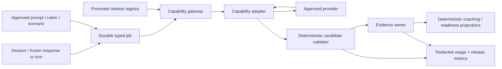

# Bestehen / App — AI Gateway, Model Governance, Evaluation, and Cost

> **Stage:** 19 of 28  
> **Status:** Accepted architecture baseline  
> **Owner:** Productive Evaluation / AI Governance  
> **Applies to:** Writing evaluation, Speaking transcription/partner/evaluation, exceptional runtime content candidates, provider routing, model release, privacy and variable cost  
> **Last verified:** 2026-08-23

## 1. Purpose and scope

This stage fixes the smallest AI boundary that can support productive-language coaching without letting a commercial model become the source of evidence truth, Readiness policy, planning, objective scoring, or routine coach wording.

The launch shape is one App-owned **capability registry and gateway module** inside the existing worker, not a generic AI platform or lowest-common-denominator wrapper. Each permitted capability has its own typed request, response schema, model release, payload allowlist, benchmark, timeout, cost policy, fallback and circuit. The initial provider routes are:

- paid Gemini Developer API, pinned stable `gemini-3.6-flash`, for bounded Writing candidates, bounded audio-aware Oral candidates, and the exceptional adaptive Speaking turn/content candidate;
- OpenAI `gpt-4o-mini-transcribe-2025-12-15` for provisional German STT with token log probabilities; and
- OpenAI `gpt-4o-mini-tts-2025-12-15` only for a bounded adaptive partner turn when no reviewed audio asset exists. Reviewed fixed text/audio remains the routine default.

Gemini runs at the cheapest thinking level that passes the capability benchmark. A single request may be escalated once to the same pinned model at a registered stronger thinking level; it is not a retry loop or a vote. A network retry with the same semantic operation is not a second evaluation and cannot create another candidate. If the one escalation cannot produce a supported candidate, the affected conclusion remains `pending` or requests a fresh sample.

No production code, provider account, prompt, benchmark data, content, Design source, or prior architecture output is created here. Provider activation remains gated by Stage 23 privacy/security/legal controls and Stage 25 release evidence.

## 2. Inputs, authority, and continuity

### 2.1 Reproducible GitHub snapshot

Every required input was fetched from GitHub before deciding. App `main` was `747aeb1050fc9821fa000c91f3f6ece759df391d`; Shaping `main` was `9f37ad78fdd101b3c9cb8782ddc54d12dbce1fdc`.

| Source | Blob SHA |
|---|---|
| Shaping `app/28-bestehen-app-product-specification.md` | `18ae80cc2fd63cecd76c297c3e56d44a68367856` |
| Shaping `app/07-core-learning-loop.md` | `c313c859f64997972feca87497d70476c4528a20` |
| Shaping `app/12-writing-coaching.md` | `0a606197ad514e8c8958004188837e37173258be` |
| Shaping `app/13-speaking-coaching.md` | `9462c78a1e7cc68249d38aa5a18a287be8aacd9c` |
| Shaping `app/16-mock-exams.md` | `8f6c23fa16524bd251cef39d823cfeea73bfcef3` |
| Shaping `app/18-coach-personality-and-behavior.md` | `7bc3c2ee918264911a9550fe20e53dc565f986dd` |
| Shaping `app/21-content-strategy.md` | `8149d6a268da70e17cad46f774b9d5de77776986` |
| Shaping `app/24-analytics-and-success-metrics.md` | `28d1a5380a7ea9f28efdc95ce0c96987920917e1` |
| Shaping `app/25-business-model-and-product-boundaries.md` | `904ae20e8cb3f9f354d6505513821e86f609622b` |
| Shaping `app/26-platform-accessibility-nonfunctional.md` | `8137091683941b0d55f3d4fb90af3c402b8371e5` |
| `Design/DESIGN-HANDOFF.md` | `417a6820037e045e2dd9f29afc42b9f2e94fd638` |
| `Design/Bestehen-01-Design-System.dc.html` | `d4e371aacee32c85ddc53cf9cf3abaaff4e86e7a` |
| `Design/Bestehen-04-Flows-Handoff.dc.html` | `7120b05a2272c31e5896e4313a7007935f5d0aed` |
| `Architecture/00-architecture-shaping-plan.md` | `b263c5e7b3bccc0450ddd17aa0cc007432d672b7` |
| `Bestehen_App_Architecture_Checklist.md` | `3ea044670edc79c100ea5fa87372193e04cac906` |
| Stage-19 prompt | `dade759e77a282cc2e8c88c4c6286ad50194d3fd` |
| Stage 03 output | `907b04c57813dc50f92a7ed00e49196ff7d4a924` |
| Stage 05 output | `bb6df811ec9010de556d1719f22e31bb8ca3190e` |
| Stage 06 output | `53d34ae65ef4c8fa79c00026f9bd5d7b876ce672` |
| Stage 09 output | `e6fb121ab1b10c6cbcf692bc88acaf98f2e45e7a` |
| Stage 12 output | `c640da01d6eb6d71a5e2ea7a0dcf19147d6d7528` |
| Stage 17 output | `c2c3de417f1d3bcd8c53e1bf40fbb49522c34529` |
| Stage 18 output | `2f118f817a99b76dc1e0c38c0aedaa1e0662268e` |
| ADR index | `64cfcdc81ea03826e926eb7d9312b98a0f3f91de` |

All seven required predecessor stages are complete and compatible. PostgreSQL owns jobs and semantic facts; Evidence owns validity and accepted interpretation; provider output is immutable candidate input; HTTP work is versioned and idempotent; routine content is approved and cached; Writing and Speaking already define the exact candidate contracts this gateway must implement.

### 2.2 Authority reconciliation

Stage-27 precedence is binding: validity/fairness, direct evidence, independent Written/Oral risk, uncertainty resolution, due repair/retention, progression/coverage, then preference. AI cost never outranks a pass-critical modality or evidence truth.

The design's evaluator-slow state assumes copy such as “usually under a minute” and changes an indefinite spinner to Pending after 30 seconds. Those are UX assumptions, not provider promises. The architecture preserves the behavior—non-blocking Pending and a stable original-attempt attachment—but Stage 24/25 must set measured copy/SLO thresholds. Design also correctly requires generated feedback to retain semantic structure, visible provenance/conditions and neutral system-failure treatment.

Stage 18 records a separate copy conflict: “audio is never shared” is incompatible with approved cloud processing. Product authority permits minimum processor transfer. Release copy must disclose transfer, purpose and deletion; no Design file is edited here.

## 3. Official provider evidence and selection

All mutable provider facts below were accessed **2026-08-23**. Prices are USD list prices before taxes/currency conversion; the registry stores the observed price revision and never treats promotional pricing as permanent.

| Provider / route | Current primary evidence | Current price / limit fact | Data, region, support and exit finding |
|---|---|---|---|
| **Gemini Developer API paid / `gemini-3.6-flash`** | [model](https://ai.google.dev/gemini-api/docs/models/gemini-3.6-flash), [structured output](https://ai.google.dev/gemini-api/docs/structured-output), [audio](https://ai.google.dev/gemini-api/docs/audio), [thinking](https://ai.google.dev/gemini-api/docs/thinking), [deprecations](https://ai.google.dev/gemini-api/docs/deprecations) | [pricing](https://ai.google.dev/gemini-api/docs/pricing): promotional $0.75/M input and $3.75/M output including thinking through 2026-12-31; $1.50/M and $7.50/M from 2027-01-01. Audio is 32 tokens/second, so audio input alone is about $0.00144/min now and $0.00288/min after promotion, before text/output. Stable GA, 1,048,576 input and 65,536 output token model ceilings; App uses far smaller registered maxima. | Text/image/video/audio/PDF input, text and structured output, thinking levels; no shutdown date announced. Paid content is not used to improve products. Default service may process/cache transiently in countries where Google/agents operate; [ZDR controls](https://ai.google.dev/gemini-api/docs/zdr) require approval/configuration. Use inline audio and no developer logs/datasets/grounding; no Files API for learner audio. Exit is a capability adapter plus replayable, rights-safe benchmark fixtures. |
| **OpenAI `/audio/transcriptions` / `gpt-4o-mini-transcribe-2025-12-15`** | [audio API](https://platform.openai.com/docs/api-reference/audio/createTranscription), [model/pricing](https://platform.openai.com/pricing), [data controls](https://platform.openai.com/docs/guides/your-data) | $0.003/min; JSON output can include token log probabilities for confidence. The endpoint accepts common capture formats and a language hint. | API data is not used for training by default; the data-control table lists no abuse-monitoring or application-state retention for transcription and ZDR eligibility. EU regional processing is an approval/ZDR option, not assumed. Exit candidates: Deepgram Nova-3 Multilingual EU or a validated self-hosted recognizer. |
| **OpenAI `/audio/speech` / `gpt-4o-mini-tts-2025-12-15`** | [model](https://developers.openai.com/api/docs/models/gpt-4o-mini-tts), [audio API](https://platform.openai.com/docs/api-reference/audio/createSpeech), [data controls](https://platform.openai.com/docs/guides/your-data) | $0.60/M text input and $12/M audio output tokens (official model page; roughly $0.015/min is an estimate, actual token usage is authoritative); 4,096-character endpoint ceiling and a pinned snapshot. | No training by default; speech endpoint has no application state but default abuse logs may last up to 30 days. Only scenario-approved generated text is sent; no learner audio/profile. Cheaper exit is fixed reviewed audio or device synthesis labelled as lower-fidelity practice. |
| **Deepgram Nova-3 Multilingual EU** | [pricing](https://deepgram.com/pricing), [EU endpoint](https://developers.deepgram.com/reference/custom-endpoints), [rate limits](https://developers.deepgram.com/reference/api-rate-limits), [terms](https://deepgram.com/terms) | Self-serve list currently shows $0.0058/min streaming and $0.0092/min prerecorded multilingual; true per-second billing. EU endpoint is GA and lists up to 50 concurrent prerecorded requests. | Credible STT substitution, but current self-serve terms grant broad content-use rights unless the per-request training opt-out is set. Therefore not the launch default; it may be promoted only with opt-out enforcement, retention proof and benchmark parity. Self-host/dedicated is an enterprise-cost exit, not launch scope. |
| **Vertex AI / Gemini** | [zero-retention controls](https://docs.cloud.google.com/vertex-ai/generative-ai/docs/vertex-ai-zero-data-retention), [security controls](https://docs.cloud.google.com/vertex-ai/generative-ai/docs/security-controls), [Gemini 3.6 availability](https://docs.cloud.google.com/vertex-ai/generative-ai/docs/models/gemini/3-6-flash) | Model/pricing varies by service/SKU; no assumed discount. Gemini 3.6 is GA but currently global endpoint only. | Stronger cloud-governance route, but adds GCP IAM/billing and does not presently give EU inference for this model. Upgrade only when ZDR/security/account controls materially outweigh the extra operations or a regional supported model passes benchmarks. |

The Gemini Developer API terms require Paid Services for an API client in the EEA/Switzerland/UK and restrict services likely accessed by under-18 users. Launch is therefore an adult private pilot unless Stage 23 legal/product review selects a permissible processor/age boundary. This is a release gate, not a claim of legal compliance. The safe fallback with the gate unmet is no model call: fixed/self-check learning and Pending/no productive evidence.

## 4. Decisions and rationale

| ID | Decision | Consequence / durable boundary | ADR |
|---|---|---|---|
| **ARCH-S19-D01** | Keep deterministic objective scoring, validity acceptance, Readiness, Written/Oral aggregation, planning/ranking, schedules, analytics aggregation and coach templates outside AI. | No AI output can create truth, probability, score conversion, priority or learner fault. | ADR-0027 |
| **ARCH-S19-D02** | Allow only capability-registered productive evaluation, provisional STT, exceptional adaptive partner/TTS and quarantined exceptional content candidates. | No always-on/per-click/decorative AI, live Corpus AI, routine generation or learner-facing unreviewed item. | ADR-0027 |
| **ARCH-S19-D03** | Use one in-process gateway with capability-specific ports and schemas, not one generic `generate()` wrapper and not a microservice. | Shared transport/security/cost policy; semantic differences remain explicit and replaceable. | ADR-0027 |
| **ARCH-S19-D04** | Registry releases pin capability, provider/model snapshot, thinking level, prompt/evaluator/schema/rubric versions, payload policy, timeouts, price revision, benchmark evidence and rollback predecessor. | Aliases cannot silently change behavior. Unknown majors and unpromoted releases fail closed. | ADR-0027 |
| **ARCH-S19-D05** | Gemini 3.6 Flash is the initial candidate producer. OpenAI mini Transcribe is STT; OpenAI mini TTS is adaptive partner voice only. | Two credentials/failure domains, no realtime agent, no provider SDK types above adapters. | ADR-0027 |
| **ARCH-S19-D06** | Run deterministic prechecks, one candidate, then at most one policy-triggered stronger-thinking evaluation. Never average, vote or escalate because a result is low. | Unresolved ambiguity is Pending/cannot-judge/fresh sample. Retry is semantic-idempotent and does not multiply candidates. | ADR-0027 |
| **ARCH-S19-D07** | Evidence validates identity, hash, schema, citations, allowed enums, rubric/contract compatibility, confidence/scope and candidate safety before accepting supported scope. | Candidate rejection is system-owned and neutral; corrections append and recompute deterministic projections. | ADR-0027 |
| **ARCH-S19-D08** | Promote releases only through rights-safe human-labelled gold/benchmark sets with repeatability, subgroup/fairness, drift, calibration, failure and cost gates. | Provider/model substitution is a release, never a live experiment on learner truth. | ADR-0027 |
| **ARCH-S19-D09** | Send minimum pseudonymous payload, use paid/no-training settings, disable log sharing/grounding/files, redact local telemetry, rotate least-privilege secrets and delete raw audio immediately/finally within the seven-day ceiling. | No hidden training contribution; no learner data reaches Corpus; legal/region/subprocessor controls remain explicit gates. | ADR-0027 |
| **ARCH-S19-D10** | Attribute every billed unit to one request/capability/release and measure cost per useful accepted productive evidence unit, separated by skill/validity/escalation. | Cost chooses equivalent-quality routes; it cannot suppress Writing/Oral truth or accessibility. | ADR-0027 |
| **ARCH-S19-D11** | Use per-capability bulkheads/circuits, bounded deadline/retry-after and fallback. Open circuits produce Pending or fixed/deterministic alternatives while unrelated work continues. | No global provider outage and no technical failure becomes learner failure. | ADR-0027 |
| **ARCH-S19-D12** | Generated feedback is structured text with language/semantic markup, evidence references and deterministic templates; audio never replaces text. | WCAG 2.2 AA semantics survive provider change and Pending/failure messages remain sparse/non-blocking. | ADR-0027 |

## 5. Capability inventory and routing matrix

| Capability | Permitted input / purpose | Launch route | One escalation | Deterministic validation / owner | Cheaper fallback | Explicit exclusions |
|---|---|---|---|---|---|---|
| Objective Reading/Language Elements/Listening result | structured learner selections | **No AI** | none | Stage 15/16 scoring; Evidence | exact deterministic scoring | no explanation call per answer; no answer-key invention |
| Writing evaluation | approved prompt/rubric revision + frozen response + actual conditions | Gemini 3.6 Flash, low thinking if benchmark passes; otherwise medium | same snapshot, one stronger registered level only on consequential low confidence/disagreement/schema-correct ambiguity | schema, content-point/rubric citations, response hash; Evidence accepts | structured self-check and Pending; retain response | no Readiness update, planning, score averaging or decorative rewrite |
| STT reference | exact completed learner audio + language `de` + minimal scenario terms | OpenAI mini Transcribe pinned snapshot, one pass, logprobs | no model escalation; one transport retry with same request, then audio-aware evaluator/no transcript | segment/token confidence mapping; Productive Evaluation owns reference, not score | learner dispute annotation; audio evaluation; Pending | no pronunciation or grammar judgment from transcript alone |
| Oral evaluation | exact completed audio, turns, transcript/reference, scenario/rubric and actual conditions | Gemini 3.6 Flash audio input, medium thinking | one high-thinking pass on material audio-dependent ambiguity/dispute or governed calibration | audio/turn evidence refs, cannot-judge scope; Evidence accepts | preserve fixed observables; Pending/fresh voice sample | no transcript-only pronunciation/fluency, no invented weak score |
| Adaptive S2/S3 partner turn | minimum previous-turn semantic reference + scenario allowlist + hidden constraints | Gemini 3.6 Flash low thinking, strict partner-turn schema | none; repeat clarification only if scenario contract permits, not a premium escalation | scenario/intent/length/no-coaching/policy validator; Session owns turn | reviewed fixed branch or honest partner delay | no unrestricted chat, full-duplex or profile/Readiness context |
| Adaptive partner voice | approved generated partner text only | OpenAI mini TTS pinned voice/snapshot | none | digest/text equivalence, format/duration and media checks | fixed reviewed audio; text-only accessible practice; device synthesis after release test | no cloned learner/examiner voice; no learner data; audio never sole content |
| Exceptional fresh narrow retry/content draft | App-owned structured brief with no learner identity and rights-safe pattern intelligence | Gemini 3.6 Flash low thinking into quarantine | none | Stage 09 form/schema/rights/dedup/answer validation; human approval where required | last approved content or transparent “fresh task unavailable” | no routine P4/gold publication, raw Corpus imitation or per-attempt generation |
| Diagnosis/repair wording | already accepted structured observations | **No additional call**; deterministic template from the accepted candidate | none | Coaching/Mistake/Review | deterministic template | no mascot/chat persona, summary call, notification call |
| Readiness, mock aggregation, Ready-to-Book | accepted evidence facts only | **No AI** | none | Stage 11 deterministic policy | withhold/widen claim | no pass probability field/model/event/template/calculation |
| Daily plan, scheduling, analytics | accepted derived facts | **No AI** | none | Stages 08/21/24 deterministic rules | deterministic policy | no AI priorities, cohort summaries or nudges |

Corpus remains asynchronous and receives no learner profile, response, transcript, audio, evaluation or outcome. Runtime generation never searches Corpus; it consumes only an approved App-owned structured brief.

## 6. Components, ownership, and data flow

| Component | Owns | Must not own |
|---|---|---|
| Capability registry | immutable promoted route/release, price and policy facts | learner evidence, mutable vendor aliases |
| AI gateway coordinator | allowlist, idempotent orchestration, deadline, routing, circuit, usage receipt | rubric semantics, Evidence acceptance |
| Gemini adapter | request/response translation, provider request ID/usage | App enums outside mapping, learner identity |
| OpenAI audio adapter | transcription/TTS translation, provider usage/deletion receipt | evaluation truth, partner scenario policy |
| Productive Evaluation | requests, immutable candidates, provider provenance, candidate lifecycle | final validity/Readiness |
| Session & Attempt | attempt/turn/response identities and actual conditions | provider choice or candidate truth |
| Evidence & Capability | candidate acceptance/rejection, validity, supported scope, correction | provider transport, price |
| Content & Forms | approved prompts/rubrics/scenarios/rights | learner state or runtime provider logs |
| Operations/Governance | benchmark labels, promotions, price catalog, redacted measures, rollback | learner content in telemetry |
| Stage 23 data-rights/security | secrets, processor records, deletion/export orchestration | evaluator semantics |



## 7. Contract, schema, confidence, and versioning

The following are explanatory pseudotypes, not production TypeScript, DDL or provider schemas.

```text
AiCapabilityRelease = {
  release_id, capability,
  provider, endpoint, model_snapshot,
  thinking_level?, voice_id?, region_observation,
  prompt_version, evaluator_contract_major, response_schema_major,
  rubric_or_scenario_versions[], payload_policy_version,
  timeout_policy_version, retry_policy_version, circuit_policy_version,
  price_catalog_revision, benchmark_release_id,
  status: draft | shadow | promoted | suspended | retired,
  effective_at, rollback_release_id, provenance
}

AiRequest = {
  request_id, semantic_operation_key,
  learner_scope_pseudonym, capability, purpose: standard | escalation,
  attempt_or_response_ref, immutable_input_hash,
  release_id, minimum_payload_manifest,
  deadline, created_at
}

AiCandidateEnvelope = {
  candidate_id, request_id, capability, release_id,
  provider_request_id_hash, model_snapshot_observed,
  prompt_version, schema_version, rubric_or_scenario_versions[],
  input_hash, structured_payload,
  confidence: high | medium | low,
  supported_scope[], cannot_judge_scope[], evidence_refs[],
  validation: accepted_for_evidence_review | rejected_schema |
              rejected_identity | rejected_policy | rejected_rights,
  usage_receipt_id, created_at, immutable_hash
}

AiUsageReceipt = {
  usage_receipt_id, request_id, capability, release_id,
  input_text_tokens, input_audio_tokens?, input_audio_seconds?,
  cached_input_tokens?, output_text_tokens, output_audio_tokens?,
  provider_reported_cost?, calculated_cost_usd,
  price_catalog_revision, retry_ordinal, escalation_ordinal,
  provider_status, latency_ms, billed_observed_at
}

EvidenceAcceptance = {
  acceptance_id, candidate_id?, accepted_scope[], rejected_scope[],
  validity: valid | partially_valid | pending | interrupted | not_counted,
  reason_codes[], acceptance_policy_version,
  accepted_at, correction_of?
}
```

There are exactly five validity values: `valid`, `partially_valid`, `pending`, `interrupted`, `not_counted`. Provider job/circuit/schema states are operational states, never extra validity values. Readiness remains exactly `evidence_building`, `not_ready`, `borderline`, `safe`, `ready_to_book`, `stale_contradicted`.

Confidence is ordinal and claim-scoped. Provider confidence is an observation, not calibrated probability. The App maps STT log probabilities through a versioned calibration policy and retains `unknown` when mapping is unsupported. A candidate can be high confidence for content-point coverage and `cannot_judge` for pronunciation. Evidence acceptance never upgrades unsupported scope.

Compatibility rules:

- exact model snapshot/release is recorded; moving stable aliases require a new promoted release;
- additive optional fields are minor; a changed enum, meaning, required field or evidence-reference coordinate is major;
- unknown major, missing input hash, unsupported rubric/schema or uncited pass-critical claim rejects the candidate neutrally;
- prompt, model, thinking, schema, rubric, scenario, STT, TTS voice, price, payload, circuit, acceptance and benchmark versions evolve independently;
- old candidates remain historical facts; a new release produces a new candidate/correction, never rewrites lineage;
- rollback moves the registry to its recorded predecessor and suspends new work on the faulty release; affected accepted interpretations are reviewed through Stage 06 scoped correction.

## 8. Gateway and evaluation flows

### 8.1 Writing evaluation

```mermaid
sequenceDiagram
  participant A as Attempt service
  participant Q as pg-boss job
  participant G as AI gateway
  participant M as Gemini adapter
  participant E as Evidence owner
  A->>Q: TX frozen response + Pending + operation key
  Q->>G: EvaluateWriting(request, approved release)
  G->>G: Payload, rights, hash, circuit and token prechecks
  G->>M: Minimum structured paid-tier request
  M-->>G: Candidate + usage + provider provenance
  G->>G: Schema/citation/identity/policy validation
  alt candidate supports the claim
    G->>E: Immutable candidate
    E->>E: Accept/reject scope under evidence policy
  else one escalation predicate true
    G->>M: Same input/release, stronger registered thinking, escalation=1
    M-->>G: Candidate + usage
    G->>E: Both candidates + disagreement; never average
  else timeout/outage/invalid/second uncertainty
    G->>E: System-owned Pending/cannot-judge reason
  end
```

### 8.2 Speaking transcription, partner and oral evaluation

```mermaid
sequenceDiagram
  participant S as Speaking pipeline
  participant G as AI gateway
  participant O as OpenAI audio
  participant M as Gemini multimodal
  participant E as Evidence owner
  S->>G: Completed turn audio + opaque refs
  par provisional reference
    G->>O: One STT request, de, pinned snapshot
    O-->>G: Transcript + token logprobs + usage
  and audio-aware evaluation
    G->>M: Audio + exact turns/scenario/rubric/conditions
    M-->>G: Structured oral candidate + usage
  end
  G->>G: Validate transcript role and candidate evidence refs
  alt meaning-dependent next turn required
    G->>M: Minimum prior meaning + bounded scenario contract
    M-->>G: Structured partner-turn candidate
    G->>G: Scenario/no-coaching/length validator
    G->>O: Approved partner text only to pinned TTS
    O-->>S: Temporary generated audio + usage
  end
  G->>E: Candidate(s), provenance, confidence and limits
  E->>E: Accept supported scope or Pending/fresh sample
  S->>S: Delete raw App/provider audio after finalization; prove by deadline
```

Network/provider retries use the same request and semantic operation key, exponential backoff with jitter and provider `Retry-After`, and a bounded attempt/deadline policy. A retry after an unknown transport outcome first resolves the provider/job receipt. It never creates a second attempt, evaluation or evidence record.

## 9. Escalation, failure, fallback, and circuit breakers

Escalation predicates are deterministic and versioned. Eligible triggers are: material low confidence on a pass-critical requested scope; primary candidate contradicts deterministic facts/rubric constraints; material learner dispute whose original audio/text still exists; audio-dependent cannot-judge where stronger thinking was benchmarked to help; or a governed calibration sample. Low performance alone, curiosity, coach wording, analytics and provider retry are not triggers.

| Fault / signal | Gateway action | Learner/evidence consequence | Fallback / circuit action |
|---|---|---|---|
| input hash/schema/rights/payload precheck fails | do not call provider; record redacted reason | no learner-negative observation; `pending` or `not_counted` only for affected scope | fix data/content or fresh task |
| 429/5xx/timeout before deadline | idempotent bounded retry | stable Pending; unrelated work available | respect Retry-After; circuit records failure |
| unknown outcome | reconcile request/provider receipt before retry | no duplicate candidate/evidence | same operation key |
| malformed/refusal/policy block | reject candidate; one schema repair only if it is the same evaluation and within policy, otherwise escalation predicate | Pending/cannot-judge; “feedback delayed on our side” | deterministic/self-check/fixed path |
| low confidence | accept only supported low-claim scope or one escalation | never default-low learner score | fresh sample after ceiling |
| primary/escalation disagree | Evidence compares cited support; never average/vote | supported scope only, otherwise Pending | human gold review only outside learner flow |
| STT outage | oral evaluator may use audio; partner uses fixed clarification/branch | no transcript-based weakness | fixed partner; learner annotation later |
| Gemini circuit open | no call until half-open probe passes | Writing/Oral Pending; objective work continues | self-check, fixed partner, approved content |
| TTS circuit open | no adaptive audio | text/fixed reviewed audio; narrower learning claim | fixed assets/device synthesis only if release-tested |
| cost guard reaches configured stop | stop new optional generation first; pass-critical accepted jobs remain queued/Pending, never silently dropped | transparent delay; unrelated/deterministic work continues | owner raises cap or route remains disabled |
| raw audio delete-by approaches/expires | block non-deletion work for object; delete first | if unresolved at seven days, `not_counted` system correction/fresh sample | no retained-audio retry |

Each capability has a separate rolling circuit keyed by provider/region/model release; STT failure cannot open Writing, and TTS failure cannot open evaluation. Thresholds/window/half-open probes are Stage 24 calibrated parameters with provenance and rollback. No breaker threshold is invented here. The invariant is fail closed, bounded attempts, durable Pending and local isolation.

## 10. Benchmark, release gates, and drift

Benchmark data is App-owned, rights-safe and de-identified. Learner production content never silently becomes training or a provider evaluation dataset. Voluntary, separately consented calibration is a later product/legal path. Human labels store adjudicator role/version and disagreement, never demographics not required for fairness analysis.

| Gate | Writing | Speaking/STT/partner | Promotion rule / failure response |
|---|---|---|---|
| Schema/contract | 100% parse, enum, span and hash fixtures | 100% parse, turn/audio refs, transcript role and no-coaching fixtures | any failure blocks release |
| Human gold agreement | criterion/content-point/verdict and cannot-judge by condition | S1–S3 rubric/dimensions, interaction dependency, transcript semantic error | minimum thresholds set from adjudicated baseline in Stage 24/25; regression blocks |
| Pass-critical error | false supported claim, wrong-side boundary, missing obligation | false intelligibility/interaction/pronunciation claim | zero known critical fixture regressions; investigate/correct before promotion |
| Repeatability | repeated calls over frozen fixture/release | repeated text/audio calls and thinking levels | measure exact/semantic/categorical variance; unsupported variance blocks |
| Fairness/bias | response length, register, topic, orthographic variation | German accent variety, speech rate, voice pitch, device/noise/codec, access conditions | compare error/cannot-judge/escalation by tested group; material unexplained gap blocks |
| Drift | frozen sentinel set on current promoted release | same plus STT word/meaning error and partner policy | scheduled and on provider change; suspend/rollback on gate breach |
| Failure/recovery | 429, 5xx, timeout, malformed, refusal, duplicate | same plus partial audio, deletion, transcript dispute | only scoped neutral states; duplicate count must remain one |
| Accessibility | structured feedback order/labels/language/spans | transcript uncertainty/turn labels/timestamps and audio text alternative | keyboard/AT/reflow/zoom; audio never sole feedback |
| Cost/latency | input/output/escalation and cost per accepted unit | seconds/tokens/TTS and cost per accepted unit | record baseline; route cannot promote without acceptable quality and sustainable measured cost |
| Privacy/rights | payload diff/log scan/deletion | raw audio/provider copy/deletion proof | any excess field/log/training share or missed delete blocks |
| Exit | replay through substitute adapter | substitute STT/TTS/multimodal adapters | App contract/evidence semantics unchanged |

Promotion stages are `draft → shadow → promoted`. Shadow uses only benchmark fixtures, never undisclosed production learner content. Canary on real requests is allowed only after full gates and preserves the old release as immediate rollback; candidates from canary are not accepted until the release policy explicitly permits them. Preview/`latest` aliases cannot be promoted. A published deprecation, price/data-use/region/subprocessor change, safety-policy change or behavior drift opens a new review and may suspend the route before shutdown.

## 11. Cost accounting, alerts, and sustainability

### 11.1 Per-capability cost formula

For request `r` under price catalog `p`:

```text
cost(r) = text_input_tokens * p.text_input
        + cached_input_tokens * p.cached_input
        + audio_input_tokens_or_seconds * p.audio_input
        + text_output_including_thinking_tokens * p.text_output
        + audio_output_tokens_or_seconds * p.audio_output
        + provider_fixed_request_charges
```

All rates are normalized to USD per billed unit. Provider-reported usage is authoritative when supplied; otherwise a documented conservative estimator is reconciled to invoice export. Currency/tax conversion is an operations fact, not mixed into model-quality comparisons.

| Capability | Billed unit and current route | Cost-sensitive policy | Useful accepted productive evidence unit |
|---|---|---|---|
| Writing evaluation | Gemini text input/output/thinking | bounded rubric/context and output schema; no extra wording call; escalation separately attributed | one finalized Writing response for which Evidence accepts at least one requested productive scope as `valid` or `partially_valid` |
| Oral evaluation | Gemini text + 1,920 audio tokens/min + output/thinking | only completed required turns/audio; one bounded candidate/escalation | one finalized Speaking part/block with at least one accepted requested Oral scope as `valid` or `partially_valid` |
| STT | OpenAI $0.003 per audio minute | completed turn/block only, language hint, no realtime idle stream | supporting cost attributed to the same accepted Oral unit; also report transcript minutes and semantic-error rate |
| Adaptive partner text | Gemini input/output/thinking | only meaning-dependent S2/S3; no escalation | attributed to the resulting accepted Speaking part/block; separately report turns that never yield evidence |
| Adaptive partner TTS | OpenAI $0.60/M text input + $12/M audio output tokens | approved turn only; cache only non-learner scenario-safe assets | attributed to the same Speaking unit; report generated audio minutes |
| Exceptional content candidate | Gemini input/output | quarantine/batch where latency permits; no learner identity | one candidate that passes rights/form/answer/dedup validation and is promoted to its allowed content role; never counted as learner evidence |

`cost_per_useful_accepted_productive_evidence_unit = sum(all attributable standard, retry, escalation, STT and TTS cost) / count(accepted units)` for the same capability/release/window. Report Writing and Oral separately, and split `valid` from `partially_valid`; never hide zero-denominator/Pending periods with a blended average. Also report cost per attempted request, escalation rate, wasted/rejected candidate cost and human adjudication minutes.

### 11.2 Budget and alert policy without an invented owner budget

The architecture does not invent a euro/month value. Before any paid route is enabled, Operations must set an explicit recoverable operator spend envelope and per-capability daily/rolling ceilings in the registry. The safe default when no envelope is configured is **AI disabled**; deterministic/fixed/Pending behavior still works.

Controls are:

1. preflight token/audio/output maxima per capability; reject or truncate only provider context that the contract declares optional;
2. provider billing/prepaid and project limits as an outer guard, never the sole monitor;
3. alerts at versioned fractions of the configured envelope, with optional generation shed before productive evaluation and hard circuit at the stop threshold;
4. alert on any unregistered SKU/rate, invoice-estimator variance, cost without a usage receipt, duplicate charge, sudden escalation/rejection change, or cost-per-accepted-unit regression beyond its benchmark control band;
5. mandatory price-catalog review at the Gemini promotion end date (2026-12-31), provider/model/deprecation change and each release promotion; and
6. no automatic upgrade to priority/provisioned throughput. Upgrade only when measured Pending age/throughput breaches a Stage-24 objective and the incremental price buys benchmark-equivalent or better quality/reliability.

Fallback order preserves truth: fixed reviewed assets → deterministic/self-check support → standard bounded productive evaluation → one justified stronger-thinking evaluation → Pending/fresh sample. Cost may remove optional runtime generation or use batch for non-learner content, but cannot erase accepted learner work, actual-voice requirements, accessible alternatives, deletion work, or produce a lower score.

## 12. Security, privacy, rights, and accessibility

### 12.1 Minimum payload and secrets

The gateway uses outbound allowlists per capability. It sends an opaque request ID/pseudonym, exact required response/audio, minimum approved prompt/rubric/scenario/turn facts, and required actual-condition facts. It excludes name, email, date of birth, exact exam date, profile, Readiness, other attempts, schedules, analytics identifiers, device fingerprint, IP collected by the App, accommodation/medical inference, Corpus provenance/source documents and secrets.

Provider credentials are server/worker-only, per-provider/per-environment/per-capability where supported, least privilege, stored in the deployment secret manager, rotated and never exposed to browser, prompt, response, log or export. Provider request IDs are hashed/redacted in ordinary telemetry; a restricted operational lookup is time-bound and audited. URLs, errors, traces, metrics and session replay never contain learner text/audio/transcript.

Paid Gemini is mandatory, developer logging/dataset contribution/grounding/context caching/session resumption are disabled, and inline audio is used so no 48-hour Files object is created. OpenAI training opt-in is disabled and only the no-application-state transcription/speech endpoints are used; default speech abuse retention remains a disclosed processor risk until ZDR. Provider dashboards/log access is restricted. Stage 23 must verify effective settings, DPA/terms, subprocessors, age/use restrictions, regional processing, incident/export/delete behavior and jurisdiction-specific review. No compliance claim is made.

Raw audio remains encrypted/private in App storage, is sent only when required, and is deleted from App/provider paths immediately after finalized evaluation/correction and no later than seven days while Pending. Inline-provider calls still require a provider deletion/retention receipt or documented endpoint guarantee; if proof is insufficient, the route cannot launch. STT/TTS/evaluation content is never contributed to training without a separate explicit future opt-in product/legal decision. No benchmark uses raw production learner data by default.

Only App-approved/right-cleared prompt, rubric, scenario and audio context may leave the App. Restricted reference/Corpus material is not sent. Generated content enters quarantine with source brief/model/prompt/schema lineage, similarity/rights review and role approval; it cannot silently become P4/gold. A rights withdrawal suspends affected generation inputs and triggers content/evidence correction under Stages 06/09; it never rewrites unrelated performance.

### 12.2 Accessible output

- The candidate schema returns criterion/dimension, plain-language message keys, exact text spans or audio/turn timestamps, confidence/limits and ordered correction targets; the UI renders semantic HTML, not provider Markdown/HTML.
- German spans have language metadata; corrections do not depend on colour/underline alone and expose original/correction/uncertainty to AT.
- Audio feedback/partner content has the exact text alternative. TTS is never the only representation.
- Pending appears after the measured UX threshold, never as an indefinite spinner or modal. Arrival is polite/non-interrupting; failures use neutral “This wasn't you” ownership.
- No token stream, confidence tick, waveform, timer or model reasoning is continuously announced. Focus remains with learner work and unrelated routes stay operable.
- Provider prose cannot override the three-part coach voice or introduce praise, shame, probability, marketing or unsupported claims; deterministic templates own final copy.

## 13. Alternatives considered

| Decision | Simpler / do-nothing | Other credible alternative | Selection, rejection and exit |
|---|---|---|---|
| AI boundary | no productive AI; self-check only | generic multi-provider AI service / microservice | No-AI is the complete outage/privacy fallback but cannot deliver required rubric/audio evaluation. A generic service hides semantic differences and adds operations. In-process capability ports are smallest sufficient. |
| Provider breadth | one Gemini provider for everything | three best-of-breed providers | Gemini lacks STT token logprob contract and dedicated TTS route is not the chosen evaluator path. Two providers are bounded; a third adds retention/secrets/circuits without launch evidence. |
| Gemini service | paid Developer API | Vertex AI | Developer API is lower-ops and has exact paid/no-training terms; its global-processing/age terms constrain the pilot. Vertex is an exit when governance/region benefit is proven. |
| Evaluator model | Gemini 3.5 Flash-Lite | `gemini-latest` or preview Pro | 3.6 Flash is stable, multimodal, structured and currently cheaper promotional; Flash-Lite may later win a benchmark. Mutable aliases/preview lifecycle are not release-safe. |
| Escalation | accept one result or Pending | majority vote / multi-agent chain | One stronger-thinking pass uses the same contract and bounds cost. Voting creates fake precision; Pending remains honest after one ceiling. |
| STT | Gemini transcript in same call | Deepgram Nova-3 EU or self-hosted Whisper | OpenAI mini Transcribe exposes logprobs and a no-application-state endpoint at lower current price. Deepgram is a credible EU exit but self-serve training opt-out/terms add risk; self-hosting adds ops. |
| Partner | fixed only | realtime voice agent | Fixed is routine fallback, but some S2/S3 needs meaning-dependent response. One turn text + TTS is auditable; realtime is unnecessary cost/privacy/latency. |
| TTS | browser/device synthesis only | OpenAI mini TTS | Browser voices are not stable across evidence devices. Pinned TTS is used only when adaptive voice is necessary; fixed reviewed audio remains cheaper exit. |
| Content | no runtime generation | routine per-attempt generation | No generation is normal. Exceptional narrow retry/adaptive content enters quarantine; routine generation harms rights, freshness and cost. |
| Data retention | provider defaults | retain requests for debugging/training | Minimum paid/no-share settings and no files/log datasets satisfy the product boundary. Retained learner payload is disproportionate; use rights-safe fixtures for debugging. |
| Budget | invent a low monthly euro cap | no controls until invoice | Neither is acceptable. Require an owner-configured envelope, measured unit economics and disabled-by-default routes without a value invented by architecture. |

## 14. Operations, validation, risks, and downstream handoff

### 14.1 Measures without learner content

Measure by opaque capability/release/schema/rubric/scenario/browser/condition IDs: request/retry/escalation counts, provider status/latency/Pending age, schema/refusal/policy/circuit outcomes, confidence/cannot-judge/disagreement/correction, STT semantic/uncertain-span/dispute, partner fallback/no-coaching violations, deletion deadline/proof, input/output/audio usage, list/invoice cost, cost per accepted unit, benchmark/fairness/drift gates and rollback time. Do not emit learner text/audio/transcript, name, profile, exact date, Readiness or probability.

### 14.2 Risks and required evidence

| Risk / assumption | Required evidence / mitigation | Owner |
|---|---|---|
| Gemini 3.6 general multimodal ability may not match TELC human judgment | rights-safe bilingual/TELC-informed human gold labels and cannot-judge tests | Stage 25 / evaluation |
| stronger thinking may cost more without changing supported decisions | measure decision-change, agreement and cost; remove escalation if not useful | Stages 24/25 |
| STT logprobs may be poorly calibrated for German accents | map empirically or retain `unknown`; compare meaning error by condition | Stage 25 |
| global Gemini processing or provider age/use terms may be unsuitable | adult private-pilot boundary; Stage 23 legal/processor review; Vertex/other exit | Stage 23 / owner |
| provider claims/settings drift | automated config evidence plus scheduled terms/price/deprecation review | Stages 23–25 |
| inline audio still appears in abuse logs | obtain ZDR/retention proof or do not launch audio route | Stage 23 |
| model output cites nonexistent spans/turns | deterministic reference validator; reject neutrally | implementation / Stage 25 |
| accent/topic/register/device bias | stratified benchmark and adjudicated gaps; block release on material unexplained regression | Stage 25 |
| promotional price expires | registered future list rate and mandatory 2026-12-31 review; no assumption of continuation | Stage 24 |
| cost guard delays pass-critical evaluation | durable Pending, process accepted queue when envelope restored; never discard/score low | Stage 24 / owner |
| TTS voice changes or harms comprehension | pinned snapshot/voice, transcript alternative and listening checks | Stages 16/25 |
| generated content resembles restricted material | structured brief, similarity/rights review, quarantine, human sign-off where required | Stage 09/25 |

### 14.3 Downstream requirements

Stages 23–28 must preserve:

- capability-specific ports and promoted immutable releases; no generic model call from features;
- AI candidate-only status and Evidence-owned acceptance/correction;
- exact five validity and six Readiness states, independent Written/Oral truth, absent not zero, Safe not Ready to Book and no probability;
- deterministic objective scoring, Readiness, planning, scheduling, analytics and coach templates;
- one evaluation plus at most one stronger-thinking escalation, never voting/averaging;
- paid/no-training/no-sharing settings, minimum pseudonymous payload, no learner data to Corpus and ephemeral raw audio/deletion proof;
- stable structured feedback, citations, semantic/accessibility output and neutral Pending/failure;
- cost per useful accepted productive evidence unit, explicit operator envelope, optional-generation shedding and pass-critical truth preservation;
- release-gated benchmarks, subgroup/fairness/repeatability/drift, rollback and provider exit replay.

Dependencies introduced: `AiCapabilityRelease`, prompt/evaluator/schema registry, Gemini/OpenAI capability adapters, `AiUsageReceipt`, price catalog, per-capability circuits, benchmark promotion records, config/privacy receipts and provider exit fixtures. Dependencies removed/rejected: realtime voice agent, generic AI service, multi-agent voting, runtime Corpus, routine generation, AI planning/Readiness/analytics/copy and raw learner-data eval collection.

### 14.4 Deferred implementation choices

| Choice | Future owner | Fixed boundary |
|---|---|---|
| exact SDK/HTTP client, retry library and metric names | implementation | typed ports, operation keys, deadlines, receipts and circuits fixed |
| benchmark numeric thresholds and circuit/SLO windows | Stages 24/25 | human-gold/repeatability/fairness/drift/privacy/cost gates fixed; versioned with rollback |
| owner spend-envelope currency/amount | owner / Stage 24 operations | required before enablement; AI disabled when absent; no invented budget |
| EU/ZDR account approval, DPA/subprocessors and adult-use boundary | Stage 23 / owner legal review | no route launches without verified lawful/contractual fit; fixed fallback |
| exact prompt text and gold-set contents | evaluation/content implementation | immutable versions, rights-safe fixtures and no hidden production reuse |
| Flash-Lite, Gemini 3.7, Vertex, Deepgram or self-host substitution | later promotion | must pass the same capability gates; no historical rewrite |
| notifications for late evaluation | Stage 22/25 tone review | only “evaluation ready” semantic event; no learner content/nagging |

No owner decision blocks the architecture: if legal/account, budget or benchmark gates are absent, the route remains disabled and the honest fixed/deterministic/Pending fallback is the selected default.

## 15. ADR

Created and Accepted:

- `Architecture/adr/ADR-0027-capability-specific-ai-routes-and-evidence-governed-candidates.md` — capability-specific paid-provider routes, immutable governance, one bounded escalation, candidate-only evidence boundary and measured cost.

ADR-0027 applies ADR-0001 through ADR-0003, ADR-0005, ADR-0007, ADR-0010 through ADR-0013, ADR-0016, ADR-0018, ADR-0019, ADR-0022 and ADR-0025–0026. It supersedes none.

## 16. Decisions made and definition of done

1. AI is excluded from deterministic truth, objective scoring, Readiness, planning, analytics and routine copy.
2. Only five bounded productive/content capabilities have explicit registered routes.
3. Gemini 3.6 Flash is the initial stable multimodal/text candidate producer; OpenAI pinned mini transcription and TTS cover their narrow audio roles.
4. Routine partner/content/audio stays reviewed and cached; realtime voice and per-click generation are absent.
5. Every request, candidate, usage unit, price and accepted scope is independently versioned and provenance-linked.
6. One standard evaluation and at most one stronger-thinking escalation is the hard ceiling; disagreement is never averaged.
7. Evidence validates and accepts/rejects scope; provider candidates cannot change Readiness directly.
8. Golden, repeatability, fairness, drift, privacy, accessibility, failure, cost and exit gates precede promotion.
9. Paid/no-training, no-log-sharing/grounding/files, minimum pseudonymous payload, secret isolation and raw-audio deletion are release requirements.
10. Cost per useful accepted productive evidence unit is measured by capability; an owner envelope is required but no budget is invented.
11. Per-capability circuits yield scoped Pending/fixed/deterministic fallback and preserve unrelated work.
12. Provider/model/data/region/price/deprecation change creates a new review/release and supports immediate rollback.

- [x] All required current inputs, direct rules, SHAs and predecessor continuity are recorded.
- [x] Authority/design assumptions are reconciled without editing Shaping or Design.
- [x] Allowed and excluded AI uses are exhaustive.
- [x] Capability-specific routing, gateway depth, versions, confidence and candidate ownership are fixed.
- [x] Timeout/retry/idempotency, one escalation, disagreement, circuits, Pending and fallback are fixed.
- [x] Benchmark/gold/repeatability/fairness/drift/release/rollback/substitution gates are fixed.
- [x] Minimum payload, secrets, training/retention/log/region/rights/deletion controls are fixed without a legal claim.
- [x] Current provider capability, price, quota/lifecycle/data-use and exit evidence is linked with access date.
- [x] Per-capability accounting and useful accepted productive evidence-unit measurement are defined without an invented budget.
- [x] Required routing matrix, sequence diagrams, schema contract, release-gate table, provider comparison and cost/circuit table are present.
- [x] Security, privacy, rights, accessibility, reliability, operations, risks, dependencies and downstream handoff are complete.
- [x] ADR-0027 is Accepted and indexed; all 24 Stage-19 checklist decisions are supported; no owner blocker remains.
