# Bestehen / App — Account, Local-First Use, Profile, Sync, Export, and Deletion

> **Stage:** 20 of 28  
> **Status:** Accepted architecture decision and implementation handoff  
> **Decision owner:** account-optional identity, profile boundary, adoption/sync semantics, export, deletion, and identity-provider portability  
> **Baseline:** `m-elsharkawi/Bestehen-App@2f85ad3632c58007dae04daf0fd0d4cc9715d26b`; `m-elsharkawi/Bestehen-Shaping@9f37ad78fdd101b3c9cb8782ddc54d12dbce1fdc`  
> **Scope:** logical architecture and provider decision; no production code, schema migration, provider account, product/design edit, or Stage-21 conflict implementation

## 1. Purpose and scope

Bestehen starts without an account wall. A learner can set a goal, complete the diagnostic, receive a plan, practise all five skills, retain evidence on one device, inspect Readiness, run mocks, and exercise export/deletion without first supplying an email address. The App creates an opaque **guest learner scope**, not a fake account and not a browser fingerprint. IndexedDB is a write-ahead checkpoint/replica; PostgreSQL remains authority for accepted server facts. Until adoption, possession of the unguessable guest capability on that browser is the only recovery credential. Losing or clearing it can make the guest scope unreachable, and the product says that before meaningful work accumulates.

For optional cross-device recovery and sync, the selected launch identity baseline is **Auth0 Public Cloud in the EU, New Universal Login, email one-time code (OTP), with Amazon SES in Frankfurt as the production email transport**. The App owns `AccountPrincipalId`, `LearnerScopeId`, authorization and all learning data. Auth0 owns proof of an email credential and its `issuer + subject` only. There is no launch password, social-login matrix, SMS recovery, security question, or provider subject used as a learner primary key.

This stage fixes id-preserving guest adoption, semantic merge boundaries, export format, complete live deletion with truthful bounded backup residual, device reset/loss behavior, provider exit, security, accessibility, cost and validation. Stage 21 still owns concrete IndexedDB queue/checkpoint/reconnect/timing mechanics; it may not change the merge truth fixed here. Stage 23 owns jurisdiction-specific legal language and detailed security/privacy controls; it may strengthen but not remove these rights or boundaries.

All validity, Evidence and Readiness rules remain unchanged. The only evidence validity values are `valid`, `partially_valid`, `pending`, `interrupted` and `not_counted`. The only Readiness client states are `evidence_building`, `not_ready`, `borderline`, `safe`, `ready_to_book` and `stale_contradicted`. Missing is absence, never zero; Written and Oral remain independent; Safe is not Ready to Book; no probability field, model, event, copy template or hidden calculation is introduced.

## 2. Inputs, current source snapshot, and continuity

All required inputs were fetched from GitHub `main` on 2026-08-23 before deciding. Required Stages 03, 04, 05, 06, 12, 13 and 14 are present, Accepted and mutually compatible. The Stage-20 output was absent and all 24 Stage-20 checklist boxes were open.

| Repository / path | Blob SHA | Stage-20 use |
|---|---|---|
| Bestehen-App `prompts/architecture/20_define_account_local_first_profile_sync_export_and_deletion.txt` | `4384063f19099c53bb7194f3c40f0edce34b5071` | Binding execution contract |
| Bestehen-Shaping `app/28-bestehen-app-product-specification.md` | `18ae80cc2fd63cecd76c297c3e56d44a68367856` | Highest product authority |
| Bestehen-App `Design/DESIGN-HANDOFF.md` | `417a6820037e045e2dd9f29afc42b9f2e94fd638` | Semantic design, account-optional flow and accessibility |
| Bestehen-App `Architecture/00-architecture-shaping-plan.md` | `b263c5e7b3bccc0450ddd17aa0cc007432d672b7` | Stage routing, constraints and downstream owners |
| Bestehen-App `Bestehen_App_Architecture_Checklist.md` | `69914e04c26ffe277010dee05f10a7dd921d510f` | Live Stage-20 checklist, initially 0/24 |
| Bestehen-Shaping `app/02-complete-learner-journey.md` | `3c536176154a8239aeafc0697acd947280130142` | First use, return, absence and recovery journey |
| Bestehen-Shaping `app/04-learner-model.md` | `f7ae1f4af375ee3302d04c726d8fe8453a9daf80` | Profile versus derived learner truth |
| Bestehen-Shaping `app/19-information-architecture-and-core-screens.md` | `615ba3ce97fb25f974b6ba3a020cf254ddd0065f` | Settings/data-control surfaces and IA |
| Bestehen-Shaping `app/22-user-controls-vs-coach-autonomy.md` | `27f33cd56a09df27952e15bb3dfd0e077b89633c` | Learner-controlled profile/schedule versus coach-owned projections |
| Bestehen-Shaping `app/24-analytics-and-success-metrics.md` | `28d1a5380a7ea9f28efdc95ce0c96987920917e1` | Minimal measurement, privacy and irreversibly de-linked aggregates |
| Bestehen-Shaping `app/25-business-model-and-product-boundaries.md` | `904ae20e8cb3f9f354d6505513821e86f609622b` | Private/personal/low-cost posture and no billing |
| Bestehen-Shaping `app/26-platform-accessibility-nonfunctional.md` | `8137091683941b0d55f3d4fb90af3c402b8371e5` | WCAG, resilience, account and data-control requirements |
| Bestehen-App `Design/Bestehen-02-Mobile-Screens.dc.html` | `0a9f2d3ea982c3197f399941b57defd9869d2428` | Landing and Data & deletion states |
| Bestehen-App `Design/Bestehen-04-Flows-Handoff.dc.html` | `7120b05a2272c31e5896e4313a7007935f5d0aed` | Flow G: absence, staleness and data control |
| Bestehen-App `Architecture/03-technology-stack-and-repository-strategy.md` | `907b04c57813dc50f92a7ed00e49196ff7d4a924` | One Next/Node app, PostgreSQL/pg-boss/R2, provider port |
| Bestehen-App `Architecture/04-domain-model-and-bounded-contexts.md` | `ab1a775d7689e47bba00c2544c247ef344c44e70` | Single semantic writers and App-owned learner identity |
| Bestehen-App `Architecture/05-data-ownership-persistence-and-schema-evolution.md` | `bb6df811ec9010de556d1719f22e31bb8ca3190e` | Guest scope, IndexedDB replica, ID preservation, backup/deletion journal |
| Bestehen-App `Architecture/06-evidence-ledger-validity-versioning-and-audit.md` | `53d34ae65ef4c8fa79c00026f9bd5d7b876ce672` | Immutable evidence, corrections, five validity states |
| Bestehen-App `Architecture/12-api-contracts-jobs-events-and-idempotency.md` | `c640da01d6eb6d71a5e2ea7a0dcf19147d6d7528` | Same-origin API, operation receipts, merge, export/deletion jobs |
| Bestehen-App `Architecture/13-frontend-application-and-design-system-architecture.md` | `7da94f122fa86412b0d1a12b84c123645693efb4` | Server-first frontend, exhaustive states, shared design semantics |
| Bestehen-App `Architecture/14-responsive-accessibility-browser-and-device-architecture.md` | `362068924a6942eb955dcc132fb4c94da122597b` | Capability-local degradation, WCAG 2.2 AA and no access/account wall |

### 2.1 Authority reconciliation and recorded design issues

Authority is final App specification; delegated detailed shaping with Stage-27 precedence; Identity; Product Overview; consistent human-authored design; illustrative runtime last. Validity/fairness outranks direct evidence, independent Written/Oral risk, uncertainty, repair/retention, progression/coverage and preference.

| Exact source difference | Resolution and consequence |
|---|---|
| `Design/Bestehen-04-Flows-Handoff.dc.html` Flow G says deletion is “immediate, total and irreversible,” includes “no backup,” while accepted Stage 05 `ARCH-S05-D07/D08` requires encrypted backups and a deletion journal replayed after restore, with linkable journal data expiring within 91 days. | Product authority requires full deletion but does not authorize a false instant backup claim. Access is revoked and live/provider data is purged immediately through a durable operation; inaccessible backup residual is disclosed with a latest-expiry date and cannot be restored without deletion replay. Record `S20-DESIGN-01` for later copy reconciliation; do not edit Design here. |
| `Design/DESIGN-HANDOFF.md` says account recovery is explicitly not designed, while this stage owns recovery architecture. | Logical recovery is email OTP plus honest email/device-loss limits. Stage 25 must add and test the missing account/recovery surfaces against the semantic design system; no ad-hoc implementation UI is authorized. |
| Final specification `15` says sync is desirable but not required for the first personal version; Flow A begins cold with no account. | Guest first use remains single-device and complete. Account adoption adds ordinary cross-device server sync without making sync or sign-in a prerequisite. No separate realtime-sync service is introduced. |
| Product says local-only loss risk must be plain; Stage 05 makes accepted server facts authoritative. | “Local-first” means account-free initiation and local continuity, not client-only semantic truth. A guest server capability owns accepted facts; IndexedDB owns only unacknowledged checkpoints/outbox and cached projections. |

No owner blocker remains.

## 3. Current official evidence and provider decision

Mutable provider facts were checked against official primary documentation on **2026-08-23**. They are provisioning evidence, not legal-compliance claims or an owner-approved euro budget.

- Auth0 currently lists a Free B2C tier up to 25,000 MAU with passwordless authentication and basic attack protection: [pricing](https://auth0.com/pricing?pm=true).
- Auth0 Public Cloud offers an EU locality and hosts tenant data in the selected region: [tenant regions](https://auth0.com/docs/get-started/auth0-overview/create-tenants).
- Auth0 passwordless supports email OTP and magic links; this architecture chooses OTP: [passwordless authentication](https://auth0.com/docs/authenticate/passwordless), [code/link API](https://auth0.com/docs/api/authentication/passwordless/get-code-or-link).
- New Universal Login documents WCAG 2.2 AA, associated labels, inline screen-reader errors and ARIA behavior: [Universal Login accessibility](https://dev.auth0.com/docs/universal-login).
- Free-tier limits currently include 300 Authentication API requests/minute and 50 passwordless-start requests/hour per IP; OTP challenge failures can also hit an unchangeable platform limit: [Free rate limits](https://auth0.com/docs/troubleshoot/customer-support/operational-policies/rate-limit-policy/rate-limit-configurations/free-public), [OTP 429 behavior](https://support.auth0.com/center/s/article/auth0-rate-limit-error-and-http-429-status-on-passwordless-authentication).
- Auth0 bulk exports portable profile data, but ordinary API export omits password hashes; tenant-to-tenant transfer is not automatic: [data export/transfer](https://auth0.com/docs/troubleshoot/customer-support/operational-policies/data-export-and-transfer-policy), [import/export](https://auth0.com/docs/manage-users/user-migration). Launch email OTP deliberately avoids a password-hash exit dependency.
- Auth0 documents login-session limits and refresh-token revocation. App sessions remain independently revocable: [tenant session settings](https://auth0.com/docs/get-started/tenant-settings), [refresh-token revocation](https://auth0.com/docs/secure/tokens/refresh-tokens/revoke-refresh-tokens).
- Auth0's built-in email service is testing-only; production requires an external provider: [customize email](https://dev.auth0.com/docs/customize/email).
- Amazon SES is available in Frankfurt. New accounts currently start on Essentials at USD 0.16 per 1,000 email recipients for the first 10 million, with no plan base fee shown; prices remain mutable: [SES pricing](https://aws.amazon.com/ses/pricing/), [regional availability](https://aws.amazon.com/about-aws/whats-new/2025/06/amazon-simple-email-service-new-aws-regions/).
- Clerk currently offers 50,000 monthly retained users on Hobby and full user export, but its official security page says there is no regional data-residency selection and data is hosted in US infrastructure: [Clerk pricing](https://clerk.com/pricing), [Clerk security/data residency](https://clerk.com/security), [migration/export](https://clerk.com/docs/guides/development/migrating/overview).
- Supabase currently offers 50,000 MAU free and Pro from USD 25/month with 100,000 included MAU; Auth can use Frankfurt and exports from its Postgres auth schema: [pricing](https://supabase.com/pricing), [Auth](https://supabase.com/docs/guides/auth), [regions](https://supabase.com/docs/guides/platform/regions), [user export/delete](https://supabase.com/docs/guides/auth/managing-user-data).
- Better Auth is open-source/self-hosted, uses PostgreSQL/Kysely-capable schemas, and documents session revocation/security; its optional managed infrastructure has separate pricing: [installation](https://better-auth.com/docs/installation), [database](https://better-auth.com/docs/concepts/database), [security](https://better-auth.com/docs/reference/security), [pricing](https://better-auth.com/pricing).

### 3.1 Provider comparison

| Alternative | Region/privacy | Launch sign-in and recovery | Portability/exit | Recurring/variable/ops cost | Decision |
|---|---|---|---|---|---|
| **Auth0 EU + SES Frankfurt** | EU tenant locality; SES in Frankfurt; DPA/legal review still required | Hosted email OTP; no password; email possession is recovery; WCAG 2.2 AA hosted UI | OIDC boundary; profile export; no credential hash needed; planned re-verification maps a new issuer/subject to stable App principal | Auth0 free to 25k MAU today, then mutable paid tiers; SES usage; low application security maintenance | **Selected smallest low-maintenance baseline** |
| Clerk | No regional selection; US-hosted identity data | Polished email code/link and passkey UI; Hobby session fixed to seven days | Full export including hashes is strong | Free to 50k MRU; Pro base/overage; low ops | Rejected at launch because EU processing locality is the stronger fit, not because of feature quality |
| Supabase Auth managed | Exact Frankfurt project possible | Email OTP/magic link, sessions and admin APIs | Open GoTrue/Postgres data is portable | Free/Pro MAU plus a second managed project/database and backups | Rejected because it duplicates the already accepted Render PostgreSQL authority and operating boundary |
| Better Auth in existing App | Same Frankfurt App/PostgreSQL region | Email OTP can be built; App owns session and abuse controls | Strongest: App schema and open-source library | No per-user licence; SES plus additional security patching, abuse response, recovery and on-call labor | **Cheaper-license/provider-exit fallback**, not launch default because maintainer security burden is higher |
| Hand-built auth / no account | Same App region | Either unsafe bespoke auth or no recovery/sync | Superficially portable | Low invoice, highest security/maintenance risk; fails cross-device/export/delete recovery | Rejected |

### 3.2 Selected sign-in, session and recovery contract

1. Auth uses OIDC Authorization Code with PKCE through hosted New Universal Login. Launch enables only email OTP. Magic links are rejected because cross-device link opening and security-scanner consumption create ambiguous recovery; passwords, SMS, social sign-in and security questions add unnecessary credentials and recovery surfaces.
2. SES Frankfurt sends OTP mail from an authenticated dedicated subdomain with SPF, DKIM and DMARC. No learning content, Readiness, goal/date or raw response appears in the message. Delivery metadata is minimized; provider retention and DPA are a Stage-23/26 release gate.
3. The callback validates issuer, audience, nonce, state, PKCE and verified email. It resolves `AuthCredentialRef {issuer, subject} -> AccountPrincipalId`. Email is a mutable contact/credential attribute, never authorization identity and never a learner foreign key.
4. The server creates an App session in PostgreSQL and sends only an opaque `Secure; HttpOnly; SameSite=Lax` same-origin cookie. Provider access/refresh tokens are never placed in localStorage or readable client state. Sign-in, sign-out and adoption rotate the session identifier.
5. `session-policy/v1` defaults to a seven-day absolute App session, 24-hour inactivity expiry, and a fresh OTP no older than ten minutes for guest adoption, credential change/link, export, deletion and “revoke other sessions.” These are versioned security parameters with provenance, effective date, monitor and rollback; Stage 23 may tighten them after threat evidence.
6. The App maintains its own minimal session registry, so a learner can view coarse device label, creation and last-used time and revoke other App sessions without an Auth0 Enterprise session-management dependency. No stable device fingerprint, IP history display or behavioral profile is created.
7. Recovery is precisely **prove access to the verified email using OTP**. A still-authenticated learner may add a replacement email by fresh verification of both old and new addresses; the App adds a new credential binding before retiring the old. If the learner has lost email access and has no valid App session, there is no automated recovery and support does not silently override identity. The data may be unrecoverable until a later independently verified recovery method is approved.
8. A future passkey is additive only after current/current-previous browser/AT tests, recovery usability and provider-plan/cost evidence pass. Email OTP remains recovery until a separately approved replacement exists.
9. Rate limiting uses provider and App-level per-IP-risk, email-destination, guest/account and operation bounds. An inaccessible CAPTCHA is never the only route to core first use: guest work remains available. For account access, no unsafe bypass is offered; accessible challenge/retry-later/support copy and retained local work are required.

## 4. Decision registry

| ID | Accepted decision | Alternatives and reason rejected | Consequence, fallback and review trigger | ADR |
|---|---|---|---|---|
| `ARCH-S20-D01` | Account-free first use uses one opaque guest server scope plus local write-ahead continuity. Sign-in is never required for the complete initial single-device core. | Account wall violates product. Client-only truth conflicts with accepted server evaluation/recovery. A permanent shared demo cannot own personal evidence. | Guest works across five skills on one browser; loss is honestly unrecoverable. Review only if product authority changes, never for convenience. | ADR-0028 |
| `ARCH-S20-D02` | App-owned `LearnerScopeId` and `AccountPrincipalId` remain stable; guest/device/provider credentials are replaceable principal bindings and never semantic primary keys. | Provider subject as learner ID locks data and forces rewrites. Email as key is mutable/reassignable. Device fingerprint is invasive and unreliable. | Provider migration or credential change appends/retires bindings without rewriting evidence. | ADR-0028 |
| `ARCH-S20-D03` | Select Auth0 EU New Universal Login + email OTP + SES Frankfurt; App-owned same-origin sessions and email-only recovery. | Clerk lacks region selection. Supabase duplicates database boundary. Better Auth increases solo security duty. Password/social/SMS add recovery and privacy surface. | Cheapest fallback is Better Auth + existing PostgreSQL/SES; managed fallback is Supabase EU if topology changes. Recheck prices/terms/regions before provision and each release. | ADR-0028 |
| `ARCH-S20-D04` | Profile, preferences, goal/schedule, credentials, evidence and derived projections retain distinct owners and authorization commands. | One editable profile document would let sync/import rewrite truth. Provider metadata as profile couples domain state to identity. | Clients may edit only owner-approved mutable facts. Evidence/Readiness are read-only projections and recompute from source facts. | ADR-0028 |
| `ARCH-S20-D05` | Guest adoption attaches IDs; an existing account merge unions immutable facts by semantic ID/hash, explicitly resolves mutable fields, discards/rebuilds projections and never sums evidence. | Copy/re-ID duplicates evidence. “Newest wins” loses work. “Highest score wins” corrupts truth. Heuristic same-item dedupe can erase legitimate retries. | Same operation is idempotent; divergent same identity quarantines. Stage 21 implements queue/conflict UX inside this rule. | ADR-0028 |
| `ARCH-S20-D06` | Multi-device sync is cursor-based over server-authoritative facts and versioned mutable resources; outbox operations have stable IDs/hash, tombstones dominate stale writes, and raw audio never syncs. | Realtime CRDT for all data cannot decide validity. Whole-profile upload overwrites truth. Dedicated sync SaaS adds cost and a second authority. | Poll/reconnect is enough; push may invalidate cache only. Add infrastructure only after measured backlog/SLO failure. | ADR-0028 |
| `ARCH-S20-D07` | Export is a versioned, checksummed ZIP with accessible human summary plus machine JSON/NDJSON at one frozen source cut; restricted Corpus assets and raw audio are excluded. | Screenshot/PDF-only is inaccessible/non-portable. Database dump leaks internals/secrets. Provider export alone omits App truth. | Private expiring artifact; retry returns same source cut. Format major only for breaking meaning. | ADR-0028 |
| `ARCH-S20-D08` | Deletion revokes access first, durable-purges every live/provider/local-reachable class, rejects late writes, proves steps and discloses inaccessible backup residual until bounded expiry. | Primary-row delete can resurrect. Destroying shared backups immediately harms others/DR. Soft delete alone violates full deletion. | Retry partial failures; restore replays journal. Maximum linkable journal window remains 91 days from Stage 05. | ADR-0028 |
| `ARCH-S20-D09` | Local reset/device loss/account/provider migration have explicit asymmetric outcomes; no fake guest recovery or email-loss override. | Recovery questions and fingerprint matching are insecure. Silent reset hides loss. Auto-link by email outside a controlled migration can take over accounts. | Account device resyncs after OTP; unlinked guest loss is irreversible; planned provider migration uses dual verified bindings or re-verification manifest. | ADR-0028 |
| `ARCH-S20-D10` | Security/privacy/rights/a11y are release gates: object authorization, recent auth, revocation, minimized provider data, keyboard/screen-reader/reflow forms, no CAPTCHA-only core wall. | Route authentication alone permits object leaks. Embedded auth increases XSS/token surface. Visual-only/timeout-only confirmation excludes users. | Provider outage/access failure preserves unrelated local work and never changes learner truth. | ADR-0028 |
| `ARCH-S20-D11` | Reuse PostgreSQL/pg-boss/R2/IndexedDB; measure identity email, sync, export and purge unit cost; no sync service/cache/warehouse. | Kafka/Redis/realtime platform and cross-region identity are unmeasured complexity. | Switch only on measured cost, region/term, portability or reliability trigger after ordinary tuning. | ADR-0028 |
| `ARCH-S20-D12` | Version identity, session, sync, export and deletion contracts independently and validate adoption/deletion races, restore suppression, provider exit and access flows before release. | “Latest” silently changes stale devices; happy-path tests miss duplicate/resurrection faults. | Unknown consequential major fails the affected action closed while unrelated local work remains. | ADR-0028 |

## 5. Identity, account and device architecture

### 5.1 Identity/account state diagram

```mermaid
stateDiagram-v2
    [*] --> NoScope
    NoScope --> GuestActive: online mint of guest scope + capability
    GuestActive --> GuestLocalDegraded: network/provider unavailable
    GuestLocalDegraded --> GuestActive: reconnect + idempotent outbox
    GuestActive --> AdoptionPending: verified account + fresh guest capability
    AdoptionPending --> AccountActive: attach or approved semantic merge commits
    AdoptionPending --> GuestActive: conflict/cancel; no facts changed
    AccountActive --> AccountLocalDegraded: identity/sync unavailable
    AccountLocalDegraded --> AccountActive: session restored + cursor sync
    GuestActive --> DeleteRequested: guest confirms deletion
    AccountActive --> DeleteRequested: fresh OTP + confirmation
    DeleteRequested --> AccessRevoked: tombstone + sessions/capabilities revoked
    AccessRevoked --> Purging: durable owner/provider purge
    Purging --> BackupResidual: live/provider proof complete; backup expiry pending
    BackupResidual --> FullyExpired: restore-suppression window expired
    FullyExpired --> [*]
```



`NoScope -> GuestActive` requires a network on cold first use so the server can issue an unguessable capability; “account optional” is not a false full-offline promise. A previously loaded guest can continue checkpointable work under Stage 21 when the network disappears. Identity/provider outage never creates `not_counted`, lowers Readiness, or globally blocks content already usable.

### 5.2 Identity concepts (non-production)

| Concept | Stable meaning | Storage / secret boundary | Lifecycle |
|---|---|---|---|
| `LearnerScopeId` | Primary owner scope for one learner's domain facts | Opaque UUID in App PostgreSQL; IDs may appear in internal payloads but are not authority | Never rewritten on adoption/provider migration |
| `AccountPrincipalId` | App account security principal | App PostgreSQL | Created after verified sign-in; may bind one learner scope at launch |
| `GuestPrincipalId` | Account-free authorization principal | App PostgreSQL | Bound to a guest capability; retired after adoption/deletion |
| `GuestCapability` | Proof of possession for guest scope | High-entropy value only in HttpOnly cookie; verifier/hash server-side | Rotated on privilege transition; cannot be recovered from device fingerprint |
| `DeviceInstallationId` | Local outbox/checkpoint namespace and coarse session label | Random IndexedDB ID; not sufficient authority | Reset with local data; no cross-site/device fingerprint |
| `AuthCredentialRef` | `issuer + subject` proof from identity provider | App principal-binding table; email held separately/minimally | Add/retire without touching learner data |
| `AppSessionId` | Same-origin authenticated or guest session | Opaque HttpOnly cookie; registry server-side | Rotate, idle/absolute expiry, revocable |
| `SyncCursor` | Opaque server source cut for one learner/device | Server plus IndexedDB | Monotonic; never a score/version substitute |
| `MutationReceipt` | Idempotency identity/hash/result | PostgreSQL owner transaction | Retain through retry/fact horizon |
| `DeletionOperation` | Terminal purge and proof state | Restricted PostgreSQL journal | Linkable maximum 91 days; then irreversibly de-link |
| `ExportOperation` | Frozen source cut and artifact status | PostgreSQL + private temporary R2 | Artifact default 24-hour expiry; receipt may outlive bytes per policy |

A device installation records no font list, canvas value, installed apps, exact hardware, browsing behavior or stable IP fingerprint. Capability observations from Stage 14 remain activity-scoped and separate.

### 5.3 Before-sign-in capability and loss copy

| Capability | Guest before sign-in | Offline/identity outage | Account-only value |
|---|---|---|---|
| Goal/date, available time, explanation language, display name | Yes, skippable where shaped | Local checkpoint; server acceptance resumes | Recovery/sync on another device |
| Diagnostic, five-skill practice, coaching loop and reviews | Yes | Already-loaded continuity only; Stage 21 defines exact matrix | Cross-device continuation |
| Productive evaluation | Yes when evaluator/network available; result may be Pending | Draft/capture preserved where safe; no invented result | Result visible on other devices |
| Evidence, Mistake Memory, Progression and Readiness | Yes, server-derived | Last validated cached projection labeled stale; no client calculation | Cross-device view |
| Mocks | Yes when admission/durability/capabilities pass | No clean-start promise without required durability | Cross-device history, not seamless mid-block takeover |
| Export and deletion | Yes with live guest capability | Local snapshot/export may be incomplete and says so; server purge waits | Email recovery and multi-device clearing on reconnect |
| Notifications | Not required for core; browser-local only if later opted in | No effect on learning truth | Later transport scheduling from Stage 22 |

Before the first retained observation and again in Data settings, present: **“This browser is the only way back until you add an email. Clearing site data, using private browsing, or losing this device can make this work unrecoverable.”** Do not claim the server has no copy. Show `Only on this browser` / `Saved to your account` / `Changes waiting to sync` as text plus icon, never color alone. Adoption is offered after value is demonstrated and before high-risk actions such as local reset; it is not modal pressure.

## 6. Ownership and authorization

### 6.1 Data/profile ownership matrix

| Data class | Semantic owner / authoritative writer | Learner command | Sync/merge | Export | Deletion |
|---|---|---|---|---|---|
| Provider credential/email verification | Identity provider proves; App Account owns binding | Add/retire verified credential through step-up | Binding union only after explicit proof; never merge by display email alone | Contact/credential summary, provider name; no token/secret | Revoke App sessions/bindings, delete provider user, purge email-provider metadata where controllable |
| Optional display name, UI/explanation language | Profile owner | Edit field | Per-field optimistic version; explicit choice on divergent concurrent edit | Yes | Yes |
| Goal/target date, available time, plan preferences | Planning/Goal owner | Versioned domain command | Domain-specific field conflict; no profile-document overwrite | Yes | Yes |
| Schedule/reminder preferences | Scheduling owner (Stage 22) | Versioned opt-in/edit | Stage-22 semantic merge; tombstone/opt-out dominates stale enable | Yes | Yes |
| Access/support presentation preference | Profile/Access policy; actual attempt conditions stay Evidence-owned | Edit preference only | Preference merge cannot declare exam equivalence | Yes, with verification status if any | Yes; sensitive proofs only if later lawfully retained |
| Session/attempt/checkpoint/response facts | Session/Evidence owner | Start/respond/submit commands, never direct row edit | Immutable semantic IDs union; divergent identity quarantines | Useful history and learner-authored response | Yes |
| Evidence interpretation/corrections/five validity states | Evidence owner only | Report defect/request review, not set validity | Never merged or imported as learner edit; rebuild from facts | Yes with lineage/reasons | Yes |
| Mistake Memory/Progression/review obligations | Owning deterministic projections | Supported repair/override facts only | Discard incoming projection and recompute | Yes | Yes |
| Readiness/mocks/six state/gates | Measurement owner only | No direct edit; voluntary outcome is separate fact | Never sum/average/merge; recompute from accepted source cut | Yes with Written/Oral lineage; no probability | Yes |
| Writing drafts/retained Writing | Writing owner | Edit versioned draft | Preserve divergent branches; learner resolves before submit; Stage 17/21 mechanics | Yes | Yes |
| Transcript/evaluation/candidate lineage | Speaking/Writing evaluation owners | No result editing; correction workflow | Immutable accepted interpretation/correction rules | Transcript/evaluation yes | Yes, including provider-held candidate where controllable |
| Raw Speaking audio | Speaking media lifecycle | Capture/stop/delete intent | **Never sync** and never backup; ephemeral only | **Never included** | Immediate local/object/provider purge; already absent after finalization |
| Approved content/Corpus references | Content owner / Corpus publication boundary | None | Cache by immutable revision; not personal sync | IDs/version/rights-safe citations only; no restricted source bytes | Shared content remains; personal exposure links deleted |
| Operational aggregates | Operations owner | None | No learner sync | Only personal events if part of user-facing audit | May remain only after irreversible de-link; no join key |

Every command authorizes `principal -> learner binding -> object owner` inside the application/domain boundary. An opaque ID, provider token, route authentication, email match or local cache is insufficient. Sync, profile import and export are transports/views; none may write validity, scores, bands, gates, weakness state or Readiness.

## 7. Anonymous adoption and multi-device sync

### 7.1 Anonymous adoption sequence

```mermaid
sequenceDiagram
    participant B as Guest browser
    participant A as App account boundary
    participant I as Auth0 EU / SES OTP
    participant P as PostgreSQL owners
    participant W as pg-boss worker

    B->>A: Start adoption(guest capability, operation ID)
    A-->>B: Redirect OIDC Authorization Code + PKCE
    B->>I: Enter email and accessible OTP
    I-->>A: Verified issuer/subject/email callback
    A->>P: Resolve/create AccountPrincipal; recheck guest ownership
    P->>P: Transaction: attach or open MergeCase; preserve every fact ID
    P->>P: Dedupe ID+hash; quarantine divergent same ID
    P->>W: Commit projection rebuild/outbox with mapping
    P-->>A: AdoptionResult(attached | merge_required | conflict)
    A-->>B: Rotate session; return exact status + safe actions
    W->>P: Rebuild derived projections from accepted union
```

The operation key is `guest_scope_id + destination_account_principal_id + adoption_operation_id`. Same key/same canonical hash returns the original result. Same operation with another destination is a security conflict. A guest already attached elsewhere is never stolen by knowing its email.

- If the destination account has no learner scope, append the ownership binding; do not copy or re-ID facts.
- If it already has a learner scope, create a bounded `MergeCase`. Freeze only mapping publication, not unrelated learning. Immutable facts union by stable semantic identity. Distinct attempts at the same item remain distinct legitimate occasions; dedupe never guesses from timestamp/content similarity.
- Reused ID + identical canonical hash is one fact. Reused ID + different hash is quarantined and cannot affect evidence.
- Incoming derived projections, counts, badges, weakness status and Readiness are discarded; each owner recomputes once from the accepted union/source cut.
- Mutable field conflicts are shown neutrally with both values and provenance. The learner chooses; a default may be recommended but not silently committed.
- History keeps original device/occasion and conditions. Adoption itself never changes validity or creates a new evidence occasion.

### 7.2 Sync sequence

```mermaid
sequenceDiagram
    participant D1 as Device 1 local replica
    participant API as Same-origin /api/v1
    participant DB as PostgreSQL owners
    participant D2 as Device 2 local replica

    D1->>API: Push operations(after cursor C7, IDs + hashes, expected versions)
    API->>DB: Authorize owner; apply idempotently in owner transactions
    DB-->>API: receipts + conflicts + new cursor C11
    API-->>D1: accepted/pending/conflict/deleted + C11
    D2->>API: Pull after cursor C8
    API->>DB: Read authorized facts/projections/tombstones through C11
    API-->>D2: changes C9..C11 + ETags + complete state discriminators
    D2->>D2: Apply facts; keep conflicting draft branch; never recalculate truth
    Note over D1,D2: Push/pull retries may duplicate; semantic effects may not.
```

Sync is polling/reconnect first. Browser push may later be an invalidation hint, never authority. The server issues opaque cursors; clients do not derive order from clocks or UUIDs. Every mutation includes `client_operation_id`, semantic identity, canonical hash, contract version and expected resource version where mutable. The server returns Stage-12 discriminated states: completed, accepted/pending, partial, conflict, unavailable, deleted or protocol problem.

### 7.3 Conflict, merge and deduplication table

| Class / race | Accepted rule | User-visible recovery | Evidence consequence |
|---|---|---|---|
| Same operation ID + same hash | Return persisted receipt/result | None; show normal completion | Exactly one fact/effect |
| Same operation ID + different hash | Security/domain conflict; quarantine second payload | Keep local copy and ask retry/support; never pick one | No second evidence; first committed fact remains |
| Same attempt/fact ID + same hash across devices | Union once | None | One occasion |
| Same item/family completed separately with different attempt IDs | Preserve both as separate occasions with exposure/independence rules | History shows both | Evidence owner decides eligibility; sync does not dedupe legitimate retry |
| Profile field changed from same base | Per-field conflict | Show both values, device/time and explicit choose | None |
| Goal/date/schedule changed concurrently | Owning domain validates; no timestamp LWW | Choose/confirm current plan; Stage 22 adds time-zone rules | Planning only; cannot change historical evidence |
| Writing draft branches | Preserve both immutable revisions | Compare/merge/select before submit | Draft is not evidence; committed submission remains immutable |
| Active session on two devices | Do not automatically take over or co-mingle timers | Join current, start separate where allowed, or explicit takeover | Conditions/interruption recorded; Stage 21 owns mechanics |
| Derived projection differs | Server projection/source cut wins; discard client copy and refetch | Label stale/rebuilding/Pending | Never merge scores, Readiness or weakness counts |
| Tombstone versus older update | Tombstone dominates; reject/purge late update | “Deleted on another device”; clear reachable local copy | No resurrection |
| Deletion versus provider/job callback | Deletion precondition rejects result and queues purge | Deletion remains retrying until proof | No recreated candidate/evidence |
| Raw audio | Never part of sync | Capture/evaluate on originating device only; retry limitations explicit | Missing/provider fault is Pending/not_counted, never learner failure |
| Restricted content cache | Immutable revision cache; purge on rights impact, no personal merge | Refetch approved replacement | Content fault has scoped zero learner penalty |

Stage 21 owns exact IndexedDB stores, checkpoint compaction, reconnect scheduling, timer anchors and conflict UI interactions. It must preserve this semantic table and cannot introduce global last-write-wins, automatic score merge or a dedicated sync authority.

## 8. Data, contracts and versioning

### 8.1 Independent version axes

| Contract/release | Launch version | Breaking change |
|---|---|---|
| `identity-binding/v1` | Principal, learner, guest/device/provider binding discriminators | New identity meaning, authorization scope or link proof |
| `session-policy/v1` | Cookie/session/step-up states and versioned time windows | New session authority or unsafe client token exposure |
| `adoption/v1` | ID-preserving attach/merge results and reasons | Re-ID/copy semantics or new automatic merge class |
| `sync/v1` | Cursor, operation receipt, ETag, tombstone and result unions | Reordering/merge/tombstone meaning |
| `bestehen-export/v1` | Manifest, accessible human files and JSON/NDJSON schemas | Removed/reinterpreted fields or different evidence semantics |
| `deletion-policy/v1` | Inventory, state/proof/retry/backup-expiry meanings | Weaker scope, new retained personal class or terminal-state meaning |
| Domain/evidence/readiness versions | Existing independent owners | Never coupled to identity/sync version |

Additive optional fields require a safe textual fallback. Unknown consequential discriminators fail only the affected sign-in/adoption/sync/export/delete surface closed; local work and unrelated skills remain usable. Historical facts keep their original versions.

### 8.2 Conceptual same-origin APIs (non-production)

| Operation | Contract |
|---|---|
| `POST /api/v1/guest-scopes` | Mint one guest principal/scope/capability after CSRF/origin/rate controls; return local-loss message version |
| `POST /api/v1/account-adoptions` | Fresh account auth + guest capability + operation ID/hash; return `attached | merge_required | conflict | pending` |
| `GET /api/v1/sync?after=cursor` | Authorized bounded changes with ETags, tombstones and new opaque cursor |
| `POST /api/v1/sync/operations` | Bounded batch of owner commands; per-operation discriminated receipt; no arbitrary domain writes |
| `POST /api/v1/exports` | Fresh auth or current guest capability; format version; returns durable job/resource at frozen source cut |
| `GET /api/v1/exports/{id}` | Status; private expiring download only when complete and still authorized |
| `POST /api/v1/deletions` | Recent auth/current guest capability + typed confirmation + operation ID; returns local proof token before revocation |
| `GET /api/v1/deletions/{id}` | One-time proof-token status without restoring account authority; exact purge/provider/backup state |
| `POST /api/v1/sessions/revoke` | Fresh auth; revoke one/all other App sessions; no provider-plan dependency |

No endpoint accepts client-set validity, evidence, score, band, gate, probability, derived weakness/progression state or active policy version.

## 9. Export contract

### 9.1 Artifact and source-cut contract

An export is a durable idempotent job keyed by learner scope, request ID, requested `bestehen-export/v1` and frozen source cut. It creates a ZIP in private R2 with a single-use/short-lived download grant. Default artifact expiry is 24 hours under versioned policy; expiry deletes the artifact, not the underlying right to request a new export.

| Path in ZIP | Format / audience | Contents and constraints |
|---|---|---|
| `manifest.json` | Machine | Format/schema versions, generated/effective time, source cut, locale, included/excluded classes, file byte counts, SHA-256 checksums and lineage roots |
| `README.txt` | Human | Plain-language scope, how to read/import, rights exclusions, validity/Readiness definitions and support |
| `summary.html` | Human/AT | Standalone semantic headings/tables; profile, goal, Written/Oral estimates/ranges, six state, blockers, weakness/review summary and deletion note; no scripts or remote assets |
| `profile.json` | Machine | Optional display/contact summary, preferences, access preference status, goal/date/schedule facts with owner/version |
| `attempts.ndjson` | Machine | Useful attempt/mock history, conditions, responses/reference IDs and immutable occasion/version lineage |
| `evidence.ndjson` | Machine | Evidence interpretations, corrections, exact affected scope and one of five validity states |
| `learning-state.json` | Machine | Mistake Memory, Progression/review obligations as projections plus source cut/rule versions |
| `readiness.json` | Machine | Independent Written/Oral values/ranges/absence, index as bottleneck not probability, exactly one of six states, Gates A–F/reasons and lineage |
| `writing-and-evaluations.ndjson` | Human/machine | Retained learner-authored Writing, transcripts, structured evaluations/corrections; no raw audio |
| `content-references.json` | Machine | Approved content/bundle/revision identifiers and rights-safe citations only; no restricted Corpus source/item/audio redistribution |
| `activity.csv` | Human spreadsheet | Flattened selected history with UTF-8, stable headers and explicit empty values; not canonical import truth |
| `deletion-and-audit.json` | Machine/human | User-facing consent/data-control events and current retention classes; excludes secrets, operator/security internals and other learners |

The export is generated from owner APIs/allow-lists, not a database dump. It contains the same semantic Readiness/evidence facts exposed in the accessible UI, including absence/Pending/staleness and exact version lineage. Missing fields are absent/null as specified, never zero. It never includes session/refresh/guest tokens, password/OTP data, raw audio, provider secrets, internal prompts/rubrics, another learner, restricted Corpus assets or re-identifiable operational aggregates.

A guest with its live capability can request the same complete server export. During outage, a browser may export a **local recovery snapshot** containing only reachable checkpoints/cache; its manifest must say `local_snapshot_incomplete` and never masquerade as the complete export. Export download is keyboard/screen-reader/reflow operable, uses recent authentication for accounts, warns about shared devices, and does not force a password-protected archive that assistive tooling cannot open. The learner owns safe storage after download; deletion cannot erase exported copies or mail already in the learner's control.

### 9.2 Import and portability boundary

Launch guarantees machine readability and provider exit, not a public “restore any ZIP” feature. A future import validates manifest/checksums/majors and routes each fact to its semantic owner; it may never write derived projections. Provider migration imports credential mappings separately from learner data. Unknown or altered evidence remains quarantined, not silently accepted.

## 10. Deletion orchestration and proof

### 10.1 Confirmation and durable flow

Deletion is available to guest and account learners. The screen first offers export but never makes it a condition. Account deletion requires a fresh OTP; guest deletion requires the current guest capability. The confirmation phrase is visible beside the field, paste is allowed, no memory/timing puzzle is imposed, errors retain input, and a screen-reader/keyboard path is complete.

```mermaid
sequenceDiagram
    participant U as Learner/browser
    participant A as App account boundary
    participant D as Deletion coordinator
    participant O as Domain owners / PostgreSQL
    participant Q as Jobs, outbox, caches, R2
    participant P as Auth0 / SES / processors
    participant B as Encrypted backups

    U->>A: Confirm deletion + operation ID (recent OTP or guest capability)
    A->>D: Create deletion tombstone + inventory transaction
    D->>A: Revoke guest capability and all App sessions
    A-->>U: Opaque receipt + one-time proof token; clear reachable local data
    D->>O: Purge profile, facts, evidence, projections, Writing, outcomes
    D->>Q: Cancel/purge jobs, payloads, cache keys, exports, remaining raw media
    D->>P: Revoke/delete provider identities and retained candidate/metadata
    P-->>D: Provider receipts or retryable failure
    D->>B: Record restore-suppression entry and latest backup expiry
    D-->>U: live_erased / provider_pending / backup_residual / fully_expired
    Note over D,B: Any restore replays the deletion journal before service exposure.
```

### 10.2 Deletion inventory, states and proof

| State | Meaning | Learner promise / next action |
|---|---|---|
| `requested` | Confirmation accepted and operation persisted | Do not resubmit; receipt is durable |
| `access_revoked` | Guest/account sessions and new writes blocked; deletion tombstone wins races | Data is no longer available through the App |
| `live_purging` | Domain/job/object/cache/provider inventory executing | System-owned delay; automatic retry; no learner blame |
| `provider_pending` | At least one external deletion/revocation lacks proof | Name provider class, not secret; retry/escalate operationally |
| `live_erased_backup_residual` | All reachable/live/provider data proven erased; only inaccessible scheduled backup residual may remain | Show latest expiry date and restore-suppression protection; never say “no backup” |
| `fully_expired` | All containing backups expired and linkable journal ended | Terminal proof; only irreversibly de-linked aggregate counts may remain |
| `failed_retrying` | A step failed but tombstone/access revocation remains | Show retrying/support, preserve receipt; unrelated learners unaffected |

Deletion covers:

- account principal/bindings, guest/device capabilities and App sessions;
- profile, preferences, goal/date/schedule and notification registrations;
- attempts, responses, conditions, evidence/corrections, Mistake Memory, Progression/review, plans/sessions, Readiness/mocks, retained Writing, transcripts/evaluations and voluntary outcomes;
- operation/job/outbox/inbox payloads, temporary export artifacts, personalized cache/search keys and log fields that are not already irreversibly de-linked;
- remaining browser-reachable IndexedDB/Cache Storage/service-worker data on each device when it next receives the tombstone;
- all R2 personal objects and **all raw audio**; raw audio must already be absent after finalization and is never in backups;
- Auth0 user/bindings, refresh grants where present, SES/provider contact/message metadata where controllable, and evaluator/STT/AI candidate data under their deletion APIs/contracts;
- a deletion journal sufficient to suppress restore resurrection, restricted from product/analytics access and linkable for no more than the accepted 91-day maximum.

Each step has `step_id, owner, inventory count/digest, requested/completed time, provider receipt/digest, retry count, next action and policy version`. Proof contains no deleted content. Same deletion operation resumes the same inventory; late writes/callbacks/jobs see the tombstone and are rejected then purged. A partial failure never reopens access.

The architecture cannot remotely erase a browser that remains permanently offline, a lost device backup outside App control, an already delivered OTP email from the learner's mailbox, or files the learner exported. Other devices clear App-managed copies on next contact; this limitation is stated. Shared backups are not destructively edited because that could damage other learners and disaster recovery. They are inaccessible to the deleted account, protected by restore replay, retained under Stage-05 14-daily/12-weekly policy and reach latest expiry within the 91-day journal window.

The lower-authority design phrase “immediate, total, no backup” therefore becomes two truthful learner-visible milestones: **access/live deletion now** and **bounded backup expiry by the shown date**. Stage 23/legal review owns jurisdiction-specific wording, not the right or the mechanism.

## 11. Local reset, loss and migration

| Situation | Exact behavior | Limitation / safe exit |
|---|---|---|
| Account learner chooses “reset this device” | Show unsynced inventory; sync/export or explicitly discard; revoke this App session; clear IndexedDB/cache/device ID | Server learner scope remains; email OTP on any device restores accepted state, not unsynced discarded bytes |
| Guest chooses reset/clear | Strong irreversible warning; offer adopt, complete export and server deletion before clearing; require visible confirmation | After guest capability is gone, App cannot find/recover the server scope by fingerprint/email |
| Account device lost | Re-authenticate by verified email OTP; view/revoke other App sessions; cursor-resync | Local unacknowledged work on lost device may be gone; no clean mock continuity claim |
| Guest device lost/private mode eviction | No recovery claim | Server facts may remain unreachable until retention/deletion operations can address orphan policy; Stage 23 defines retention/legal treatment |
| Email access lost, valid App session remains | Permit controlled credential replacement only after fresh proof required by policy; dual verify old/new by default | If old proof cannot be completed, no silent support override; export while session is valid is recommended |
| Email access lost, no valid session | No automated recovery | Later passkey/recovery method needs new architecture/security approval; data may remain inaccessible |
| Auth0 outage | Guest first use and signed-in local work continue where current App session/local data permit; new sign-in/adoption/recovery waits | Never downgrade evidence or clear work; show provider-local outage |
| Planned Auth0 tenant/provider migration | Export provider profiles/config; keep App principal/learner IDs; while old auth works, dual-bind a new verified credential. Inactive passwordless users reverify email under a signed migration manifest | No automatic ordinary email collision linking; no fact re-ID. Keep old provider read-only until export/reverification/deletion drill passes |
| Emergency provider exit | Disable new provider calls, retain current App sessions within bounded policy, switch OIDC adapter/Better Auth fallback and require controlled re-verification | Some signed-out users may need email re-verification; learner data remains in App PostgreSQL/export |
| Account deletion then same email returns | Create a new AccountPrincipal/LearnerScope after journal/tombstone checks | Never resurrect or auto-link deleted evidence |

Provider exit drill must export Auth0 profiles/config, map every active `issuer+subject` to App principal, prove a sample re-verification, revoke old sessions, and delete the old tenant/user records without changing any learner/evidence ID. Because launch has no password, missing password hashes do not strand credentials. Auth0's documented lack of automatic tenant transfer is accepted and tested, not hidden.

## 12. Security, privacy, rights and accessibility

### 12.1 Security and privacy boundary

- Hosted Universal Login reduces embedded credential/XSS surface. OIDC state, nonce, PKCE, issuer, audience and callback allow-list are mandatory. Provider/admin secrets remain server-only and rotated; tenant/app configuration is version-controlled as redacted declarative inventory.
- Same-origin HttpOnly cookies, CSRF/origin validation, CSP, output encoding and property-level authorization protect App sessions. Sign-in/adoption rotates session IDs; logout/revocation invalidates the App registry. Sensitive operations require `session-policy/v1` recent auth.
- Email/issuer/subject are security/communication data only. Auth0/SES receive no goal, exam date, disability/access data, response, evidence, weakness, Readiness, Writing, transcript, raw audio or Corpus data.
- Guest capabilities are at least 128 bits of cryptographic entropy, stored only as protected cookie/server hash, rate-limited and rotated. Device IDs are random local namespaces, never recovery fingerprints.
- Account takeover protections include OTP destination/risk throttling, enumeration-neutral copy, new-session/credential/deletion notification, session list/revocation, step-up and durable audit. An email-account compromise remains a known single-factor risk; no false guarantee is made.
- Logs redact email/OTP/token/cookie/query secrets, raw response/audio and export/deletion contents. Metrics use operation class and irreversibly de-linked aggregates, not a cross-context learner tracking ID.
- Authorization is deny-by-default per object/property/function. Corpus never receives a learner profile. External evaluators receive only the minimum already-governed payload. Export/delete jobs are purpose-scoped and cannot enumerate other learners.
- Restricted content stays referenced, not redistributed. Raw audio is ephemeral, never synced/exported/backed up and absent after finalization/deletion.

### 12.2 Accessible account and data-control flows

| Requirement | Release behavior and evidence |
|---|---|
| Keyboard/focus | Logical label/instruction/input/action order; focus moves to first heading/error/result, not page top; no drag/pointer-only recovery |
| Screen reader | Visible associated labels, descriptive OTP purpose/destination, error summary plus inline error, status announcements only on meaningful transition |
| OTP | One pasteable value or correctly labelled fields with programmatic grouping/autocomplete; expiry/resend state is text, not a visual countdown; input retained on recoverable error |
| Reflow/zoom | 320 CSS px, 200% text zoom and 400% desktop reflow preserve sign-in, session list, merge choices, export manifest and deletion proof |
| Color/motion | Word + named icon + color; no state by color/motion; reduced motion honored |
| Cognitive access | No security question, image puzzle, memory-only deletion phrase or time-pressure-only action. Confirmation phrase remains visible and pasteable |
| CAPTCHA/abuse | Rate limits and risk controls first. If provider challenge appears, it must have an accessible route; otherwise guest core remains and account work waits with support/retry copy—never an unsafe bypass or global block |
| Language/help | Consistent help location, plain language, `lang` set correctly; security copy explains consequence without blame |
| Recovery | Failure preserves entered email/local work and exposes retry, another safe device when applicable, export or continue-as-guest; it never labels technical failure learner failure |
| Testing | Auth0 hosted UI plus App callback/error/session/export/delete surfaces tested with keyboard, VoiceOver/Safari, NVDA/Firefox or Chrome, 320 reflow, zoom, reduced motion and rate-limit/error fixtures |

A provider's accessibility claim is not sufficient release evidence. Stage 25 must test the configured branding, OTP template, error page and actual current/current-previous browser/AT matrix. Custom Auth0 markup/scripts are avoided; minimal branding preserves the hosted semantic surface.

## 13. Failure, recovery and uncertainty

| Failure | Truthful state | Recovery / forbidden behavior |
|---|---|---|
| Auth0 or SES unavailable/delayed | `sign_in_unavailable` or `otp_delayed`; local account session/guest work unaffected | Retry with resend bounds; no password fallback invented; no data cleared |
| Wrong/expired OTP or provider 429 | Associated field/error summary; current local work retained | Announce wait/retry; custom accessible error page; never loop hidden CAPTCHA |
| Adoption loses response after commit | Local `adoption_pending` | Retry same operation and receive same mapping; never copy facts |
| Merge conflict | Typed `merge_required` with both mutable values/branches | Resolve only conflicting owner fields; immutable truth remains |
| Sync timeout/outage | `changes_waiting_to_sync`; cached projection labeled source cut/stale | Retry idempotently; no local Readiness calculation or duplicate evidence |
| Stale tab pushes after deletion | `deleted` terminal result | Clear reachable local state; do not recreate scope |
| Export job fails/expires | `failed_retryable` / `artifact_expired` | Same source-cut retry in window or new export; no right lost |
| Deletion provider step fails | `provider_pending` / `failed_retrying` after access revoked | Durable retry/escalation; no false terminal receipt |
| Restore occurs | Service remains isolated until deletion journal, jobs/objects and auth bindings reconcile | Never expose resurrected learner state |
| Local storage unavailable/evicted | Capability-local warning; clean durable activity may not start | Server state stays; guest capability loss limitation explicit; no learner-negative evidence |
| Auth credential compromised | Revoke App sessions/bindings, fresh OTP, audit | Evidence remains immutable; attacker/profile actions are corrected through owners, not silent overwrite |
| Unsupported contract major | Affected surface unavailable with update/export/retry | Never guess state, treat missing as zero, or block unrelated skill |

Every technical, identity, network, browser, accessibility, provider, export or deletion fault is system-owned. Pending blocks only the dependent action. No failure changes learner validity, capability, Written/Oral estimate or Readiness except through an accepted correction of actual affected evidence.

## 14. Performance, reliability, operations and cost

### 14.1 Smallest operating model

No Redis, dedicated sync database/service, Kafka, realtime socket fleet, identity microservice, analytics warehouse, cross-region active-active account store or durable raw-media archive is added. The modular Next/Node app, PostgreSQL, pg-boss, private R2, IndexedDB/Cache Storage, Auth0 EU and SES Frankfurt are sufficient.

- Guest/adoption/session/merge/deletion transactions use bounded owner rows and unique operation receipts.
- Sync pages by opaque cursor and bounded batch size; projection payloads use ETag. Poll/reconnect is authoritative; optional push only invalidates.
- Export streams owner-approved records at one source cut into private R2 rather than holding the request or memory.
- Deletion fans out through durable pg-boss steps with per-owner/provider receipts, bounded retry and dead-letter escalation.
- Raw audio never joins sync/export/backups and therefore does not create identity-storage egress.
- Account/profile queries remain indexed by App principal binding/learner scope; provider APIs are not in ordinary learning reads.

### 14.2 Cost, fallback, exit and measured triggers

| Driver | Measure | Default/fallback | Review/substitution trigger |
|---|---|---|---|
| Auth0 | MAU, auth API/OTP requests, failure/429 rate, plan USD, admin time | Free tier while eligible; Better Auth existing-PostgreSQL fallback | Forecast exceeds included tier; paid total exceeds documented alternative TCO for 3 months; EU locality/terms/security/export changes; auth SLO misses after ordinary fixes |
| SES | OTP sends, bounces/complaints, USD/1k, DNS/admin time | Frankfurt Essentials; alternate EU-capable SMTP supported by Auth0 | Delivery SLO/complaint failure, region/terms change or measured alternative lower TCO |
| App sessions/sync | active sessions, operations/bytes, conflict/duplicate rate, DB CPU/storage | PostgreSQL + bounded polling/batching | Sustained SLO miss after indexes, batching, cursor compaction and worker tuning; only then isolate |
| Export | jobs, bytes, generation/download/expiry/error, R2 storage/ops/egress | Generate on request, 24-hour private artifact | Measured size/latency requires streaming partition or longer expiry; never remove machine/human completeness for cost |
| Deletion | operation age by step, retries/provider latency, object/row counts, backup residual | pg-boss durable coordinator and existing journal | Any operation beyond policy, provider cannot prove purge, restore drill resurrects, or journal nears 91-day maximum |
| Security/accessibility | takeover/revocation, challenge block, completion by browser/AT | Hosted WCAG UI + App semantic fallbacks | Material inaccessible/unsafe flow blocks release or triggers provider substitution |
| Maintainer labor | auth incidents, upgrades, support/recovery minutes | Managed provider | Self-host only when measured provider cost/constraint exceeds security-reviewed maintenance capacity |

There is no invented fixed euro budget. Prices are USD list facts and must be rechecked at Stage 26 provisioning, on plan change and at least each release. Cost chooses among equivalent-quality options; it cannot introduce an account wall, drop export/delete, suppress Writing/Oral evidence, retain raw audio, or weaken accessibility/recovery.

### 14.3 Provider exit paths

- **Auth0 -> Better Auth:** deploy the identity adapter and reviewed schema in existing PostgreSQL; dual-run credential verification; bind new Better Auth credential to existing App principal; signed-out users reverify email OTP; revoke/delete Auth0 after mapping/export/deletion drills. Learner facts never move.
- **Auth0 -> another OIDC provider:** same issuer/subject binding procedure; use bulk export for contact/config inventory; reverify rather than rely on provider user ID/email auto-link.
- **SES -> alternate SMTP:** Auth0 email-provider configuration changes behind the same OTP contract; templates/content remain minimal and versioned; DNS/deliverability release gate repeats.
- **No managed provider temporarily:** existing bounded App sessions and guest scopes continue; new sign-in/recovery pauses. Do not turn Better Auth on during an incident without pre-tested keys, migrations and rollback.

## 15. Validation, monitoring and release evidence

| Evidence/test | Required invariant | Failure action / owner |
|---|---|---|
| Account-wall journey fixtures | Goal, diagnostic, first plan and five-skill initial product work with no sign-in | Block release; Stage 20/25 |
| Guest-loss comprehension | Learner can explain device/site-data loss and find adopt/export/delete before reset | Revise copy/focus; Stage 20/25 |
| Adoption property/concurrency tests | Retry/reorder/crash yields one mapping, same IDs/facts, no duplicate evidence; divergent ID quarantines | Block adoption; Stages 12/21/25 |
| Multi-device sync fault injection | Duplicate/lost/out-of-order operations converge; mutable conflicts visible; tombstones dominate | Keep single-device/account sync disabled locally; Stages 21/25 |
| Projection integrity | Imported/client projections never write; recompute exactly from accepted union; all five validity and six Readiness states preserved | Block sync/merge; Evidence/Measurement |
| Authorization matrix | Guest/account/operator/service cannot cross learner/object/property/function boundaries | Security release blocker; Stages 23/25 |
| Session/takeover | Rotation, CSRF, idle/absolute expiry, step-up, revoke-all, compromised credential paths | Block account release; Stage 23/25 |
| Provider/tenant exit drill | Complete profile/config export; sample dual binding/reverification; old provider revoke/delete | Do not accept provider; Stages 25/26 |
| OTP/deliverability/rate limits | Success/error/expiry/429/email delay states accessible; no lost local work | Tune/provider fallback; Stages 24–26 |
| Export golden fixtures | Checksums/schema; human/AT equivalence; source cut; restricted content/raw audio/secrets absent | Block export; Stages 23/25 |
| Deletion inventory/race tests | Every class purged; late callbacks rejected; partial provider failure retries after revocation | Block deletion release; Stages 23/25 |
| Isolated restore drill | Journal suppresses every deleted learner before exposure; jobs/objects/providers reconcile | Incident/release stop; Stages 25/26 |
| Backup-expiry proof | Latest containing backup and linkable journal end within 91 days | Escalate/purge policy review; Stages 23/26 |
| Local/offline device tests | Account reset/resync and guest loss behave exactly as disclosed; offline device self-clears on return | Block affected capability; Stages 21/25 |
| Accessibility matrix | Hosted login and App flows keyboard/screen-reader/reflow/zoom/reduced-motion complete, CAPTCHA not sole core route | Block affected account/data flow; Stages 14/25 |
| Cost/ops dashboard | MAU/OTP/unit cost, conflicts, dedupe, export/deletion age, provider proof and maintainer minutes visible without PII | No scale/provider change without evidence; Stage 24 |

Operational alerts use policy records, not hard-coded UI numbers. Minimum hard conditions are: any cross-learner authorization event; same operation ID/different hash; deletion resurrection; raw audio in export/backup; provider purge without proof beyond policy; guest/adoption duplicate evidence; or inaccessible sign-in/export/delete release path. These stop or isolate the affected capability.

## 16. Traceability, earlier/later stages and handoff

### 16.1 Decision traceability

| Decision | Primary product/design sources | Prior architecture | Downstream consumers |
|---|---|---|---|
| D01–D02 guest, device and App-owned identity | final spec `15; journey first use; mobile Act 1; Flow A; platform account optionality | S03 identity port; S04 owner; S05 D03/D09 | 21, 23, 25, 26, 28 |
| D03 provider/sign-in/recovery | final spec ``15–16; platform auth/access; Design recovery gap | S03 provider adapter; S14 auth accessibility | 23–26, 28 |
| D04 profile/evidence separation | learner model; user controls; final spec evidence truth | S04 contexts; S06 ledger; S11 projection invariants | 21–24, 28 |
| D05–D06 adoption/sync | final spec `15; Stage-27 precedence; Flow F/G | S05 IDs/guest/local; S12 idempotency/conflict | 21–25, 28 |
| D07 export | final spec `15; Data & deletion; Flow G | S05 classification; S06 audit; S12 export job | 23–26, 28 |
| D08 deletion | final spec `15; Data & deletion; Flow G conflict | S05 backup/deletion journal; S12 deletion race; S18 raw audio boundary | 21, 23–26, 28 |
| D09 migration/reset/loss | journey return/recovery; platform reliability | S03 exits; S05 guest loss; S12 version/failure | 21, 23, 25, 26, 28 |
| D10–D12 cross-cutting | final spec ``15–18; platform WCAG/reliability; business low-cost | S03/S12/S14 | 21–26, 28 |

### 16.2 Downstream decisions that must be preserved

Stages 21–26 and 28 must preserve:

1. no account wall for core first use and no provider/network outage global block;
2. App `LearnerScopeId` and `AccountPrincipalId` are canonical; provider/email/device identifiers are replaceable credentials only;
3. guest capability loss is honestly unrecoverable; no fingerprint or silent account creation;
4. adoption preserves IDs, dedupes only by semantic identity/hash, quarantines divergence and recomputes projections;
5. sync never writes derived evidence/Readiness and never uses global last-write-wins;
6. five validity states and six Readiness states remain exact; Written/Oral independent; absence not zero; Safe not Ready; no probability;
7. profile/preferences/schedule cannot rewrite Evidence, Mistake Memory, Progression, Readiness or historical attempt conditions;
8. raw audio never syncs/exports/backups and is absent after finalization/deletion;
9. export contains accessible human plus machine truth at one source cut and excludes restricted Corpus assets/secrets;
10. deletion revokes first, is idempotent/audited/retryable across every owner/provider/cache/job/object, rejects late writes and suppresses restore resurrection;
11. backup residual is bounded and disclosed; lower-authority “no backup” copy is not implemented as a false claim;
12. sign-in/recovery/export/delete remain WCAG 2.2 AA, keyboard/screen-reader/reflow complete and avoid CAPTCHA-only core dependency;
13. account/provider/sync failure preserves unrelated local work and has zero learner-negative evidence effect;
14. provider selection has measured cost/region/security/accessibility/export triggers and a tested Better Auth/another-OIDC exit.

### 16.3 Dependencies introduced/removed

Introduced:

- Auth0 EU Public Cloud tenant and OIDC configuration at provisioning;
- Amazon SES Frankfurt domain/DNS/transport at provisioning;
- App-owned principal/binding/session registry and versioned identity/session policy;
- guest capability/device-installation/adoption/merge/sync cursor/receipt contracts;
- `bestehen-export/v1` and `deletion-policy/v1`;
- durable export/deletion jobs, private temporary artifacts, provider deletion receipts and restore-suppression proof;
- real configured provider/AT/exit/restore test evidence.

Removed:

- any need for password storage/recovery, SMS/social matrix, provider subject/email as learner key;
- any need for dedicated sync/realtime/identity microservice, Redis/Kafka/warehouse or raw-audio sync/archive;
- provider lock-in of learner data or credential hashes.

### 16.4 Risks, assumptions and evidence required

| Risk/assumption | Evidence needed / mitigation |
|---|---|
| Email OTP is usable and delivered reliably to target learners | SES sandbox-exit/DNS/deliverability tests; completion/error/AT usability; substitute SMTP if measured |
| Email-only recovery is too weak or strands learners | Account takeover and loss support metrics; evaluate passkeys only with recovery and browser/AT evidence |
| Guest loss warning is ignored | Comprehension/usability test; repeat neutrally at meaningful points; no coercive account wall |
| Auth0 terms/region/pricing/export change | Scheduled official recheck, provider inventory and exit drill; Better Auth/another OIDC fallback |
| Auth0 challenge blocks assistive technology | Configured UI real AT test and accessible error/support route; guest core continues |
| Merge duplicates or loses evidence | Property/concurrency fixtures over retries, two devices, crash points and divergent hashes |
| Offline device keeps deleted local bytes | Tombstone/self-clear test on reconnect and honest remote-erasure limitation; Stage 21 cache TTL |
| Backup restore resurrects deletion | Isolated quarterly restore with journal replay before exposure; release/incident blocker |
| External provider cannot prove deletion | Contract/DPA/API test; remain provider_pending and substitute provider if unresolved |
| Export leaks restricted content, raw audio or secrets | Allow-list schemas, golden files, scans/checksums and rights review |
| Self-host fallback is not actually supportable | Pre-production patch/key/abuse/recovery/load runbook and maintainer-time estimate before switch |

### 16.5 Intentional implementation deferrals

| Deferred choice | Future owner and fixed boundary |
|---|---|
| Exact IndexedDB tables, outbox compaction, reconnect cadence, timer and mock takeover mechanics | Stage 21; must preserve semantic IDs/hash/cursor/tombstone/merge rules and local-loss bounds |
| Notification credential/channel/time-zone merge | Stage 22; no notification wall or stale opt-out override |
| Field encryption/KMS, DPA/subprocessor/legal wording, orphan guest retention, recovery/accommodation verification | Stage 23 + jurisdiction-specific legal review; may strengthen, not weaken rights/truth |
| Concrete dashboards/alert thresholds below hard invariants | Stage 24; aggregate/minimized, no session replay/fingerprint |
| Exact UI composition for account/recovery/merge/export/delete design gap and automated/manual gates | Stage 25; reuse semantic system and Stage-14 matrix |
| Auth0/SES tenant/account, DNS, secrets, plan approval, backup/deletion/exit runbooks | Stage 26/owner; recheck official mutable facts and obtain spend approval |
| Consolidated status and design-issue disposition | Stage 28; `S20-DESIGN-01` must remain visible until corrected by an authorized design owner |

There is no unresolved owner question. These deferrals choose implementation mechanics or legal/provisioning evidence while the consequential architecture is fixed.

## 17. ADR

Created [ADR-0028 — Provider-portable account identity and id-preserving local-first lifecycle](adr/ADR-0028-provider-portable-account-identity-and-id-preserving-local-first-lifecycle.md), status **Accepted**, covering `ARCH-S20-D01`–`ARCH-S20-D12`. It does not supersede another ADR; it specializes ADR-0012, ADR-0019, ADR-0020 and ADR-0022 at the account/sync/export/deletion boundary.

## 18. Decisions made

1. Core first use remains account-free through a guest server scope and local write-ahead replica; guest/device loss risk is explicit.
2. App principal/learner IDs are permanent semantic identity; provider, email, guest and device credentials are replaceable bindings.
3. Launch identity is Auth0 EU hosted Universal Login email OTP with SES Frankfurt; no password/social/SMS, with Better Auth as cheaper-license exit.
4. App-owned same-origin revocable sessions and recent-auth sensitive actions avoid client tokens/provider-plan lock-in.
5. Profile/preferences/goal/schedule are separate owner facts; derived Evidence/Mistake/Progression/Readiness are never editable/sync-merged.
6. Adoption preserves IDs, dedupes ID/hash, quarantines divergence, resolves mutable fields and rebuilds projections.
7. Multi-device sync uses server cursors, idempotent operation receipts, optimistic owner conflicts and deletion tombstones; raw audio never syncs.
8. Export is an accessible human + machine checksummed `bestehen-export/v1` ZIP at one source cut.
9. Deletion revokes access first, purges every live/provider/local-reachable class, retries with proof, suppresses restore resurrection and truthfully shows backup expiry.
10. Local reset, device/email loss and provider migration never invent recovery; stable learner data survives provider exit but unlinked guest/unsynced bytes may not.
11. Security/privacy/rights/WCAG are release gates; provider failure preserves unrelated local work and never becomes learner failure.
12. Cost and maintenance are measured; no new sync/cache/event platform or invented fixed budget.

## 19. Definition-of-done check

- [x] Every required input was fetched from current `main`; blob/current-head continuity and Stage-03/04/05/06/12/13/14 prerequisites are recorded.
- [x] Source authority/Stage-27 precedence and exact design contradictions are resolved without editing Shaping or Design.
- [x] Account-optional first use, guest/device identity, loss messaging and pre-sign-in feature matrix are explicit.
- [x] Current official provider pricing/limits/regions/data/access/session/export/migration evidence supports a provider, sign-in and recovery decision with fallback/exit.
- [x] Profile/preferences/schedule, credentials, immutable facts and derived evidence/Readiness owners and authorization boundaries are separated.
- [x] Anonymous adoption, multi-device sync, dedupe, conflicts, tombstones and idempotency are specified without preempting Stage-21 mechanics.
- [x] Human/machine export contents/version/source-cut/rights/security/accessibility and complete deletion inventory/proof/retry/backups are defined.
- [x] Account/provider migration, local reset, device/email loss and recovery limitations are honest.
- [x] Identity state, adoption/sync sequences, ownership matrix, conflict table, export contract, deletion proof and provider comparison exist.
- [x] Data/API/state/versioning, security/privacy/rights, accessibility, failure/recovery, cost/operations and validation are complete.
- [x] ADR-0028 is Accepted; dependencies, risks, downstream invariants, triggers/fallbacks/exits and named deferrals are complete.
- [x] No production code/configuration/provider resource, Shaping/Design file, prior/later architecture output or unrelated checklist item is changed.

**Stage 20 result:** complete with no owner blocker. Stage 21 is the next consumer and must not reinterpret this handoff.
