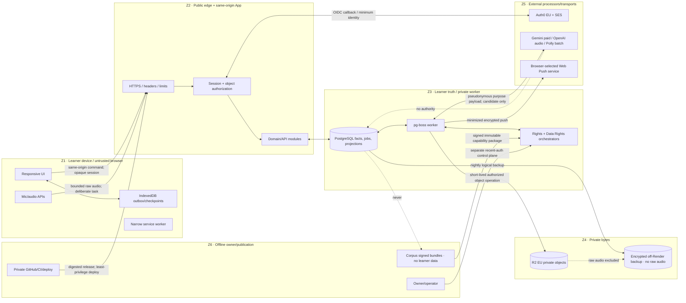

# Bestehen / App — Security, Privacy, Rights, Retention, and Threat Model

> **Status:** Accepted Stage 23 architecture handoff  
> **Owner:** Stage 23  
> **Snapshot date:** 2026-08-23  
> **App base commit:** `b9ea730c31a8793b76b82b672a3f7846d2b320e7`  
> **Shaping base commit:** `9f37ad78fdd101b3c9cb8782ddc54d12dbce1fdc`  
> **Scope:** Architecture only. This document is not a claim of legal, regulatory, trademark, or accessibility-law compliance.

## 1. Purpose and scope

This stage makes one end-to-end security and data-governance contract for anonymous/local use, optional accounts and sync, App-approved content, asynchronous Corpus publication, AI/STT/TTS, direct Web Push, minimal analytics, owner/operator access, export and deletion. It owns the threat model, processor inventory, retention ceiling, security-control families, rights/takedown behavior, abuse/supply-chain risks, and public-hardening triggers. It does not implement controls, select a jurisdiction-specific legal basis, edit product/design sources, or take Stage 24–28 release/deployment ownership.

The baseline is deliberately small: one same-origin modular App, PostgreSQL authority, pg-boss worker, private R2 EU objects, IndexedDB write-ahead continuity, direct Web Push, Auth0 EU plus SES for optional accounts, capability-specific AI/speech adapters, and offline Corpus publication. Security boundaries are logical modules enforced by allowlisted contracts; they do not require microservices, Kubernetes, a SIEM, a warehouse, session replay, a general upload service, or a new identity/data platform.

The product invariants are structural:

- the five and only five evidence-validity states are `valid`, `partially_valid`, `pending`, `interrupted`, and `not_counted`;
- the six and only six client-visible Readiness states are `evidence_building`, `not_ready`, `borderline`, `safe`, `ready_to_book`, and `stale_contradicted`;
- Written and Oral remain independent; missing is absence, never zero; Safe is not Ready to Book;
- there is no pass-probability field, model, event, template, log dimension, analytics measure, or hidden calculation;
- a technical, content, media, accessibility, browser, network, provider, operator, or evaluator fault is neutral and cannot become learner failure;
- account-free first use, export/delete, WCAG 2.2 AA, minimum-purpose external payloads, and raw-audio deletion are not reopened;
- Corpus is asynchronous, receives no learner data, and is never a routine learner-runtime dependency.

## 2. Inputs, immutable references, and continuity

All required inputs were fetched as complete current contents at immutable commits before deciding. The Stage-23 checklist contained 24 unchecked items; all prerequisite stage outputs were present and accepted.

| Repository/path | Blob SHA |
|---|---|
| Shaping `app/28-bestehen-app-product-specification.md` | `18ae80cc2fd63cecd76c297c3e56d44a68367856` |
| Shaping `app/01-product-thesis.md` | `6bbb074dc6a262cb66cebad960dd248d1010f21f` |
| Shaping `app/04-learner-model.md` | `f7ae1f4af375ee3302d04c726d8fe8453a9daf80` |
| Shaping `app/05-mistake-memory.md` | `a7c574b08c33418eab44aba8b6e9b7f8ab877109` |
| Shaping `app/12-writing-coaching.md` | `0a606197ad514e8c8958004188837e37173258be` |
| Shaping `app/13-speaking-coaching.md` | `9462c78a1e7cc68249d38aa5a18a287be8aacd9c` |
| Shaping `app/15-telc-readiness.md` | `b4456939928493569336bbc565d7e67307e7a3db` |
| Shaping `app/16-mock-exams.md` | `8f6c23fa16524bd251cef39d823cfeea73bfcef3` |
| Shaping `app/21-content-strategy.md` | `8149d6a268da70e17cad46f774b9d5de77776986` |
| Shaping `app/22-user-controls-vs-coach-autonomy.md` | `27f33cd56a09df27952e15bb3dfd0e077b89633c` |
| Shaping `app/24-analytics-and-success-metrics.md` | `28d1a5380a7ea9f28efdc95ce0c96987920917e1` |
| Shaping `app/25-business-model-and-product-boundaries.md` | `904ae20e8cb3f9f354d6505513821e86f609622b` |
| Shaping `app/26-platform-accessibility-nonfunctional.md` | `8137091683941b0d55f3d4fb90af3c402b8371e5` |
| Shaping `corpus/12-corpus-app-contract.md` | `7add217f62118e5abe100680d2e8230a93b8c280` |
| Shaping `corpus/17-bestehen-corpus-product-specification.md` | `537b5185313097d043748f9dc9f9fdaf432ee71d` |
| App `Bestehen_App_Architecture_Checklist.md` | `ca476ae5ec745fe7853a8bbf5770ccb78ecaef88` |
| App `Design/DESIGN-HANDOFF.md` | `417a6820037e045e2dd9f29afc42b9f2e94fd638` |
| App `Design/Bestehen-02-Mobile-Screens.dc.html` | `0a9f2d3ea982c3197f399941b57defd9869d2428` |
| App `Design/Bestehen Logo/Bestehen Logo System.dc.html` | `5eb296da8a83531306195c9d91dd30cbeed8c608` |
| App `Architecture/00-architecture-shaping-plan.md` | `b263c5e7b3bccc0450ddd17aa0cc007432d672b7` |
| App `Architecture/02-system-context-and-product-boundaries.md` | `046d114bbbc96528bf0b9eae0406c0235f759127` |
| App `Architecture/03-technology-stack-and-repository-strategy.md` | `907b04c57813dc50f92a7ed00e49196ff7d4a924` |
| App `Architecture/04-domain-model-and-bounded-contexts.md` | `ab1a775d7689e47bba00c2544c247ef344c44e70` |
| App `Architecture/05-data-ownership-persistence-and-schema-evolution.md` | `bb6df811ec9010de556d1719f22e31bb8ca3190e` |
| App `Architecture/06-evidence-ledger-validity-versioning-and-audit.md` | `53d34ae65ef4c8fa79c00026f9bd5d7b876ce672` |
| App `Architecture/09-content-exercise-form-and-media-architecture.md` | `e6fb121ab1b10c6cbcf692bc88acaf98f2e45e7a` |
| App `Architecture/10-corpus-integration-compatibility-cache-and-rights.md` | `d4e1ab25e359dcfcc506ee29462760a41647138d` |
| App `Architecture/12-api-contracts-jobs-events-and-idempotency.md` | `c640da01d6eb6d71a5e2ea7a0dcf19147d6d7528` |
| App `Architecture/16-listening-audio-tts-and-media-delivery.md` | `6bb60e2d6048a39035107ff427a0c4fd305c1ba6` |
| App `Architecture/17-writing-editor-autosave-and-evaluation-pipeline.md` | `c2c3de417f1d3bcd8c53e1bf40fbb49522c34529` |
| App `Architecture/18-speaking-audio-stt-partner-and-evaluation-pipeline.md` | `2f118f817a99b76dc1e0c38c0aedaa1e0662268e` |
| App `Architecture/19-ai-gateway-model-governance-evaluation-and-cost.md` | `60aef66f8443e747935b2cfb479dd7f4dd4d5c23` |
| App `Architecture/20-account-local-first-profile-sync-export-and-deletion.md` | `9a1aa2d5fea31ff0bdccfc4561806bb870511ab6` |
| App `Architecture/21-offline-checkpointing-recovery-conflicts-and-timing-integrity.md` | `1216f98f5489119b4d8114804ac87936bc78ddd4` |
| App `Architecture/22-notifications-scheduling-and-time-zones.md` | `6e0e8a761b9cf83a75931e815f447e148e3a20d0` |
| App `prompts/architecture/23_define_security_privacy_rights_retention_and_threat_model.txt` | `765d11c7fd4b01275dcdc103dd89e1728a790e43` |
| App `Architecture/adr/README.md` | `0c84ef930ebcf66afa358cde4f14eada32eb0e26` |

### 2.1 Authority and source reconciliation

Authority is product specification, delegated detailed shaping, identity/overview, then human-authored design when consistent. Stage-27 ordering is binding: validity/fairness → direct evidence → independent Written/Oral risk → uncertainty resolution → due repair/retention → progression/coverage → preference. Urgency, security friction, account status, or notification state may change access or priority but never rewrite truth.

| Exact sources | Difference | Resolution and consequence |
|---|---|---|
| `Design/Bestehen-02-Mobile-Screens.dc.html` Act 5 says deletion means “there is no backup”; accepted `Architecture/05...` D08 and `Architecture/20...` D08 disclose inaccessible backup residual plus a linkable deletion journal bounded to 91 days | Design copy promises more than the accepted recoverable backup topology can prove | Preserve live/provider purge and restore suppression. Replace the design sentence during implementation with truthful, accessible residual wording; never edit Design here. The journal contains only the minimum restore-blocking linkage and expires by day 91. |
| The same design’s microphone copy says audio is “never shared”; `Architecture/18...` requires minimum-purpose transfer to selected speech/evaluation processors | “Shared” is ambiguous and can conceal processing | Learner copy must name purpose-bound processor transfer without implying public disclosure. Raw audio is never sold, contributed to training, placed in analytics/Corpus, or retained as history. |
| Design’s “Export everything · JSON” versus `Architecture/20...` D07’s checksummed ZIP with accessible summary plus JSON/NDJSON | Compact button copy is not a complete format contract | Keep the visual action; the generated artifact follows Stage 20, excludes credentials, raw audio, and restricted Corpus bytes, and declares omissions. |
| Logo system says the base typeface is OFL but production must verify the current release; it explicitly claims no trademark clearance | Design evidence is not legal clearance | Preserve font/license manifests and attribution. A professional trademark/license review is a public-commercial launch blocker, not a claim made by this architecture. |
| Design states audio is deleted after evaluation and within seven days; accepted Stages 05/18 say immediately after finalization or a hard seven-day Pending ceiling | Consistent outcome, different precision | Architecture precision controls: terminal completion triggers immediate purge; unresolved Pending can retain only until its absolute deadline, then becomes unresolved/non-counting and purges. Raw audio is excluded from backups. |

No prerequisite contradiction remains unresolved. Jurisdiction-specific notices, legal basis, contract clauses, data-subject terminology, age restrictions, and trademark clearance remain owner/legal review work before public use; this document does not guess them.

## 3. Current official evidence and verification baseline

Accessed 2026-08-23:

- [OWASP ASVS 5.0.0](https://owasp.org/www-project-application-security-verification-standard/) is the pinned web-control verification catalogue. Stage 25 must record the applicable requirement IDs and evidence; this stage does not claim conformance merely by citing it.
- OWASP guidance informs [session management](https://cheatsheetseries.owasp.org/cheatsheets/Session_Management_Cheat_Sheet.html), [file upload](https://cheatsheetseries.owasp.org/cheatsheets/File_Upload_Cheat_Sheet.html), [logging](https://cheatsheetseries.owasp.org/cheatsheets/Logging_Cheat_Sheet.html), [secrets](https://cheatsheetseries.owasp.org/cheatsheets/Secrets_Management_Cheat_Sheet.html), and [Content Security Policy](https://cheatsheetseries.owasp.org/cheatsheets/Content_Security_Policy_Cheat_Sheet.html). They are control/test sources, not legal rules.
- [WCAG 2.2](https://www.w3.org/TR/WCAG22/) and W3C’s [Accessible Authentication (Minimum)](https://www.w3.org/WAI/WCAG22/Understanding/accessible-authentication-minimum.html) require an authentication path without an unsupported cognitive-function test and permit mechanisms such as copy/paste and password managers.
- Auth0’s official docs say an EU locality controls where tenant data is hosted, while the public-cloud sub-locality is assigned rather than manually chosen ([tenant regions](https://auth0.com/docs/get-started/auth0-overview/create-tenants)); email OTP invalidates older/used codes, defaults to a three-minute expiry, and allows three failed attempts before a new code ([email OTP](https://dev.auth0.com/docs/authenticate/passwordless/authentication-methods/email-otp)). Auth0 log retention varies by plan from one to thirty days ([log retention](https://auth0.com/docs/deploy-monitor/logs/log-data-retention)); App security truth therefore cannot depend on Auth0 log availability.
- Render redirects HTTP to HTTPS and manages TLS certificates ([TLS](https://render.com/docs/tls)); Render Postgres external access can be disabled and clients require TLS 1.2+ ([Postgres networking](https://render.com/docs/postgresql-creating-connecting)); paid PITR and logical export windows remain provider-bounded ([backups](https://render.com/docs/postgresql-backups)). Pro workspace audit logs retain at least 90 days, so their availability/cost is a public-hardening input, not a launch assumption ([audit logs](https://render.com/docs/audit-logs)).
- R2 encrypts objects/metadata at rest with AES-256-GCM and traffic with TLS ([R2 data security](https://developers.cloudflare.com/r2/reference/data-security/)); its audit log covers configuration changes but not object data access ([R2 audit logs](https://developers.cloudflare.com/r2/platform/audit-logs/)); presigned URLs are bearer credentials and must be short-lived ([presigned URLs](https://developers.cloudflare.com/r2/api/s3/presigned-urls/)).
- OpenAI says API data is not used for training unless explicitly opted in; audio transcription currently has no abuse/application-state retention, while audio speech has up to 30-day abuse monitoring by default and eligible approved projects can use ZDR ([OpenAI data controls](https://platform.openai.com/docs/models/default-usage-policies-by-endpoint)). These are mutable processor facts and must be rechecked before release.
- Google says paid Gemini prompts/responses are not used to improve products. Default abuse logging is limited but identifiable until an approved ZDR configuration; File API, stored interactions, grounding, and explicit caches introduce separate retention, so Bestehen disables those features ([Gemini ZDR](https://ai.google.dev/gemini-api/docs/zdr)).
- Amazon says Polly synthesis input/output is not stored and not used to train Polly; customer pronunciation lexicons are the service-side retained exception ([Polly service card](https://docs.aws.amazon.com/ai/responsible-ai/amazon-polly/overview.html)). Bestehen does not upload learner audio or lexicons to Polly.
- GitHub recommends minimum workflow permissions, full-commit-SHA pinning for third-party Actions, and restriction of allowed Actions ([secure organization guidance](https://docs.github.com/en/code-security/tutorials/secure-your-organization/protect-against-threats)); OIDC replaces long-lived deployment secrets with short-lived tokens where the hosting provider supports it ([GitHub OIDC](https://docs.github.com/en/actions/concepts/security/openid-connect)). npm provenance improves traceability but does not prove code is safe ([npm provenance](https://docs.npmjs.com/generating-provenance-statements/).

Every mutable provider fact is a release-time procurement/configuration check, with recorded evidence and effective date. A marketing security/compliance badge is never substituted for contract/configuration verification.

## 4. Decisions and rationale

| ID | Accepted decision | Credible alternatives and rejection | Consequence / exit / review trigger | ADR |
|---|---|---|---|---|
| `ARCH-S23-D01` | Use one versioned data-flow/threat register over six enforceable trust zones: browser/device; public edge/same-origin App; learner-truth data/worker; private object/media; external processors/transports; operator/offline publication. Logical isolation precedes physical services. | **Do nothing/one trusted backend:** cheap but excessive privilege and no testable boundary. **Microservice-per-zone:** physical isolation but disproportionate solo operations. **Chosen:** modular monolith with explicit ports, separate credentials and deny-by-default flows. | Add a physical split only after measured blast-radius, throughput, deployment-cadence, or independent-operator need. Export standard Node/SQL/S3 contracts. | ADR-0031 |
| `ARCH-S23-D02` | The App authenticates a principal, authorizes every object/action against App-owned scope and purpose, and never lets browser, provider subject, email, URL, object key, or model output confer authority. Optional-account and guest scopes use same-origin opaque sessions. Operator is a separate role/plane. | **Route-only authentication:** IDOR risk. **JWT in browser storage:** stateless but enlarges XSS/token exposure. **Provider subject as key:** lock-in and identity/data coupling. | Server-side session revocation and scope checks are authoritative. Identity outage preserves local guest work. Provider exit follows Stage 20 binding migration. | ADR-0031 |
| `ARCH-S23-D03` | Minimize by purpose and classify before crossing a boundary. External processors receive pseudonymous job IDs and the smallest task payload; no Corpus learner path, no advertising/data sale/session replay, no hidden training opt-in, and no provider feature that stores state/files unless separately approved. | **Send full profile for quality:** privacy/lock-in without benchmark need. **No productive processors:** omits pass-critical evaluation. **Self-host every model:** higher ops/cost and unproven quality. | Capability adapter enforces allow/deny fields. Processor privacy/quality/cost regression opens circuit and uses Pending/fixed/manual fallback. | ADR-0031 |
| `ARCH-S23-D04` | Retention is data-class-specific and deadline-driven. Learner facts useful for coaching remain until deletion; rebuildable/transient data expires; raw audio purges immediately after finalization or by the absolute seven-day Pending deadline and never enters backups; deletion access revokes first and restore-suppression linkage expires by day 91. | **Keep everything:** privacy and cost risk. **Delete all history quickly:** destroys explainability/export and readiness calibration. **One global TTL:** cannot reconcile raw audio, evidence, rights, jobs, and backups. | A single retention registry produces expiry jobs and deletion inventory. Any longer provider copy requires disclosed, reviewed contract; unsupported retention blocks that capability. | ADR-0031 |
| `ARCH-S23-D05` | Rights are an execution gate, not metadata decoration: App serves only an exact approved revision whose use, audience, action, attribution, accessibility, and effective-time gates pass. Verified takedown creates an immediate deny overlay, revokes future/private access, purges required bytes/caches, and separately repairs evidence only when correctness/fairness was affected. | **Serve Corpus publication directly:** conflates Corpus eligibility with App approval. **Rely on robots/no-copy CSS:** not authorization. **Remove all history:** destroys audit and can misstate past performance. | Preserve only permitted non-reconstructive lineage/tombstone. Move to original App content when rights are uncertain. Professional legal review owns uncertain public reuse, not feature code. | ADR-0031 |
| `ARCH-S23-D06` | Secrets and cryptographic keys are inventoried by owner/purpose/environment/version; stored only in platform/provider secret boundaries; least-privilege; never logged; rotatable with overlap/revocation. High-sensitivity raw-audio objects and Web Push subscription secrets use application-layer envelope encryption in addition to provider at-rest encryption. | **Provider encryption only:** simplest but data-admin/storage compromise has broad read scope. **New dedicated KMS service now:** stronger custody but extra service/cost before public risk. **Custom crypto:** forbidden. | Use standard authenticated encryption via reviewed platform crypto, unique nonce/DEK and versioned KEK; rotate by rewrapping DEKs. Add managed KMS/HSM at public launch, another operator, key-use audit need, or inability to meet drill. | ADR-0031 |
| `ARCH-S23-D07` | Secure browser baseline: HTTPS; `__Host-` Secure HttpOnly SameSite session cookies; session rotation at authentication/privilege change; origin/CSRF checks on unsafe actions; strict CSP without arbitrary third-party script, framing, objects or base changes; HSTS after domain readiness; `nosniff`, restrictive referrer/permissions policy, safe cache directives, and allowlisted redirects/routes. | **Framework defaults only:** drift and omissions. **WAF as primary defense:** does not solve object authorization or XSS. **Broad third-party analytics scripts:** supply-chain/privacy exposure. | Header/session contract is versioned and release-tested in all routes including Auth0 callback, exports, media and errors. CSP report-only precedes enforcement; a break-glass relaxation is time-bounded and reviewed. | ADR-0031 |
| `ARCH-S23-D08` | Treat all learner text/audio, model output, Corpus packages, filenames/metadata, callbacks, logs and provider responses as untrusted. Launch accepts only the already-shaped bounded audio upload; there is no general learner file upload/import. Decode/validate privately, never execute/render as active markup, and give AI no tools, URL fetch, secrets, authority or direct learner-facing publish path. | **Trust MIME/model schema:** spoofable. **Antivirus alone:** incomplete and adds provider/data surface. **General attachments:** no launch requirement. | Invalid/ambiguous input quarantines the smallest operation with neutral result. Add a scanner/sandbox service only if a new upload class or incident justifies it. | ADR-0031 |
| `ARCH-S23-D09` | Layer abuse and cost controls by network, guest capability, learner scope, endpoint, operation and provider budget; use idempotency, concurrency ceilings, request/body/duration limits, progressive backoff, circuit breakers and operator kill switches. Never use invasive fingerprinting or CAPTCHA-only access and never convert a block/provider fault to evidence. | **IP-only limit:** shared-network harm/evasion. **Account wall:** violates first use. **Unlimited retries:** cost/DoS. **Black-box bot vendor:** identifiers, accessibility and cost. | Limits are versioned operational calibration with reason, effective date, metrics and rollback. Stage 24 sets measured thresholds; Stage 25 tests accessible alternatives. | ADR-0031 |
| `ARCH-S23-D10` | Keep two minimized audit families: learner-semantic correction/deletion/rights facts in existing authoritative ledgers; security/operations events containing actor scope, action, target class/hash, outcome, reason, request/trace ID, release and time—but no response, transcript, raw audio, token, secret, prompt, full IP in long retention, or disability inference. | **No logs:** incidents uninvestigable. **Full payload logs/session replay:** surveillance and secret/content leakage. **New SIEM now:** recurring cost/ops before need. | General raw operational logs expire at 30 days; high-risk App audit events at 90 days, then purge/de-link. Provider retention may be shorter. Public hardening may add a bounded sink after volume/incident evidence. | ADR-0031 |
| `ARCH-S23-D11` | Dependency and release trust uses exact lockfile/tool pins, dependency admission, license/provenance review, SBOM, vulnerability/license scanning, full-SHA Actions, least workflow permission, protected deployment environments, reproducible build evidence, artifact digest/attestation, secret scanning, staged rollback, and emergency patch policy. | **Dependabot/automerge everything:** quick but unreviewed behavior. **Never update:** known vulnerabilities. **Vendoring all dependencies:** maintenance/license burden. | Stage 25 tests/scans; Stage 26 enforces deploy gates. Remove/replace on unmaintained package, critical reachable issue without mitigation, provenance/license failure, or unexpected install script/network behavior. | ADR-0031 |
| `ARCH-S23-D12` | Incidents use detect → contain → preserve-minimum evidence → assess scope → neutral learner/rights handling → eradicate/rotate → recover/verify → communicate as reviewed → learn. Private operation may use documented manual response; public launch requires stronger access, monitoring, disclosure intake, processor/legal review and exercised runbooks. | **Ad hoc response:** slow and unauditable. **Enterprise SOC now:** disproportionate. **Claim breach-free/compliant:** false assurance. | Security stops the affected capability first, not learner truth globally. Public/commercial exposure, second operator, sustained abuse, high-severity incident, or processor/rights expansion activates the hardening table. | ADR-0031 |

Cost may select among controls that provide equivalent protection; it cannot remove object authorization, learner-truth integrity, accessible account/data controls, raw-audio deletion, rights deny/takedown, export/deletion, or incident containment.

## 5. Components, ownership, and trust boundaries

| Component | Owns | Must never own |
|---|---|---|
| Browser shell + local continuity | rendering, capability preflight, encrypted/origin-scoped checkpoints/outbox, user gesture, local cleanup | score, validity, Readiness, authorization, provider secret, deletion proof |
| Session & Authorization module | opaque guest/account session, principal binding, CSRF/origin checks, object/action policy, recent-auth assertion | learner-semantic IDs from provider, profile/evidence edits |
| Learner domain modules | authoritative facts, corrections, projections, five validity and six Readiness states | raw Corpus/source authority, processor truth, probability |
| Data Rights orchestrator | export source cut, live purge state, provider tasks, local cleanup instruction, restore-suppression journal/proof | instant backup destruction claim, restricted asset redistribution |
| Content/Rights gate | exact App revision, permissions/obligations/effective time, signed access, quarantine/takedown overlay | learner profile, evidence mutation, legal clearance claim |
| Productive Evaluation gateway | allowlisted payload, job/candidate lineage, provider circuit, raw-audio deadline/delete task | final evidence/Readiness authority, durable audio history |
| Scheduling/Push adapter | minimized reviewed payload, endpoint lifecycle, caps/dedupe | weakness/score/transcript/raw audio, learning evidence |
| Corpus publication ACL | offline signed immutable import, compatibility/rights validation, active/last-compatible pointer | learner data, runtime learner query |
| Operations/Security | release/key/policy registry, alerts, audit query, containment commands | silent fact edits, broad learner impersonation, unrestricted content browsing |
| Providers | bounded transport/processing function under current contract | App semantic truth or unrestricted App dataset |

### 5.1 Data-flow and trust-boundary diagram



### 5.2 Threat inventory (STRIDE-informed, not limited to STRIDE)

| Threat | Boundary/assets | Primary prevention | Detection / containment | Failure truth |
|---|---|---|---|---|
| Session theft/fixation, login CSRF | Z1–Z2; guest/account scope | HTTPS, strict server-issued cookie, rotate on authentication, origin/CSRF, no URL/browser-storage token | session-version/revocation audit, rate alert, revoke affected sessions | local unlinked work continues; sign-in/sync unavailable |
| IDOR/cross-learner access | Z2–Z3/Z4 | object authorization by App-owned scope on every command/read; opaque IDs are not controls | denied-access counters without content; invariant tests | unauthorized operation denied; no learner penalty |
| XSS/clickjacking/data exfiltration | Z1–Z2 | contextual output encoding, no active learner HTML, strict CSP, frame denial, safe referrer/cache headers | CSP reports stripped of sensitive URL data; kill affected release | smallest surface unavailable; facts preserved |
| CSRF/replay/duplicate side effect | Z1–Z3 | SameSite + Origin/Fetch Metadata/CSRF, stable operation ID/hash/expected version | unique constraints, replay audit | same accepted result or neutral conflict |
| Malicious/oversized audio | Z1–Z4 | allowlisted task, size/duration/codec signature + decode, private random key, no public render/execute | quarantine/decode failure/volume alert; purge deadline | `not_counted`/Pending as applicable, never skill failure |
| SQL/template/log injection | every input | parameterized persistence, schema/length validation, fixed reviewed templates, log encoding | negative fixtures and log parser alarms | affected request fails neutral |
| Prompt/content injection or model exfiltration | Z3–Z5 | data/instruction separation, no tools/URLs/secrets, fixed task schema, minimum payload, candidate validation | schema/leak benchmark, circuit breaker, human-reviewed corpus/content | candidate rejected/Pending; deterministic paths continue |
| Provider callback spoof/replay | Z5–Z2 | authenticated signatures/credentials, timestamp/replay window, job nonce/digest and owner mapping | mismatch audit; rotate credential/circuit | job remains Pending or safely retries |
| Object URL/key leakage | Z2–Z4 | private bucket, server authorization, short single-purpose expiry, no URL logs/referrers | access anomalies; revoke object/generation | issue new authorized access or neutral unavailable |
| Privileged/operator misuse | Z6–Z3/Z4 | separate account/role, phishing-resistant MFA before public use, recent auth, least privilege, no default impersonation, two-step destructive commands | immutable attributable audit and provider audit | contain operator; learner facts corrected via append-only path |
| Corpus/signing compromise or replay | Z6–Z3 | Ed25519 manifest, SHA-256 objects, sequence, revoked-key list, private staging | signature/digest/sequence alert; quarantine candidate | active last-compatible App inventory continues |
| Dependency/build compromise | CI–runtime | pins/lock, restricted Actions, minimum token, SBOM/scans/attestation, protected deployment | digest mismatch, secret/provenance/vulnerability alert, rollback | stop release; last validated release continues |
| Cost/availability abuse | edge/jobs/providers | layered quotas, body/duration limits, idempotency, concurrency, budget circuit | per-capability units/error/cost without learner content | expensive action Pending/fallback; unaffected learning continues |
| Deletion resurrection | device/jobs/live DB/backups/providers | access-first tombstone, task inventory, provider delete, late-write reject, restore replay | proof reconciliation until all steps/backup generations expire | deletion remains `in_progress`/partial; never claim complete early |
| Rights/source-expression leakage | Corpus/import/content/AI/export/cache | capability/action permission, non-reconstructive transform review, no restricted bytes in export/prompts, deny overlay | similarity/leak fixtures and takedown drill | quarantine/replace; rights-only issue does not create negative evidence |
| Sensitive notification leakage | App–push–lock screen | allowlisted generic payload, encryption, one endpoint, safe authenticated refetch | template/payload static checks | suppress push; in-App action remains |
| Analytics surveillance/reidentification | runtime/log/metrics | no third-party learner analytics SDK/session replay; coarse/de-linked aggregate; deny content fields | schema allowlist and deletion test | metrics absent rather than reconstructed from truth |

## 6. Data, processor, retention, export, and deletion matrix

“Until deletion” is a purpose boundary, not indefinite permission. Stale derived/transient copies still expire as below. Retention clocks use server time; every retained class has an owner, expiry/delete command, and proof state. Provider facts are rechecked before enabling the capability.

| Data class / purpose | Authority and processors | Default / hard ceiling | Export | Deletion and backup |
|---|---|---|---|---|
| Guest/account principal binding and verified email | App principal binding; Auth0 EU; SES Frankfurt for OTP mail | App binding until deletion; Auth0/SES provider logs/config per current plan and minimum supported retention, not App truth | verified email/profile fact, never OTP/session/provider token | revoke sessions/provider identity first, then purge binding; restore journal blocks resurrection ≤91 days |
| Same-origin session/CSRF/recovery material | App Session module | session-policy expiry; revoke on logout/delete/risk; no durable plaintext token | excluded | revoke/rotate immediately; never backup browser token |
| Profile, goal/date, schedule, preferences, declared access needs | owning App modules; local cache | meaningful history until deletion; declared access only, no inferred diagnosis | human + machine, with versions | purge live/local; inaccessible backup residual disclosed and suppressed |
| Attempts, responses, conditions, evidence, corrections | Session/Evidence authority in PostgreSQL | until deletion; corrections append; no analytics reconstruction | complete useful facts/lineage | purge with scope; journal suppresses restore |
| Readiness, mocks, Mistake Memory, repair/review/progression | App authoritative facts + rebuildable projections | learner-useful facts/snapshots until deletion; obsolete transient projection generation 30 days | current/material history, Written/Oral separate | purge/rebuild only from remaining authorized facts |
| Writing drafts/revisions and accepted evaluation | learner/App; Gemini paid receives minimum selected text/rubric | active/local checkpoints per Stage 17/21; retained Writing/history until deletion; transient provider payload stripped after terminal acceptance; job metadata 90 days | retained Writing, revision/evaluation, provider-neutral lineage | purge local/live/provider-controllable copies; backup residual handling |
| Speaking transcript/structured result/candidate | App; OpenAI STT and Gemini evaluator minimum payload | retained when useful with evidence until deletion; rejected/transient provider payload removed after terminal; job metadata 90 days | retained transcript/result, not vendor internals | purge with scope/provider-controllable state |
| Raw learner audio for speaking job | transient App; private R2; OpenAI STT/Gemini evaluator only when required | delete immediately after terminal finalization; unresolved Pending absolute maximum 7 days; no permanent history | excluded from asynchronous export; if user downloads current local recording before submission, that is device action, not archival export | purge local/R2/provider-controllable state; **never backup, sync, analytics, Corpus, logs or TTS** |
| Approved static Listening/TTS media | App Content; offline Amazon Polly input is reviewed content text, not learner data; private R2 | immutable revision while approved/rights allow and referenced; master + audited encodings | stable reference/description only, not restricted bytes | takedown/retire exact bytes; minimal permitted lineage |
| AI requests/candidates | App gateway; Gemini paid, OpenAI audio as selected | no stored conversation/file/grounding/cache feature; strip provider payload after terminal; accepted provider-neutral candidate lineage until deletion; terminal job metadata 90 days | useful accepted result + model/release lineage, not hidden prompt/vendor trace | delete App copy; request provider deletion where controllable; disclose unavoidable processor retention before use |
| Corpus capability packages and rights metadata | Corpus publishes; App ACL/import/content owners | active + last compatible + versions referenced by evidence; exact bytes only while permitted | not learner personal export; only stable content reference/description | rights/takedown purge exact bytes/caches; permitted non-reconstructive tombstone remains |
| Push endpoint/keys, schedule and delivery detail | App Scheduling; browser-selected push service | endpoint while opted in; raw delivery detail 30 days; minimum content-free dedupe/idempotency 90 days | settings/channel status and understandable recent reason, never secret | revoke endpoint first; purge link/content; tombstone defeats late jobs; ≤91-day restore suppression |
| Operational request/job logs | App/Render, processor metadata where unavoidable | raw 30 days; no bodies, responses, prompt, transcript, audio, token or full sensitive URL | not ordinary learner export unless required to explain an operation | delete/de-link learner scope; provider expiry verified |
| High-risk security/audit events | App; Auth0/Render provider logs supplemental only | minimized App event 90 days; provider plan may be shorter; no content/full IP beyond immediate bounded abuse need | learner-facing export/deletion action history where relevant, not defense detail/secrets | purge/de-link after horizon except nonpersonal release/key history |
| Product analytics/calibration facts | App only at launch; Stage 24 aggregation | raw linkable operational facts 30 days; longer only irreversibly de-linked aggregate with documented unlink test | learner facts already exported from authority, not analytics shadow | delete link; never rebuild personal analytics after deletion |
| Export request/artifact | Data Rights; private R2 | frozen source-cut job metadata 90 days; download artifact expires and purges after 7 days or first successful-download grace policy, whichever Stage 24 safely tunes within 7 days | artifact itself: summary + JSON/NDJSON + manifest/checksums | delete artifact immediately on scope deletion; short bearer link is redacted/no-referrer |
| Deletion operation, tombstone and journal | Data Rights/Operations | operational proof/idempotency up to 90 days; minimum linkable restore journal hard ceiling 91 days; non-linkable policy/release history may remain | understandable proof/status and residual deadline | journal self-expires after all backup generations and no later than day 91 |
| PostgreSQL/R2 backups | Operations; Render and off-Render encrypted logical backup store | provider PITR per current plan; off-Render 14 daily + 12 weekly accepted generations; raw audio excluded | excluded from learner export | inaccessible residual, no normal access; restore replays journal before service; all linkable suppression ends ≤91 days |
| Rights/takedown incident | Content/Rights/Operations | minimum permitted case/evidence while dispute/response requires; no reconstructive copy retained when prohibited | not learner data; affected learner sees neutral content/evidence consequence | purge source expression per disposition; retain only permitted hashes/IDs/action/times |
| License/trademark/build provenance | Operations/Content | nonpersonal governance history while artifact/release exists | referenced manifest where relevant | not personal; supersede, never claim clearance |

### 6.1 Provider boundary and exit table

| Processor | Allowed data/purpose | Forbidden / configuration gate | Cost/maintenance/exit |
|---|---|---|---|
| Auth0 EU + SES Frankfurt | verified email, OTP transaction, provider principal and minimum security metadata | no learner evidence/profile beyond required identity; EU locality; App-owned IDs; own SES; log-retention and deletion verification | variable identity/email cost already selected Stage 20; export principal bindings, dual-verify migration; Better Auth + App PG/SES is cheaper operationally expensive fallback |
| Render Frankfurt | App processes, PG learner truth/jobs | external PG access disabled; minimum service role; no raw content logs; paid recovery before real learner evidence | normal service/DB/worker and possible Pro audit-log cost; standard Node/PG/pg_dump exit |
| R2 EU | approved media, encrypted ephemeral raw audio, short export artifact | private buckets; public `r2.dev` disabled; separate credentials/prefixes; no long-lived bearer URL; lifecycle not sole deletion proof | storage/operation cost, zero direct egress currently; S3-compatible manifest/object export |
| Gemini paid | bounded Writing/Oral evaluation and exceptional adaptive candidate | no free/unbilled training terms, File API, stored interactions, grounding, explicit cache, learner identity/profile, tools | per-token/audio cost Stage 19; capability adapter, benchmark corpus and provider-neutral accepted result permit substitution |
| OpenAI audio endpoints | provisional STT and bounded adaptive TTS only | no Responses conversation/file state; raw audio only to transcription; TTS input is reviewed/partner text, not learner audio; ZDR/MAM gate if required | per-minute/token Stage 19; adapter to Deepgram/fixed prerecorded fallback |
| Amazon Polly Frankfurt | reviewed batch Listening/TTS text | no learner response/profile/audio/lexicon; outputs enter App QA before use | batch-only variable synthesis; reusable audio and provider-neutral manifest; alternative TTS or human recording |
| Browser Web Push service | encrypted minimized payload, endpoint metadata/timing | no score/weakness/Readiness/date-by-default/content/audio; no engagement journey | no separate SaaS; turn off to in-App-only; endpoint resubscription on key/provider changes |
| GitHub/CI | private source, dependency/release metadata and bounded deploy credentials | no production learner data; least token; fork/untrusted PR cannot access deploy secrets | included repository/CI cost; source/SBOM/artifact export; local verified build fallback |

No processor is authoritative for learner meaning. A provider change cannot reinterpret prior facts; it creates a new candidate/model/key/processor release.

## 7. Authorization, sessions, secrets, and security controls

| Surface/action | Authentication and authorization | Secret/key and rotation | Required control / audit |
|---|---|---|---|
| Guest learning | high-entropy server-issued guest capability bound to App `LearnerScopeId`; scope/action policy on every object | opaque cookie only; rotate on adoption/risk; not exportable | Secure HttpOnly `__Host-` cookie, SameSite, origin/CSRF, rate limits; no account wall/fingerprint |
| Account sign-in/adoption | Auth0 email OTP proves provider principal; App command attaches/merges under expected versions | Auth0/SES credentials separate per environment; revoke/rotate on role/term/incident and supported scheduled inventory review | hosted accessible login; copy/paste OTP; generic enumeration-safe result; adoption merge/idempotency audit |
| Account session/sync | App server session maps App principal → learner scope; object and field-command authorization | session signing/encryption key has version/active+retiring sets; rotate at auth/privilege, suspected exposure and policy cryptoperiod | idle/absolute limits in `session-policy/v1`; session list/revoke; no bearer in URL/localStorage |
| Profile/preference edit | owner scope + allowed command + expected version | none client-side | CSRF/origin, schema bounds, audit consequential change; cannot write evidence/Readiness |
| Attempt/evidence write | session/guest scope; server recomputes authority and condition | idempotency secret is not client authority | operation ID/hash/expected contract; duplicate same effect; no “higher score wins” |
| Raw-audio upload/read/delete | deliberate speaking job scope, one purpose/object, size/duration/codec policy; no generic browse | opaque object key plus per-object DEK; KEK version server-only; single-purpose short authorized operation | private quarantine until verified decode; no CDN/public URL; absolute delete deadline; access/delete audit without content |
| Approved media/content read | exact approved revision, rights action/audience/effective-time and learner task authorization | short locator/signed read; storage credential server-only | anti-index/no-store where rights require; attribution/accessibility; cache purge generation |
| AI/STT/TTS call | worker capability port with allowlisted job/release, no direct browser call | separate least-privilege provider keys per capability/environment; dual rotate where supported; circuit on exposure | redacted request metadata, payload schema/hash, cost/latency, candidate only; no secrets/prompts in logs |
| Web Push subscription/send | explicit learner scope + device gesture; one selected endpoint; intent generation current | endpoint auth secret encrypted; VAPID private key server-only with release/version; incident rotation may require explicit resubscribe | generic encrypted payload, TTL/tag, host/schema limit, opt-out tombstone, no post-delete send |
| Export | learner scope + recent authentication for account; explicit typed/confirmed action accessible without memory puzzle | short single-purpose download credential, stored only as hash; expires ≤7 days | frozen source cut, checksum, no secrets/restricted bytes/raw audio; creation/download/purge audit |
| Deletion | learner scope + recent account auth or current guest capability; accessible explicit intent and consequences | all sessions/provider/access keys revoked first | two-step state machine, late-write tombstone, provider tasks, restore proof; cannot say complete while partial |
| Owner/operator | separate operator identity, allowlisted role/action; phishing-resistant MFA and recent auth before public launch; no default learner impersonation | unique human account; no shared admin secret; deploy/provider keys separated; break-glass sealed/reviewed | attributable high-risk audit, read purpose, two-step destructive/rights/key action; revoke on role change |
| Corpus publication | offline signer key authorizes canonical package, not runtime operator | Ed25519 public keyring in App; private signer offline/isolated; key activation/revocation manifest | signature + SHA-256 + sequence + required capabilities; unknown/revoked quarantines |
| CI/deploy | protected branch/environment and least workflow identity | prefer short-lived OIDC; otherwise environment-scoped key; no fork access; full-SHA Actions | locked install, scans, SBOM, artifact digest/attestation, reviewed promotion and rollback |
| Database/backups | service role per App/worker/backup purpose; no public PG network | distinct DB/backup credentials; encrypted backup; exposure/event rotation and verified restore | TLS, external access disabled, least SQL role, restore audit, deletion journal replay before serving |

### 7.1 Header and browser policy

`web-security-policy/v1` is an architecture configuration, not production code. It requires:

- HTTPS-only; HSTS only after the production domain/subdomain recovery plan is verified, then increase through staged rollout before considering preload;
- nonce/hash-based CSP with `default-src 'self'`, no `unsafe-eval`, no arbitrary third-party script, `object-src 'none'`, `base-uri 'none'`, `frame-ancestors 'none'`, explicit `form-action`/connect/media allowlists, and privacy-scrubbed report endpoint;
- `X-Content-Type-Options: nosniff`, `Referrer-Policy: no-referrer` for authenticated/asset/download surfaces, restrictive `Permissions-Policy` with microphone only on the same-origin speaking route and no location/camera;
- authenticated/private responses `Cache-Control: no-store`; immutable public App assets content-addressed; rights-sensitive media follows its manifest and never becomes broadly public by convenience;
- state-changing requests require allowed method/content type, origin/Fetch Metadata and CSRF proof in addition to SameSite; CORS is absent by default;
- redirects, callback state/nonce/PKCE, return routes and notification routes are allowlisted; no learner/scope/token/content in URL or referrer;
- error responses and accessibility states reveal no account existence, secret, storage key, internal stack, provider payload or cross-scope object.

Stage 25 owns executable header/session/authorization fixtures; Stage 26 owns deployed verification and secret configuration.

## 8. Main flows and state transitions

### 8.1 Security-gated productive evaluation

1. Browser obtains a job-specific upload authorization only after speaking capability/preflight and deliberate capture.
2. Edge enforces body/codec/duration/concurrency policy; private staging stores envelope-encrypted bytes with absolute expiry.
3. Decoder validates actual media; invalid/ambiguous data is purged or quarantined briefly for bounded incident inspection without serving.
4. Worker constructs minimum payload with pseudonymous job ID. Processor receives no learner ID/profile/history beyond the reviewed task evidence required.
5. Processor output is untrusted candidate; schema, range, rubric, content-leak and model-release gates run. Evidence owner accepts or returns Pending.
6. Terminal success/failure creates an idempotent raw-audio purge immediately. Pending cannot extend past seven days; deadline creates a neutral unresolved/non-counting path and purge.
7. Logs hold only job/capability/release/outcome/latency/cost/delete-proof metadata.

### 8.2 Rights/takedown flow

```mermaid
stateDiagram-v2
  [*] --> Reported
  Reported --> Held: credible notice or signed Corpus impact
  Held --> Reviewing: access denied for affected action now
  Reviewing --> Cleared: permission/currentness confirmed
  Reviewing --> Conditioned: attribution/action can be corrected
  Reviewing --> Withdrawn: direct use prohibited or takedown accepted
  Conditioned --> ApprovedSuccessor: new immutable approved revision
  Cleared --> Active
  ApprovedSuccessor --> Active
  Withdrawn --> Purging
  Purging --> Tombstoned: bytes/cache/access removed; permitted non-reconstructive lineage only
  Held --> EvidenceImpact: correctness/fairness may be affected
  EvidenceImpact --> Recomputed: scoped correction + projection rebuild
  Recomputed --> [*]
  Tombstoned --> [*]
```

Takedown sequence:

1. Accept report through an accessible public/owner channel; issue case ID without asking the reporter to expose more source expression than needed.
2. Apply an immediate deny overlay to the exact component/action/effective scope. Stop new sessions, signed URL issue, offline cache lease and derivative generation for that scope.
3. Verify identity/claim and the current rights manifest through owner/legal review. Do not require the learner to decide.
4. On clear: remove hold and record basis/version. On condition: create a new immutable corrected/attributed revision, never mutate history. On withdrawal: purge prohibited bytes and source-expression caches; block stale clients via serving generation/tombstone.
5. Separately classify evidence impact. Rights-only withdrawal does not make past learner performance wrong. Correctness/fairness defect appends the smallest defensible `not_counted`, `partially_valid`, or `pending` correction and rebuilds dependent projections neutrally.
6. Notify an affected learner only when their available task/evidence claim changed, without disclosing disputed source material or blaming them.
7. Preserve only permitted non-reconstructive case/audit facts. Public response/legal wording remains reviewed work.

“Anti-copy” is bounded deterrence: private authorized delivery, short access, no indexing/public bucket, cache/print/offline permissions, watermark only if accessible and rights-approved, and no source-expression export/model prompt. A browser recipient can still capture displayed material; the App never claims DRM or perfect prevention.

### 8.3 Deletion and proof flow

```mermaid
sequenceDiagram
  actor L as Learner
  participant DR as Data Rights
  participant S as Session/Auth
  participant DB as PostgreSQL/jobs
  participant O as R2/local reachable
  participant P as Processors/transports
  participant B as Backup/restore control
  L->>DR: explicit accessible delete request + recent proof
  DR->>DB: create tombstone + inventory atomically
  DR->>S: revoke guest/account sessions and provider binding
  DR->>O: purge export/raw/media-private learner objects; return tasks
  DR->>P: revoke endpoint/delete provider-controllable copies
  DR->>DB: purge learner-owned live classes; reject late writes
  DR->>B: append minimum restore-suppression journal (≤91 days)
  loop Until all required steps prove terminal
    DR->>DR: retry idempotently / reconcile callbacks
  end
  DR-->>L: live access revoked; complete or partial + residual deadline
  B->>B: any restore replays journal before service
  B->>DR: all containing generations expired
  DR->>DB: expire linkable journal by day 91
```

Deletion status is discriminated separately from evidence validity: `requested`, `access_revoked`, `purging`, `provider_pending`, `live_purged_backup_residual`, `complete`, `failed_retrying`. These are operation states, not evidence/Readiness states. UI never says complete while a required live/provider step remains. A provider without controllable immediate deletion must have its maximum retention disclosed and approved before use; otherwise the capability is disabled.

## 9. Abuse, prompt/upload, and supply-chain risk register

| ID | Risk / attack | Preventive controls | Detection / recovery | Owner / release evidence |
|---|---|---|---|---|
| `R-S23-01` | OTP enumeration/flood/account takeover | generic response; Auth0 current OTP one-active/three-attempt behavior; layered email/IP/scope cooldown; session rotation; recent auth | Auth0 + App counters, revoke binding/sessions, provider incident route | Stage 25 enumeration/rate/accessibility tests; Stage 26 config capture |
| `R-S23-02` | Guest expensive-job farm | guest capability + IP/ASN-coarse rate, idempotency, one active job/capability, body/duration limits, circuit/budget | unit/cost/concurrency anomalies; degrade to fixed/manual/Pending | Stage 24 thresholds; no account/CAPTCHA-only wall |
| `R-S23-03` | Cross-scope object/session attack | per-object owner/action policy, unguessable IDs only as secondary, no public bucket | denial anomaly, access matrix/property tests; revoke affected credentials | Stage 25 authorization matrix |
| `R-S23-04` | Audio polyglot/decompression/malformed payload | no general upload; size/duration/signature/decode limits; private quarantine; no execution | decode timeout/error pattern; purge/quarantine; scanner/sandbox trigger | Stage 25 malicious-media corpus; Stage 26 resource limits |
| `R-S23-05` | Stored/reflected XSS via Writing/model/content | encode by context, render as text, strict CSP, sanitize only where unavoidable; no active HTML | CSP/leak/static/dynamic tests; rollback/kill route | Stage 25 ASVS/CSP fixtures |
| `R-S23-06` | Prompt injection changes score/exfiltrates | fixed system/rubric; learner/content delimiters; no tools/URLs/secrets/profile; structured candidate validation; Evidence authority | adversarial benchmark, canary secret/leak test, circuit/model rollback | Stages 19/24/25 |
| `R-S23-07` | Corpus package forgery/replay/zip bomb/source leak | canonical Ed25519/SHA-256/sequence; size/depth/path allowlist; private staging; capability rights gate | signature/digest/sequence/quota alerts; active snapshot unchanged | Stage 25 import corpus; Stage 26 key drill |
| `R-S23-08` | Rights-restricted expression leaks through generated content | non-reconstructive blueprint, source/action permission, restricted source excluded from routine AI, similarity/human review | leak/similarity fixtures, immediate deny/takedown and successor | Content/Rights + Stage 25 |
| `R-S23-09` | Dependency typosquat/maintainer compromise/install script | admission record, exact lock/tool, registry integrity/signature/provenance where present, lifecycle scripts denied unless reviewed, SBOM/license | dependency review, vulnerability/malware alerts, reproducible clean install; remove/rollback | Stages 25/26 |
| `R-S23-10` | GitHub Action/workflow injection/secret theft | full SHA, minimum permissions, no untrusted input in scripts, protected env, no fork secrets, OIDC/short credentials | workflow diff review, secret scan/audit, rotate and invalidate artifact | Stages 25/26 |
| `R-S23-11` | Compromised model/provider returns plausible poison | pinned release, candidate-only, schema/fairness benchmark, one bounded escalation, provider circuit | drift/leak/invalid-output monitor; rollback model release; recompute accepted scope if required | Stages 19/24/25 |
| `R-S23-12` | Notification leak/spam | reviewed minimal template, cap/dedupe/quiet time, one endpoint, no sensitive lock-screen data | payload snapshot, delivery anomaly; revoke key/endpoint, in-App fallback | Stages 22/25/26 |
| `R-S23-13` | Log/metric injection or secret/content leak | structured allowlist, newline/control encoding, centralized redaction, no bodies/tokens/content | canary/secret scan, volume/stop/tamper checks; purge/rotate | Stages 24–26 |
| `R-S23-14` | Backup theft/restore resurrects deleted data | encrypted off-provider backup, separate credential, raw audio excluded, restore isolation, journal replay | quarterly restore + deletion fixture; rotate/purge generation on incident | Stages 05/25/26 |
| `R-S23-15` | Operator account/source repository compromise | separate accounts, MFA, least roles, protected branch, no default impersonation/shared keys | provider audit/App high-risk audit, revoke all sessions/keys, verified rebuild | Public hardening prerequisite |
| `R-S23-16` | Resource exhaustion hides security logging/deletion jobs | bounded input/jobs/logs, reserved deletion/security queue capacity, backpressure | queue age/dropped-log/deletion-deadline alert; shed noncritical AI first | Stages 24/26 |
| `R-S23-17` | Accessible-security bypass pressure | copy/paste OTP, keyboard/AT/reflow, no visual/audio/CAPTCHA-only proof, alternate typed/described confirmation | AT/manual release test and support feedback; preserve local work | Stage 25 WCAG 2.2 AA evidence |
| `R-S23-18` | False compliance/trademark/accreditation claim | reviewed public copy, no TELC logo/accreditation, no legal badges, license manifest and clearance gate | content review/search; withdraw release/asset | Owner/legal before public commercial use |

Risk acceptance is versioned and names owner, expiry, compensating control and evidence. “Personal project” is not itself a control.

## 10. Failure, recovery, and uncertainty

| Event | Immediate containment | Recovery / audit | Learner/evidence consequence |
|---|---|---|---|
| Auth0/SES outage | stop new sign-in/adoption/recovery; do not clear existing valid App session automatically | retry/provider status; in-App local work queue remains | account-optional local/guest work continues; no evidence change |
| Session/key compromise | revoke affected session/key generation; block privileged action; rotate with overlap only where safe | trace minimum audit, force reauthentication; investigate cross-scope access | facts remain; correct only proven unauthorized facts via append-only correction |
| Database outage | no unaudited external side effect; device checkpoint/outbox | restore/fail back, idempotent replay, journal before service | affected tasks queued/interrupted/Pending neutrally |
| R2/object compromise | deny affected object generation; rotate storage/access/KEK; block new audio if confidentiality uncertain | reconcile metadata/digests, purge/re-encrypt/replace | affected media unavailable; no learner failure |
| AI/STT/TTS provider outage/terms drift | open capability circuit; stop sending data | fixed/prerecorded/manual or Pending; substitute adapter after benchmark | objective/deterministic work continues; no guessed evaluation |
| Partial raw-audio deletion | deny further reads, retry priority task; deadline watchdog | proof per local/R2/provider-controllable copy; incident if deadline risk | result may remain Pending/unresolved; never retain past seven days to “save” evaluation |
| Partial learner deletion | access stays revoked, tombstone rejects callbacks/writes | retry inventory; show partial/provider/residual state and deadline | no resurrection/send; never claim complete |
| Rights notice | immediate exact-action hold | reviewed clear/condition/withdraw path; purge/cache generation | rights-only change not learner failure; correctness/fairness impact recomputed |
| Critical dependency vulnerability | block release/feature or apply time-bounded mitigation; no automatic major | patch/replace, rebuild/attest, targeted incident assessment | unaffected release continues; affected function neutral unavailable |
| CSP/header regression | stop/rollback affected release, not disable headers globally | report-only reproduction, compatible fix, re-enforce | local saved work preserved; no evidence penalty |
| Operator unavailable | automated TTL/deletion/rights deny continues; queue review | no auto-expansion of authority; documented recovery access | already-approved App work continues |
| Audit/monitor failure | treat as degraded security control, cap privileged/new high-risk capability | repair, bound gap, provider audit comparison | no learner penalty; public launch may stop |
| Provider retains more than contract | stop new sends; preserve evidence candidate lineage without payload | procurement/legal/security review, deletion request, substitute provider | no further exposure; dependent jobs Pending/fallback |

Pending blocks only dependent conclusions. Security operation states never become sixth validity or seventh Readiness values.

## 11. Incident response and public-hardening triggers

### 11.1 Incident states

`detected → triaged → contained → scoped → eradicated → recovering → verified → closed_learned`. Severity is based on confidentiality/integrity/availability/rights impact, scope and exploitability—not learner performance. An incident record may reference pseudonymous target hashes; raw learner content is preserved only when necessary, authorized, access-restricted and bounded. Jurisdiction-specific notification timing/recipient decisions require owner/legal counsel and processor contracts; no timing is invented here.

### 11.2 Trigger table

| Trigger | Required action before continuing/expanding | Evidence to close |
|---|---|---|
| First real learner evidence (even private tester) | paid/non-ephemeral Render posture, verified backups/restore, provider terms/data settings, production secrets separated, deletion and raw-audio deadline drills | signed configuration snapshot + restore/delete/media tests |
| Publicly discoverable launch | operator MFA; protected deployment; ASVS 5.0.0 applicable controls; external attack-surface scan; abuse/kill switches; security contact/vulnerability intake; rights/takedown contact; privacy/processor/legal review; monitoring on auth/delete/audio/rights/key | Stage 25/26 release packet and owner acceptance; no compliance claim |
| Public commercial use/marketing | professional trademark/font/content-license clearance; public claims review; processor/subprocessor and jurisdiction-specific terms/notices review | counsel/owner record outside architecture; asset/license manifest |
| Second write-capable operator | explicit RBAC roles, no shared accounts, join/leave runbook, provider workspace audit availability, review of break-glass/two-person control for destructive action | role matrix and offboarding/key drill |
| Sustained abuse/cost threshold or capacity circuit opens repeatedly | Stage 24 measured limit tuning; consider managed edge/WAF/bot control only after privacy/accessibility test; reserve deletion/security capacity | before/after abuse, false-positive, cost and AT evidence |
| Any suspected credential/key leak | revoke/rotate affected and dependent keys, session invalidation, artifact rebuild, scoped incident review | no use of old version, canary/authorization tests, documented exposure window |
| Critical reachable dependency or compromised build/action | stop promotion, replace/patch or explicitly time-bound mitigation, rebuild from verified source, rotate exposed secrets | clean SBOM/scans/attestation and rollback test |
| Model/provider privacy/retention/region/terms change | circuit affected route; re-procure and re-benchmark; update processor register/copy | current primary docs/config + privacy/legal/quality/cost approval |
| Rights/trademark complaint or source-leak evidence | immediate exact-action deny/takedown flow; stop derivative generation/export/cache | disposition, purge/cache proof, similarity/rights successor review |
| Raw-audio past-deadline risk or deletion resurrection | disable new speaking upload or affected restore path, treat as high-severity incident | zero overdue objects, deletion/restore drill, root cause and monitor |
| Cross-learner access, unauthorized operator access, sensitive notification exposure | contain scopes/key/template/release; preserve minimum audit; assess affected data; reviewed communication | authorization regression suite and verified remediation |
| Need for >90-day security evidence or repeated investigations | evaluate bounded encrypted log sink/SIEM and legal basis; do not extend payload logging | necessity, access, retention, deletion and cost review |
| Need for general file upload/import | new threat model, content-type/sandbox/scanner/rights/retention design before implementation | Stage amendment/superseding ADR and malicious-file test set |
| Regional/data-location requirement cannot be met | disable affected provider/capability or select reviewed substitute; never claim unsupported residency | contract/config verification and tested migration |

### 11.3 Initial security release evidence

Stage 25 must produce: authorization matrix/property tests; CSRF/origin/session fixation/logout/revocation fixtures; CSP/header/browser tests; malicious audio/import/content/prompt corpus; no-probability/no-sensitive-log static scans; raw-audio/delete/restore races; rights/takedown/cache tests; dependency/SBOM/license/provenance/Action pin checks; WCAG keyboard/AT/reflow/auth/delete flows; and provider-contract configuration evidence. Stage 26 must prove deployed network/secret/role/TLS/backup/rotation/kill-switch/monitor/runbook behavior. Stage 24 defines measured SLO/alert thresholds without changing these semantic release blockers.

## 12. Data/API/state/versioning contracts

These are explanatory pseudotypes, not production code:

| Contract | Independent version axes | Owner and fail-closed behavior |
|---|---|---|
| `SecurityPolicyRelease` | session, headers, CSRF/origin, authorization, rate/abuse, upload, log/redaction | Security/Operations; unknown consequential major blocks affected action/release, not unrelated learning |
| `ProcessorPolicyRelease` | provider, capability, region, retention/training setting, payload schema, model snapshot, key version, benchmark | AI Gateway/Operations; no route until every mandatory gate is current |
| `RetentionClassRelease` | class, purpose, authority, active TTL/ceiling, provider ceiling, export/delete/backup rules | Data Rights; cannot lengthen silently; correction starts bounded reconciliation |
| `RightsServingDecision` | artifact/revision, action, audience, permission, obligations, effective interval, decision version | Content/Rights; unknown/missing denies exact action and uses safe replacement |
| `TakedownImpact` | case/release, exact selectors, action, effective time, byte/cache disposition, evidence-impact class | Content/Rights + Evidence; idempotent deny/purge/correction |
| `SecurityAuditEvent` | event schema, actor/target pseudonymization, action/outcome/reason, release/key version, retention class | Operations; content/token fields structurally absent |
| `IncidentRecord` | severity policy, affected boundary/classes/releases, containment/recovery/test evidence | Operations; access-restricted and bounded |
| `DeletionProof` | inventory version, source cut, task/provider state, live-purge time, residual deadline, restore-journal generation | Data Rights; complete only after required live/provider steps and truthful residual state |
| `UploadPolicyRelease` | purpose, media types, byte/duration/decode/resource limits, encryption/delete deadline | Productive Evaluation/Security; unknown type fails the upload only |
| `KeyRelease` | purpose, algorithm, provider/env, active/retiring/revoked state, activation, dependent artifacts | Operations; revoked/unknown cannot verify/sign/decrypt new work |

All commands retain Stage-12 idempotency/expected-version/result envelopes. Client can request but not assert authorization, deletion completion, rights clearance, provider privacy, evidence validity, score or Readiness. Mutable empirical values such as rate limits, session lifetimes, log volumes, signed-link expiry and concurrency carry provenance, effective date, monitor and rollback in the relevant policy release. Stable product ceilings—especially raw-audio seven days and deletion-journal 91 days—cannot be relaxed as tuning.

Corrections do not rewrite facts: security can quarantine/deny access; Evidence appends scoped validity correction; Measurement rebuilds deterministic projections from a new source cut. Rights-only removal never manufactures learner failure.

## 13. Accessibility, privacy, and rights implications

- Authentication, OTP, recent-auth, consent, export and deletion work by keyboard, screen reader, voice input, 200% zoom/reflow and current/current-previous supported browser/AT families. Copy/paste and browser assistance are allowed; no CAPTCHA, puzzle, memory transcription, color, motion, sound, timeout or fine pointer is the sole path.
- Session expiry preserves drafts/checkpoints and explains what is saved. Reauthentication never silently discards a Writing draft or recording; raw audio remains under its hard deletion deadline.
- Typed destructive intent is not the only accessible confirmation if typing is unavailable. The equivalent path must express the same irreversible scope and recent authority without a weaker object-authorization rule.
- Security copy is neutral and specific: who owns the failure, what is preserved, what action is unavailable, and what happens next. It does not imply learner fault, fraud or lower ability.
- Mic permission is contextual; denial retains typed learning practice and narrows evidence claims honestly. Accessibility support is not assistance unless it supplies answer-bearing content.
- No inferred disability, diagnosis, language vulnerability, immigration status or identity is collected. Declared access preferences have one purpose and are not sent to AI, notifications or analytics.
- Processor disclosure names categories/purpose and the actual current providers/configuration; “never shared” is not used where a purpose-bound processor receives data.
- There is no advertising, data sale, third-party learner analytics, session replay, hidden model training contribution, TELC accreditation, or pass guarantee.

## 14. Performance, reliability, operations, and cost

Security work stays inside existing systems at launch:

- PostgreSQL stores authoritative policies/events/tombstones/jobs; pg-boss schedules expiry/purge/reconciliation; R2 stores only approved/private bytes; browser local storage remains origin-scoped and deletion-aware.
- No Redis, Kafka, general secrets service, WAF/bot vendor, malware-scanning SaaS, SIEM, DLP suite, analytics warehouse or multi-region replication is added by default.
- Separate service credentials/prefixes, application-layer envelope encryption for the two highest-sensitivity byte/secret classes, static/dynamic security tests, and provider dashboards are the smallest sufficient controls.
- Track security work in units: auth requests/denials, authorization failures, raw-audio objects/deadlines/bytes, provider payload units, rights holds/purge age, deletion task age, backup bytes/restore time, log volume/redaction failures, dependency findings, and operator/key actions. Measures contain no learner response/content.
- Recurring/variable costs are existing provider tier, storage/operations, outbound email, AI/audio, CI time, backup storage and owner maintenance. Render Pro/audit logs, managed KMS, WAF/bot service, scanner/sandbox or SIEM require a public/risk/volume trigger and an exit review.
- Provider exit is standard Node/PG logical export, S3 object/manifest export, provider-neutral AI accepted results/adapters, App-owned identity bindings, direct Web Push/in-App fallback and signed Corpus manifests. No security control may make a provider subject or proprietary log the only authority.

A cheaper fallback may reduce convenience or automation, never the protected invariant: in-App-only notifications; fixed/prerecorded/manual productive path; no new uploads; Better Auth with existing PG/SES after its own security review; manual owner incident log; App-curated content while Corpus/import is unavailable. If equivalent protection is not affordable, the affected public/high-risk capability stays off.

## 15. Alternatives summary

| Architecture | Cost/ops | Security/privacy/rights | Decision |
|---|---|---|---|
| Minimal trusted monolith, framework defaults, provider dashboards only | least initial work | unowned authorization/retention/takedown gaps and provider-log dependency | rejected |
| Service-per-boundary + WAF/bot/SIEM/KMS/scanner from launch | high recurring cost and solo on-call burden | strong physical controls but complex failure/identity/data flows | rejected until triggers |
| Existing modular topology + explicit policy/ports, separate credentials, envelope encryption for highest-sensitivity classes, bounded audit and tested runbooks | moderate architecture/test/maintenance, no new always-on service | preserves ownership and proportionate containment with clear upgrade path | selected |
| Local-only/no processors/accounts/notifications | cheapest/private | cannot deliver optional sync and pass-critical productive evaluation as shaped | rejected as whole-product architecture; retained per-capability fallback |
| Retain everything for analytics/incidents | low deletion design effort, rising storage | surveillance, rights and breach amplification | rejected |
| Delete all historical data quickly | low storage | destroys learner explainability, correction and export | rejected |
| Provider terms/compliance badges as proof | low verification effort | mutable configuration/contract gaps and false claim risk | rejected |

## 16. ADR

Created and accepted:

- [ADR-0031 — Minimized authoritative trust boundaries and bounded retention](adr/ADR-0031-minimized-authoritative-trust-boundaries-and-bounded-retention.md), covering `ARCH-S23-D01`–`D12`.

No earlier ADR is superseded. ADR-0031 tightens Stages 02–22 without changing their semantic owners or provider selections.

## 17. Relationship to earlier and later stages

### 17.1 Earlier contracts preserved

- Stages 02–04: App learner authority, six logical trust zones, modular monolith, Corpus/processor anti-corruption.
- Stages 05–06: append-oriented facts/corrections, five validity/six Readiness states, backup topology, 91-day deletion journal, no probability.
- Stages 09–10: App-approved immutable content, action/component rights, signed Corpus bundles, atomic promotion, targeted correction.
- Stage 12: same-origin versioned commands, idempotency, durable jobs and client-visible discriminated failures.
- Stages 16–18: fixed/batch Listening; durable Writing; raw-audio immediate/≤7-day lifecycle; candidates not authority.
- Stage 19: selected capability-specific providers, pseudonymous minimum payload, bounded escalation, benchmark/cost/privacy gates.
- Stage 20: account-optional use, App-owned identity, Auth0 EU/SES, merge/sync, ZIP export, access-first deletion/proof.
- Stage 21: narrow local write-ahead/service-worker boundary, conflicts/timers, deletion tombstones and no raw-audio cache/sync.
- Stage 22: direct standards Web Push, generic payload, caps/dedupe, 30/90-day notification retention and in-App fallback.

### 17.2 Downstream stages must preserve

- **Stage 24:** observe the security/deletion/audio/rights/provider/abuse signals without bodies, responses, transcripts, raw audio, pass probability, click-as-learning, or a shadow learner authority. Set measured SLO/alert/cost thresholds; do not weaken hard ceilings.
- **Stage 25:** implement the ASVS/WCAG/authorization/session/CSRF/CSP/upload/prompt/deletion/restore/takedown/supply-chain test matrix and record real browser/AT evidence.
- **Stage 26:** deploy separate roles/secrets/network boundaries, rotation/kill-switch/runbooks, current provider config/terms evidence, backups/restore, audit and raw-audio/delete deadline monitors.
- **Stage 27:** validate incident/security urgency never outranks validity/fairness or changes truth; confirm neutral behavior through end-to-end scenarios.
- **Stage 28:** consolidate processor/retention/rights/security contract and ADR status; keep public/legal/trademark claims explicitly gated.

### 17.3 Dependencies introduced or removed

Introduced logical dependencies, not new services:

- `SecurityPolicyRelease`, `RetentionClassRelease`, `ProcessorPolicyRelease`, `RightsServingDecision`, `KeyRelease` and their validation evidence;
- application-layer envelope encryption/key-version support for raw learner audio and Web Push subscription secret material;
- security/rights/data-rights incident and kill-switch runbooks;
- public vulnerability and rights/takedown contact before public launch.

Removed assumptions:

- no reliance on provider log retention as App authority;
- no claim that provider encryption, robots/no-copy CSS, opaque IDs, compliance badges or “private project” alone are sufficient;
- no general file upload/import or third-party learner analytics/session replay at launch.

### 17.4 Risks and validation needs

| Risk/assumption | Evidence needed | Fallback |
|---|---|---|
| Envelope encryption/rotation can be operated reliably by one owner | cross-version encrypt/decrypt/rewrap/revoke/delete and lost-key drill | disable new raw audio/push; managed KMS after trigger |
| Current provider privacy/region/delete controls match documented route | release-time console/contract capture and deletion test | circuit route; substitute adapter/fixed/manual |
| Layered guest abuse limits preserve account-free/accessibility contract | load/abuse/false-positive/AT test | lower concurrency; owner queue; no CAPTCHA-only wall |
| 30/90-day logs are enough for private incident response | incident drill and investigation lead time | bounded encrypted sink after necessity review |
| Takedown can invalidate all cache/access generations promptly | signed impact + stale-client/browser/object drill | global exact-capability deny while reconciling |
| Raw audio never enters backup/log/cache/export | storage/log/backup/export scans and restored-environment proof | disable speaking upload until fixed |
| Deletion journal prevents restoration without extending beyond 91 days | isolated restore at multiple backup ages and journal-expiry test | block restored service until reconciliation |
| Prompt/content boundaries prevent authority/leakage | adversarial multilingual prompt/source-leak benchmark | reject candidate; fixed/manual content/evaluation |
| Auth/security flows remain WCAG 2.2 AA | keyboard, screen reader, reflow, copy/paste, timeout and alternative-confirmation evidence | guest/local path and accessible manual recovery; no global block |

### 17.5 Intentional implementation deferrals

- exact rate/session/signed-link/concurrency alert numbers: Stage 24, in versioned policies with evidence;
- executable control fixtures and supported browser/AT matrix: Stage 25;
- concrete cryptographic library, Render plan, provider console/IAM role names, alert transport and runbook automation: Stage 26, constrained by this contract;
- end-to-end precedence/scenario reconciliation: Stage 27;
- jurisdiction-specific legal basis/notices/data-processing terms/age rules/incident notification and professional trademark/license clearance: owner/legal review before public/commercial use;
- any future general file upload, social sharing, billing, external tester admin or research export: new shaping/threat/rights review and superseding ADR where consequential.

There is no unresolved owner decision required to finish this architecture stage. Public/commercial launch is intentionally blocked on named evidence and legal/trademark review, not on an invented conclusion.

## 18. Decisions made and definition of done

Stage 23 owns and decides all twelve `ARCH-S23-D01`–`D12` decisions. It supplies:

- threat model and two end-to-end data-flow/sequence diagrams;
- complete data/processor/retention/export/deletion matrix;
- authorization/session/secrets/control table;
- rights/takedown state and flow;
- abuse, prompt/upload and supply-chain risk register;
- incident states and public-hardening trigger table;
- alternatives, costs, fallbacks, exits, accessibility, failure/recovery, state/API/versioning, validation and downstream handoff;
- one accepted consequential ADR, indexed as ADR-0031.

Definition-of-done check:

- [x] Every required immutable input and current blob SHA is recorded; prerequisites are complete.
- [x] Authority and Stage-27 precedence are applied; exact source contradictions are recorded without editing sources.
- [x] Anonymous/account/sync/content/Corpus/AI/STT/TTS/notifications/analytics/operator/deletion flows and threats are covered.
- [x] Authentication, authorization, sessions, secrets/rotation, encryption, headers, abuse, audit, privacy, rights and retention are decided.
- [x] Raw audio, export/delete, backup residual, Corpus isolation, no training contribution, no probability, exact state counts, neutral faults and WCAG 2.2 AA are preserved.
- [x] Required diagrams/tables, alternatives, operations/cost/exits, release evidence and downstream ownership are complete.
- [x] No production code/config or product/design source was modified.
