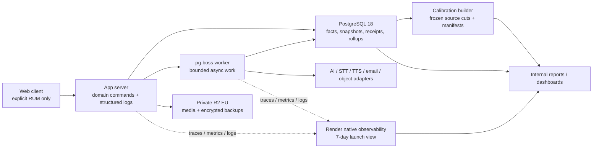
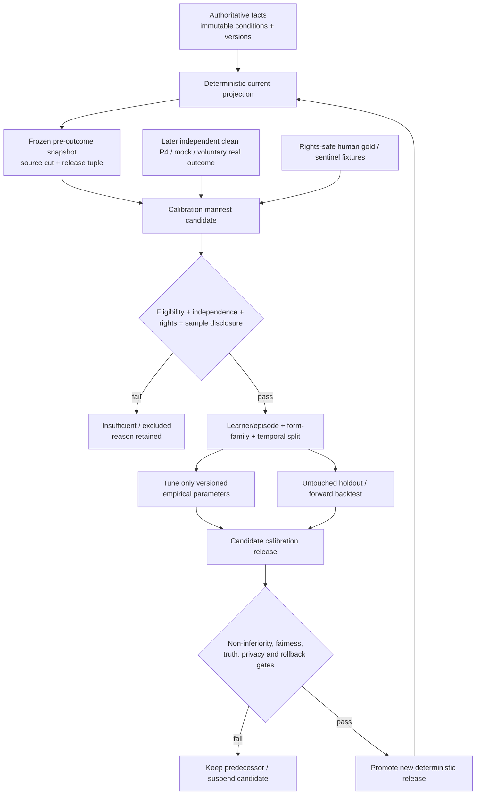
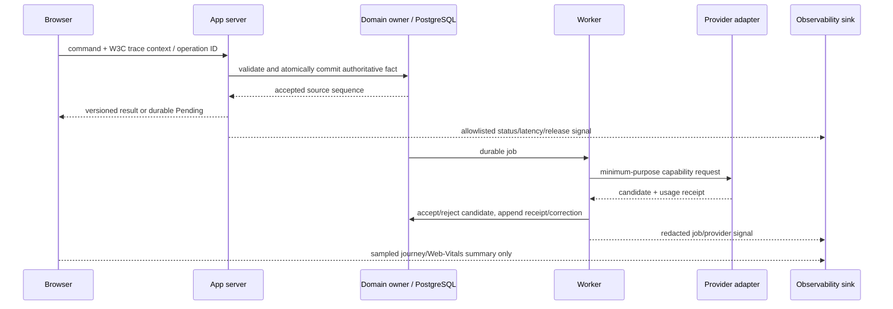

# Bestehen / App — Analytics, Calibration, Observability, Performance, Reliability, and Cost

> **Status:** Accepted architecture baseline  
> **Owner:** Stage 24 / Architecture and Operations  
> **Scope:** architecture decisions and handoff only; no production code, configuration, provisioning, or product/design modification  
> **Accepted App base:** `9bdb088eb4cc52c2fd308e63df57559ba5447501`  
> **Shaping authority:** `9f37ad78fdd101b3c9cb8782ddc54d12dbce1fdc`  
> **Research/access date:** 2026-08-23

## 1. Purpose and scope

This stage defines the smallest sustainable measurement and operating architecture that can tell whether Bestehen improves decision-grade TELC B1 readiness, whether its evidence instruments remain trustworthy, and whether the product can be operated safely at personal-project scale.

The selected baseline is deliberately lean:

- product analytics is a privacy-minimized projection of facts the product already needs for coaching, evidence, correction, data rights, and cost;
- PostgreSQL remains the authoritative store for semantic facts, immutable material snapshots, bounded quality incidents, usage receipts, and scheduled aggregate views;
- low-cardinality structured application logs and server/worker metrics/traces use a vendor-neutral contract and the existing Render surfaces at launch;
- browser measurement is an explicit, allowlisted Real User Measurement contract for journey timing and Core Web Vitals, not broad automatic capture;
- there is no product-analytics SDK, invasive session replay, heatmap, raw clickstream, event-stream platform, warehouse, time-series database, or always-on AI analytics;
- calibration uses frozen predictions made before independent outcomes, versioned dataset manifests, temporal/form-family holdouts, sample disclosure, and reproducible backtests;
- current Readiness remains deterministic. No pass-probability field, model, event, copy template, dashboard, export field, or hidden calculation exists.

This document consolidates earlier performance, durability, availability, media, AI, capacity, storage, cost, privacy, accessibility, and failure rules. It does not implement instrumentation, choose a legal basis, collect sensitive demographics, set an owner spending amount, or promise a public SLA.

## 2. Inputs, authority, continuity, and contradictions

### 2.1 Reproducible source snapshot

Every required input was fetched at the immutable refs above before decisions were made.

#### Shaping repository

| Path | Blob SHA | Stage-24 use |
|---|---|---|
| `app/28-bestehen-app-product-specification.md` | `18ae80cc2fd63cecd76c297c3e56d44a68367856` | Highest product authority, sections 16–18 and 20.5 |
| `app/01-product-thesis.md` | `6bbb074dc6a262cb66cebad960dd248d1010f21f` | Outcome hierarchy and sustainable-cost intent |
| `app/04-learner-model.md` | `f7ae1f4af375ee3302d04c726d8fe8453a9daf80` | Evidence conditions, independence and confidence |
| `app/05-mistake-memory.md` | `a7c574b08c33418eab44aba8b6e9b7f8ab877109` | Repair/resolution/reopen lifecycle |
| `app/06-daily-coaching-engine.md` | `3cd869cd337dd3a878c27f35e1e8b5dad0c4c7bb` | Useful work, prioritization and session purpose |
| `app/11-listening-training.md` | `e77948d6722b2ce635886d4b345e2ff9aad476a8` | Playback/media validity and direct evidence |
| `app/12-writing-coaching.md` | `0a606197ad514e8c8958004188837e37173258be` | Productive evaluation and Writing quality |
| `app/13-speaking-coaching.md` | `9462c78a1e7cc68249d38aa5a18a287be8aacd9c` | Oral evidence, interaction and evaluator quality |
| `app/14-review-and-spaced-repetition.md` | `fa9b65e92cd1511e00e106a199eb6fbc06273a69` | Separate immediate transfer and delayed retention |
| `app/15-telc-readiness.md` | `b4456939928493569336bbc565d7e67307e7a3db` | Independent gates, deterministic Readiness, no probability |
| `app/16-mock-exams.md` | `8f6c23fa16524bd251cef39d823cfeea73bfcef3` | Clean independent validation occasions |
| `app/20-progress-and-motivation.md` | `fd8d002dbb79fd66dca3fdfa8f6771318f76cbe4` | Internal metrics do not become learner motivation |
| `app/21-content-strategy.md` | `8149d6a268da70e17cad46f774b9d5de77776986` | Approval, defects, freshness and form health |
| `app/23-exam-date-and-urgency.md` | `5942ed811bcbaa5baaf1dd55079b8971d34b1d01` | Urgency affects priority, not truth |
| `app/24-analytics-and-success-metrics.md` | `28d1a5380a7ea9f28efdc95ce0c96987920917e1` | DSRA, Useful Session Outcome, metric catalog, frozen snapshots |
| `app/25-business-model-and-product-boundaries.md` | `904ae20e8cb3f9f354d6505513821e86f609622b` | Private/free baseline and cost boundaries |
| `app/26-platform-accessibility-nonfunctional.md` | `8137091683941b0d55f3d4fb90af3c402b8371e5` | L0–L3, durability, accessibility, degradation |

#### App repository

| Path | Blob SHA | Stage-24 use |
|---|---|---|
| `Design/DESIGN-HANDOFF.md` | `417a6820037e045e2dd9f29afc42b9f2e94fd638` | Six presentation states, recovery, audit disclosure |
| `Design/Bestehen-03-Desktop-Responsive.dc.html` | `94056db181b45298a759ff727ad5cfeac2f2a469` | Claim plus learner-visible evidence audit; no internal dashboard leakage |
| `Design/Bestehen-04-Flows-Handoff.dc.html` | `7120b05a2272c31e5896e4313a7007935f5d0aed` | Flow recovery and accessibility acceptance |
| `Architecture/00-architecture-shaping-plan.md` | `b263c5e7b3bccc0450ddd17aa0cc007432d672b7` | Stage ownership and downstream handoff |
| `Bestehen_App_Architecture_Checklist.md` | `8478d48a01970b4cdf94ef39695152514e78233c` | 24 Stage-24 checks initially open |
| `Architecture/01-architecture-charter-and-quality-attributes.md` | `cc8d28816f43d627861d11cd90e8770c4c96414c` | Binding QA budgets and low-ops posture |
| `Architecture/03-technology-stack-and-repository-strategy.md` | `907b04c57813dc50f92a7ed00e49196ff7d4a924` | Render/PG/R2 topology and scale triggers |
| `Architecture/05-data-ownership-persistence-and-schema-evolution.md` | `bb6df811ec9010de556d1719f22e31bb8ca3190e` | One PG authority, no warehouse, backup/RPO/RTO/retention |
| `Architecture/06-evidence-ledger-validity-versioning-and-audit.md` | `53d34ae65ef4c8fa79c00026f9bd5d7b876ce672` | Evidence identity, corrections, exact validity states |
| `Architecture/07-learner-model-mistake-memory-progression-and-review.md` | `ad58238aee48e41a0d4bd30bd21ac5a17707656f` | Deterministic projections and retention obligations |
| `Architecture/08-coaching-engine-and-session-state-machines.md` | `02c5e1ee5967bad976eda49ab4813a768eda5bd3` | Session boundaries, Pending concurrency, redacted operations |
| `Architecture/09-content-exercise-form-and-media-architecture.md` | `e6fb121ab1b10c6cbcf692bc88acaf98f2e45e7a` | Content/form versions, family independence, quality incidents |
| `Architecture/11-readiness-scoring-mocks-and-ready-to-book.md` | `7c327cd770460b94107f2756e2b7d8f29c56b909` | Frozen source cuts, six states, deterministic scoring |
| `Architecture/12-api-contracts-jobs-events-and-idempotency.md` | `c640da01d6eb6d71a5e2ea7a0dcf19147d6d7528` | Versioned resources/jobs/events, idempotency, correlation |
| `Architecture/16-listening-audio-tts-and-media-delivery.md` | `6bb60e2d6048a39035107ff427a0c4fd305c1ba6` | Media delivery/playback integrity and cost |
| `Architecture/17-writing-editor-autosave-and-evaluation-pipeline.md` | `c2c3de417f1d3bcd8c53e1bf40fbb49522c34529` | Approximately-five-second loss bound and evaluator measures |
| `Architecture/18-speaking-audio-stt-partner-and-evaluation-pipeline.md` | `2f118f817a99b76dc1e0c38c0aedaa1e0662268e` | Audio/partner/evaluator/deletion measures |
| `Architecture/19-ai-gateway-model-governance-evaluation-and-cost.md` | `60aef66f8443e747935b2cfb479dd7f4dd4d5c23` | Capability receipts, benchmark gates, unit-cost formula |
| `Architecture/20-account-local-first-profile-sync-export-and-deletion.md` | `9a1aa2d5fea31ff0bdccfc4561806bb870511ab6` | Anonymous adoption, identity-safe aggregation, data rights |
| `Architecture/21-offline-checkpointing-recovery-conflicts-and-timing-integrity.md` | `1216f98f5489119b4d8114804ac87936bc78ddd4` | Outbox/checkpoint/timer truth and honest conflict metrics |
| `Architecture/22-notifications-scheduling-and-time-zones.md` | `6e0e8a761b9cf83a75931e815f447e148e3a20d0` | Notification delivery is diagnostic, not learning |
| `Architecture/23-security-privacy-rights-retention-and-threat-model.md` | `abc1a300d5b0fd659d28f768669dd73afbb90887` | Redaction, security audit, deletion/audio/rights/abuse signals |

All required prior stages are present and compatible. The stage output did not read a filename as proof; the contents and current blobs were examined.

### 2.2 Authority reconciliation and recorded contradictions

| Source tension | Resolution and consequence |
|---|---|
| `app/01-product-thesis.md` uses “maximize probability of passing” as objective prose; the final specification, `app/15-telc-readiness.md`, and accepted Stages 01/11 forbid a pass-probability artifact. | Interpret the thesis as directional product intent only. Current software measures target performance and decision-grade evidence through DSRA and deterministic Readiness. No probability artifact exists. |
| `Design/DESIGN-HANDOFF.md` and `Design/Bestehen-04-Flows-Handoff.dc.html` say evaluation is “usually under a minute”; the final product and accepted Stage 01 set useful L2 result normally ≤15 s and Pending after ~30 s. | The 15/30 behavior wins. Copy is selected from the measured service-policy release and may never hard-code an unmeasured provider promise. Design remains unchanged; Stage 25 verifies truthful copy. |
| `Design/Bestehen-04-Flows-Handoff.dc.html` says offline Writing keeps the timing claim; accepted Stages 17/21 make this conditional on trusted start/monotonic/visibility/checkpoint anchors. | Preserve the draft and queue it. Keep the clean timing claim only when the exact continuity proof passes; otherwise mark only timing/continuous scope `interrupted`. |
| `app/26-platform-accessibility-nonfunctional.md` rejects a launch enterprise SLA/multi-region obligation; Stage 01 instructs Stage 24 to establish measured internal baselines. | The SLOs below are internal release/operating targets for learner truth and critical journeys, not a public availability promise. They do not imply multi-region or 24×7 staffed on-call. |
| Product-shaping Stage 24 also resolved an older account/data checklist mismatch. | Accepted Stage 20 is authoritative for account/local-first/export/delete. This stage measures those flows without reopening identity or retention semantics. |
| Provider prices, quotas, plan names, and signal retention are mutable. | Keep price catalogs and provider capabilities as dated operational facts. Re-verify before provisioning/renewal and on provider notice; a mismatch opens review, not an in-place historical rewrite. |

No contradiction or missing owner preference blocks this stage.

## 3. Invariants and state boundary

The exact evidence validity values remain:

`valid · partially_valid · pending · interrupted · not_counted`

The exact Readiness states remain:

`evidence_building · not_ready · borderline · safe · ready_to_book · stale_contradicted`

Written and Oral remain independent pass gates. Missing is absence, never zero. Safe is not Ready to Book. P0–P4 remain local condition profiles. Corpus receives no learner profile and ordinary attempts make no live Corpus search/AI call. A technical, content, media, accessibility, browser, network, evaluator, provider, or telemetry failure has zero learner-negative effect.

Analytics may observe state transitions; it cannot author evidence, validity, score, Readiness, planning, correction, deletion completion, rights clearance, or provider acceptance. Urgency, engagement, cost, and telemetry volume never outrank Stage-27 precedence.

## 4. Decisions and rationale

| ID | Decision | Alternatives and rationale | Consequences, fallback, review |
|---|---|---|---|
| `ARCH-S24-D01` | Use evidence-derived, purpose-bound product/quality/cost records over existing PostgreSQL facts; no parallel clickstream learner model. | Do nothing/provider dashboards cannot evaluate learning. Full product analytics duplicates truth and creates surveillance. A thin semantic catalog is sufficient. | Facts remain with their domain owner; analytics owns manifests/aggregates only. Review a separate store only after measured PG/query/isolation pressure. |
| `ARCH-S24-D02` | Persist a closed, versioned lean event catalog plus separate low-cardinality operational signals. Semantic events are complete, not sampled; ordinary diagnostic logs/traces are sampled. | Every UI click is easy but meaningless. Manual notes miss correctness/cost evidence. | Unknown consequential major fails closed for analytics consumption only; learner work continues. Event deletion follows its source personal-data class. |
| `ARCH-S24-D03` | DSRA and Useful Session Outcome remain primary product metrics; transfer, retention, evaluator/content/mock-to-real and cost metrics preserve independence/conditions. | Engagement score or blended “learning score” is simpler but circular/unsafe. | Invalid evidence is excluded from outcomes and counted as delivery failure. Every rate discloses denominator and missingness. |
| `ARCH-S24-D04` | Calibration uses immutable pre-outcome snapshots, rights-safe gold sets, independent future P4/real outcomes, versioned manifests, temporal/form-family holdouts, and reproducible backtests. | Re-evaluate history with current truth produces hindsight bias; same-form validation is circular. | Historical learner-visible prediction never changes. Correction creates a new projection and separate current truth. |
| `ARCH-S24-D05` | Probability remains structurally forbidden. A future activation requires a separate product decision and superseding ADR after independent empirical, privacy/legal, fairness, and communication gates. | Add a hidden model now or show a convenience estimate; both create uncalibrated fake precision. | Current schemas/lints reject probability-like fields. Insufficient data yields no calculation, not a weak estimate. |
| `ARCH-S24-D06` | Use structured allowlisted stdout logs, low-cardinality metrics, and server/worker traces correlated by W3C Trace Context/OpenTelemetry-compatible fields; browser RUM is explicit and minimal. | Provider-only opaque signals hinder exit; browser auto-instrumentation/session replay overcollects. | Render native views are launch sink. Export behind OTel-compatible ports later. Browser OTel auto-instrumentation is not selected while experimental. |
| `ARCH-S24-D07` | Launch with Render native 7-day logs/metrics plus PostgreSQL daily operating/calibration aggregates; no new observability vendor. | Managed Grafana/Better Stack improves retention but adds processor/cost. Self-hosted collector adds on-call burden. | Add a bounded sink only after incident/retention/scale trigger. Provider loss cannot erase product facts or calibration snapshots. |
| `ARCH-S24-D08` | Define internal SLO-style targets around evidence integrity, durable responses, local degradation, latency and deletion—not vanity uptime alone. | No targets makes failure invisible; 99.99% public SLA/multi-region is disproportionate. | Low-traffic alerting uses absolute critical events and synthetic probes as well as ratios. SLO miss opens correction/degradation; never reclassifies learner ability. |
| `ARCH-S24-D09` | Consolidate the accepted L0–L3, ≤5-second Writing loss, backup RPO/RTO, media/evaluator, availability and recovery budgets into one versioned operating baseline. | Per-feature ad hoc targets drift; provider SLA passthrough is not learner truth. | Stage 25 makes gates executable; Stage 26 provisions/runbooks. Tightening is versioned; truth/accessibility cannot be relaxed. |
| `ARCH-S24-D10` | Account all fixed and variable provider/media/storage/backup/observability/human-ops cost through immutable usage receipts and invoice reconciliation. | Invoice total alone cannot explain capability value; token estimates alone miss actual charges. | No owner euro budget is invented. Paid AI is disabled without an owner-configured envelope per Stage 19. |
| `ARCH-S24-D11` | Scale only on sustained measured trigger after ordinary query/index/cache/batch/retention tuning. | Speculative replicas, queue service, warehouse, multi-region and SIEM add idle cost/failure domains. | Preserve standard PG/SQL, S3, JSON/OTel and adapter exits. Capacity planning reports assumptions and uncertainty, not a fictitious learner forecast. |
| `ARCH-S24-D12` | Operate six small dashboards and three alert classes with runbook links, owner, source, freshness, release versions and redaction proof. | One mega-dashboard hides responsibility; per-feature dashboards create toil. | Dashboard outage does not alter learner truth. A signal without an actionable response is reported, not paged. |

All decisions are summarized by ADR-0032.

## 5. Components and responsibility ownership



| Component | Owns | Explicitly does not own |
|---|---|---|
| Domain owners | Authoritative attempt/evidence/weakness/session/mock/readiness/content/evaluation/data-rights facts | Analytics interpretation outside their contract |
| Analytics catalog | Event schemas, purpose, retention class, sampling class, release compatibility | Learner truth, score, validity, Readiness |
| Snapshot builder | Immutable material Readiness/Ready-to-Book pre-outcome snapshots and source cuts | Retroactive history rewrite |
| Calibration builder | Dataset manifests, joins, exclusions, splits, backtest result and sample disclosures | Live Readiness or probability |
| Observability adapter | Structured logging, metric instruments, trace context/export port, redaction | Raw learner content or provider semantic authority |
| Operating views | Aggregate dashboard queries, SLI computation, alert state/runbook references | Product state mutation |
| Cost ledger | Price catalogs, provider usage receipts, invoice reconciliation and useful-unit attribution | Permission to suppress pass-critical truth |
| Operations/Governance | Policy promotion, threshold/release review, incidents, rollback and provider exit | Arbitrary learner record inspection |
| Stage 25 | Executable quality/release suites and benchmark acceptance evidence | Changing the architecture invariant |
| Stage 26 | Deployed resources, alert routing, backup/restore, runbooks and configuration evidence | Inventing product metrics |

## 6. Lean event and metric catalog

### 6.1 Explanatory event envelope

The following is architecture pseudotype, not production code.

```text
SemanticEvent = {
  event_id,
  event_name,
  schema_version,
  occurred_at,
  recorded_at,
  owner_context,
  purpose_code,
  opaque_subject_ref?,
  source_fact_ids[],
  source_cut?,
  operation_id?,
  independent_episode_id?,
  validity?, affected_scope?,
  release_tuple,
  dimensions: allowlisted low-cardinality fields,
  retention_class,
  correction_of_event_id?
}
```

`opaque_subject_ref` is App-internal and access-controlled. It is omitted where aggregate operation does not need it and is destroyed/de-linked with learner deletion. There is no global third-party analytics identity. Attempt/evidence IDs remain semantic references in the App database; general logs receive one-way operational correlation only when necessary.

Every event schema declares:

- one purpose and named consumers;
- semantic owner and producer;
- exhaustive allowed fields and cardinality budget;
- source facts and idempotency identity;
- sampling rule;
- personal-data and sensitivity class;
- retention/export/delete behavior;
- release/version compatibility and correction policy;
- forbidden fields and safe degradation.

### 6.2 Product/evidence/quality/cost events

| Event family | Trigger / purpose | Required fields beyond envelope | Sampling | Retention / privacy |
|---|---|---|---|---|
| `evidence.observation_recorded` | A valid/partial/pending/interrupted/not-counted observation is committed once | skill/lane, condition/profile, validity, scope, content/evaluator release, no response body | 100%; it is product truth, not telemetry | Source fact retention until learner deletion; aggregate counts may persist only irreversibly de-linked |
| `evidence.correction_applied` | A material correction/invalidation changes supported scope | correction reason, affected releases/scope, old/new projection generation refs | 100% | Source correction policy; no learner payload in operations view |
| `readiness.material_snapshot` | Baseline, material component/band/confidence/blocker/gate change, pre-mock or pre-exam freeze | Written/Oral states separately, six-state kind, ranges/confidence where allowed, source cut, blueprint/rules/calibration/evaluator set | 100% at material boundary; never every render | Product history until deletion; immutable historical snapshot |
| `weakness.transfer_outcome` | Repair, immediate retry, R1–R4 result, resolved/reopened | weakness/capability ID, episode relation, interval class, assistance/condition, validity | 100% | Source lifecycle retention; no content text |
| `session.summary_recorded` | Meaningful session stop boundary | dominant purpose, planned bucket, stop reason, Useful Session Outcome type, invalidated scopes, no click trail | 100% one summary/session | 24 months or learner deletion, whichever is earlier; after that only de-linked aggregates |
| `mock.summary_recorded` | Mock block closes or remains partial/pending | form/blueprint/release, clean/modified scopes, component outcomes separately, source cut | 100% | Product history until deletion |
| `quality.incident_recorded` | Content/media/evaluator/accessibility/system defect | fault owner/code, version, affected scope/count, quarantine/correction refs, severity | 100% material incidents | 24 months after closure; learner references minimized/de-linked on deletion |
| `evaluator.release_result` | Gold/sentinel/release evaluation or governed correction | benchmark manifest, slice, schema/agreement/pass-flip/cannot-judge/drift outcomes | 100% benchmark result; no production response | Release history; rights-safe de-identified fixtures only |
| `cost.usage_receipt` | A billable/high-cost operation is accepted from adapter | capability/release/SKU, billed units, price catalog, estimated/list/invoice cost, retry/escalation attribution | 100% | 24 months for reconciliation; no learner payload; opaque operation ref expires with source |
| `real_exam.outcome_reported` | Learner voluntarily submits component outcome | exam occasion/date, Written/Oral known/unknown/score/pass separately, self-report confidence, consent/purpose version | 100% | Personal fact until deletion; never provider training by default |
| `data_rights.operation_state` | Export/delete lifecycle state materially changes | operation state, inventory release, provider/task counts, residual deadline, proof digest | 100% | Stage 20/23 policy; deletion proof contains no learner content |
| `security_or_rights.incident` | Stage-23 audit/rights boundary event | allowlisted actor/target pseudonym, action/outcome/release/reason, no content | 100% | Stage-23 bounded audit policy; restricted access |

The event name `pass_probability_*` and any field expressing chance of passing are prohibited by schema lint and registry review. A Readiness snapshot stores only the accepted target-performance and evidence contract.

### 6.3 Operational signals

| Signal | Examples | Cardinality rule | Learner/content rule |
|---|---|---|---|
| Counters | requests, jobs, retries, status/reason, circuit opens, invalidations, deletion tasks, audio objects | route template/capability/release/status only | no learner/attempt/content ID label |
| Histograms | L0–L3 latency, checkpoint/write/queue age, object transfer, restore duration, cost/unit | bounded buckets, route/capability/release | no payload size that reveals response content beyond coarse approved bucket |
| Gauges | queue oldest age, DB storage %, backup age, raw-audio overdue count, deletion overdue count, circuit state | service/capability/region/release only | zero raw learner data |
| Structured logs | state transition, failure owner, reason, release, operation correlation | allowlist; no arbitrary object serialization | no body, response, transcript, audio, prompt, secret, token, email, IP, full URL/query |
| Traces | HTTP/server/worker/provider/storage spans | sampled; normalized route names; baggage allowlist empty by default | no learner scope, content or auth data |
| Browser RUM | LCP, INP, CLS, supported capability family, coarse connection/offline state, critical flow duration/result class | route family/release/device class with minimum cohort disclosure | no DOM, selectors, keystrokes, field values, accessibility/disability inference, replay |

### 6.4 Sampling and retention policy

| Class | Launch sampling | Retention |
|---|---|---|
| Semantic product/evidence/correction/data-rights events | 100%; idempotent because these are facts/material projections | Governing source policy and learner deletion |
| Security/privacy/rights/audio/deletion critical events | 100%; never sampled away | Stage-23 release; normally 90 days for linkable audit unless a shorter governing class applies; deletion journal ≤91 days |
| Warning/error logs | 100% until provider cap; volume circuit preserves a counted “dropped” signal | Render launch retention 7 days |
| Ordinary info/debug logs | deterministic sample by operation/release, launch default 10%; debug off outside bounded incident window | 7 days, shorter for bounded debug |
| Server/worker traces | errors and declared critical journeys 100%; ordinary success default 5%; adaptive/tail policy only after a sink supports it | 7 days |
| Browser RUM | one sample per critical journey completion/failure, not per interaction; default 25% ordinary journeys and 100% explicit technical invalidation | raw 30 days in bounded PG aggregate input, then daily de-linked rollup ≤13 months |
| Raw service metrics | provider/native window | Render native 7 days |
| Hourly/daily low-cardinality rollups | 100% aggregation, no subject | 30 days hourly; 13 months daily |
| Incident record and release evidence | 100% | 24 months or superseding governance record; personal links deleted/de-linked |
| Calibration dataset manifests/results | 100% immutable release history | retain while source data remains authorized; results/manifests may remain only if rights-safe and de-linked |

These are versioned launch defaults, not legal conclusions. A retention change requires purpose, provenance, access review, cost, deletion/restore impact and rollback. Retain-everything is forbidden. Render currently limits Hobby logs and metrics to seven days and accepts at most 6,000 application-generated lines per minute per instance; loss/dropped-log signals are therefore first-class and excess debug volume is shed before critical audit/deletion signals.

## 7. Outcome and quality metric catalog

### 7.1 Metric rules

Every metric names its numerator, denominator, unit of independence, inclusion/exclusion, source cut, applicable releases, window, missingness, and sample count. No percentage appears without the raw count. A zero denominator renders `insufficient_data`, never zero success. Invalid evidence is excluded from learner outcome denominators but counted in delivery-quality metrics.

Written and Oral are always reported separately before a combined view. Same-session retry is separate from delayed transfer. Engagement is diagnostic and cannot be optimized at the expense of direct evidence, fairness, coverage, or learner agency.

### 7.2 Product, learning, and delivery metrics

| Metric | Exact architecture interpretation | Anti-circularity / guardrail |
|---|---|---|
| DSRA attainment | Both components reach current Safe under the accepted decision-grade rules; denominator begins below DSRA after usable baseline | Readiness thresholds cannot be loosened to improve DSRA |
| Time/useful effort to DSRA | Calendar interval and purposeful session/attempt time from baseline | Descriptive; disclose gaps/availability |
| Ready-to-Book attainment | Exact Stage-11 Gates A–F all pass | Not a score; Safe alone is insufficient |
| Sustained Safe | Later current independent evidence still supports Safe | Aging is uncertainty/currentness, not learner decline |
| Useful Session Outcome rate | Session ends at a meaningful boundary that creates valid decision evidence, due retention, repair+fresh transfer, clarifier, stronger condition, or valid mock scope | One session, not clicks/time, is the unit |
| Fresh-transfer success | Fresh equivalent same-lane attempt after repair, without answer-bearing help | Separate from exposed repair item |
| R1/R2/R3/R4 outcomes | Early/consolidation/broader/stability delayed checks | Each independent occasion reported separately |
| Reopen rate | Resolved/repaired weakness reappears under valid fresh evidence | Does not include system/content invalidation |
| Assistance reduction / condition-strength gain | Comparable performance remains functional under stronger condition | Stable raw score may be gain; preserve conditions |
| Content validity/defect/freshness/form health | Serve eligibility, later invalidation, quarantine, correction, collision, family concentration and P4 supply | Defects repair affected evidence; never lower learner ability |
| Audio/media validity | Preload/integrity/decode/output/playback/capture success by evidence role | System failure is delivery fault |
| Evaluator quality | Schema, gold agreement, pass-gate flip, criterion/part agreement, repeatability, cannot-judge, confidence validity, escalation/correction and slice drift | Candidate is never self-validating; zero known critical fixture regression |
| Mock-to-real | Latest clean current full mock and frozen pre-exam state versus voluntary real Written/Oral outcome | Latest mock initially within product’s 30-day reporting window; disclose selection/self-report bias |
| Cost per useful accepted productive unit | All attributable standard/retry/escalation/STT/TTS cost divided by accepted `valid`/`partially_valid` productive evidence units | Writing and Oral separate; Pending/zero denominator explicit |
| Engagement diagnostics | return, resume, reminder action, planned commitment | Separate dashboard; never learner-quality proxy |

## 8. Calibration data flow and frozen snapshot model



### 8.1 Frozen snapshot contract

```text
FrozenReadinessSnapshot = {
  snapshot_id,
  learner_scope,
  purpose: material_change | pre_independent_p4 | pre_mock | pre_exam,
  frozen_at,
  source_cut,
  written_projection?,
  oral_projection?,
  readiness_state,
  booking_gate_results?,
  blockers[],
  evidence_coverage,
  blueprint_release,
  rules_release,
  calibration_release,
  content_form_release_set,
  evaluator_release_set,
  accommodation_or_actual_condition_release?,
  previous_snapshot_id?,
  immutable_hash
}
```

Missing component projections remain absent. The snapshot is never recomputed after the validating outcome. A content/evaluator correction may create a current correction and successor snapshot, while the historical snapshot remains what the product actually asserted.

### 8.2 Calibration dataset classes

| Dataset | Purpose | Admission and exclusion |
|---|---|---|
| Productive evaluator gold | Promote Writing/Oral evaluator releases | Rights-safe, de-identified, human adjudication version, required rubric/condition slices; production content excluded without separate explicit consent |
| Frozen forward P4 | Validate current component estimate/range/confidence against a later independent clean P4 occasion | Outcome must be outside snapshot source cut, fresh family/occasion and applicable blueprint; invalid/assisted/non-equivalent evidence excluded |
| Frozen mock-to-real | Compare clean mock/readiness state with voluntary real component outcome | Same exam attempt/blueprint, source confidence, days-to-exam, missing components explicit |
| Content/form calibration | Difficulty residual, form health, freshness and defect behavior | Control learner state/condition; never infer difficulty from raw weak/strong cohort alone |
| Operational benchmark | Latency, durability, restore, cost and fault behavior | Synthetic/fixture or minimized production aggregate; no learner response |

### 8.3 Dataset manifest and sample disclosure

Every calibration run freezes a `CalibrationDatasetManifest` containing:

- manifest ID/hash, purpose, hypothesis and preregistered metrics;
- source table/fact versions and immutable source cut;
- inclusion/exclusion reasons and counts;
- independence unit and deduplication/freshness rule;
- train/tune/holdout split by learner/preparation episode, form family and time;
- total and per-component/band/confidence/form/evaluator counts;
- count of pass/fail outcomes separately for Written and Oral;
- missing fields, invalid/excluded outcomes, loss to follow-up and self-report confidence;
- selection mechanism and known bias;
- rights/consent/deletion basis and de-identification status;
- blueprint/rules/calibration/content/evaluator releases;
- adjudicator protocol/disagreement for gold data;
- statistical method, uncertainty intervals, non-inferiority margin provenance and power/precision justification;
- output artifacts, review decision, rollback release and expiry/review date.

No minimum sample count is guessed. The analysis owner must justify sample adequacy from the planned error tolerance and observed outcome prevalence. If that justification cannot be met, the result is exploratory/`insufficient_data` and cannot change learner-facing claims.

### 8.4 Backtesting and no circular validation

1. Freeze the projection before any validating result exists in its source cut.
2. Split by learner/preparation episode so one person does not appear on both fitting and holdout sides.
3. Split near-duplicate/freshness families and complete mock forms together.
4. Prefer a forward temporal holdout; also test leave-one-form-family/release-period-out where data permits.
5. Fit/tune only explicitly empirical calibration parameters. Official TELC weights/gates, independent components, validity, absence, and state semantics are not tunable.
6. Report signed error, absolute error, range coverage, component gate agreement, confidence ordering, DSRA/Ready false-ready cases and failure-case narratives—not correlation alone.
7. Compare candidate with predecessor on the untouched holdout and required evaluator/content/access-condition slices.
8. Preserve all manifests/results, including failed candidates. Never select the best run after repeatedly inspecting the same holdout; refreshing a compromised holdout creates a new manifest.
9. Promote atomically with effective time, monitor and rollback; recompute only affected current projections. Historical snapshots remain fixed.

### 8.5 Drift and recalibration gates

| Trigger | Required action | Promotion/suspension rule |
|---|---|---|
| Blueprint/rubric/content-form/evaluator/model/provider or material prompt change | New release, affected-scope benchmark and fresh manifest | No readiness influence before gates pass |
| One known pass-critical fixture regression, schema/reference/privacy failure or probability artifact | Suspend candidate/affected route immediately | Zero tolerance; use predecessor/fallback/Pending |
| Gold/sentinel metric breaches its preregistered non-inferiority/control band | Investigate slice/data/provider drift, rerun adjudication where justified | One material breach blocks promotion; three consecutive operating excursions trigger rollback/recalibration review |
| False-ready real outcome | High-severity calibration case review by component | Does not automatically rewrite history; may suspend risky release if evidence supports systemic cause |
| Confidence ordering fails or a material unexplained access/device/voice slice gap appears | Freeze promotion, inspect sample/adjudication and alternate route | Insufficient sensitive-group data is disclosed; no demographic collection is invented |
| Sample becomes stale, selection changes, or matched outcome mix shifts materially | Publish new dataset manifest and forward validation | No silent parameter change |
| Cost/latency improves but quality does not | Keep cheaper route only if quality non-inferiority and privacy/reliability pass | Cost never overrides a pass-critical regression |

Gold/sentinel checks run on every consequential release and at least monthly while the route is active. Real-outcome calibration review runs when a newly matched outcome arrives and as a scheduled aggregate only when the manifest has adequate independent data.

### 8.6 Pass-probability activation boundary

The current registry rejects any probability-like schema/event/model/copy. Frozen snapshots and real outcomes are collected for readiness validation, not to calculate a hidden probability.

A future pass-probability capability is eligible for consideration only after all of the following are proven:

1. a new explicit product decision says the learner benefit outweighs the communication and behavioral risk;
2. a superseding ADR defines independent Written, Oral and combined-gate probability semantics without compensation;
3. a preregistered, rights/privacy-reviewed dataset has adequate independent matched real outcomes, including enough failures and coverage across relevant readiness ranges for the declared precision;
4. learner/form/time separated out-of-sample calibration is stable across repeated forward periods;
5. discrimination, calibration error, Brier/log loss, reliability plots, uncertainty intervals, range coverage and false-ready harm are reported by component, not correlation alone;
6. missingness, self-report/selection bias, evaluator/blueprint drift and applicable fairness/access conditions are disclosed;
7. wording/comprehension research proves learners do not confuse probability with Safe, Ready to Book or official TELC certainty;
8. monitoring, recalibration, rollback, deletion/export and model-card ownership are approved.

Until that future decision commits new contracts, the system performs no pass-probability calculation at all.
## 9. Observability and redaction

### 9.1 Current official technical evidence

Mutable claims were rechecked in official primary documentation on 2026-08-23:

- [Render Logs](https://render.com/docs/logging): Hobby retention is currently seven days, Pro 14 days, Scale/Enterprise 30 days; Render processes at most 6,000 application-generated log lines per minute per instance and drops excess.
- [Render Service Metrics](https://render.com/docs/service-metrics): native CPU, memory, HTTP and PostgreSQL views have plan-dependent 7/14/30-day retention.
- [Render Metrics Streams](https://render.com/docs/metrics-streams): Pro+ can stream service metrics in OpenTelemetry JSON to a compatible endpoint; this is an exit/upgrade path, not a launch requirement.
- [Render flexible PostgreSQL plans](https://render.com/docs/postgresql-refresh): storage is currently USD 0.30/GB-month and can grow independently; paid databases include plan-dependent PITR.
- [OpenTelemetry JavaScript status](https://opentelemetry.io/docs/languages/js/): traces and metrics are stable, logs are development, and browser instrumentation is experimental/mostly unspecified. Therefore Bestehen selects server/worker OTel-compatible contracts and an explicit browser RUM schema, not broad browser auto-instrumentation.
- [OpenTelemetry semantic conventions](https://opentelemetry.io/docs/concepts/semantic-conventions/) and [log data model](https://opentelemetry.io/docs/specs/otel/logs/data-model/): common signal names and trace/log correlation support provider exit.
- [W3C Trace Context](https://www.w3.org/TR/trace-context/): `traceparent`/`tracestate` provide interoperable request correlation. Bestehen propagates context but does not place learner identity/content in baggage.
- [PostgreSQL `pg_stat_statements`](https://www.postgresql.org/docs/current/pgstatstatements.html): normalized statement planning/execution statistics support query diagnosis; SQL text access remains privileged and query literals/payloads are never used as analytics.
- [Cloudflare R2 pricing](https://developers.cloudflare.com/r2/pricing/): current Standard rates are USD 0.015/GB-month, USD 4.50/million Class A, USD 0.36/million Class B, with the documented Standard free allowance and no direct R2 egress charge. Price catalogs remain mutable.
- [Core Web Vitals thresholds](https://web.dev/articles/defining-core-web-vitals-thresholds): LCP ≤2.5 s, INP ≤200 ms and CLS ≤0.1 at the 75th percentile are secondary page-experience baselines, not evidence or learner metrics.
- [Google SRE Workbook — alerting on SLOs](https://sre.google/workbook/alerting-on-slos/): multi-window burn rates are useful at sufficient traffic, but the official guidance warns that low-traffic services need different handling. Bestehen combines ratios with absolute critical events and synthetic journeys.

Official documentation describes capabilities and prices, not evidence that a particular release/configuration is safe. Stage 25/26 must record actual deployed behavior.

### 9.2 Signal flow



A product fact is never made true because a log/event arrived. Semantic analytics is written transactionally with, or reproducibly projected from, the authoritative fact. Ordinary telemetry export is best effort and cannot roll back a learner command. Security/deletion audit facts that prove an authorized state transition use PostgreSQL authority, not stdout.

### 9.3 Observability/redaction matrix

| Surface | Allowed | Structurally forbidden | Sampling / access | Failure behavior |
|---|---|---|---|---|
| Browser RUM | app release, normalized route/flow, LCP/INP/CLS, journey duration, capability/preflight outcome class, online/offline transition, anonymous coarse device family | DOM/HTML, selectors containing content, keystrokes, form values, text/audio/transcript, exact URL/query/fragment, IP, fingerprint, name/email, disability/accessibility inference, Readiness numbers, probability | sampled per journey; Ops aggregate access | Drop signal; never block UI or change evidence |
| HTTP/application log | time, level, service/release, normalized route, method/status class, duration, trace/request/operation ID, error/reason code, contract/version | request/response body, headers/cookies/tokens, prompt, SQL literal, stack containing payload, learner/content ID, full URL | warning/error complete; ordinary sampled; Ops | Provider drops are counted; shed debug first |
| Worker/job log | job/capability/release/schema, attempt count, queue age/duration, terminal status, circuit/reason, provider status class | payload, learner response, transcript/audio, prompt/rubric content, provider secret/raw request ID | complete terminal/errors; ordinary sampled | Durable job state remains in PG; log loss cannot lose work |
| Metrics | low-cardinality count/histogram/gauge by service/capability/release/status/region | subject/attempt/object ID labels, arbitrary reason text, URLs, content family when cardinality unsafe | aggregate; Ops | Missing series marked stale, not zero |
| Traces | normalized server/worker/db/provider/storage spans, timing/status/retry, trace/span IDs | baggage with learner scope, body/events containing payload, secrets, raw SQL values, audio/content bytes | critical/error 100%, ordinary sample | Trace export failure is local; authoritative operation continues |
| PostgreSQL query stats | normalized query ID, calls, total/mean time, rows, I/O/WAL where available | learner query values in analytics, broad developer access to SQL text | restricted DBA/Ops | Use query plan/aggregate; do not enable unsafe logging |
| Domain quality incident | exact content/evaluator/media release and affected fact IDs in restricted product store | raw audio/general support copy; unrelated learner history | complete; authorized owner | Drives quarantine/correction, not learner fault |
| AI/provider usage receipt | capability/SKU/release, billed units, list/estimated/invoice cost, latency/status/retry | learner payload, identity/profile, general provider conversation/file state | complete; Finance/Ops aggregate | Missing receipt opens cost incident; candidate acceptance stays separate |
| Security/data-rights audit | actor/target pseudonym, action/outcome/reason, policy/key/inventory release, proof digest | secret, content, reusable capability, public object key | complete; restricted/security | Missing critical audit blocks release/operation completion |
| Incident record | severity, timeline, scope, affected releases, containment/recovery/verification, minimum opaque refs | copied learner payload “for convenience” | complete; time-bound access | Personal evidence only under explicit necessity/authorization/retention |

### 9.4 Redaction controls

1. **Schema before serialization:** signal producers construct closed allowlisted objects; they never pass arbitrary domain/provider objects to a logger.
2. **Typed secret/content wrappers:** high-sensitivity values have no default string/JSON representation.
3. **Normalize before emission:** route templates, provider status classes and bounded reason enums replace free-form URLs/errors.
4. **Context allowlist:** trace baggage is empty by default; correlation IDs are random/opaque and carry no embedded learner or time information.
5. **Central scrubber as defense in depth:** remove auth/email/IP/token/key/object-locator patterns, control/newline injection and unexpected high-cardinality fields before export.
6. **Sink guard:** reject an event whose schema/field/cardinality release is unknown; increment a local redaction/drop counter without including the rejected payload.
7. **Release proof:** fixtures/canary secrets and multilingual content scan browser beacons, stdout, traces, metrics, crash reports, backups and provider dashboards.
8. **Incident mode:** temporary increased sampling has a written purpose, owner, expiry ≤24 hours, narrower access and the same payload prohibitions.
9. **No replay:** no DOM/screen/session/audio replay is enabled in any mode.
10. **Deletion/de-link:** linkable semantic records follow the source learner deletion; aggregate signal retention does not preserve a re-link key.

Unknown error objects render a reviewed generic operational code. They are not serialized. Redaction failure is itself a release blocker and security incident when data escaped.

## 10. Internal SLOs, performance and reliability budgets

### 10.1 SLO semantics

These are internal launch hypotheses over eligible, supported journeys. They are not provider SLAs or a public availability promise.

A **good critical-command outcome** is one that:

- authorizes the correct learner scope;
- produces exactly one durable accepted fact/result, or an explicit durable `pending`/`interrupted`/`not_counted` state owned by the system;
- preserves unaffected work;
- exposes the correct versions and recovery action;
- creates no learner-negative consequence from a system fault.

The first three objectives below have zero-tolerance integrity dimensions. Availability ratios never average away an integrity failure.

| SLO / invariant | Launch objective / window | Denominator and exclusions | Miss response |
|---|---|---|---|
| `SLO-EVIDENCE-INTEGRITY` | 100% sampled consequential projections trace to facts/releases; zero duplicate evidence; zero system-fault learner-negative effects | All accepted consequential facts/projections and fault fixtures | Page on first proven breach; stop affected release, correct scope, preserve audit |
| `SLO-CRITICAL-COMMAND` | ≥99.5% good outcomes over rolling 28 days | Eligible supported objective submit, checkpoint/finalize, mock unit commit, evaluation acceptance, sync/adoption, export/delete commands; learner cancellations and declared unsupported preflight excluded | At low traffic show raw counts + synthetic results; ticket/page only actionable sustained/systemic failures |
| `SLO-DURABILITY` | 100% acknowledged facts recover; Writing recoverable loss normally ≤5 s; no silent overwrite/timer reset/duplicate submission | Accepted server writes plus supported release/device durability tests | First acknowledged loss is critical incident; repeated loss-bound miss blocks high-stakes path |
| `SLO-L2-EVALUATION` | useful result normally ≤15 s; every job beyond ~30 s has stable durable Pending identity and unrelated work available | Approved productive routes, by capability/release; learner/network cancellation separate | Open circuit/route Pending; capacity/provider review; no guessed score |
| `SLO-L3-PARTNER` | begin response around ≤2 s, tolerate ≤4 s; repeated >~5 s uses declared fixed/modified fallback or stops honestly | Approved adaptive turns; system wait excluded from learner timing | Circuit/fallback; invalidate only interaction conditions actually changed |
| `SLO-MEDIA-MEASURED` | 100% admitted high-stakes media has exact revision, integrity/decode/output preflight and recorded playback ordinal | Admitted high-stakes media scopes | Block/replace affected scope; no learner penalty |
| `SLO-BACKUP-RESTORE` | off-Render backup RPO ≤24 h; validated-service RTO ≤8 h; quarterly isolated restore; deletion journal replay succeeds | Production evidence database/backup generations | Block risky release; repair frequency/key/runbook; no unverified backup claim |
| `SLO-RAW-AUDIO` | zero raw objects after finalized evaluation; zero beyond seven-day capture ceiling while Pending; deletion proof complete or incident | All raw App/provider-controllable copies | First overdue object pages; disable affected upload route if deadline at risk |
| `SLO-DATA-RIGHTS` | zero restore resurrection; truthful operation status; no “complete” while live/provider task remains; linkable journal ≤91 days | All export/delete/restore fixtures and live operations | Access remains revoked; priority retry/incident; never fabricate completion |
| `SLO-ACCESSIBILITY` | WCAG 2.2 AA core-flow gates, equivalent evidence paths and neutral recovery; no critical automated/manual/AT blocker | Supported current/current-previous browser/AT/device release matrix | Block affected release/capability, not whole learner history |
| `SLO-COST-CONTROL` | 100% billable routes have registered SKU/catalog/receipt/envelope/fallback; zero unbounded retry chain | All paid/provider operations | Unknown SKU/cost opens circuit; preserve Pending/fixed/deterministic fallback |

`SLO-CRITICAL-COMMAND` is the only initial broad availability ratio. Do not create a second uptime number that counts a static health page while learner truth is unavailable. When traffic is too sparse for a stable ratio, publish numerator/denominator and synthetic critical-journey status without pretending statistical confidence.

### 10.2 Consolidated L0–L3 and delivery budget

| Class / flow | Target | Measurement and degradation |
|---|---|---|
| L0 local acknowledgement | approximately 100 ms | field interaction/toggle/timer/selection on supported device; network/model absent from critical path |
| Browser page experience | p75 LCP ≤2.5 s, INP ≤200 ms, CLS ≤0.1 on supported route families | secondary delivery metric; stratify coarse device/connection, never infer ability/accessibility |
| L1 deterministic state/result | p95 ≤1 s; explicit progress after ~2 s | cached/connected objective submit and current state; local fallback or neutral retry if missed |
| Plan assembly | p95 ≤1 s under ordinary load | exact deterministic checksum/release; no AI/Corpus call |
| L2 productive evaluation | normally ≤15 s; Pending after ~30 s | one stable job/result identity; result applies once |
| L3 adaptive partner | start around ≤2 s, tolerate ≤4 s, declared fallback after repeated >~5 s | pause/exclude system wait; no false clean interaction |
| Writing checkpoint | recoverable loss normally ≤5 s | measured crash/reload/background/device matrix; high-stakes admission only when proven |
| Local checkpoint operation | must not block typing/AT announcements; release-specific p95 baseline recorded before promotion | no invented universal sub-millisecond target; coalesce and force at semantic/lifecycle boundaries |
| Objective/media preflight | all required content/media/checkpoint/timer capability proven before clean measured start | fail locally with exact reason |
| Playback | admitted asset begins from complete verified local/preloaded bytes; exact ordinal committed idempotently | no network buffering condition hidden inside P4 |
| Evaluation queue | oldest eligible age and Pending age visible per capability; no retry beyond policy/retention/cost | throttle optional work before productive truth/delete/security |
| Export/delete | synchronous request returns durable operation identity within L1; completion is async and stateful | never hold connection/spinner for provider/backup completion |
| Backup | nightly off-provider logical archive, 14 daily + 12 weekly (max normal containing age 84 days) | quarterly restore; raw audio excluded; ≤91-day restore-suppression journal |
| Regional/PG outage | no multi-region promise | local eligible drafts/static practice and honest interruption; restore/migrate from verified portable backup |

### 10.3 Capacity and degradation order

Capacity is managed in this order:

1. preserve authorization, accepted facts, checkpoints, idempotency, deletion/audio/rights/security tasks;
2. preserve deterministic objective work, current cached state and valid fixed media;
3. throttle/reduce debug traces and optional analytics refresh;
4. pause optional content generation and non-urgent benchmark jobs;
5. open capability-specific circuits and leave productive work Pending/fixed;
6. resize/split only after measured trigger;
7. never drop/delete accepted evidence, pass-critical Writing/Oral access, accessibility, recovery, deletion or rights enforcement.

A dashboard or telemetry outage never consumes reserved deletion/security queue capacity.

## 11. Capacity and cost model

### 11.1 Workload and cost equations

The model accepts observed inputs; it does not invent a user forecast.

```text
monthly_cost =
  render_workspace_and_compute
  + postgres_compute
  + postgres_provisioned_gb * pg_storage_rate
  + backup_gb_month * backup_storage_rate
  + r2_standard_gb_month * r2_storage_rate
  + r2_class_a_millions * r2_class_a_rate
  + r2_class_b_millions * r2_class_b_rate
  + ai_text_audio_usage_by_capability_and_sku
  + email_usage
  + optional_observability_sink
  + verified_currency_tax_adjustment

cost_per_useful_accepted_productive_evidence_unit(capability, release, window) =
  attributable_standard_retry_escalation_stt_tts_cost
  / accepted_valid_or_partially_valid_productive_units

monthly_capacity_projection =
  observed_daily_rate
  * declared_growth_or_scenario_multiplier
  * days
  with low/base/high assumptions disclosed separately
```

Human adjudication, content QA, release review, restore/incident time and maintenance are recorded in minutes/hours beside provider cost, not assigned a fictitious wage. Owner budget decisions compare both cash and toil.

### 11.2 Capacity driver model

| Driver | Observed unit | Capacity/cost projection | Quality guardrail |
|---|---|---|---|
| Active preparation episodes | active learner-scope days/episodes | sessions, retained facts, snapshots, notification eligibility | not DAU optimization |
| Objective attempts | accepted attempts + decisions | DB writes/indexes, deterministic compute | duplicate retry counts once |
| Sessions | meaningful session boundaries | summaries/plans and Useful Session denominator | no click/event multiplication |
| Writing evaluations | finalized response/evaluation/escalation | text tokens, queue time, retained text | required Writing not suppressed for cost |
| Oral work | learner audio minutes, partner turns, evaluator/STT/TTS calls | provider billed units, transient bytes, queue time | raw audio hard ceiling; actual-voice evidence preserved |
| Approved media | GB-month, Class A/B, cache hit/miss | R2 storage/operation and delivery path | rights/freshness/integrity before cheapness |
| PostgreSQL | rows/bytes by class/index, transaction/query p95, connections/WAL, job table size | compute/storage/backup/restore | facts never pruned to meet dashboard target |
| Backups | generation bytes, age, restore duration | encrypted storage/operations/operator time | RPO/RTO/deletion replay gate |
| Logs/metrics/traces | lines/bytes/series/spans and dropped count | provider cap, optional sink cost, owner time | drop debug first; critical audit facts stay in PG |
| Content/evaluator calibration | fixtures/runs/adjudicator minutes | batch AI + human time | no learner production reuse by default |

### 11.3 Current price catalog facts and review

Stage 03’s dated comparison places the minimum paid Render web/worker/PostgreSQL baseline at approximately USD 20/month plus PostgreSQL storage, R2 overage, tax and later processors. This is comparison arithmetic, not an approved budget. Current official Render flexible PostgreSQL storage is USD 0.30/GB-month. Current R2 Standard rates are recorded in section 9.1. Stage 19 remains authoritative for current Gemini/OpenAI/Deepgram comparison and capability usage units; Stage 20 for Auth0/SES; Stage 22 for Web Push.

The cost ledger stores each price as `PriceCatalogRelease(provider, SKU, unit, currency, rate, effective_at, fetched_at, source_url, tax_scope, predecessor, review_trigger)`. Provider usage is reconciled to invoice/export. A provider change/deprecation/terms/region/price notice, unknown SKU, promotional expiry, or invoice-estimator variance requires a new catalog/review.

### 11.4 Spend controls without an invented owner budget

Before any paid AI route is enabled, the owner configures recoverable daily and rolling capability envelopes. If absent, AI remains disabled and fixed/deterministic/Pending paths work.

| Envelope state | Action |
|---|---|
| <50% | normal approved routing |
| ≥50% | informational forecast and anomaly check |
| ≥80% | warn owner; shed optional generation/batch work; preserve accepted productive queue |
| ≥100% | hard circuit new optional/paid dispatch; retain durable productive Pending and require explicit envelope/change approval |
| Any unregistered SKU/receipt mismatch/duplicate charge | immediate circuit for affected route and reconciliation |
| Cost per accepted unit outside preregistered control band | investigate rejection/escalation/provider drift before price-only upgrade |

Fractions are policy defaults; the currency/amount is owner input. No automatic paid-tier or priority-throughput upgrade occurs.

### 11.5 Measured upgrade and substitution triggers

| Trigger | First response | Upgrade / exit |
|---|---|---|
| Render web 14-day p95 CPU >70% or memory >80%, or L1 miss attributable to capacity | profile/cache/query tune, remove optional work | resize web; provider exit remains standard Node process |
| Oldest eligible job misses capability objective for seven days because of worker capacity | tune batch/concurrency/backpressure, reserve critical queues | resize/split worker; separate queue only if PG contention remains |
| PG reaches forecast 70% storage within 30 days, connection/transaction/query/restore SLO misses after tuning | prune rebuildable/transient/log payloads, index/partition only measured paths | resize/restore to portable PG; read replica only for measured read isolation |
| Job tables/rebuilds harm learner transactions for seven days after tuning | shorten operational payload, batch/scoped rebuild, isolate connections | move queue/read workload behind existing port; facts remain PG |
| R2 exceeds free allowance three months, object cost >25% monthly infrastructure, or access SLO misses | lifecycle/cache/batch/manifest review | substitute S3-compatible provider using PG manifest/checksum |
| Render reports any dropped log or required incident cannot be diagnosed inside seven-day native window | fix volume/redaction and persist minimum incident record | add bounded encrypted managed sink/OTel stream only after privacy/retention/cost approval |
| Two material incident reviews in a quarter independently show seven-day raw signal retention insufficient | document exact missing signal and required bounded retention | managed sink, not warehouse; prove deletion/access/export |
| PG rollup/calibration queries breach learner SLO for seven days after indexing/scheduling or cannot reproduce an approved calibration manifest | schedule/offline/export first | add read replica/columnar analytical copy/warehouse only through new ADR and deletion/lineage proof |
| Single-region availability repeatedly breaches `SLO-CRITICAL-COMMAND` and restore/fallback cannot meet accepted learner need | fix application/backup/provider issue first | second region/provider only with owner SLA/budget/on-call decision and consistency design |
| AI/provider cost or terms change | circuit/benchmark catalog review | cheaper validated route or fixed/Pending fallback; no quality regression |
| Security/rights/deletion evidence needs >90 days or repeated investigations | bounded necessity/access/retention review | encrypted audit sink/SIEM only after Stage-23/owner approval |

Speculative million-user capacity, Kubernetes, service-per-domain, streaming platform, multi-region active-active, warehouse and SIEM remain rejected.

## 12. Dashboard and operating baseline

Six small internal views are sufficient.

| Dashboard | Questions / widgets | Source and freshness | Alert/runbook |
|---|---|---|---|
| 1. Truth and data integrity | duplicate evidence, projection/source mismatch, unknown versions/states, correction closure, probability-schema scan, Written/Oral independence fixtures | PG facts/releases; immediate/daily | evidence correction and release rollback |
| 2. Critical learner journeys | critical-command good outcomes, L0–L3, objective submit, checkpoint/finalize, media preflight/playback, sync/adoption, export/delete, capability-local degradation | metrics + semantic summaries; near-real-time/15 min | journey/capability runbooks |
| 3. Product outcome and learning | DSRA, Ready attainment, Useful Session Outcome, transfer/R1–R4/reopen/condition-strength, raw counts/missingness | de-linked scheduled PG aggregates; daily/weekly | analysis only; never page on learner outcome |
| 4. Content/evaluator/calibration | content/media defects, form/freshness health, gold/sentinel gates, pass flips, confidence/cannot-judge, frozen forward/mock-to-real manifests, sample adequacy/drift | quality incidents + calibration releases; release/daily/monthly | quarantine/evaluator rollback/calibration review |
| 5. AI/media/data-rights/security | queue/Pending age, circuits, escalation yield, raw-audio objects/deadlines, deletion/provider tasks, rights holds, auth/abuse/redaction/dropped logs | PG critical audits + metrics; near-real-time | privacy/delete/rights/security runbooks |
| 6. Capacity, reliability and cost | CPU/memory/DB storage/connections/query/job/backup/R2, RPO/RTO, cost by provider/SKU/capability, per accepted unit, forecast/envelope | provider exports + usage receipts + rollups; hourly/daily/monthly | scale/provider-exit/cost control |

Each dashboard declares owner, purpose, data release, query hash, freshness timestamp, current/previous baseline, sample counts, access role, retention class and link to the response runbook. “No data” is distinct from zero. Dashboard access is restricted, audited and unavailable to Corpus/provider roles.

### 12.1 Alert classes

| Class | Initial trigger | Response |
|---|---|---|
| **Immediate critical** | first confirmed cross-scope authorization, acknowledged-fact loss, duplicate learner evidence, system fault creating learner-negative truth, raw audio past ceiling, restore resurrection, deletion falsely complete, restricted rights serving, secret/content redaction escape, or probability artifact | page owner, circuit/contain affected path, preserve facts, open incident/correction; no traffic threshold |
| **Fast service** | two consecutive independent synthetic critical-journey failures across five minutes; L2/L3 route unavailable without correct Pending/fallback; deletion/audio deadline forecast at risk; cost hard circuit/unknown SKU | capability-specific page during supported operator hours; otherwise automated safe circuit and next-owner notification |
| **Working-time action** | p95/availability/queue/storage/backup/cost control-band breach for three consecutive observation windows with adequate denominator; repeated dropped logs; benchmark drift without critical regression | ticket with evidence, source cut and runbook; no noisy overnight page |
| **Analysis/review** | learner outcome, DSRA, transfer, retention, content/evaluator trend or mock-to-real finding | scheduled review, never page or manipulate learner |

At low volume, a single random request can make a ratio meaningless. Alerts therefore pair windowed ratios with raw counts, synthetic critical journeys and first-event integrity/privacy triggers. Threshold/calculation changes are versioned and replayed against recent data before activation.

## 13. Failure, recovery, uncertainty, and accessibility

| Failure | Observable fact | Learner/evidence consequence | Recovery |
|---|---|---|---|
| Analytics semantic projection late/down | source-cut lag/stale dashboard | none; domain fact remains truth | rebuild idempotently from facts |
| Log/metric/trace exporter down | export failure/drop count | none; critical audit stays PG | bounded retry, local counter, alternate sink after trigger |
| Telemetry schema unknown | rejected event + compatibility count | learner command continues | use predecessor schema/fallback, fix producer |
| PG unavailable | connection/command failure; no false ACK | cached/static shell and local eligible draft; affected server work interrupted/Pending | backoff/restore; idempotent replay |
| Worker/provider outage | queue/Pending/circuit state | dependent evaluation only Pending; no weak score | fixed/manual/deterministic alternative or later fresh sample |
| Content/media defect | quality incident and affected release | affected scope `not_counted`/corrected; no learner penalty | quarantine, replace, recompute |
| Browser RUM blocked | absent beacon | no access/evidence effect | server/synthetic evidence; never require analytics consent for core use |
| Accessibility path slow/fails | capability/access route fault and latency | system fault; do not infer disability/ability | equivalent path or narrower honest activity |
| Cost envelope reached | circuit/cost state | optional generation off; productive work durable Pending, no score | owner envelope review or cheaper validated adapter |
| Calibration sample sparse/biased | `insufficient_data` plus manifest disclosure | no parameter/probability activation | collect independent voluntary outcomes; keep predecessor |
| Snapshot/outcome deletion | manifest source becomes unauthorized | remove/de-link personal row, mark manifest deletion impact | rebuild if still valid; do not reconstruct learner |
| Dashboard unavailable | freshness stale | no product truth effect | direct PG/provider/runbook path |

Accessibility measurement uses capability and interaction-path outcomes, not disability labels. Compare latency/invalidation for keyboard, pointer-independent alternative, screen-reader-tested build, reduced motion, text reflow and supported device classes only where the product already needs that condition. Small cohorts remain undisclosed/insufficient. A disparity triggers feature/accessibility review, never learner reclassification.

Alerts and dashboards use text, status, tables and non-colour indicators. Operator surfaces must be keyboard operable, expose table alternatives and not rely on flashing/sound. Learner UI announces only meaningful save/Pending/failure/finalization changes; telemetry never adds live-region noise.

## 14. Data, API, state, versioning, correction and deletion

### 14.1 Authority and transactional rules

- Authoritative domain fact and semantic analytics boundary are committed atomically where the event is necessary to reproduce meaning, or the event is deterministically projected from the fact/source sequence.
- A producer operation key and event identity make retry return the existing record. Delivery duplication cannot create another session, attempt, observation, cost unit or real outcome.
- Operational telemetry is emitted after the authoritative decision and may be lost without losing product truth.
- Cost usage receipt and provider candidate are distinct. Paying for a call does not make its result accepted evidence.
- Snapshot builder reads a frozen source cut and records immutable release/hash lineage.
- Calibration builder is offline/batched and read-only over approved snapshot/outcome/gold data.
- Client may request views but cannot assert event purpose, validity, Readiness, deletion completion, cost, calibration eligibility or SLO outcome.
- Corpus receives neither event stream nor learner/calibration profile.

### 14.2 Version registry

| Release | Contains | Compatibility / rollback |
|---|---|---|
| `AnalyticsEventCatalogRelease` | names, schemas, purposes, fields, cardinality, sampling, retention/export/delete | additive optional fields only within major; unknown consequential major rejected |
| `MetricDefinitionRelease` | formula, unit, independence, inclusion/exclusion, window, missingness | dashboard shows predecessor/unknown; historical values label original definition |
| `FrozenSnapshotSchemaRelease` | material trigger, source cut and projection/version tuple | immutable old snapshot; new major creates successor |
| `CalibrationDatasetManifest` | dataset source/splits/sample disclosure/rights/method | immutable; deletion impact creates successor or withdrawn status |
| `CalibrationRelease` | deterministic empirical parameters, provenance, validation, effective time, monitor, rollback | atomic promote; current projections targeted-recomputed; stable product rules absent |
| `ObservabilityPolicyRelease` | instruments, fields, sampling, redaction, cardinality, sink and retention | fail closed for signal only; predecessor stays; emergency sampling auto-expires |
| `SloBudgetRelease` | SLI definition, target/window, exclusion, alert threshold/runbook | replay before promotion; internal only |
| `PriceCatalogRelease` | provider/SKU/unit/rate/currency/effective/source | immutable history; unknown SKU circuits route |
| `CapacityScenarioRelease` | observed baseline, declared low/base/high multiplier and assumptions | no automatic scaling; compare actual |
| `DashboardRelease` | query/hash/source/freshness/access/runbook | dashboard rollback cannot alter facts |

A semantic formula change never rewrites an old dashboard number without its definition release. Corrections append, name affected scope and rebuild only dependent aggregates/snapshots/current projections. Unknown states display neutral unavailable/stale operator copy.

### 14.3 Retention, export and deletion

Learner export includes understandable evidence/readiness/mock/progress data per Stage 20, not internal logs/traces/dashboard calculations/provider usage internals. It may include the material readiness history the learner saw. Rights-restricted content bytes and deleted raw audio remain excluded.

Deletion:

1. revokes learner access and freezes new linkable semantic analytics writes;
2. tombstones/rejects late provider/event/callback results;
3. deletes/de-links semantic events, snapshots, optional real outcomes and operation correlations;
4. rebuilds affected aggregates or proves irreversible de-linking;
5. purges provider/local/object copies under Stages 20/23;
6. applies the backup restore-suppression journal and truthful residual state;
7. expires linkable journal material by the accepted 91-day maximum.

General logs/traces are designed without a re-linkable learner identifier. If an incident record exceptionally contains a personal reference, it appears in the deletion inventory and follows its explicit authorization/retention decision. Raw audio never enters analytics, logs, traces, backups, exports or calibration datasets.

## 15. Alternatives and exit paths

| Decision area | Simplest/do-nothing | Selected baseline | Higher-complexity alternative | Exit/review |
|---|---|---|---|---|
| Product analytics | Manual notes/provider dashboards | PG semantic events/material snapshots/rollups | Product analytics SDK + clickstream | Add only a named product question unavailable from facts; session replay remains forbidden |
| Analytics store | Query facts ad hoc | Indexed PG rollups/materialized views scheduled off critical path | Warehouse/columnar store | Trigger in section 11.5; SQL/export/deletion/source-cut proof |
| Observability sink | Render only with no internal incident record | Render 7-day views + PG critical audit/rollups + OTel-compatible contracts | Grafana/Better Stack/other managed sink | Bounded sink after two demonstrated retention failures; export/retention/redaction proof |
| Tracing | No traces | sampled server/worker traces and W3C correlation | full browser/distributed trace capture | Browser auto-instrumentation rejected while experimental/overbroad |
| Calibration | Current score compared with itself | frozen prior snapshot + independent holdout | learned psychometrics/probability | probability requires explicit future gate/ADR |
| Evaluator QA | Spot check | rights-safe gold/sentinel + predecessor non-inferiority + critical zero-regression | double-score production/multi-model voting | Human benchmark only; learner data needs separate consent |
| Availability | health-check uptime only | critical learner-command correctness + integrity/degradation SLOs | public 99.99% multi-region SLA | owner need/budget/on-call + measured miss |
| Cost control | invoice surprise | receipts/catalog/envelope/circuits/unit economics | FinOps platform | add only after invoices/providers exceed manual reliable reconciliation |
| Capacity | provision for imagined scale | measured triggers and stepwise tune/resize/split | Kubernetes/microservices/streaming | new ADR and failure/data-consistency proof |

All external formats remain portable: PostgreSQL logical export, ordinary JSON/CSV reports, S3-compatible object manifests, W3C Trace Context, OpenTelemetry-compatible signal ports and App-owned provider adapters. No vendor subject, dashboard, proprietary event name, trace backend or billing export is semantic authority.

## 16. Validation, release evidence, risks, and downstream handoff

### 16.1 Required validation before Stage-25 release gate

| Risk / invariant | Required evidence |
|---|---|
| Event correctness | schema/property/idempotency tests; source fact ↔ semantic event reconciliation; exactly one event per identity |
| No parallel learner truth | prove analytics write cannot set evidence/Readiness/plan and deletion rebuild cannot restore facts |
| Exact states/no probability | schema/API/event/dashboard/export/copy static scan for five validity, six Readiness and prohibited probability artifacts |
| Metric semantics | golden numerators/denominators, invalid exclusion, Written/Oral separation, zero-denominator/missingness, episode/freshness dedupe |
| Frozen validation | source-cut fixture proves validating outcome absent; learner/form/time split; history unchanged after correction |
| Evaluator/content calibration | rights-safe slice manifest, human adjudication, schema/pass-critical/repeatability/confidence/fairness/drift, predecessor rollback |
| Redaction/privacy | canary secret/content/PII/injection scan across browser/log/trace/metric/crash/provider/backup; no replay |
| Accessibility | RUM/path does not require tracking; dashboard and learner Pending/fault states keyboard/AT/reflow/non-colour; no noisy announcements |
| Performance | supported-device L0/Web Vitals/L1, network-shaped L2/L3, queue capacity and local degradation |
| Durability/recovery | crash/reload/offline/background, ≤5-second Writing loss, duplicate prevention, timer truth, PG/R2/provider outage |
| Media/audio | preload/integrity/decode/output/playback ordinal, mic/capture, raw-audio delete after final and seven-day ceiling |
| Data rights/security/rights | auth scope, export/delete/tombstone/late result, restore journal, restricted asset, abuse and reserved critical queue |
| Cost | provider receipt/list-estimate/invoice reconciliation, unknown SKU/duplicate/envelope circuits, per-unit denominator and fallbacks |
| Capacity | load/queue/query/storage/backup forecast using disclosed low/base/high assumptions; trigger/rollback rehearsal |
| Operability | each dashboard/alert source/freshness/runbook; synthetic failure, dropped-log, stale-series, sink outage, rollback |
| Provider exit | replay signals/reports through alternate sink; export PG/R2; disable AI/notification/observability provider locally |

### 16.2 Risks and mitigations

| Risk | Monitor | Mitigation / owner |
|---|---|---|
| One learner produces misleading rates | raw counts, independence units, uncertainty | trajectory/qualitative report; no public aggregate claim |
| Self-reported exam outcomes are selective | report rate, source confidence, missingness | disclose bias; no probability activation |
| Gold set reflects adjudicator/form bias | disagreement, form/voice/register/device slices | refresh/adjudicate; block unsupported claim |
| Monitoring changes learner behavior | field/payload audit and SDK inventory | remove click/replay/fingerprint signals |
| PG rollups contend with learner writes | query/lock/transaction p95 | schedule/index/limit; read replica/store only after trigger |
| Render seven-day signals lose incident context | incident diagnosis evidence, drops | minimum PG incident record; bounded sink after trigger |
| High-cardinality labels create cost/outage | series/cardinality/drop volume | registry limits; aggregate/reject unknown |
| Alert fatigue defeats solo operation | actionability, false page count, acknowledgement delay | page only critical/fast actionable; safe automation and working-time tickets |
| Cost control starves Writing/Oral | Pending age and modality selection/accepted units | reserve productive truth; shed optional generation first |
| Metrics incentivize easy work | modality/condition distribution and retained-transfer outcome | Stage-27 precedence; no engagement optimizer |
| Provider price/terms/model drift | catalog/config/deprecation review | circuit/rebenchmark/substitute |
| Accessibility cohorts too small | count/uncertainty | no inference; manual AT/release proof remains authoritative |
| Deletion corrupts calibration manifest | deletion impact/rebuild result | withdraw/rebuild; no reconstruction |

### 16.3 Downstream handoff

**Stage 25 must implement/verify:**

- event schema/idempotency/redaction/cardinality/no-probability contract tests;
- metric numerator/denominator and frozen-source-cut fixtures;
- rights-safe evaluator/content benchmark acceptance, slice and rollback evidence;
- browser/device/AT L0/Web-Vitals/checkpoint/media/Pending/failure matrices;
- cost/envelope/unknown-SKU and provider-exit tests;
- all SLO/durability/deletion/audio/restore critical scenarios.

**Stage 26 must provision/operate:**

- Render/PG/R2 dashboards, scoped roles and actual 7-day signal evidence;
- synthetic critical journeys and alert routing;
- encrypted backups, quarterly restore, RPO/RTO and deletion journal replay;
- signal/price/config release evidence, rotation, circuits, kill switches and runbooks;
- cost receipt/invoice reconciliation and monthly capacity/cost review;
- any later managed sink only after the trigger/privacy/retention decision.

**Stage 27 must validate end-to-end:**

- all nine product scenarios and Design Flows A–G against truth, failure, latency, cost, privacy, rights, accessibility and recovery;
- DSRA/Useful Session/transfer/retention and calibration independence without engagement leakage;
- a false-ready case, content defect, evaluator drift, PG/provider outage, raw-audio deadline, deletion/restore and cost-circuit path.

**Stage 28 must consolidate:**

- decision/ADR/traceability indexes;
- the event/metric/calibration/SLO/cost contracts and provider-source review cadence;
- intentionally absent warehouse, session replay, probability, multi-region and public SLA;
- final risks, phased roadmap and implementation handoff without ad hoc semantic choices.

## 17. ADR, decisions made, deferrals, and definition of done

### 17.1 ADR

Created:

- [ADR-0032 — Lean evidence-derived telemetry, frozen calibration, and measured operating gates](adr/ADR-0032-lean-evidence-derived-telemetry-frozen-calibration-and-measured-operating-gates.md), covering `ARCH-S24-D01`–`D12`.

### 17.2 Decisions made

1. Reused authoritative product facts and bounded PG projections instead of creating a clickstream learner model.
2. Defined a closed event catalog with purpose, schema, sampling, retention, privacy, version and deletion rules.
3. Preserved DSRA and Useful Session Outcome and specified transfer/retention/evaluator/content/mock-to-real/cost metrics without circular validation.
4. Defined immutable frozen snapshots, dataset manifests, independent splits, backtesting, drift, sample disclosure and recalibration.
5. Kept pass probability structurally absent and defined the separate future activation gate.
6. Selected Render native launch signals, PG rollups and vendor-neutral server/worker observability; rejected browser auto-instrumentation, warehouse and replay.
7. Defined redaction before serialization, correlation without learner identity, signal access and bounded retention.
8. Established internal learner-truth SLOs and actionable low-traffic alerting, not a public enterprise SLA.
9. Consolidated L0–L3, Writing loss, media, backup, deletion, audio, accessibility and degradation budgets.
10. Defined fixed/variable capacity and cost formulas, immutable usage receipts, price catalogs, owner envelope fractions and cost per useful accepted productive evidence unit.
11. Defined progressive tune/resize/split/substitute triggers and portable exits.
12. Defined six small dashboards, validation evidence and Stage 25–28 handoff.

### 17.3 Open questions and intentionally deferred implementation details

There is no owner blocker. The following are intentionally deferred within fixed boundaries:

| Detail | Future owner | Boundary already fixed |
|---|---|---|
| Exact logging/metric/tracing library and instrument names | implementation / Stage 26 | closed allowlist, OTel-compatible server port, W3C context, no payload/replay |
| Actual dashboard query/UI and alert transport | Stage 26 | six views, SLIs, thresholds/classes, runbook/access/freshness |
| Owner spending amount/currency/tax policy | owner before paid enablement | required daily/rolling envelopes; AI disabled without them |
| Exact statistical sample number/non-inferiority margin | calibration owner + Stage 25 review | preregistered power/precision/adjudicator basis; insufficient data cannot promote |
| Jurisdiction-specific analytics/legal basis, processor/DPA wording | owner/legal + Stage 23/26 | minimization, purpose, deletion, no sensitive demographics/session replay |
| Managed observability vendor | later ADR after trigger | bounded retention/access/export/redaction/cost; no vendor authority |
| Warehouse, read replica, queue service, second region | later measured decision/ADR | section 11.5 triggers, portable facts/contracts and no truth weakening |
| Probability model/UI | future product decision + superseding ADR | completely absent now; activation prerequisites in section 8.6 |

### 17.4 Definition-of-done check

- [x] Every required input was fetched at immutable current refs and prior-stage continuity reconciled.
- [x] Source authority and exact-path contradictions are recorded without modifying shaping/design.
- [x] Event/metric catalog includes purpose, schema, sampling, retention, privacy and frozen snapshots.
- [x] DSRA, Useful Session Outcome, transfer/retention, evaluator/content, mock-to-real, calibration and cost metrics avoid circular validation.
- [x] Calibration datasets, manifests, backtests, sample disclosures, drift/recalibration and probability activation boundary are defined.
- [x] Logs/metrics/traces/correlation/redaction, dashboards, alerts, internal SLOs, incident evidence and no replay are defined.
- [x] L0–L3, autosave/data-loss, availability/degradation, media/AI, capacity, storage, backup and cost budgets are consolidated.
- [x] Measured upgrade/scale triggers and per-capability cost per useful accepted productive evidence unit are defined.
- [x] Credible alternatives, simplest baseline, fallback and portable exit paths are documented.
- [x] Cost/sustainability covers every fixed/variable driver without inventing an owner budget.
- [x] Security/privacy/rights minimization and bounded access/retention are explicit.
- [x] Accessibility/fairness measurement avoids unnecessary disability/demographic collection.
- [x] Failure/recovery distinguishes learner outcome from system/content/media/evaluator/provider faults.
- [x] Data/API/state/ownership/version/correction/deletion implications are explicit.
- [x] Event/metric catalog artifact is present.
- [x] Calibration data-flow and frozen-snapshot artifact is present.
- [x] Observability/redaction matrix is present.
- [x] Performance/reliability budget table is present.
- [x] Capacity/cost model and alert/upgrade trigger artifact is present.
- [x] Dashboard/operating baseline is present.
- [x] One consequential ADR records the durable integrated decision.
- [x] Product/design traceability, risks, validation and Stage 25–28 handoff are explicit.
- [x] Exact Stage-24 deliverable is complete and ready for live re-fetch/checklist reconciliation.
- [x] No true owner decision blocks this architecture.

**Stage 24 is complete when the immutable document, ADR, ADR index and exactly the Stage-24 checklist boxes are present in one verified fast-forward commit, with no other path changed.**
