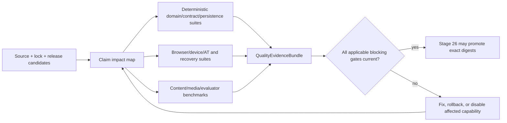
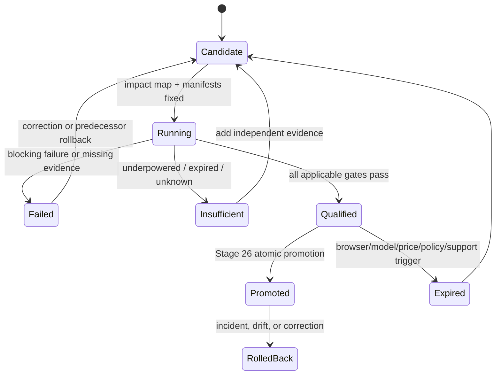

# Stage 25 — Testing, Evaluation, and Quality Gates

**Status:** Accepted  
**Decision date:** 2026-08-23  
**App baseline:** `m-elsharkawi/Bestehen-App@87349e0f773eb314c71bf89135e321b2440a9927`  
**Shaping baseline:** `m-elsharkawi/Bestehen-Shaping@9f37ad78fdd101b3c9cb8782ddc54d12dbce1fdc`

## 1. Purpose and scope

This stage makes release quality a proof about learner-facing claims. It defines the smallest risk-based test system that can show that evidence, scoring, Readiness, coaching, content, productive evaluation, media, recovery, accessibility, privacy, rights, cost, and operations still obey the accepted architecture. It does not implement tests, CI, environments, production code, providers, or deployment. Stage 26 turns these gates into promotion machinery; Stages 27–28 validate and consolidate them.

Coverage percentage is diagnostic only. A release with high coverage but an unproved pass-critical claim is blocked. Cost chooses among equivalent-quality test techniques; it never waives productive Writing/Oral evidence, gold/P4 quality, evidence truth, WCAG/build completeness, or recovery.

## 2. Inputs, authority, continuity, and research

Every required input was read at the immutable commits above before decisions. Shaping `app/01`–`app/28` are blobs `6bbb074d`, `3c536176`, `038ab89b`, `f7ae1f4a`, `a7c574b0`, `3cd869cd`, `c313c859`, `839a01c0`, `fcc41029`, `a5aac29a`, `e77948d6`, `0a606197`, `9462c78a`, `fa9b65e9`, `b4456939`, `8f6c23fa`, `9e3e8b24`, `7bc3c2ee`, `615ba3ce`, `fd8d002d`, `8149d6a2`, `27f33cd5`, `5942ed81`, `28d1a538`, `904ae20e`, `81370916`, `5da3b0a2`, and `18ae80cc` respectively. Corpus contracts are `corpus/12` blob `7add217f` and `corpus/17` blob `537b5185`.

App Architecture `00`–`24` are blobs `b263c5e7`, `cc8d2881`, `046d114b`, `907b04c5`, `ab1a775d`, `bb6df811`, `53d34ae6`, `ad58238a`, `02c5e1ee`, `e6fb121a`, `d4e1ab25`, `7c327cd7`, `c640da01`, `7da94f12`, `36206892`, `ef7f4228`, `6bb60e2d`, `c2c3de41`, `2f118f81`, `60aef66f`, `9a1aa2d5`, `1216f98f`, `6e0e8a76`, `abc1a300`, and `c588f487`. The checklist is blob `0b66c80d`.

Human-authored design was read, excluding `.thumbnail`, duplicated uploads, and support/runtime code: `DESIGN-HANDOFF.md` `417a6820`; Design System `d4e371aa`; Mobile `0a9f2d3e`; Desktop `94056db1`; Flows `7120b05a`; Type Options `7b51302a`; Logo System `5eb296da`. Design remains read-only.

Authority is final product specification, detailed shaping with Stage-27 precedence, Identity, Product Overview, consistent human design, then illustrative code. Stage-27 precedence remains validity/fairness → direct evidence → independent Written/Oral risk → uncertainty → due repair/retention → progression/coverage → preference.

### 2.1 Reconciliation and exact contradictions

- `Design/Bestehen-04-Flows-Handoff.dc.html` Flow G says deletion is immediate, total, has no backup, and is irreversible. Accepted Stages 05, 20, and 23 require immediate live denial/purge plus a truthful bounded restore-suppression/deletion journal and inaccessible backup residual of at most 91 days. Product/architecture authority wins. Tests assert the accepted bounded lifecycle and forbid UI claims of instant backup erasure.
- Design groups Ready to Book as four rows; `app/17-ready-to-book-logic.md` and Stage 11 require Gates A–F. Tests require all six machine gates and reason codes even when UI groups them.
- Design uses “practice-only” in mock presentation; the exact Evidence states remain `valid`, `partially_valid`, `pending`, `interrupted`, `not_counted`. Presentation aliases cannot create a sixth validity state.
- Design’s evaluator timing copy is an assumption; Stage 12/24 versioned service classes and observed Pending behavior are authoritative. Contract tests prohibit an unmeasured promise.

Required Stages 01–24 are present, Accepted, and mutually usable. No prerequisite is missing and no shaping/design edit is required.

### 2.2 Current primary sources

Accessed 2026-08-23: [Playwright browsers](https://playwright.dev/docs/browsers) requires runner/browser binaries to move together and distinguishes patched Firefox/WebKit/emulation from branded browsers and physical devices; [Vitest 4 coverage](https://v4.vitest.dev/guide/coverage) describes code coverage, which this stage treats as diagnostic rather than learner-claim proof; [Testing Library principles](https://testing-library.com/docs/guiding-principles/) support user-observable component tests; [WCAG 2.2 conformance](https://www.w3.org/WAI/WCAG22/Understanding/conformance.html) requires complete processes and combined machine/human evaluation; W3C [ACT test-rule guidance](https://www.w3.org/WAI/WCAG22/Understanding/understanding-act-rules.html) says automated rules are partial checks and a pass is not conformance. Mutable runner/browser/AT/support manifests are therefore versioned release inputs, not timeless facts.

## 3. Decisions and rationale

| ID | Accepted decision | Simpler and credible alternatives rejected | Consequence, fallback, review trigger |
|---|---|---|---|
| `ARCH-S25-D01` | Organize tests by consequential learner claim and risk tier; use a broad deterministic domain/contract base, narrower persistence/component seams, and the smallest browser/provider/manual apex that proves real integration. | **Coverage target only:** cheap but misses semantic lies. **All E2E:** realistic-looking but slow/flaky and poor fault localization. | Every claim has owner, oracle, fixtures, cadence, artifact, and blocker. Rebalance only from defect escapes/runtime data; no truth gate is removed. ADR-0033. |
| `ARCH-S25-D02` | Deterministic engines use example + property + model/state-machine + replay tests at exact source cuts/versions. | Examples only miss permutations. Snapshot-everything freezes incidental presentation. Formal proof is disproportionate initially. | Random seeds and minimized counterexamples are artifacts; replay twice must be byte-equivalent where specified. Add formal methods only after a safety invariant resists executable modeling. |
| `ARCH-S25-D03` | Cross-boundary tests use real PostgreSQL 18, contract fixtures, deterministic fake adapters, and a small quarantined provider sandbox lane; never SQLite or production learner data. | Mock every seam misses SQL/transaction behavior. Live provider every PR is costly, variable, and exposes data. | Provider outage cannot block deterministic work; candidate provider evidence expires on model/config change. |
| `ARCH-S25-D04` | Golden content/forms and evaluator/media benchmarks are immutable, rights-cleared release datasets with frozen manifests, independent holdouts, slices, human adjudication, predecessor comparison, cost/latency, and rollback. | Anecdotal prompts and vendor self-tests are not independent. One aggregate score hides pass-critical slice harm. | P4/gold requires the higher bar. Insufficient sample or missing rights blocks promotion, never relaxes the gate. ADR-0033. |
| `ARCH-S25-D05` | WCAG 2.2 AA is a complete-process build gate: automated axe/semantic checks plus manual keyboard, screen reader, zoom/reflow, branded browser, real device, media/mic, recovery, and equivalent-path evidence. | Axe-only is partial. Playwright WebKit/emulation cannot claim Safari/device/AT support. Outsourced audit-only is slow and cannot protect every change. | Affected core flow cannot release without current evidence. Add paid farm/audit when access gaps, usage, procurement, or repeated escapes justify it. |
| `ARCH-S25-D06` | Quality gates are blocking, conditional blocking, or advisory by claim/risk. Productive evidence, truth, rights, security, deletion, accessibility, restore, and supported-device gates have no ordinary waiver. | All failures block creates noise. All waivable lets schedule/cost rewrite truth. | Conditional gates block only releases touching a named capability when current predecessor evidence remains valid elsewhere. Emergency exception narrows exposure and expires; it cannot manufacture a learner claim. ADR-0033. |
| `ARCH-S25-D07` | Release evidence is an immutable, signed/digest-bound `QualityEvidenceBundle` tied to source, dependency lock, schema/content/model/browser/policy releases, datasets, environment, results, exceptions, and predecessor. | CI green badge alone is mutable/opaque. Store every raw trace forever is a privacy/rights burden. | Stage 26 chooses storage/signing mechanism. Missing/invalid bundle blocks promotion; sensitive raw artifacts follow minimized TTLs. |
| `ARCH-S25-D08` | Flakes are product risks, not retry-to-green: one diagnostic retry may classify infrastructure nondeterminism; the original failure remains recorded; quarantine has owner, claim impact, expiry, and compensating gate. | Unlimited retry hides defects. Zero retry wastes capacity on known infrastructure noise. | A quarantined test cannot be sole proof of a blocking claim. Repeated flake or expiry blocks affected release until repaired/replaced. |
| `ARCH-S25-D09` | Synthetic/minimized fixtures are default; no copied production learner dataset. Raw audio is generated/consented and expires under the stricter purpose ceiling; logs/traces/screenshots are redacted before persistence. | Production snapshots are convenient but violate minimization/deletion. Permanently retaining provider payloads improves debugging but breaks lifecycle promises. | Deletion drills cover artifacts and restore. Legal review owns jurisdiction-specific basis, not this test architecture. |
| `ARCH-S25-D10` | Stage 26 implements promotion; Stage 27 exercises nine scenarios/Flows A–G; Stage 28 consolidates. Test code/tool thresholds are implementation-owned only inside these fixed semantic gates. | Stage 25 choosing every numeric threshold would invent unvalidated calibration. | Empirical thresholds require provenance, effective date, preregistration where applicable, validation, rollback, and cannot weaken stable rules. |

## 4. Test strategy and ownership matrix

| Layer / risk | Primary technique and oracle | Owner | Blocking cadence | Required artifact |
|---|---|---|---|---|
| Pure domain | examples, property/model tests, deterministic replay | owning domain + Measurement | every change | seed/counterexample, source cut, release IDs, checksum |
| Contract/API/job | schema compatibility, consumer fixtures, result-union exhaustiveness, duplicate/reorder/drop | API + each producer/consumer | every change | compatibility report and idempotency receipts |
| Persistence | real PG18 transaction/concurrency, migration from empty + supported predecessors, constraints | Data | every schema change | plans/checksums, migration/rollback/restore receipts |
| UI/component | RTL observable behavior, semantics/focus/live state; no implementation snapshots | Frontend/design system | every change | semantic result and failure DOM excerpt |
| Browser/device | Playwright engines then branded/physical release manifest | Frontend + accessibility | per change/nightly/candidate by matrix | versioned browser/device/OS evidence |
| Content/forms | deterministic validators, independent answer/rubric review, rights/provenance, form assembly | Content/Rights | each content release | golden manifest, reviewer/adjudication, coverage/family report |
| Evaluator/AI | frozen accepted gold + holdout/slices, disagreement, safety/injection, latency/cost | Productive Evaluation + Evidence | candidate model/prompt/rubric/config | benchmark card and predecessor delta |
| Media/STT/TTS/partner | byte/decode/playback/capture manifests, transcript intelligibility, voice/script/turn behavior | Media + Productive Evaluation | asset/provider/release candidate | media/benchmark manifest and device results |
| Security/privacy/rights | authorization properties, malicious corpus, static/config/dependency scans, lifecycle races | Security/Data Rights/Content | every relevant change + candidate | signed scan/config/drill reports |
| Recovery/operations | fault injection, restart/queue/provider/PG/R2/identity/offline, restore/deletion drills | Reliability + domain owner | nightly/candidate/quarterly as specified | run receipt, source cuts, RPO/RTO/loss observation |
| Performance/cost | L0–L3 and durability budgets, load envelopes, receipts/catalog reconciliation | Reliability/Cost + capability owner | candidate and price/model change | percentile/distribution, sample, price revision, variance |

The pyramid is a risk portfolio, not a quota. Fast deterministic tests carry most combinations; real integrations prove semantic seams; browser/manual/provider tests prove only what substitutes cannot. Each release starts from a claim-impact map so unchanged capabilities may reuse still-current evidence, while cross-cutting contract/security/runtime changes invalidate the relevant bundle.

## 5. Invariant, property, model, and state-machine catalog

| Catalog ID / owner | Generated cases and transitions | Invariants that must always hold | Failure disposition |
|---|---|---|---|
| `INV-EVIDENCE` / Evidence | five validity states; scoped corrections; reorder/duplicate/late/delete races | only owner transitions; partial scopes disjoint/exhaustive; fault never negative; history immutable | release block; targeted impact/rebuild test |
| `INV-MEASURE` / Measurement | missing units, source cuts, blueprint/calibration pairs, Written/Oral combinations | missing absent not zero; independent gates; index is bottleneck; no probability; exact six states `evidence_building`, `not_ready`, `borderline`, `safe`, `ready_to_book`, `stale_contradicted` | release block; rollback release pointer |
| `INV-BOOK` / Measurement | Gates A–F true/false/unknown, stale and contradiction transitions | Ready is conjunction and reversible; Safe is not Ready; grouped UI loses no gate/reason | release block |
| `INV-MISTAKE` / Capability | candidate→known→repairing→stabilising→repaired/reopen with due/freshness permutations | response ≠ retention; retry fresh; local P0–P4 only; unrelated axes unchanged | release block |
| `INV-COACH` / Coaching | precedence permutations, overrides, urgency, content exhaustion, Pending | lower precedence never defeats higher; override/urgency changes plan not truth; one strong default + alternatives | release block |
| `INV-SESSION` / Session | start/pause/background/crash/resume/stop/submit; timer clocks | one semantic completion; no hidden time gain/reset; interrupted claim honest; unaffected work preserved | release block |
| `INV-IDEMP` / API/jobs | duplicate/reorder/drop every request, response, callback and worker run | one fact/effect/receipt; late result honors versions/deletion/current identity | release block |
| `INV-SYNC` / Identity/Data | guest adoption, devices, field conflicts, tombstones, outbox, identity outage | IDs preserved; no evidence loss/duplication/tombstone resurrection; account wall absent | release block |
| `INV-CONTENT` / Content | family/near-duplicate, approval, rights/trust/target changes | exposure not freshness; rights/correctness/performance separate; P4 only full approved exact form | release block |
| `INV-NOTIFY` / Scheduling | DST/fold/gap/travel/clock/caps/retries/devices | deterministic calendar intent, caps, no invented delivery; notification cannot author plan/evidence | release block for changed scheduling |
| `INV-DELETE` / Data Rights | export/delete/provider/backup/restore/concurrent jobs | immediate denial; no resurrection; truthful 91-day residual ceiling; raw audio final/≤7-day Pending; Corpus gets no learner data | release block |

Model tests operate on domain commands and public projections, not private implementation state. Unknown consequential majors and enum variants fail closed with neutral supported behavior. Stable-rule static scans forbid probability fields/events/copy/calculations, client-authored validity/score/Readiness, sensitive logging, learner fields in Corpus requests, and raw-audio persistence beyond policy.

## 6. Contracts, compatibility, migration, backup, restore, deletion

| Boundary | Mandatory cases | Acceptance oracle / recovery |
|---|---|---|
| HTTP/result unions | every discriminant, auth/object scope, ETag/conflict, deleted/unknown major | exhaustive client behavior; Pending/partial remain domain states; RFC problem only protocol failure |
| Jobs/events | enqueue+fact atomicity; retry/redelivery; outbox crash; poison/dead-letter; cancel/delete/late result | one effect and stable receipt; scoped Pending; replay/substitute without duplicate evidence |
| Corpus bundles | supported minor, unknown major, missing capability, checksum/signature, takedown/trust/taxonomy/target change, no network | immutable import/quarantine; cached approved P4 works; no learner fields/route-time call |
| Local sync | offline writes, quota, corrupt journal, multi-tab/device, guest attach, identity outage | deterministic merge/conflict; local work continues; no loss/duplication/resurrection |
| Schema migration | empty DB; each supported predecessor; expand/contract mixed-version window; interrupted/duplicate runner; rollback | old/new compatibility matrix; invariant scan; backup first for destructive step; single runner |
| Backup/restore | encrypted snapshot + WAL/logical export, corrupted/missing piece, off-provider restore, source cut/checksum | Stage-05 RPO/RTO met; projections reproducible; access/keys/audit restored and tested |
| Export/delete | anonymous/account, in-flight jobs, providers, objects/caches, backup restore, repeat request | machine+human export parity; deletion proof inventory; restored tombstones suppress data; truthful residual status |
| Content/model release | predecessor/current mixed jobs, correction impact, rollback, deleted payload | exact lineage retained; targeted recompute only; no fabricated reevaluation when payload absent |

## 7. Benchmark and golden-set gate table

| Capability / dataset | Required slices and oracle | Release-blocking promotion rule | Cost/exit |
|---|---|---|---|
| Objective forms/content | rights-cleared curated gold, keys/rationales, ambiguity, distractors, family independence, P0–P4, all target families | zero unresolved material key/rubric/rights/media issue; P4 complete-form human sign-off; coverage claim supported | deterministic validators + bounded human review; quarantine/rollback revision |
| Writing evaluator | independent human-adjudicated originals/revisions/fresh transfer; every rubric dimension; varied quality/register; adversarial/injection | preregistered dimension agreement/non-inferiority and no pass-critical slice regression; low confidence stays Pending; at most one escalation | compare cost per useful accepted evidence unit; revert model/prompt/rubric or human/fresh-sample path |
| Speaking evaluator | actual consented/synthetic audio, not transcript alone; accents/noise/device, every dimension/turn/form | same as Writing plus audio-evidence admission; transcript disagreement cannot become pronunciation claim | revert route; typed path learning-only, no oral evidence claim |
| STT | speech/no-speech, accent, code/noise, truncation, device slices; human transcript | provisional utility/error thresholds by slice; never scoring authority; degradation remains visible | pinned provider comparison; substitute adapter/withhold transcript |
| TTS/listening audio | script-to-master/encoding checksum, voices/speakers, names/numbers, naturalness, intelligibility, decode/loudness/duration/device | zero wrong/truncated/mismatched asset; human language/media sign-off for P4; exact media revision | batch cache; substitute adapter/re-encode from lossless master |
| Partner | fixed scenario and adaptive turn gold: role adherence, target language, turn limits, repair, injection, unsafe/off-scenario | fixed default must pass; adaptive candidate cannot reduce scenario validity; bounded latency/cost and one escalation | fall back to reviewed fixed partner without hiding modality change |
| Calibration/readiness | frozen prior snapshots + independent holdout; false-ready, missing, contradiction, stale, Written/Oral slices | deterministic checksum and no false compensation/probability; promotion only with independent sufficient evidence | retain predecessor release; no probability until separate product/empirical gate |

Each `BenchmarkRelease` records dataset/rights revision, inclusion/exclusion, split family IDs, adjudicator protocol and disagreements, capability/model/prompt/rubric/media/config releases, statistical method and uncertainty, slice results, latency/cost distribution, predecessor delta, decision, approver, expiry, and rollback. Exact sample sizes/margins are preregistered from power/precision and harm before evaluation; an underpowered result is “insufficient,” not a pass.

## 8. Accessibility, browser, and device test matrix

| Cadence / platform | Required coverage | Blocking meaning |
|---|---|---|
| Per change | axe/semantic checks; keyboard happy+recovery; light/dark, reduced motion, forced colors; 320/360/390 and all Stage-14 breakpoint edges; Chromium/Firefox/WebKit | any detected A/AA or core semantic/keyboard/reflow failure blocks; pass is not a conformance claim |
| Nightly | all five skills; Flows A–G recovery; offline/quota/media/timer/background; visual/semantic regressions; branded current Chrome/Edge where available | failure blocks affected candidate unless current deterministic proof shows infrastructure-only and compensating candidate lane exists |
| Candidate desktop | Chrome/Edge/Firefox/Safari current+previous per support manifest; keyboard-only; NVDA Windows; VoiceOver macOS; zoom 200%; high contrast | missing current evidence or unequal decision/evidence path blocks supported-family release |
| Candidate mobile/tablet | real iPhone/iPad Safari and Android Chrome representative current/constrained devices; VoiceOver/TalkBack; 320px, orientation, touch+hardware keyboard, mic/media/storage/interruption | emulator/simulator is supplementary; unsupported capability narrows only affected activity and is tested neutrally |
| Complete processes | onboarding/account-optional, every skill, mock, Readiness/text table, review, auth/OTP, export/delete, recovery, notification controls | all pages/states in process must meet WCAG 2.2 AA; partial screen success cannot release the flow |
| Manual semantics | focus order/restoration/traps; live-region strings/no timer ticks; `lang=de`; chart text/table; select-then-place; target size; non-color; error recovery | one equivalent outcome and identical evidence semantics; accessibility support never answer assistance |

All 26 current numbered mobile design frames in Stage 13's semantic-ID/frame mapping are exercised at 320px and 200% text zoom; representative state combinations are risk-paired rather than a combinatorial screenshot dump. Tests resolve the current mapping rather than the design narrative's stale “24 mobile screens” count, and a changed frame inventory requires mapping reconciliation before promotion. Current/prior manifests name exact browser/OS/AT versions. Playwright patched WebKit/Firefox and mobile emulation are labelled honestly and cannot satisfy branded/physical evidence.

## 9. Release-blocking quality gates

| Gate | Scope and evidence | Class / exception |
|---|---|---|
| `G-TRUTH` | invariant catalog, exact states/gates, no probability, deterministic replay, five-skill foundations | blocking; never ordinary waiver |
| `G-CONTRACT` | API/job/sync/Corpus/schema compatibility and exhaustive client variants | blocking for affected contract |
| `G-DATA` | migrations, concurrency, backup/restore, export/delete/no-resurrection, raw-audio deadline | blocking; never ordinary waiver |
| `G-CONTENT` | rights, keys/rubrics, final assets, independence/coverage; P4/gold higher bar | blocking for content release; cost cannot waive |
| `G-PRODUCTIVE` | Writing/Speaking/evaluator/STT/TTS/partner benchmark card, slices, cost, expiry | conditional blocking for capability; no objective-only substitute presented as complete |
| `G-A11Y` | complete-process WCAG/manual/AT/browser/device matrix | blocking for affected core flow; never polish deferral |
| `G-SECURITY` | auth/object authorization, CSRF/origin/session, CSP/headers, malicious upload/content/prompt, secrets/dependency/SBOM/license/provenance | blocking by severity/reachability; critical unknown blocks |
| `G-RECOVERY` | offline/Pending/partial/interrupted/not_counted, duplicate, queue/provider/storage outage, timer, targeted recompute | blocking for affected claim |
| `G-OPERATE` | L0–L3, ≤5s Writing loss, media/evaluator, SLO/circuit/restore/runbook evidence | candidate block when accepted Stage-24 budget is missed without safe degradation |
| `G-COST` | usage receipts, price catalog, invoice estimator, envelope/circuit, unknown SKU, provider exit | unknown/unbounded spend blocks paid route; productive truth uses safe bounded fallback, not waiver |
| `G-ADVISORY` | coverage trend, beta browser, non-core visual drift, maintainability and later-device lanes | advisory unless it exposes a blocking claim |

An exception record names gate, exact release/capability/learner exposure, evidence, risk owner, compensating control, rollback, expiry (maximum one release or 14 days), and remediation. `G-TRUTH`, `G-DATA` deletion/raw-audio/restore, unresolved rights, pass-critical content/productive evidence, supported core accessibility, and critical security have no ordinary exception. Emergency containment may disable the capability or roll back; it may not label degraded work as valid equivalent evidence.

## 10. Test data, privacy, and evidence retention

| Artifact/data class | Default source and prohibited data | Retention / deletion | Access and proof |
|---|---|---|---|
| Domain/API/persistence fixtures | generated synthetic identities/content; never production copy | repository version history where nonpersonal/rights-safe | reviewers; fixture provenance/checksum |
| Content gold | original/licensed small fixtures with rights/attribution manifest | while release supported; takedown can remove bytes while retaining permitted minimal receipt | Content/QA/Rights |
| Evaluator gold/holdout | synthetic or explicit purpose-bound consent; family-separated; no test-to-train leakage | dataset policy TTL and withdrawal/deletion; raw learner audio obeys stricter immediate-final/≤7-day Pending ceiling | restricted adjudicators; access/deletion audit |
| CI logs/traces/screenshots/video | redacted synthetic runs; tokens/payload/audio/learner identifiers structurally absent | failures 30 days, successful detailed traces 7 days by default; Stage 26 may shorten | CI maintainers; redaction scan before upload |
| Browser/device/AT manual record | version/result/issue, no unnecessary recording of tester disability/identity | current + predecessor evidence, then aggregate decision receipt | Accessibility owner |
| Security malicious corpus | synthetic inert/quarantined files/prompts, no live secret or illegal content | supported release + incident need; restricted | Security, hash/provenance |
| Release evidence bundle | minimized reports/digests/approvals/exceptions, not raw provider payload | active + predecessor + audit period aligned to governed release; personal refs deleted/tombstoned | signed/digest-bound privileged audit |
| Restore/deletion drill | synthetic canary identities only | result/proof per Stage-05/20/23 journal; restored data purged after drill | Data Rights/Operations, no-resurrection receipt |

Production debugging begins with redacted operational facts. A narrowly authorized incident sample requires purpose, fields, access, expiry, deletion and incident record; it cannot silently enter regression data. Provider benchmarks use isolated non-learner projects/keys and approved processor settings. Corpus receives no learner profile, benchmark learner identifier, response, or route-time request.

## 11. Security, privacy, rights, failure, performance, and cost suites

Security release evidence includes object/action authorization properties across guest/account/admin; OTP/session fixation/logout/revocation/CSRF/origin; CSP/security headers and clickjacking; rate/abuse; secrets and log-redaction; dependency review, lock/provenance/SBOM/license and full-SHA workflow pins; malicious audio/import/zip/decode/resource exhaustion; indirect prompt injection; provider region/retention/training config; takedown/cache/CDN denial; and raw-audio/delete/restore/job races. Unknown rights deny only the exact serve/use action; a rights-only change does not invent learner failure.

Fault injection covers network drop/reorder, quota, multi-tab, process/worker restart, PG unavailable/recovery, queue poison/backlog, R2/media mismatch, Corpus unsupported/offline, identity outage, notification denial, browser permission/media/capture failure, evaluator disagreement/timeout, STT/TTS/provider circuit, and deployment rollback. For every case the artifact names preserved facts, affected scope, exact validity/result state, neutral copy/next action, idempotent recovery, and targeted recomputation.

Performance tests measure Stage-24 L0–L3 distributions, checkpoint loss, media preflight/decode, evaluator Pending boundary, queue age, DB contention, restore RPO/RTO, deletion/audio deadlines, and supported low-resource devices. Cost tests reconcile immutable usage receipts with current SKU catalogs/invoices, zero denominators, cache/batch behavior, retries/escalation caps, circuit/kill-switch, and provider substitution. A price/model/terms/region change invalidates the relevant evidence; no invented owner budget appears.

## 12. Release evidence flow and state

Persisted facts are test run manifests/results, minimized artifacts, benchmark manifests/adjudication, quality bundle, exception and promotion/rollback receipts. Dashboards and coverage trends are projections. A test runner/provider cannot set domain truth or promotion. Version axes remain independent: source/dependency, schema/migration, API/job, domain policy, target/calibration, content/form/media/rights, model/prompt/rubric/provider config, dataset/benchmark, browser/device/OS/AT, security/retention, environment, test harness, and gate policy. Unknown consequential major blocks only dependent promotion.

## 13. Flake, failure, and exception policy

Tests are isolated and deterministic by default: frozen clock/random/locale/time zone, explicit network/provider fixtures, unique database namespace, no order dependence. A failure records attempt 1 before one diagnostic retry. If retry passes, the result is `flaky`, not passed. Quarantine requires reproducible issue, owner, claim map, replacement/compensating gate, expiry, and visible count. A sole oracle, security/accessibility regression, migration/restore/delete/raw-audio race, benchmark slice, or learner-truth invariant cannot be quarantined to permit promotion.

Infrastructure outage may defer a candidate while a current unchanged predecessor continues; it cannot generate new qualifying evidence. Product fault yields neutral learner semantics; content/evaluator uncertainty is Pending or not counted for exact scope. Test harness defects are versioned and rerun affected evidence; they do not rewrite historical release receipts.

## 14. Alternatives, sustainability, and exits

| Area | Do nothing / simpler | Selected | Higher-cost alternative and trigger | Exit |
|---|---|---|---|---|
| Suite structure | coverage + manual smoke | claim/risk portfolio on existing Vitest/RTL/Playwright/PG | model checker when executable state models cannot expose invariant | domain contracts are runner-neutral |
| Device coverage | emulation only | free engines + owned/available real target devices/AT | paid device farm/formal audit after access gap, repeated escape, usage/procurement need | versioned test cases/results export |
| Provider testing | live calls every PR | deterministic fakes + candidate sandbox benchmark | redundant provider shadow after observed outage/drift justifies recurring cost | provider-neutral gateway/manifests |
| Visual testing | none or every pixel | small semantic + stable-region gold set | managed visual service after review burden/escapes | portable images/masks/threshold manifest |
| Test evidence | CI status only | minimized digest-bound bundle | dedicated evidence service after volume/audit trigger | JSON/Markdown/manifests in portable object storage |
| Test data | production clone | synthetic + rights-cleared/consented gold | privacy-preserving production replay only after legal/product need and new ADR | deletion/export manifests |

Launch recurring software cost stays near zero beyond CI/provider sandbox usage because selected tools are existing open-source choices. Human content/adjudication, real-device/AT time, quarterly restore, and bounded paid productive calls are explicit costs. Optimize fixture reuse, sharding, caching, nightly cadence, and impacted suites only after preserving gate completeness. Review when median clean CI exceeds Stage-03’s 10-minute trigger for 30 days, manual candidate evidence becomes the release bottleneck, defect escape rises, support expands, or provider benchmark cost breaches the approved Stage-24 envelope.

## 15. Traceability and downstream handoff

| Decision | Primary sources | Earlier contracts proved | Downstream |
|---|---|---|---|
| D01–D03 | final spec §§16,20; `app/26`; Stage 03 | S01 QA gates; S04–S12 owners/contracts | S26 promotion topology; S27 audit |
| D04 | final spec §§8,10–11,14; `app/12–17,21,24`; Corpus 12/17 | S09–S11, S15–S19, S24 | S26 benchmark jobs; S27 scenarios |
| D05 | final spec §16; `app/26`; Design Handoff §6 and Flows A–G | S13–S14, S16–S18, S20–S23 | S26 device/AT evidence; S27 complete flows |
| D06–D08 | final spec §§16,20; Stage 01/03/23/24 | ADR-0003, S12, S23–S24 | S26 CI/promotion/rollback |
| D09 | final spec §15; S05/S18/S20/S23 | retention/export/delete/raw audio | S26 environments; S27 privacy walk |
| D10 | final spec §§20–23; Stage-27 shaping | all accepted 01–24 | S26–S28 |

Stages 26–28 must preserve: claim-based rather than coverage-based gates; exact five validity and six Readiness states; independent Written/Oral; no probability; complete five-skill product; higher P4/gold bar; no cost waiver for productive evidence; complete-process WCAG with real browser/device/AT evidence; immutable benchmark/release bundles; no production learner test data; raw-audio/deletion/Corpus boundaries; one diagnostic retry but no retry-to-green; no ordinary waiver of truth/accessibility/rights/security/deletion/restore gates.

Dependencies introduced: an implementation-time claim-impact manifest, frozen rights-cleared benchmark releases, current browser/device/AT support manifest, synthetic restore/delete canaries, and digest-bound quality evidence. No new runtime dependency or commercial service is selected.

## 16. Open questions and intentionally deferred details

There is no owner blocker.

| Deferred detail | Future owner | Fixed boundary / validation |
|---|---|---|
| Exact empirical benchmark sample sizes, margins, slice floors | Evaluation/Calibration owner before candidate | preregister from harm/power/precision; insufficient cannot promote |
| CI workflow, shard graph, artifact/signing storage, promotion environment | Stage 26 | exact digest, protected roles, immutable bundle, rollback |
| Exact code-coverage advisory thresholds | implementation owner | diagnostic only; never substitutes for claim gate |
| Exact supported browser/OS/AT versions at each release | Stage 26 Accessibility owner | current/current-previous family policy and honest manifest |
| Paid device farm/formal audit | owner after trigger | real evidence gap/usage/procurement/repeated escape; no false launch claim |
| Jurisdiction-specific test-data/legal basis/DPA | owner + qualified legal review | minimization, consent/withdrawal, provider policy, no compliance claim |
| Performance/load generator and visual-diff service | implementation after measured need | portable cases/artifacts and existing budgets |

No feature implementer may use a deferred choice to weaken evidence semantics, content approval, benchmark independence, accessibility equivalence, security/privacy/rights, recovery, cost containment, or the probability prohibition.

## 17. ADR and definition of done

Created [ADR-0033 — Claim-based risk gates and immutable release evidence](adr/ADR-0033-claim-based-risk-gates-and-immutable-release-evidence.md), **Accepted**, covering D01, D04, D06–D09.

- [x] Required immutable inputs and continuity recorded; contradictions resolved by authority without source edits.
- [x] Risk-based domain/contract/persistence/UI/browser/device/content/evaluator/media/security/recovery/performance/operations strategy and owners defined.
- [x] Invariant/property/model/state-machine catalog covers every semantic engine.
- [x] API/job/sync/Corpus/migration/backup/restore/export/delete compatibility tests defined.
- [x] Golden content/forms and Writing/Speaking/STT/TTS/audio/partner/calibration gates defined.
- [x] WCAG/manual/automated/keyboard/AT/320px/200%/responsive/browser/device/offline/timer/security/privacy/rights/cost tests defined.
- [x] Blocking/advisory gates, artifacts, privacy/retention, flake and exception policy defined.
- [x] Alternatives, costs, fallbacks, exits, triggers, versions, failure/recovery and Stage 26–28 handoff defined.
- [x] All six required matrices/tables are present and no owner blocker remains.

