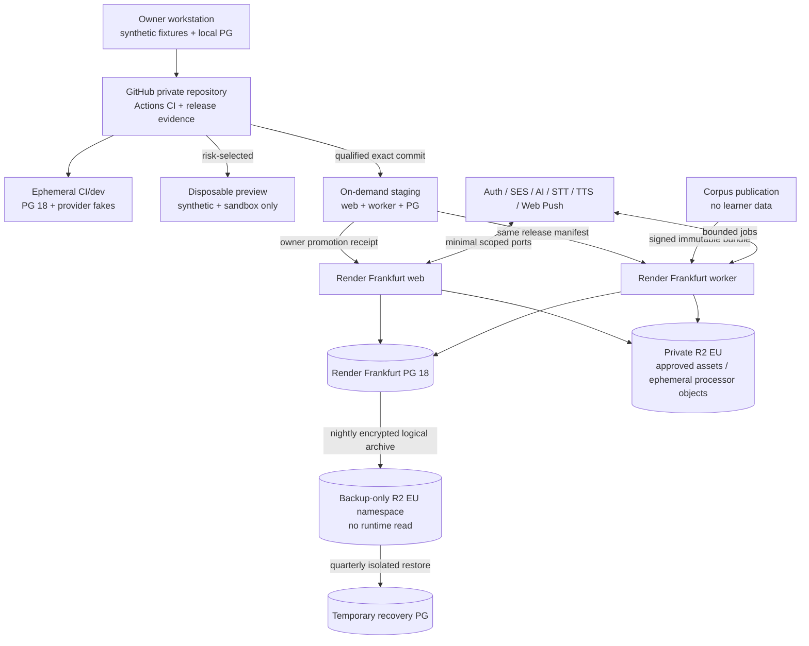
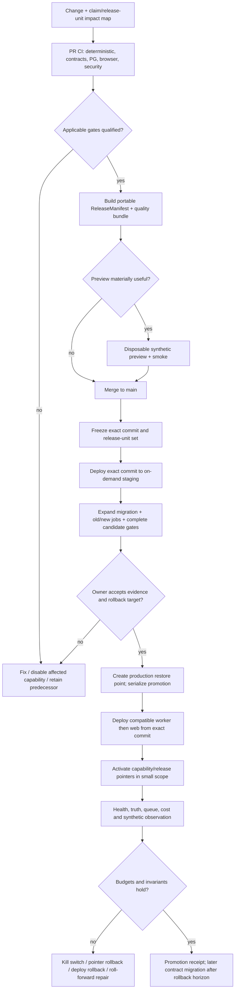

# Bestehen / App — Environments, CI/CD, Release, and Operations

> **Stage:** 26 of 28  
> **Status:** Accepted architecture decision and implementation handoff  
> **Decision owner:** Stage 26 / Release and Operations  
> **Repository baseline:** `m-elsharkawi/Bestehen-App@14cd392e8eda5b4b6eacb31521242e41551ff362`  
> **Shaping baseline (read only):** `m-elsharkawi/Bestehen-Shaping@9f37ad78fdd101b3c9cb8782ddc54d12dbce1fdc`  
> **Decision date / official-source access date:** 2026-08-23

## 1. Purpose and scope

This stage fixes the smallest solo-maintainable path from a reviewed change to a recoverable Bestehen release. It owns environment isolation, configuration and secrets, CI evidence, promotion, independently versioned release units, schema and job compatibility, rollback, backups, operational signals/runbooks, and phased activation. It produces architecture only: no deployable workflow, infrastructure file, migration, production code, provider account, or live deployment is created here.

The launch baseline remains one modular Next.js/Node application, one Node/`pg-boss` worker, one managed PostgreSQL 18 database in Render Frankfurt, and private Cloudflare R2 EU-jurisdiction storage. Normal attempts never call Corpus. The operational design deliberately adds no Kubernetes, microservice fleet, Redis, streaming platform, release-management SaaS, feature-flag SaaS, warehouse, session replay, multi-region deployment, or always-on staging fleet.

## 2. Inputs, authority, and continuity

### 2.1 Reproducible source snapshot

All inputs were fetched from the two heads named above before decisions. Output did not exist at that cut.

| Authority | Path | Blob SHA | Stage-26 consequence |
|---|---|---:|---|
| Shaping | `app/28-bestehen-app-product-specification.md` | `18ae80cc2fd63cecd76c297c3e56d44a68367856` | Complete five-skill coach, evidence/Readiness truth, account optionality |
| Shaping | `app/21-content-strategy.md` | `8149d6a268da70e17cad46f774b9d5de77776986` | Approved, reusable, versioned content; no per-click generation |
| Shaping | `app/23-exam-date-and-urgency.md` | `5942ed811bcbaa5baaf1dd55079b8971d34b1d01` | Date affects priority, never evidence or Readiness truth |
| Shaping | `app/24-analytics-and-success-metrics.md` | `28d1a5380a7ea9f28efdc95ce0c96987920917e1` | Outcome-first, frozen/versioned interpretation, no circular calibration |
| Shaping | `app/25-business-model-and-product-boundaries.md` | `904ae20e8cb3f9f354d6505513821e86f609622b` | Private/free first; meter cost, never exam truth |
| Shaping | `app/26-platform-accessibility-nonfunctional.md` | `8137091683941b0d55f3d4fb90af3c402b8371e5` | Responsive web, WCAG 2.2 AA completeness, truthful capability degradation |
| Design | `Design/DESIGN-HANDOFF.md` | `417a6820037e045e2dd9f29afc42b9f2e94fd638` | Fixed states, responsive/accessibility contract, illustrative build order |
| Design | `Design/Bestehen-04-Flows-Handoff.dc.html` | `7120b05a2272c31e5896e4313a7007935f5d0aed` | Flows A–G, recovery and complete-process acceptance |
| Architecture | `03-technology-stack-and-repository-strategy.md` | `907b04c57813dc50f92a7ed00e49196ff7d4a924` | Render/PG/R2, GitHub Actions, pinned native Node build baseline |
| Architecture | `05-data-ownership-persistence-and-schema-evolution.md` | `bb6df811ec9010de556d1719f22e31bb8ca3190e` | Expand/contract, 14 daily + 12 weekly backup generations, restore gate |
| Architecture | `10-corpus-integration-compatibility-cache-and-rights.md` | `d4e1ab25e359dcfcc506ee29462760a41647138d` | Signed immutable bundles, atomic promotion, last-compatible rollback |
| Architecture | `12-api-contracts-jobs-events-and-idempotency.md` | `c640da01d6eb6d71a5e2ea7a0dcf19147d6d7528` | Explicit contract majors, durable jobs, outbox, idempotent receipts |
| Architecture | `19-ai-gateway-model-governance-evaluation-and-cost.md` | `60aef66f8443e747935b2cfb479dd7f4dd4d5c23` | Capability routes, benchmarked candidate releases, circuit breakers |
| Architecture | `20-account-local-first-profile-sync-export-and-deletion.md` | `9a1aa2d5fea31ff0bdccfc4561806bb870511ab6` | Guest/account continuity, export, deletion proof and restore suppression |
| Architecture | `21-offline-checkpointing-recovery-conflicts-and-timing-integrity.md` | `1216f98f5489119b4d8114804ac87936bc78ddd4` | Pinned client/resource versions, safe service-worker activation |
| Architecture | `22-notifications-scheduling-and-time-zones.md` | `6e0e8a761b9cf83a75931e815f447e148e3a20d0` | Coalesced jobs, versioned tzdb/templates, external-send kill switch |
| Architecture | `23-security-privacy-rights-retention-and-threat-model.md` | `abc1a300d5b0fd659d28f768669dd73afbb90887` | Least privilege, incident states, retention/rights boundaries |
| Architecture | `24-analytics-calibration-observability-performance-reliability-and-cost.md` | `c588f48790e2fc06b9ba656fddace222d73e554a` | Lean signals, 7-day Render window, SLO/cost envelopes and runbooks |
| Architecture | `25-testing-evaluation-and-quality-gates.md` | `83f4f481fb681bf09666032a4e06e7c77289e883` | Claim-based blocking gates and immutable quality evidence |
| Workflow | `Architecture/00-architecture-shaping-plan.md` | `b263c5e7b3bccc0450ddd17aa0cc007432d672b7` | Stage routing and exact output |
| Workflow | `prompts/architecture/26_define_environments_ci_cd_release_and_operations.txt` | `f681a083f38de4e30ded4490ec8c74fcd3e4104a` | Authoritative Stage-26 requirements |
| Workflow | `Bestehen_App_Architecture_Checklist.md` | `8891982284a3edc3d199ddcccd44b6bb32e9bfea` | 24 Stage-26 completion gates initially unchecked |

### 2.2 Authority reconciliation

- The prompt and `Design/DESIGN-HANDOFF.md` narrative say 24 mobile screens. Accepted Stage 13 mapped 26 current numbered frames, and Stage 25 corrected its gate to those 26. Release evidence therefore resolves the current semantic frame map and tests all 26; the read-only design narrative is not edited.
- Design §8 and flow `#h` are explicitly illustrative build order. The safe slices in §12 preserve the complete product and may reorder plumbing, but never expose incomplete work as complete Readiness or P4.
- Stage-27 precedence remains: validity/fairness → direct modality evidence → independent Written/Oral risk → uncertainty resolution → due repair/retention → progression/coverage → preference. Date, cost, a flag, or a deployment cannot change that truth.

### 2.3 Current official provider evidence

Facts below are mutable and were checked in official sources on **2026-08-23**:

- GitHub environments can gate jobs, restrict deployment branches and delay access to environment secrets; availability of secrets/reviewers for a private repository is plan-dependent. Deployment concurrency can serialize an environment. ([Deployment environments](https://docs.github.com/en/actions/concepts/workflows-and-actions/deployment-environments), [deployments and environments](https://docs.github.com/en/actions/reference/workflows-and-actions/deployments-and-environments))
- GitHub artifact attestations bind an artifact to repository/workflow/environment/commit provenance, but private-repository generation on Free/Pro/Team is not available; an attestation is useful only when verified. It is optional enhancement here, not the portable baseline. ([Artifact attestations](https://docs.github.com/en/actions/concepts/security/artifact-attestations), [using attestations](https://docs.github.com/en/actions/how-tos/secure-your-work/use-artifact-attestations/use-artifact-attestations))
- Render can deploy an exact commit, disables autodeploy for dashboard/deploy-hook exact-commit deployments, runs pre-deploy commands before switching service, keeps the previous successful deploy on a failed deploy, and can roll back using retained build artifacts. Rollback does not rewind current platform state or arbitrary external state. ([Deploys](https://render.com/docs/deploys), [rollbacks](https://render.com/docs/rollbacks))
- Render preview environments create isolated resources without copying production data, require Pro or higher, and can expire automatically. They are therefore an on-demand option, not a launch dependency. ([Preview environments](https://render.com/docs/preview-environments))
- Render project environments and scoped environment groups can isolate configuration; variable-name collisions across groups have no guaranteed precedence and are prohibited here. ([Projects and environments](https://render.com/docs/projects), [environment variables and secrets](https://render.com/docs/configure-environment-variables))
- Paid Render PostgreSQL currently has PITR of three days on Hobby and seven days on Pro+, while logical exports are retained seven days; Free has no recovery. PITR creates an isolated recovery database. ([PostgreSQL recovery and backups](https://render.com/docs/postgresql-backups))
- R2 Standard currently includes 10 GB-month, one million Class A and ten million Class B operations monthly, then USD 0.015/GB-month, USD 4.50/million Class A and USD 0.36/million Class B; internet egress is free. Deletion is strongly consistent at the object API, but a CDN cache may continue serving cached bytes until purged. ([R2 pricing](https://developers.cloudflare.com/r2/pricing/), [consistency](https://developers.cloudflare.com/r2/reference/consistency/))

No legal-compliance claim follows from provider configuration. Jurisdiction-specific wording, contracts, and legal review remain Stage 23/later owner work.

## 3. Decision registry

| ID | Accepted decision | Main alternative rejected | Review trigger |
|---|---|---|---|
| `ARCH-S26-D01` | Five logical classes: local, CI/dev, disposable preview, on-demand staging, isolated production | Always-on duplicate infrastructure | Release cadence/load makes on-demand staging the bottleneck |
| `ARCH-S26-D02` | Typed configuration schema; environment-scoped secrets and least-privilege credentials | Shared `.env`/one credential set | Cross-environment incident or secret-rotation failure |
| `ARCH-S26-D03` | GitHub Actions claim-impact CI; pinned tools/actions; digest-bound portable provenance | Coverage-only CI or bespoke release SaaS | Clean CI >10 min for 30 days or provenance cannot be verified |
| `ARCH-S26-D04` | Manual, serialized staging→production promotion of an exact commit/release manifest; autodeploy off | Push-to-main production autodeploy | Safe unattended promotion is proven across multiple release windows |
| `ARCH-S26-D05` | Independent immutable release units plus explicit compatibility/activation manifest | One global version or mutable “latest” | Matrix burden exceeds benefit without historical/audit need |
| `ARCH-S26-D06` | Backup-first, single-runner expand/contract; roll forward by default | Reversible down migrations | A provider/tool can prove safer zero-loss alternative |
| `ARCH-S26-D07` | Capability-scoped rollback/roll-forward, old/new jobs, immutable cache keys and deny overlays | Whole-product rollback for every fault | Coupling prevents scoped containment in a drill |
| `ARCH-S26-D08` | Render PITR plus encrypted nightly off-Render logical archives and quarterly isolated restore drills | Provider backup alone | RPO/RTO or deletion replay misses accepted objective |
| `ARCH-S26-D09` | Existing Render/PG/R2/GitHub signals, actionable email routing and a small runbook catalog | New APM/on-call platform | Seven-day evidence or diagnosis repeatedly fails after PG incident record |
| `ARCH-S26-D10` | Server-owned, default-closed capability/activation flags; no flag can alter evidence meaning | Client flags or third-party flag SaaS | Nontechnical operators/team scale need delegated targeting/audit |
| `ARCH-S26-D11` | Safe vertical slices; Readiness/P4 stay hidden or truthfully incomplete until gates pass | Objective-first public “MVP” labelled complete | All five-skill/productive/P4 release evidence qualifies |
| `ARCH-S26-D12` | Solo owner promotes/operates using checklists and immutable receipts; no CAB or enterprise process | Multi-person release bureaucracy | Multiple maintainers, regulated commitment, or incident frequency justifies separation |

`ADR-0034` records D01, D04–D08 and D10–D12 as the durable release posture.

## 4. Environment and deployment topology

### 4.1 Environment classes and isolation

| Class | Lifetime and infrastructure | Data and identities | Secrets/access | Required use / forbidden use |
|---|---|---|---|---|
| Local | Developer machine; pinned Node/pnpm; local PostgreSQL 18; provider/storage fakes | Deterministic synthetic fixtures | Developer-scoped disposable sandbox credentials only | Fast suites, migrations, offline/failure work; no production copy or secret |
| CI/dev | Ephemeral GitHub-hosted runner + PostgreSQL service; no inbound learner route | Generated synthetic data and rights-cleared gold references | `GITHUB_TOKEN` read-only by default; no production environment secret | Frozen install, tests, empty/upgrade migration, build and evidence bundle |
| Preview | Per-change or shared disposable Render resources only for UI/integration risk; expire 1–3 days | Seeded synthetic tenant; new empty DB; fake/sandbox processors | Preview-only scoped credentials; never inherited production groups | Review, smoke, browser/device work; never durability/backup/real-learner proof |
| Staging | Serialized, production-shaped web+worker+PG created/resumed for a candidate; may be suspended/removed between release windows | Synthetic canary tenant and rights-cleared gold only | Separate staging groups/keys/endpoints/buckets; owner and CI deploy role | Exact-commit migration/deploy/restore/smoke/rollback rehearsal; never production learner data |
| Production | Paid Render Frankfurt web, worker and PostgreSQL; private R2 EU buckets; selected processors | Minimum learner facts and approved assets | Production-only least-privilege service identities; operator break-glass audited | Durable learner use; no ad-hoc fixtures, shell mutation, or branch-tip autodeploy |

There is no persistent shared “dev database.” CI is the reproducible integration environment; preview exists only when visual/provider fidelity is worth its cost. If Render Pro preview environments are not in the owner’s current plan, a single manually named disposable staging copy or local shareable evidence is the fallback. Missing vendor plan features do not block the architecture.

Production resources live in one Render project environment and staging in another. Environment groups are scoped to exactly one project environment. A key appears in one group only; no precedence-dependent collisions. R2 uses distinct production, staging, and backup buckets or credentials; object keys are opaque immutable release/revision keys. Auth0/SES/AI/push use separate sandbox tenants/projects where offered, otherwise deterministic adapters and no real external delivery.

### 4.2 Environment/deployment diagram



The backup destination is off Render. Database archives may use a backup-only R2 EU bucket because Stage 05 explicitly permits that baseline; the decryption key is offline/recovery-only and absent from web/worker/backup uploader. Non-regenerable rights-eligible P4/gold masters additionally keep a checksum-verified owner-controlled encrypted offline copy outside the active R2 failure domain. Select a second managed EU object provider only when owner storage/restore labor or volume makes that inadequate.

## 5. Configuration, secrets, artifacts, and supply chain

### 5.1 Configuration and secret contract — `ARCH-S26-D02`

Configuration has three classes:

1. **Committed non-secret defaults/schema:** names, types, required/optional status, safe bounds, environment applicability, owner and reload policy.
2. **Environment values:** non-secret endpoints, feature defaults and release pointers stored per Render/GitHub environment, represented by a redacted configuration digest in release evidence.
3. **Secrets:** Render/GitHub/Cloudflare/provider secret stores only. Values never enter source, build output, browser bundles, preview logs, test artifacts, screenshots or general backups.

Process startup validates the whole schema and fails only that service before accepting traffic. Browser-visible variables are a positive allowlist; credentials never use `NEXT_PUBLIC_*`. Web, worker, backup uploader, Corpus importer, notification sender and operator have separate DB/R2/provider credentials. The web cannot list/decrypt backups; the backup uploader can read only the required DB export and encrypt/upload but cannot decrypt; the learner runtime has no Corpus publication credential.

Rotation uses an overlap sequence when the provider permits: add new credential → deploy consumers able to use it → verify → revoke old → reconcile access logs → record receipt. Emergency compromise first disables the affected adapter/capability, preserves local/in-app fallback, then rotates. A production deploy credential is available to GitHub only if the repository plan supports protected environment secrets; otherwise the owner promotes in the Render dashboard/API manually. No long-lived deploy token is exposed to ordinary PR jobs.

### 5.2 Build and release provenance — `ARCH-S26-D03`

Every candidate creates a portable `ReleaseManifest` (explanatory contract, not production code) containing:

```text
release_id; source_commit; source_tree_digest; lockfile_digest;
exact Node/pnpm/framework/tool versions; build-command/config-schema digests;
dependency inventory/SBOM digest; generated-contract digest;
quality_evidence_bundle_id/digest; release-unit compatibility ranges;
required migrations; feature defaults; rollback release_id;
CI workflow/run/runner identity; artifact digests; created/approved times;
staging and production deploy IDs; environment-activation receipts.
```

The native Node/Render baseline builds from the exact commit with exact Node/pnpm and frozen lockfile. Staging and production must name that SHA, never “latest main.” Because native Render services may build separately, equality means identical source/tree/lock/tool/config inputs plus recorded environment-specific build and deploy IDs; it does not fabricate binary identity. If repeated nondeterministic output, OS dependency, provider exit, or cross-environment drift defeats verification, adopt one prebuilt OCI image by immutable digest through a superseding decision. Mutable image tags are never promotion identity.

GitHub Actions uses least-permission `GITHUB_TOKEN`, job-level permissions, action references pinned to full commit SHAs, frozen dependency install, no secrets in untrusted PRs, and concurrency per release environment. Produce checksums and the portable manifest on every candidate. GitHub artifact attestations/SBOM attestations are added and verified only when the private-repository plan supports them; they supplement rather than replace the manifest and review.

Dependabot opens small scheduled groups. Ordinary patch/minor updates batch monthly after the Stage-03 seven-day release-age control; exploitable critical fixes are isolated immediately. Runtime/framework/database majors and provider SDK majors never auto-merge or auto-promote. Each update carries lockfile diff, license/install-script/provenance review, affected claim map, tests and rollback. A dependency that cannot be updated or removed before support end is replaced behind its existing port.

## 6. CI/CD and promotion

### 6.1 Claim-impact CI gates

The change declares affected modules, release units and consequential claims. CI may skip unrelated expensive lanes only when the impact map is generated/validated conservatively; unknown impact expands to the full gate set. Required lanes are Stage-25 `G-TRUTH`, `G-CONTRACT`, `G-DATA`, `G-CONTENT`, `G-PRODUCTIVE`, `G-A11Y`, `G-SECURITY`, `G-RECOVERY`, `G-OPERATE` and `G-COST` as applicable. Coverage alone never qualifies a candidate.

Per change: frozen install, formatting/lint/type, unit/property/state-machine, API/job/bundle compatibility, real PG empty/upgrade migration, build, secret scan, dependency review, deterministic browser/a11y/recovery suites. Candidate: current support manifest, complete-process keyboard/AT/real-device evidence, rights/content/media/productive benchmark cards, backup/restore/delete/raw-audio fixtures, cost/config/price evidence, staging smoke and rollback rehearsal. One diagnostic retry records `flaky`; it never converts failure to green.

### 6.2 CI/CD and promotion flow — `ARCH-S26-D04`



Autodeploy is off for production web/worker and production Blueprint sync. One production concurrency group prevents overlapping releases. The owner is the required human decision; a second approver is not invented for a solo project. When GitHub private-plan protection cannot enforce reviewer rules, the owner records the same manual gate in the immutable promotion receipt and uses Render exact-commit deployment. A release cannot self-approve merely because a workflow passed.

Promotion is **manifest promotion**, not rebuilding from branch tip and not copying staging data. Production deploys read production configuration/secrets only after the gate. Configuration-only, content, model or calibration changes still create a release unit and evidence; they never bypass staging/compatibility merely because application code is unchanged.

## 7. Independent release units and compatibility — `ARCH-S26-D05`

### 7.1 Release-unit/version compatibility matrix

| Unit / owner | Immutable identity | Compatibility and required validation | Activation / rollback | Historical rule |
|---|---|---|---|---|
| Application web+worker | `app_release_id`, exact commit/tree/lock/build manifest; web and worker deploy IDs separate | Declares supported schema, API/job, content, blueprint, evaluator and config ranges; full impacted CI | Exact-commit deploy; previous retained Render artifact or roll-forward | Every accepted command/job/result records application/contract lineage where consequential |
| PostgreSQL schema | monotonic migration ID + checksum | Empty DB, every supported predecessor, mixed old/new readers/writers/jobs, invariant and restore gates | Expand first; contract later; do not down-migrate authoritative facts | Schema change never changes fact/domain meaning |
| API/job/event/client | explicit major/minor and handler major | Additive safe minor; unknown consequential major blocks/quarantines dependent surface | Dual-read/write/handler overlap; retire only after old-client/job/rollback horizon | Original contract/version remains with receipt/job/fact |
| Corpus snapshot/bundle | signed bundle/revision/sequence/digest and capability closure | Stage-10 signature, schema, semantic diff, rights/currentness/accessibility, no learner fields/calls | Atomic capability pointer; last compatible eligible snapshot | Pinned attempts/artifacts never retarget; rights deny overlay may stop new use |
| App content/form/media | stable item/form/media revision + approval/rights/checksums | Keys/rubrics, independence, coverage, device/media and P4/gold human gate | Immutable serving manifest pointer; quarantine/replacement revision | Attempt pins exact revision; correction targets affected scope only |
| Target blueprint | target/blueprint release + official-source provenance/effective date | Coverage, independent Written/Oral, fresh/P4 form and targeted recalculation evidence | Shadow calculation then pointer; predecessor retained while eligible | Old evidence keeps old blueprint; current claims may become `stale_contradicted`, never rewritten |
| Prompt | prompt release digest, purpose and supported evaluator contract | Injection/adversarial/gold benchmark and output-schema compatibility | Capability route pointer; revert prompt only for new jobs | Result retains exact prompt; no historical re-prompt pretending same occasion |
| Evaluator/rubric | evaluator contract/rubric release | Human-adjudicated slices, dimensions, confidence/Pending and predecessor delta | Candidate → qualified → active; rollback route/new evaluations | Accepted interpretation retains evaluator/rubric and correction lineage |
| Model/provider route | model snapshot/provider/config release, region/data-control evidence | Capability benchmark, latency/cost/privacy/retention and circuit tests | Route percentage/scope, kill switch, predecessor/substitute adapter | Model change does not silently re-evaluate history |
| Calibration/Readiness policy | immutable policy/calibration release, provenance/effective date/dataset manifest | Frozen independent backtest; no circular validation/probability; Written/Oral and gate invariants | Shadow generation then atomic pointer; predecessor generation retained | Recompute creates new projection generation from unchanged facts; old snapshot auditable |
| Notification/tzdb/template | separate policy/template/tzdb/key releases | DST/cap/dedupe/copy/privacy/accessibility and no-post-delete-send | Generation rebuild; external-send kill switch; in-app fallback | Delivery never changes evidence/Readiness |
| Quality/gate policy | quality bundle/test harness/support manifest versions | Digest-bound applicable gate evidence, expiry and flake truth | Qualifies exact unit set; expired evidence cannot promote new unit | Receipts remain immutable; corrected harness reruns, not rewrites |

An `EnvironmentActivation` names `{environment, app_release, schema_cut, contract_ranges, corpus_snapshot, content/form/media set, blueprint, prompt, evaluator, model route, calibration, notification/tzdb/template, quality bundle, flags, activated_at/by, predecessor}`. PostgreSQL owns the registry and audit; deployments and providers are executors, not semantic truth. The API exposes only capability-scoped derived availability/compatibility, never operator secrets or a monolithic “system version.”

Independent does not mean arbitrary combinations. CI generates the compatibility closure and rejects a candidate if any required edge is unknown. Unknown major blocks only its dependent capability. Last-valid unaffected projections remain available with lineage; the client shows `partial`/`unavailable` outside the Readiness enum rather than inventing a seventh state.

## 8. Migration, deploy ordering, rollback, and partial failure

### 8.1 Migration and rollback sequence — `ARCH-S26-D06`

```mermaid
sequenceDiagram
  participant O as Owner / promotion gate
  participant B as Backup / recovery
  participant M as Single migration runner
  participant W as Worker
  participant A as Web/API
  participant R as Release registry
  O->>B: Verify PITR + encrypted portable archive/checksum
  O->>M: Acquire advisory release lock; apply additive expand migration
  M-->>O: Migration receipt + invariant scan
  O->>W: Deploy worker supporting old and new job/contracts
  O->>A: Deploy web supporting old and new schema/contracts
  A->>M: Bounded resumable backfill through owner commands/jobs
  M-->>O: Counts/checksums/old+new fixtures pass
  O->>R: Activate release pointers / bounded flags
  R-->>O: Atomic activation receipt
  O->>O: Observe one rollback horizon
  O->>M: Later release contracts obsolete representation only when no old client/job/rollback target needs it
```

Migrations are forward-only reviewed SQL/Kysely files. The runner uses a database advisory lock and idempotent migration ledger. No web/worker replica migrates at startup. A failed additive migration stops deployment while the previous service continues. A backfill is bounded, resumable, observable and never required in the request transaction. Destructive/type-changing work is split across releases and never shares the initial expand deploy.

Rollback order:

1. Freeze promotion/autodeploy; disable only the affected capability or external send/model route.
2. Move active content/Corpus/blueprint/model/calibration pointer to the last eligible compatible release for **new** work; retain deny/takedown overlays.
3. Stop intake for an incompatible job major, let compatible jobs finish, and quarantine/supersede late candidates rather than discard identity.
4. Roll web/worker back to retained deploy artifacts only while the expanded schema remains compatible. Schema normally stays expanded.
5. If a data defect has committed, roll forward an append-only correction/targeted recomputation. Never restore the whole database to undo semantic writes.
6. Use PITR/portable restore only for corruption or destructive loss, into an isolated database through §10’s restore gate.
7. Reconcile caches, jobs, provider callbacks, deletion tombstones and activation registry; record achieved scope/data gap.

Render artifact rollback is an operational aid, not total system rollback: current environment-group values, external providers, database and R2 are separately versioned. Each runbook checks those axes before declaring recovery.

### 8.2 Cache, jobs, and partial release — `ARCH-S26-D07`

- Immutable static/content/media keys include release/revision digest and can coexist. Mutable active pointers are short-lived, versioned and atomically changed. A deploy never bulk-deletes the only eligible predecessor.
- Service-worker activation waits while an attempt is active; clients pin resource and contract versions. An incompatible old client gets `upgrade_required` while preserving its local outbox/checkpoint.
- Rights/security/delete overlays bypass normal cache TTL; revoke new authorization first, purge CDN/browser/object caches, and verify no-post-delete/no-new-use. R2 deletion alone is insufficient when a CDN copy exists.
- Job payloads pin handler/contract/prompt/evaluator/model/input versions. New workers accept the predecessor major throughout the maximum queued-job/callback/rollback horizon. Unknown candidates quarantine; terminal learner scope is Pending/unavailable or shaped fallback, never negative evidence.
- A web/worker version skew is allowed only inside the declared matrix. Health checks include release ID, compatible schema cut and contract majors without leaking secrets.
- If only one release unit fails, retain unaffected units and last-valid projections. A content/media fault becomes `not_counted` or narrower validity only where Stage 06/09 says; a processor fault remains `pending`; an interrupted technical block is `interrupted`. These are exactly the five validity states: `valid`, `partially_valid`, `pending`, `interrupted`, `not_counted`.
- Readiness remains exactly `evidence_building`, `not_ready`, `borderline`, `safe`, `ready_to_book`, `stale_contradicted`. No estimate is absent, never zero. Previously supported claims contradicted by a blueprint/evaluator release become `stale_contradicted` until targeted evidence/recalculation; operational API unavailability is not a seventh Readiness state. Written and Oral remain independent; Safe is not Ready to Book; no probability field/model/event/template/calculation exists.

## 9. Feature flags and phased-release safety — `ARCH-S26-D10`/`D11`

Flags are typed server-owned activation records in PostgreSQL, not arbitrary string conditionals or a third-party targeting service. Each has owner, purpose, affected capability/claim, default closed state, allowed scopes, prerequisites, compatible release ranges, start/expiry, audit, kill action and deletion/privacy classification. Client code receives a discriminated capability projection and must remain safe when unknown/closed.

A flag may choose **availability, routing or exposure**. It may not change validity, scoring, official pass line, safety margin, Written/Oral independence, assistance/timing facts, P0–P4 meaning, Readiness formula/state, rights, retention, deletion, accessibility duty or cost gate. No experiment assigns different exam truth. Learner/demographic targeting is absent; private launch uses owner/canary/environment/capability scopes only.

### 9.1 Feature-flag / phased-release safety table

| Slice / flag | May expose | Must remain closed or explicit | Promotion evidence / rollback |
|---|---|---|---|
| 0. Foundations/recovery | Account-optional shell, profiles, local checkpoints, export/delete, accessible navigation | No learner claim, P4, mock, Readiness number or booking guidance | Truth/data/security/a11y/recovery; disable server route without losing local export |
| 1. Shared objective loop | Reading/Language Elements/Listening P0–P3 Observe→Remember with deterministic scoring and neutral faults | Product is labelled limited internal build; overall Readiness and “complete coach” absent; no unsupported P4 | Content/media/five-state/family gates; quarantine revision/pointer rollback |
| 2. Productive evidence | Writing and Speaking attempts, durable Pending, deterministic/fixed fallback, direct modality history | No cross-skill substitution; no Readiness claim until breadth/currentness/evaluator gates; raw audio promise unchanged | Productive gold, privacy/raw-audio, device/AT, provider circuit; route rollback keeps submission Pending |
| 3. Complete five-skill coach | All five skills, review/Mistake Memory and independent component evidence | `evidence_building` with no numeric estimate where evidence is insufficient; no “zero”; no probability; no booking gate | Full foundation/contract/content/productive/a11y/recovery suites; activation pointer rollback |
| 4. P4/mocks | Only families/forms with current blueprint, rights, alternatives, preflight, fresh-form and gold gates | Unsupported family stays lower-stakes or unavailable; never badge P4 globally or consume a defective form | Higher P4/gold bar, complete-form human sign-off, timer/media/restore; quarantine exact form |
| 5. Readiness | Independent Written/Oral estimates/ranges/states and evidence text | Overall bottleneck only when both component claims valid; missing absent; no probability; Safe ≠ Ready to Book | Frozen deterministic replay, false-ready, targeted recalculation, all supported AT/browser paths; previous projection retained |
| 6. Ready to Book / external reminders | Gate A–F booking projection and reviewed/capped Web Push convenience | Closed until complete current mock/evidence and deletion/notification gates; in-app parity always | No-post-delete/cap/tzdb/copy/gate evidence; external-send kill switch and predecessor projection |
| Candidate model/content/calibration canary | Owner/synthetic shadow or bounded new-job routing after qualification | Never reprocess history silently; candidate result cannot author truth before owner validation | Benchmark/compatibility/cost/privacy receipts; route percentage to zero |

“Complete product can be phased” means internal vertical delivery, not a promise that an objective-only slice is the released product. Public/real-learner availability waits until each advertised capability has its complete productive, accessibility, recovery and truth gates. Cost may slow, queue or route expensive evaluation; it cannot omit pass-critical Writing/Oral evidence while showing complete Readiness.

## 10. Backups, restore, scheduled jobs, and runbooks — `ARCH-S26-D08`/`D09`

### 10.1 Backup and restore catalog

| Asset / cadence | Owner and isolation | Restore proof / objective | Failure action |
|---|---|---|---|
| Render PostgreSQL PITR, continuous provider window | Render; production admin only; paid DB required | Alternate quarterly drill restores isolated point; provider window currently 3d Hobby/7d Pro+ | PITR unavailable/stale blocks destructive release; use portable archive |
| Nightly logical PostgreSQL archive | Dedicated Render cron/uploader; backup-only DB read, R2 write and public encryption key; no decrypt | 14 daily + 12 weekly, normal max containing age 84d; RPO ≤24h, validated-service RTO ≤8h | Age >24h or checksum/key failure blocks risky release and pages owner |
| Pre-migration archive/restore point | Promotion owner; same encryption/manifest | Verified before consequential migration; retain through two verified nightly generations within 84d ceiling | Stop migration; do not trust untested point |
| Approved unique P4/gold masters | Content owner; manifest/checksum in PG; encrypted owner offline copy outside active R2 | Quarterly sampled restore, rights/attribution/accessibility still eligible | Quarantine asset; use rights-approved successor, never learner penalty |
| R2 runtime objects | PG manifest is authority; lifecycle by class | Reconcile keys/checksums/rights; regenerate or copy only when permitted | Affected media unavailable; text/unrelated work continues |
| Raw Speaking audio | Explicitly excluded from DB/media backup | Finalized deletion immediately; unresolved hard ceiling ≤7 days | Purge; keep responsible derivatives or leave affected conclusion Pending/not counted |
| Deletion journal | Restricted encrypted store, restore coordinator only | Replay every entry newer than backup cut before access; linkable max 91d | Restored DB never serves until no-resurrection gate passes |
| Export artifacts | Private R2, source-cut manifest | Checksum/download fixture; expire ≤24h | Delete/rebuild; never treat as recovery backup |

One dedicated Render cron job is justified for encrypted logical export because normal web/worker credentials must not access recovery material. It receives an encryption **public** key only; the recovery private key is held offline with a tested owner recovery procedure. App schedules, evaluator work, Corpus import, projection rebuild, notification recompute and retention cleanup remain coalesced `pg-boss` jobs in the existing worker. Render cron is not a second business scheduler.

Quarterly drills alternate: (a) Render PITR to an isolated database and (b) portable archive into a clean PostgreSQL 18 instance outside the production service. The gate verifies archive/checksum/migration manifest, applies reviewed forward migrations, replays deletion journal before access, runs referential/uniqueness/no-probability/independent-component/correction invariants, reconciles R2 and jobs, tests authorization/export/rebuild, records RPO/RTO, then destroys recovery resources after evidence retention. A backup that has never restored does not count.

### 10.2 Runbook catalog

| Runbook | Detection / first containment | Recovery and closure evidence |
|---|---|---|
| Failed web/worker deploy | Render health/release-ID mismatch | Keep previous deploy; stop autodeploy; exact artifact rollback or roll-forward; compatibility/queue smoke |
| Failed/slow migration | Migration receipt/lock/timeout/invariant | Stop before activation; previous app on expanded-compatible schema; forward repair; restore only for corruption |
| Queue/worker/provider outage | Oldest eligible job, retry/circuit/dead-letter | Stop intake/escalation; keep submissions Pending; substitute adapter/replay same identity; no duplicate evidence |
| Content/Corpus/model/evaluator defect | Benchmark/drift/rights/correction incident | Deny new use, pointer/route rollback, quarantine exact lineage, targeted correction/recompute |
| Cache/service-worker defect | Version skew, bad checksum, stale deny/delete | Halt activation, purge exact cache, last-compatible shell/resources, preserve outbox/active attempt |
| PG corruption/region loss | Invariant/provider incident | Isolated PITR/off-provider restore gate, deletion replay, job/object reconciliation, honest data-gap report |
| R2/media loss or rights revocation | Manifest read/checksum/right deadline | Block exact media/action; purge cache; restore rights-eligible second copy or successor; no negative evidence |
| Secret/key compromise | Unauthorized use or rotation alarm | Disable adapter, rotate overlap/revoke, resubscribe where required, audit scope; never log key |
| Deletion/export failure | Step age/receipt/provider proof | Access stays revoked; retry inventory; restore suppression; truthful backup residual/expiry state |
| Notification cap/tzdb/key defect | Duplicate/quiet-hour/stale/copy alarm | Global external-send kill; in-app remains; cancel stale intents; no makeup flood |
| Cost envelope breach | Unknown SKU/receipt/invoice/unit-cost alert | Shed optional generation/canary first; cap route; keep productive truth Pending/fallback; provider exit review |
| Accessibility/browser escape | Supported-flow report or candidate failure | Disable only inaccessible capability if no equal path; fix and re-run complete process; never relabel learner |

### 10.3 Monitoring, alerts, maintenance

Use Stage-24’s minimized event/metric registry. Render health/logs/metrics, PostgreSQL rollups, R2 usage, GitHub release evidence and provider receipts feed three action classes:

- **Immediate containment:** authorization/data leak, deletion resurrection, raw audio beyond ceiling, invalid evidence/false-ready, rights/security breach, notification after delete/opt-out, unbounded cost. Page the owner by existing provider/GitHub email and execute kill switch.
- **Same working day:** production down, backup >24h, migration stuck, oldest productive job beyond hard envelope, no eligible P4 capability, repeated integrity/checksum failure.
- **Next review:** capacity trend, dependency/support horizon, preview/staging spend, flake/advisory drift, monthly price/invoice mismatch.

No Slack/PagerDuty/APM vendor is required for one owner. A daily synthetic journey uses a designated non-learner canary and cannot write learner evidence; Render health checks cover liveness. Render’s short signal window is supplemented only by bounded PostgreSQL incident/release receipts, never raw payload/session replay. Add an OTel-compatible managed sink only after two material incidents cannot be diagnosed from the seven-day provider window or regulatory/team need supplies a new retention decision.

Maintenance cadence: dependency/security triage on notice; ordinary grouped updates monthly; cost/capacity/price receipt monthly; restore quarterly; provider/region/data-control and browser-support facts each candidate and at least quarterly; Node/Next/PostgreSQL support horizon quarterly; access/secret inventory quarterly; deletion/raw-audio/backup hard controls continuously. Render maintenance notices are scheduled when offered; stateless deploy behavior is not treated as a database availability promise.

## 11. Security, privacy, rights, accessibility, failure, and cost

### 11.1 Cross-cutting release rules

- **Security/privacy:** production data never moves down-environment. Logs/artifacts exclude learner responses, transcript/raw audio, tokens, exact exam dates, provider payloads and restricted content. Operator actions use owner APIs/receipts rather than ad-hoc SQL. Break-glass access is time-bounded, audited and reviewed.
- **Rights:** every content/media/Corpus activation rechecks exact action, attribution, accessibility and effective rights. A rollback cannot reactivate a revoked asset; deny overlay wins over predecessor pointer.
- **Accessibility:** `G-A11Y` is candidate-blocking for the entire affected process, not a post-deploy audit. Current 26-frame mapping, 320px/200% zoom, keyboard, current support families, real iPhone/iPad/Android representatives, NVDA/VoiceOver/TalkBack and text-equivalent evidence paths are release evidence. Automation is not a conformance claim.
- **Failure:** system/content/media/accessibility/browser/provider faults affect the smallest scope and never become learner failure. A Pending result may block only its dependent conclusion. Unaffected skills, history, export/delete and in-app planning continue where safe.
- **Truth/versioning:** release pointers change future resolution and projections; historical attempts/results keep exact lineage. Corrections append, recomputation publishes a new source cut, and no release silently interprets old facts with a new blueprint/evaluator/calibration.

### 11.2 Cost and sustainability

| Cost domain | Smallest baseline | Measure / trigger | Cheaper fallback / exit |
|---|---|---|---|
| Local/CI | Local tools + GitHub-hosted CI allowance | Minutes, queue, median clean duration; >10 min/30d triggers impacted-suite/cache review | Run expensive candidate lanes only when impacted; runners/tooling portable |
| Preview | None by default; Render Pro preview only if already justified | Resource-hours and review value; expire 1–3d | Shared disposable staging/local evidence; never copy production |
| Staging | On-demand candidate window, synthetic | Active hours, releases, restore/AT bottleneck | Suspend/delete between releases; persistent only after cadence makes recreation costlier |
| Production | Stage-03 comparison: about USD 20/month plus PG storage, R2, tax and processors; recheck before spend | CPU/memory/storage/connections, job age, SLO and cost/useful accepted unit | Tune/index/batch; resize only measured component; portable Node/PG/S3 ports |
| Backup | R2 Standard storage/Class A plus one cron run; likely low at personal scale but measured | Archive bytes/age/restore time; R2 allowance and 84d generations | Compress/encrypt/prune only expired generations; copy to another S3 provider/local archive |
| Observability | Included Render/GitHub/PG/R2 evidence, no new vendor | Diagnosis gaps, signal drops, owner minutes | Bounded OTel sink only after trigger; portable JSON/metrics |
| AI/media/notifications | Existing Stage-19/22 routes and caps | Per useful accepted productive unit, unknown SKU, retry waste | Fixed/deterministic/in-app fallback; adapter substitution |

Cost chooses among equivalent-quality operations. It cannot waive truth, Writing/Oral, current P4, rights, deletion/raw-audio, recovery or accessibility. No fixed euro budget is invented. Actual account creation/spend remains an implementation-time owner action; this document provides measured triggers rather than pre-authorizing spend.

## 12. Alternatives considered

| Decision | Simpler/do-nothing | Selected and why | Higher-complexity alternative / trigger | Exit |
|---|---|---|---|---|
| Environments | Local + production only | Ephemeral CI plus on-demand preview/staging catches migrations/browser/provider drift without permanent duplicate cost | Always-on staging and per-PR full environments after cadence/team/load justifies cost | Delete/suspend synthetic resources; manifests portable |
| Deployment | Render autodeploy main | Exact-commit serialized manual promotion prevents unqualified branch-tip release | GitOps/custom protection platform after multiple maintainers/compliance | Render API/dashboard; standard Node services |
| Artifact | Native builds only, commit SHA | Native exact-commit plus portable digest/provenance manifest fits Stage 03 | Single OCI digest after reproducibility/OS/provider-exit trigger | Containerizable entry points retained |
| Release version | One global app number | Independent units + compatibility closure preserve history and scoped rollback | Release registry service after PG contention/team scale | Ordinary PG tables/JSON export |
| Schema rollback | Handwritten down migration | Expand/contract + forward correction avoids irreversible loss | Blue/green logical replication only after migration downtime/SLO evidence | Portable SQL/pg_dump |
| Flags | Environment booleans/client checks | Typed PG activation records give audit, expiry and scope without vendor | Managed flag SaaS after team/targeting/ops need and privacy review | Export records; client contract unchanged |
| Backups | Render PITR only | PITR + encrypted portable logical copies protects provider exit/deletion replay | Continuous cross-provider replication after ≤24h RPO becomes insufficient | Standard PostgreSQL archive/restore |
| Monitoring | Logs only | Existing signals + bounded incident records/runbooks | Managed OTel/APM after diagnosis/retention trigger | OTel-compatible ports and JSON receipts |
| Scheduled work | Many provider crons | One worker/pg-boss plus one isolated backup cron minimizes authority/credentials | Managed queue/scheduler only if PG jobs harm learner transactions | Job contracts/idempotency unchanged |

## 13. Responsibility ownership and operations contracts

| Concern | Authoritative owner | Executor / evidence | Never owner |
|---|---|---|---|
| Release qualification | Stage-25 gate policy + owner approval | GitHub Actions quality bundle | Test runner status alone |
| Environment activation | Release registry / promotion receipt | Render deploys and config digests | Branch tip or dashboard appearance |
| Schema/facts | PostgreSQL owners and migration ledger | Single runner/invariant scans | Web startup or backup archive |
| Jobs/results | Domain owner + pg-boss receipt/candidate validation | Worker/provider adapters | Queue completion/provider callback |
| Content/rights | App approval/serving policy; Corpus publication input | Immutable manifests/R2 bytes | R2 key or Corpus availability |
| Readiness/calibration | Measurement domain versioned projection | Shadow/replay/quality evidence | Feature flag, deployment, analytics or date |
| Backup/recovery | Recovery policy, archive manifest, deletion journal | Render PITR, backup uploader, restore drill | Provider “backup enabled” badge |
| Incident | Incident record and affected domain owner | Logs/metrics/alerts/runbook receipts | Alerting provider |

## 14. Validation and release evidence

Stage-26 acceptance and every later production promotion require:

- environment isolation test proving no production data/secret/provider route in local/CI/preview/staging;
- configuration-schema, public-variable allowlist, secret/log/artifact scan and dual-key rotation drill;
- exact-commit/lock/tool/action provenance, manifest digest, generated-contract reproducibility and optional attestation verification where available;
- dependency admission/update/support/license/install-script/SBOM evidence;
- claim-impact closure and all applicable Stage-25 gates, including current real browser/device/AT and all 26 mapped frames;
- empty/supported-predecessor/mixed-version/interrupted migration, one-runner, bounded backfill and later contract migration fixtures;
- web/worker skew, predecessor/new job, late callback, cache/service-worker, pointer rollback and external kill-switch drills;
- every release-unit combination in the activation manifest either supported or blocked at exact scope;
- Corpus downtime with approved practice/P4, no learner data and zero learner-route Corpus calls;
- model/content/blueprint/calibration rollback proving no historical reinterpretation and targeted revalidation only;
- PITR and portable restore, archive corruption/missing key, deletion-journal replay, no resurrection, object/job/provider reconciliation and achieved RPO/RTO;
- backup age/retention, raw-audio exclusion/≤7d purge, export ≤24h, deletion backup-residual/≤91d truth;
- production health/synthetic/cost/queue/backup/rights/deletion alerts mapped to a tested runbook and owner route;
- flag default-closed/expiry/unknown behavior and every phased slice proving no misleading Readiness/P4 or objective-only complete-product claim.

Promotion produces immutable receipts for manifest, quality bundle, migration, backup point, staging deploy/smoke/rollback, owner approval, production deploys, activation, observation and final status. Missing evidence is `insufficient`/not qualified; it is never an undocumented waiver.

## 15. Relationships, risks, deferrals, and handoff

### 15.1 Downstream stages must preserve

Stages 27 and 28 must preserve:

- on-demand isolated environments and exact-commit, serialized owner promotion;
- independent release units, compatibility closure, immutable lineage and targeted revalidation;
- backup-first expand/contract, old/new client/job compatibility and forward correction;
- provider deploy rollback is not schema/content/model/config rollback;
- last-compatible pointers plus rights/security/delete overlays and scoped kill switches;
- exact five validity and six Readiness states, independent Written/Oral, absent not zero, Safe ≠ Ready, and no probability;
- no learner data in lower environments or Corpus; no learner-runtime Corpus dependency;
- raw audio excluded from backup and deleted on the accepted ceiling; truthful live-deletion/backup-expiry states;
- WCAG 2.2 AA complete-process gates before activation, using the current 26-frame mapping;
- phased vertical completeness, never a publicly complete objective-only product or unsupported P4/Readiness.

### 15.2 Dependencies introduced or removed

Introduced architecture contracts: portable ReleaseManifest, EnvironmentActivation registry, configuration schema/digest, release-unit compatibility closure, production promotion receipt, typed feature/activation records, backup archive manifest, restore-drill receipt and runbook catalog. These are implementation-time artifacts in the existing repository/PostgreSQL/R2 boundaries, not new services.

Rejected/removed dependencies: production autodeploy, mandatory Render Pro preview, private-plan GitHub attestation/reviewer dependence, feature-flag/release SaaS, permanent staging, reversible destructive migrations, provider-only backup, APM/on-call vendor, multi-region and monolithic “latest” version.

### 15.3 Risks and validation needs

| Risk/assumption | Evidence / mitigation | Future owner |
|---|---|---|
| Solo owner is single operational dependency | Quarterly restore/rollback/key-recovery drill; concise runbooks; recovery material inventory | Owner / Stage 28 roadmap |
| Native builds drift across environments | Input/output digest comparison; adopt OCI only after trigger | Implementation/Stage-26 policy |
| On-demand staging is stale or costly to recreate | Versioned seed/Blueprint validation; timed release rehearsal | Implementation |
| Old browser/job outlives compatibility window | Measured client/job/callback age; contract only after proven horizon | API/worker owners |
| R2/Render correlated vendor/account incident | Separate credentials, encrypted off-Render archive, offline unique-master copy, provider-exit drill | Operations |
| Backup encryption key is unavailable | Offline recovery inventory and quarterly two-step restore | Owner |
| A flag leaks new semantics | Typed claim map, default closed, truth fields impossible to configure | Domain owners/Stage 25 |
| Price/plan/docs change | Candidate + quarterly official-source review; no plan-only correctness dependency | Operations |
| Accessibility manual evidence bottlenecks release | Risk-paired current support matrix; never waive core process | Stage 25/owner |

### 15.4 Intentionally deferred implementation choices

| Choice | Future owner | Fixed boundary |
|---|---|---|
| Exact GitHub workflow YAML, action SHAs, script names and artifact retention | Implementation | lanes, permissions, provenance, gates and no retry-to-green fixed |
| Exact Render Blueprint/service names, plan and project setup | Implementation + owner spend approval | topology/isolation/exact-commit/autodeploy-off fixed |
| Exact secret manager field names/rotation intervals | Stage 23/implementation | scopes, no source/build/browser exposure, rotation/kill path fixed |
| Exact flag table/API/admin UI and rollout percentages | Implementation | server authority, allowed scopes, defaults, expiry and truth prohibitions fixed |
| Exact migration lock/backfill batch values and rollback observation duration | Implementation + Stage-24 measurement | single runner, bounded/resumable, compatibility and contract horizon fixed |
| Exact backup compression/encryption tooling and offline custody medium | Implementation/owner | public-key uploader, offline decrypt, generations, RPO/RTO and drills fixed |
| Numeric alert thresholds below hard policies | Stage 24 calibration/implementation | signal ownership, action class, runbook and safe degradation fixed |
| Whether/when to buy Render Pro previews, a managed sink, second object provider or OCI registry | Owner after measured trigger | no correctness depends on purchase; portable fallback fixed |

No owner question is open. Normal provider plan/spend and implementation syntax choices are reversible future actions within the fixed architecture, not blockers.

## 16. ADR

- `Architecture/adr/ADR-0034-digest-bound-independent-release-units-and-conservative-promotion.md` — **Accepted**. Records the durable choice of independently versioned units, explicit compatibility/activation, exact-commit owner promotion, expand/contract, scoped rollback and lean recoverable operations.

## 17. Definition-of-done check

- [x] Current heads, every required source and blob SHA were fetched; all 11 prerequisite stages are accepted and continuous.
- [x] Local/dev/preview/staging/production topology, isolation, data, access, seeded fixtures and cost posture are fixed.
- [x] Configuration/secrets, CI, artifact/provenance, dependency updates, promotion and provider-plan fallbacks are fixed.
- [x] Application, schema, contracts, Corpus, content/forms/media, blueprint, prompt, evaluator, model, calibration and other release axes are independent and compatible.
- [x] Migration/deploy ordering, rollback/roll-forward, caches, jobs, callbacks and partial releases preserve truth/history.
- [x] Backups, restore drills, scheduled jobs, monitors, alerts, maintenance and runbooks are owned and measurable.
- [x] Feature flags and implementation slices cannot publish misleading Readiness, unsupported P4, probability or an objective-only complete product.
- [x] Security/privacy/rights, WCAG 2.2 AA, failure neutrality, operations and cost are release gates with fallbacks/exits.
- [x] Required environment diagram, promotion flow, compatibility matrix, migration sequence, backup/runbook catalog and phased-release table are present.
- [x] ADR, downstream rules, risks, triggers, fallbacks, provider exits and implementation deferrals are explicit; no consequential owner blocker remains.

Stage 26 owns no production implementation. Stages 27 and 28 may validate and consolidate these decisions; they must not weaken them without an explicit contradiction finding and superseding ADR.
